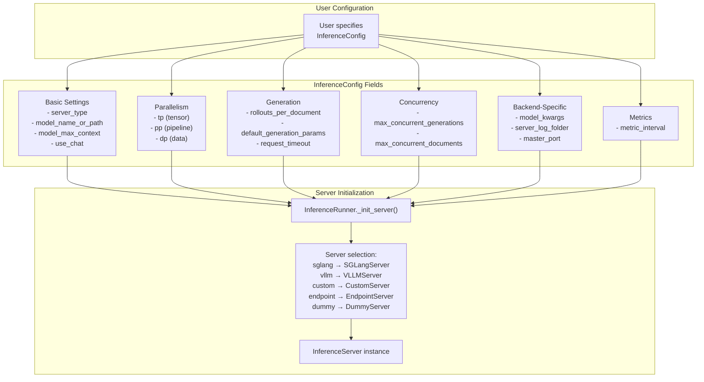
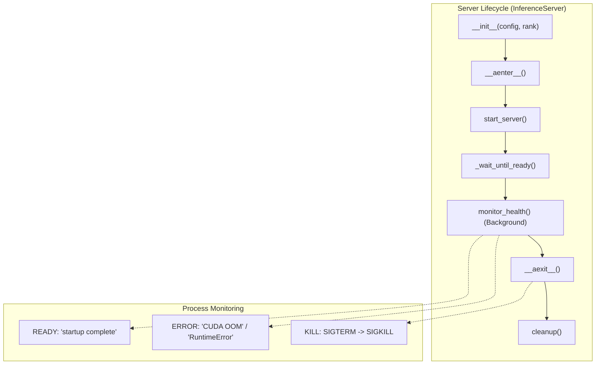

<!-- source: DeepWiki mcp.deepwiki.com · repo huggingface/datatrove · page 3.3 Server Backends and Configuration · fetched 2026-10-26 -->

# Server Backends and Configuration

<details>
<summary>Relevant source files</summary>

The following files were used as context for generating this wiki page:

- [src/datatrove/pipeline/dedup/exact_dedup.py](src/datatrove/pipeline/dedup/exact_dedup.py)
- [src/datatrove/pipeline/inference/distributed/ray.py](src/datatrove/pipeline/inference/distributed/ray.py)
- [src/datatrove/pipeline/inference/distributed/utils.py](src/datatrove/pipeline/inference/distributed/utils.py)
- [src/datatrove/pipeline/inference/servers/__init__.py](src/datatrove/pipeline/inference/servers/__init__.py)
- [src/datatrove/pipeline/inference/servers/compile_lock.py](src/datatrove/pipeline/inference/servers/compile_lock.py)
- [src/datatrove/pipeline/inference/servers/custom_server.py](src/datatrove/pipeline/inference/servers/custom_server.py)
- [src/datatrove/pipeline/inference/servers/endpoint_server.py](src/datatrove/pipeline/inference/servers/endpoint_server.py)
- [src/datatrove/pipeline/inference/servers/sglang_server.py](src/datatrove/pipeline/inference/servers/sglang_server.py)
- [src/datatrove/pipeline/inference/servers/vllm_server.py](src/datatrove/pipeline/inference/servers/vllm_server.py)
- [tests/pipeline/inference/test_vllm_compile_lock.py](tests/pipeline/inference/test_vllm_compile_lock.py)

</details>


This document describes the server backend abstraction layer that enables DataTrove's inference system to work with multiple inference frameworks. It covers the `InferenceServer` base class, concrete server implementations (vLLM, SGLang, Custom, Endpoint, Dummy), the `InferenceConfig` configuration system, and server lifecycle management including subprocess spawning, health monitoring, and distributed coordination.

For information about how servers are used within the inference pipeline, see [InferenceRunner Core](#3.1). For benchmark experiment configuration, see [Benchmark System and Experiment Management](#3.2).

## Configuration System

### InferenceConfig

The `InferenceConfig` dataclass [src/datatrove/pipeline/inference/run_inference.py:41-95]() provides a unified configuration interface for all server backends. It separates platform-agnostic parameters from backend-specific settings.

#### InferenceConfig Architecture



**Sources:** [src/datatrove/pipeline/inference/run_inference.py:41-95](), [src/datatrove/pipeline/inference/run_inference.py:181-204]()

#### Key Configuration Fields

| Field | Type | Default | Description |
|-------|------|---------|-------------|
| `server_type` | `Literal["sglang", "vllm", "dummy", "custom", "endpoint"]` | Required | Backend selection |
| `model_name_or_path` | `str` | Required | Model identifier or path |
| `model_max_context` | `int` | `8192` | Maximum context window |
| `use_chat` | `bool` | `True` | Use `/v1/chat/completions` vs `/v1/completions` |
| `tp` | `int` | `1` | Tensor parallelism size (GPUs per replica) |
| `pp` | `int` | `1` | Pipeline parallelism stages |
| `dp` | `int` | `1` | Data parallelism (number of replicas) |
| `rollouts_per_document` | `int` | `1` | Generations per document |
| `max_concurrent_generations` | `int` | `500` | Concurrent request limit |
| `max_concurrent_documents` | `int \| None` | Auto-computed | Concurrent document processing limit |
| `model_kwargs` | `dict \| None` | `None` | Backend-specific parameters |
| `server_log_folder` | `str \| None` | `None` | Directory for per-rank server logs |
| `master_port` | `int` | `9810` | Distributed coordination port |
| `request_timeout` | `float \| None` | `None` | HTTP request timeout (seconds) |

**Sources:** [src/datatrove/pipeline/inference/run_inference.py:41-95]()

#### Auto-Computation of Concurrency Limits

The `__post_init__` method automatically computes `max_concurrent_documents` when not provided:

```python
max_concurrent_documents = max(1, max_concurrent_generations // rollouts_per_document)
```

This ensures documents are processed at an appropriate rate relative to the generation capacity. For example, with `max_concurrent_generations=500` and `rollouts_per_document=3`, the system processes up to `166` documents concurrently (each spawning 3 generations).

**Sources:** [src/datatrove/pipeline/inference/run_inference.py:92-94]()

## Server Abstraction Layer

### InferenceServer Base Class

The `InferenceServer` abstract base class [src/datatrove/pipeline/inference/servers/base.py:18-268]() defines the contract that all server implementations must fulfill. It manages server lifecycle, port allocation, distributed coordination, and standardized request/response handling.

#### InferenceServer Class Hierarchy

```mermaid
graph TB
    BASE["InferenceServer<br/>(Abstract Base Class)"]
    
    VLLM["VLLMServer<br/>vLLM subprocess"]
    SGLANG["SGLangServer<br/>SGLang subprocess"]
    CUSTOM["CustomServer<br/>Custom script subprocess"]
    ENDPOINT["EndpointServer<br/>External HTTP endpoint"]
    DUMMY["DummyServer<br/>Testing/development"]
    
    BASE --> VLLM
    BASE --> SGLANG
    BASE --> CUSTOM
    BASE --> ENDPOINT
    BASE --> DUMMY
    
    subgraph "Abstract Methods"
        START["start_server()<br/>→ Process | None"]
        MONITOR["monitor_health()<br/>→ None"]
    end
    
    subgraph "Concrete Methods"
        ENTER["__aenter__()<br/>Context manager entry"]
        EXIT["__aexit__()<br/>Cleanup and shutdown"]
        REQUEST["make_request(payload)<br/>→ dict"]
        RETRY["_make_request_with_retry()<br/>Exponential backoff"]
    end
    
    BASE --> START
    BASE --> MONITOR
    BASE --> ENTER
    BASE --> EXIT
    BASE --> REQUEST
    BASE --> RETRY
```



**Sources:** [src/datatrove/pipeline/inference/servers/base.py:18-268](), [src/datatrove/pipeline/inference/servers/__init__.py:1-10]()

#### Core Abstract Methods

Each server implementation must provide:

1. **`start_server()`** [src/datatrove/pipeline/inference/servers/base.py:53-58](): Launches the server process and returns an `asyncio.subprocess.Process` or `None` (for worker ranks in distributed setups).

2. **`monitor_health()`** [src/datatrove/pipeline/inference/servers/base.py:60-65](): Continuously monitors server health, logging output and detecting failures. Raises exceptions on critical errors.

**Sources:** [src/datatrove/pipeline/inference/servers/base.py:53-65]()

#### Port Allocation Strategy

The base class implements deterministic port allocation [src/datatrove/pipeline/inference/servers/base.py:36-43]():

```
_port = 8000 + rank
```

Each rank receives a unique port, enabling multiple servers on the same node. For distributed setups, `master_addr` and `master_port` coordinate worker discovery.

**Sources:** [src/datatrove/pipeline/inference/servers/base.py:36-43]()

## Server Implementations

### VLLMServer

`VLLMServer` [src/datatrove/pipeline/inference/servers/vllm_server.py:29-281]() launches vLLM as a subprocess. It includes sophisticated mechanisms for distributed setup and compilation locking.

#### Compilation Locking

To prevent concurrent `torch.compile` corruption when multiple jobs start simultaneously on a shared filesystem, `VLLMServer` uses a `CompileLockManager` [src/datatrove/pipeline/inference/servers/compile_lock.py:21-93](). 

1. **Hash Generation**: A deterministic 12-character hash is computed based on vLLM version, model path, parallelism (tp, pp, dp), context length, and model kwargs [src/datatrove/pipeline/inference/servers/compile_lock.py:105-145]().
2. **Lock Acquisition**: Before starting, the server attempts to `acquire()` a file-based lock [src/datatrove/pipeline/inference/servers/vllm_server.py:113]().
3. **Cache Check**: If a `.done` marker file exists for the config hash, the lock is skipped [src/datatrove/pipeline/inference/servers/compile_lock.py:65-67]().
4. **Completion**: Once the server prints a ready message, the marker is created and the lock released [src/datatrove/pipeline/inference/servers/vllm_server.py:169-172]().

**Sources:** [src/datatrove/pipeline/inference/servers/vllm_server.py:44-56](), [src/datatrove/pipeline/inference/servers/compile_lock.py:1-145]()

#### Multi-Node Coordination via Ray

For multi-node setups, `VLLMServer` utilizes Ray cluster management [src/datatrove/pipeline/inference/distributed/ray.py:1-216]():

- **Master Node**: Initializes the Ray head node using `init_ray_master` [src/datatrove/pipeline/inference/distributed/ray.py:176-211]() and waits for workers to join [src/datatrove/pipeline/inference/distributed/ray.py:134-174]().
- **Worker Nodes**: Connect to the master using `init_ray_worker` [src/datatrove/pipeline/inference/distributed/ray.py:212-253]().
- **Object Store**: Memory is automatically calculated as the minimum of 30% available RAM, `/dev/shm` size, or a 200GB cap [src/datatrove/pipeline/inference/distributed/ray.py:25-50]().

**Sources:** [src/datatrove/pipeline/inference/servers/vllm_server.py:114-143](), [src/datatrove/pipeline/inference/distributed/ray.py:1-253]()

### SGLangServer

`SGLangServer` [src/datatrove/pipeline/inference/servers/sglang_server.py:19-147]() launches the SGLang runtime using `sglang.launch_server`.

- **Distributed Setup**: Uses `get_master_node_host()` and `get_node_rank()` to configure `--nnodes`, `--node-rank`, and `--dist-init-addr` for multi-node execution [src/datatrove/pipeline/inference/servers/sglang_server.py:39-43]().
- **Command Construction**: Maps `InferenceConfig` parallelism settings to SGLang flags like `--tp-size`, `--dp-size`, and `--pp-size` [src/datatrove/pipeline/inference/servers/sglang_server.py:68-74]().
- **Health Monitoring**: Watches for `"The server is fired up and ready to roll!"` to signal readiness [src/datatrove/pipeline/inference/servers/sglang_server.py:109-111]().

**Sources:** [src/datatrove/pipeline/inference/servers/sglang_server.py:45-91](), [src/datatrove/pipeline/inference/distributed/utils.py:34-57]()

### CustomServer

`CustomServer` [src/datatrove/pipeline/inference/servers/custom_server.py:14-117]() allows running a user-defined server script.

- **Initialization**: Requires `server_script` to be provided in `model_kwargs` [src/datatrove/pipeline/inference/servers/custom_server.py:26-29]().
- **Command**: Executes the script using `sys.executable` and passes `--port` along with any other `model_kwargs` as command-line arguments [src/datatrove/pipeline/inference/servers/custom_server.py:35-50]().
- **Error Detection**: Specifically monitors for `CUDA out of memory`, `ImportError`, and `ModuleNotFoundError` in the subprocess output [src/datatrove/pipeline/inference/servers/custom_server.py:81-87]().

**Sources:** [src/datatrove/pipeline/inference/servers/custom_server.py:14-117]()

### EndpointServer

`EndpointServer` [src/datatrove/pipeline/inference/servers/endpoint_server.py:12-152]() targets external OpenAI-compatible APIs.

- **Client Selection**: For `localhost` endpoints, it uses the base class's raw HTTP implementation. For external endpoints, it uses `openai.AsyncOpenAI` [src/datatrove/pipeline/inference/servers/endpoint_server.py:29-45]().
- **Request Logic**: Overrides `_make_request` to use the OpenAI client, handling specific exceptions like `RateLimitError`, `AuthenticationError`, and `APITimeoutError` by mapping them to DataTrove's `InferenceError` or standard retryable exceptions [src/datatrove/pipeline/inference/servers/endpoint_server.py:64-151]().

**Sources:** [src/datatrove/pipeline/inference/servers/endpoint_server.py:12-152]()

## Distributed Environment Utilities

The `distributed/utils.py` module provides environment-aware helpers used by all server backends to resolve node roles and resource availability.

| Function | Source | Description |
|----------|--------|-------------|
| `get_node_rank()` | [src/datatrove/pipeline/inference/distributed/utils.py:34-36]() | Returns `DATATROVE_NODE_RANK` (0 for master). |
| `is_master_node()` | [src/datatrove/pipeline/inference/distributed/utils.py:39-41]() | Boolean check for rank <= 0. |
| `get_node_hosts()` | [src/datatrove/pipeline/inference/distributed/utils.py:44-46]() | Parses `DATATROVE_NODE_IPS` into a list. |
| `get_distributed_environment()` | [src/datatrove/pipeline/inference/distributed/utils.py:49-51]() | Returns `SLURM`, `RAY`, or `LOCAL`. |
| `get_available_gpus_per_node()` | [src/datatrove/pipeline/inference/distributed/utils.py:27-31]() | Returns `DATATROVE_GPUS_ON_NODE`. |

**Sources:** [src/datatrove/pipeline/inference/distributed/utils.py:1-57]()

## Lifecycle Management Summary



**Sources:** [src/datatrove/pipeline/inference/servers/base.py:18-130](), [src/datatrove/pipeline/inference/servers/vllm_server.py:145-227]()

---

