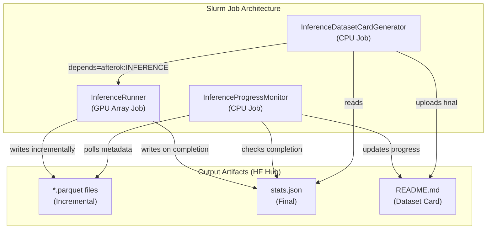
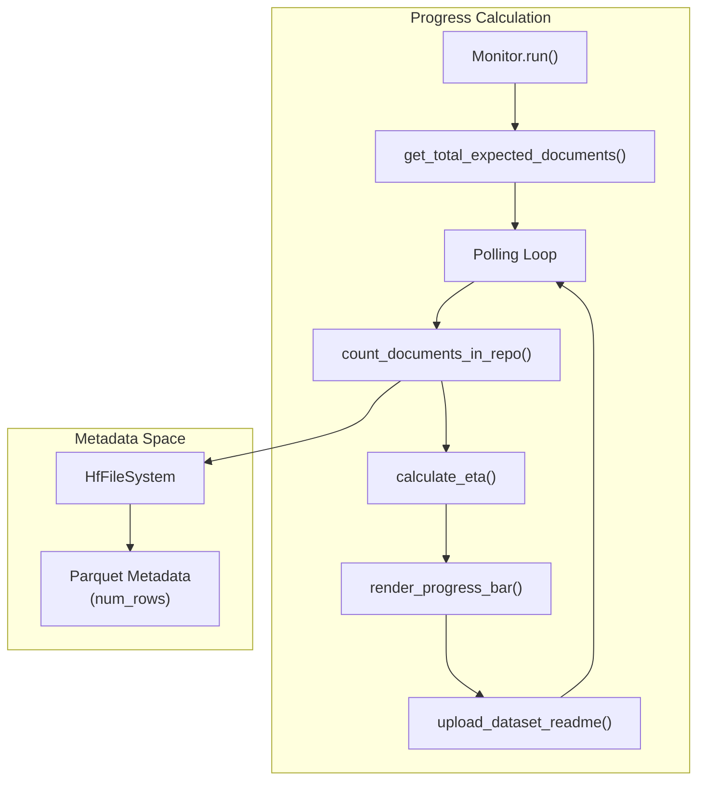

<!-- source: DeepWiki mcp.deepwiki.com · repo huggingface/datatrove · page 3.4 Progress Monitoring and Dataset Cards · fetched 2026-10-26 -->

# Progress Monitoring and Dataset Cards

Relevant source files

The following files were used as context for generating this wiki page:

- [examples/inference/progress_monitoring.py](examples/inference/progress_monitoring.py)
- [src/datatrove/pipeline/inference/dataset_card_generator.py](src/datatrove/pipeline/inference/dataset_card_generator.py)
- [src/datatrove/pipeline/inference/dataset_card_template.md](src/datatrove/pipeline/inference/dataset_card_template.md)
- [src/datatrove/pipeline/inference/progress_monitor.py](src/datatrove/pipeline/inference/progress_monitor.py)
- [tests/pipeline/inference/test_dataset_card_generator.py](tests/pipeline/inference/test_dataset_card_generator.py)
- [tests/pipeline/inference/test_progress_monitor.py](tests/pipeline/inference/test_progress_monitor.py)

## Purpose and Scope

This document covers the progress monitoring and dataset card generation systems for long-running inference jobs. These components provide real-time progress tracking with ETA estimates and automatically generate comprehensive HuggingFace dataset cards with statistics and metadata.

The system is designed to handle massive scale by polling metadata rather than downloading data, and it integrates deeply with the HuggingFace Hub and Slurm scheduling systems.

## System Overview

The progress monitoring system consists of two primary components:

1.  **`InferenceProgressMonitor`**: A lightweight monitoring process that periodically polls the output repository, calculates progress metrics, and updates the dataset card with a live progress bar and ETA. [src/datatrove/pipeline/inference/progress_monitor.py:13-32]()
2.  **`InferenceDatasetCardGenerator`**: A final pipeline step that runs after inference completes to generate a comprehensive dataset card with complete statistics, token counts, and metadata. [src/datatrove/pipeline/inference/dataset_card_generator.py:44-73]()

Both components share configuration through `InferenceDatasetCardParams` [src/datatrove/pipeline/inference/dataset_card_generator.py:24-41]() and use a template-based rendering system [src/datatrove/pipeline/inference/dataset_card_template.md:1-52]() to generate consistent, informative dataset cards.

**Sources:** [src/datatrove/pipeline/inference/progress_monitor.py:1-8](), [src/datatrove/pipeline/inference/dataset_card_generator.py:1-51]()

## Three-Job Architecture

When running on Slurm, the system orchestrates three separate jobs with inter-dependencies to ensure monitoring doesn't consume GPU resources and final cards are only generated upon success.

**Workflow:**
1.  **Inference job**: Processes data in parallel, writing parquet shards directly to HuggingFace Hub. On successful completion, it generates a `stats.json` file. [examples/inference/progress_monitoring.py:158-183]()
2.  **Monitor job**: Runs concurrently (often on a CPU partition), polling the repository every `update_interval`. It stops when `stats.json` appears (success) or the inference job disappears from the queue (failure). [src/datatrove/pipeline/inference/progress_monitor.py:291-345]()
3.  **Datacard job**: Runs only after the inference job completes successfully (Slurm `afterok`), reading the final `stats.json` to generate the definitive card. [examples/inference/progress_monitoring.py:246-267]()

**Sources:** [examples/inference/progress_monitoring.py:104-267](), [src/datatrove/pipeline/inference/progress_monitor.py:280-345]()

## Component Details

### InferenceDatasetCardParams

A dataclass encapsulating all parameters needed for generation. This ensures that the monitor (which has limited info) and the generator (which has full stats) use identical metadata.

| Field | Type | Purpose |
| :--- | :--- | :--- |
| `output_repo_id` | `str` | Target HF Hub repository [src/datatrove/pipeline/inference/dataset_card_generator.py:28]() |
| `input_dataset_name` | `str` | Name of source dataset [src/datatrove/pipeline/inference/dataset_card_generator.py:29]() |
| `prompt_column` | `str` | Source column used for generation [src/datatrove/pipeline/inference/dataset_card_generator.py:32]() |
| `model_name` | `str` | LLM used for inference [src/datatrove/pipeline/inference/dataset_card_generator.py:36]() |
| `generation_kwargs` | `dict` | Sampling params (temperature, top_p, etc.) [src/datatrove/pipeline/inference/dataset_card_generator.py:38]() |
| `stats_path` | `str` | Path to the `stats.json` file [src/datatrove/pipeline/inference/dataset_card_generator.py:40]() |

**Sources:** [src/datatrove/pipeline/inference/dataset_card_generator.py:24-41]()

### InferenceProgressMonitor

The `InferenceProgressMonitor` handles real-time feedback.

**Key Implementation Details:**
*   **Efficient Counting**: `count_documents_in_repo` uses `HfFileSystem` to glob parquet files and `pyarrow.parquet.ParquetFile.metadata` to read the row count from the file header only. It does **not** download the data. [src/datatrove/pipeline/inference/progress_monitor.py:93-137]()
*   **Cache Invalidation**: It explicitly calls `fs.invalidate_cache()` on the repository directory to ensure it sees new files uploaded by parallel workers. [src/datatrove/pipeline/inference/progress_monitor.py:109-127]()
*   **ETA Logic**: `calculate_eta` computes the throughput since the start of the job and extrapolates the remaining time for the total expected documents. [src/datatrove/pipeline/inference/progress_monitor.py:189-216]()

**Sources:** [src/datatrove/pipeline/inference/progress_monitor.py:93-137, 189-216, 291-345]()

### InferenceDatasetCardGenerator

This `PipelineStep` is responsible for the final "polished" card. It waits for the inference job to write its final statistics.

**Key Functions:**
*   **`load_job_stats`**: Polls the filesystem for `stats.json` with a timeout (default 5 mins). It parses the DataTrove stats format to extract `prompt_tokens`, `completion_tokens`, and `mean_doc_len`. [src/datatrove/pipeline/inference/dataset_card_generator.py:85-138]()
*   **`fetch_source_dataset_metadata`**: Uses `huggingface_hub.dataset_info` to inherit tags, license, and language information from the source dataset. [src/datatrove/pipeline/inference/dataset_card_generator.py:141-152]()
*   **`build_and_upload_dataset_card`**: The orchestrator that merges the template, parameters, and stats into a final `README.md`. [src/datatrove/pipeline/inference/dataset_card_generator.py:210-330]()

**Sources:** [src/datatrove/pipeline/inference/dataset_card_generator.py:52-152, 210-330]()

## Dataset Card Template System

The system uses a markdown template [src/datatrove/pipeline/inference/dataset_card_template.md:1-52]() with a custom tag format `[[tag_name]]`.

### Progressive vs Final Rendering
The monitor and generator use the same underlying rendering logic but fill different sections:

| Feature | `InferenceProgressMonitor` | `InferenceDatasetCardGenerator` |
| :--- | :--- | :--- |
| **Progress Section** | Renders `## 🔄 Generation Progress` with a dot-bar [src/datatrove/pipeline/inference/progress_monitor.py:244-252]() | Empty string (removes the bar) [src/datatrove/pipeline/inference/dataset_card_generator.py:68]() |
| **Stats Table** | Shows "Job statistics could not be collected" [src/datatrove/pipeline/inference/dataset_card_generator.py:170-171]() | Renders full markdown table with token counts [src/datatrove/pipeline/inference/dataset_card_generator.py:173-186]() |
| **Configs Block** | Updates YAML metadata for the specific config being run [src/datatrove/pipeline/inference/progress_monitor.py:321-322]() | Finalizes all dataset configurations in the YAML header [src/datatrove/pipeline/inference/dataset_card_generator.py:284-289]() |

**Sources:** [src/datatrove/pipeline/inference/progress_monitor.py:244-277](), [src/datatrove/pipeline/inference/dataset_card_generator.py:169-188, 210-330](), [src/datatrove/pipeline/inference/dataset_card_template.md:1-52]()

## Progress Bar Format

The progress bar is rendered as a string using dots (●) and circles (○).

**Example Output:**
`**default**: [●●●●●●●●●●○○○○○○○○○○] 50% • 500/1,000 docs ⏱️ 5m remaining • 📅 Feb 15, 21:00 UTC`

*   **`render_progress_bar`**: Handles the ASCII bar logic and clamps values to ensure they don't exceed 100% due to race conditions in file counting. [src/datatrove/pipeline/inference/progress_monitor.py:203-235]()
*   **`format_time_remaining`**: Converts seconds into the two largest units (e.g., "1h 30m" or "1d 4h"). [src/datatrove/pipeline/inference/progress_monitor.py:39-73]()

**Sources:** [src/datatrove/pipeline/inference/progress_monitor.py:39-73, 203-235](), [tests/pipeline/inference/test_progress_monitor.py:85-150]()

## Multi-Config Management

The system supports datasets with multiple configurations (e.g., a "math" config and a "coding" config).

1.  **Config Discovery**: `_extract_config_names` parses existing `README.md` files to find previously generated configs. [src/datatrove/pipeline/inference/progress_monitor.py:348-353]()
2.  **Config Patching**: `patch_readme_configs` and `patch_readme_progress` allow updating the progress or YAML metadata for one config without overwriting the others. [src/datatrove/pipeline/inference/dataset_card_generator.py:361-382](), [src/datatrove/pipeline/inference/progress_monitor.py:356-382]()
3.  **The "all" Config**: If multiple named configs exist, the generator automatically adds an "all" configuration to the YAML header that points to the union of all data files. [src/datatrove/pipeline/inference/dataset_card_generator.py:440-466]()

**Sources:** [src/datatrove/pipeline/inference/progress_monitor.py:348-382](), [src/datatrove/pipeline/inference/dataset_card_generator.py:361-466](), [tests/pipeline/inference/test_dataset_card_generator.py:112-156]()

---

