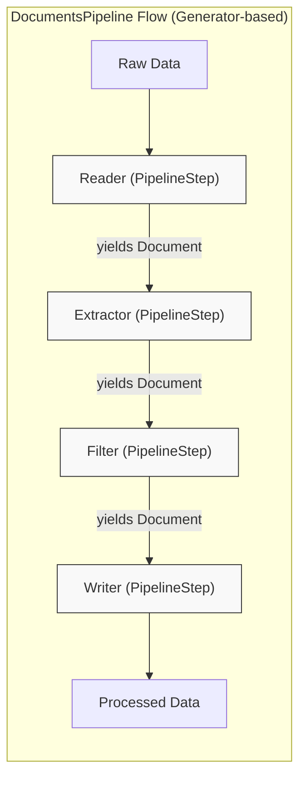
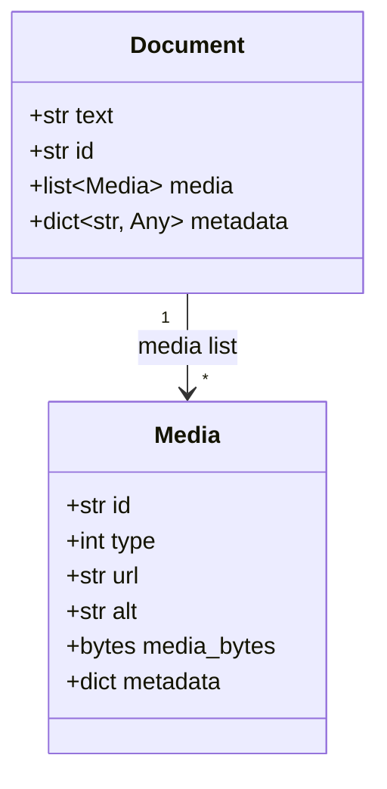
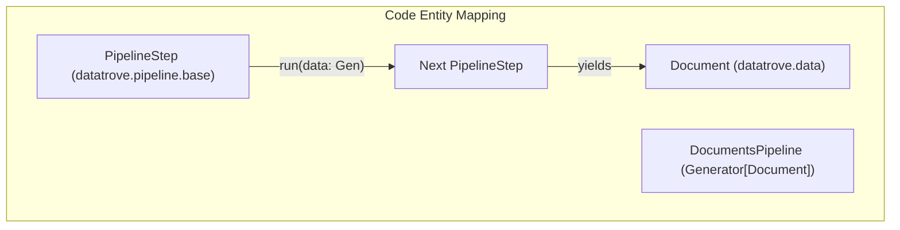

<!-- source: DeepWiki mcp.deepwiki.com · repo huggingface/datatrove · page 4 Document Processing Pipeline · fetched 2026-10-26 -->

# Document Processing Pipeline

<details>
<summary>Relevant source files</summary>

The following files were used as context for generating this wiki page:

- [src/datatrove/data.py](src/datatrove/data.py)
- [src/datatrove/pipeline/base.py](src/datatrove/pipeline/base.py)
- [src/datatrove/pipeline/filters/base_filter.py](src/datatrove/pipeline/filters/base_filter.py)
- [src/datatrove/utils/stats.py](src/datatrove/utils/stats.py)

</details>


The Document Processing Pipeline is the core workflow system in DataTrove that enables comprehensive text data processing at scale. This document explains the pipeline architecture, the `Document` data structure that flows through it, and the `DocumentsPipeline` abstraction. For information about executing these pipelines, see [Pipeline Execution Architecture](#2).

## Overview

The Document Processing Pipeline provides a modular framework for processing text data through a series of operations. Each pipeline consists of interconnected blocks (subclasses of `PipelineStep`) that perform specific functions like reading data, extracting content, filtering, deduplication, tokenization, and writing output. [src/datatrove/pipeline/base.py:9-21]()

### Pipeline Abstraction and Data Flow

The data flow is based on Python generators. The `DocumentsPipeline` type is a type alias for a generator of `Document` objects. [src/datatrove/data.py:58-58]()


Sources: [src/datatrove/pipeline/base.py:99-115](), [src/datatrove/data.py:58-58]()

## Document Data Structure

The `Document` class is the fundamental data unit. It carries text content and associated metadata between pipeline components. [src/datatrove/data.py:38-56]()



### Document Fields
- **text**: The actual text content for each sample. [src/datatrove/data.py:52-52]()
- **id**: A unique identifier string for this sample. [src/datatrove/data.py:53-53]()
- **metadata**: A dictionary where any additional info (e.g., source URL, language score, token count) is stored. [src/datatrove/data.py:55-55]()
- **media**: A list of `Media` objects (currently reserved for future multimodal functionality). [src/datatrove/data.py:54-54]()

Sources: [src/datatrove/data.py:20-56]()

## PipelineStep Abstraction

All processing blocks inherit from `PipelineStep`. This base class handles dependency checks, statistics tracking, and timing. [src/datatrove/pipeline/base.py:9-36]()

### Component Interface
Every pipeline component implements the `run` method:
1. **Input**: A `DocumentsPipeline` (generator of `Document`). [src/datatrove/pipeline/base.py:106-106]()
2. **Output**: A `DocumentsPipeline` (generator of `Document`). [src/datatrove/pipeline/base.py:113-114]()
3. **Context**: Receives `rank` and `world_size` for data sharding. [src/datatrove/pipeline/base.py:107-108]()

### Statistics Tracking
Each `PipelineStep` maintains a `Stats` object. [src/datatrove/pipeline/base.py:36-36]()
- `stat_update()`: Increments counters or updates metrics (min/max/mean/variance) for a specific label. [src/datatrove/pipeline/base.py:38-54]()
- `track_time()`: Context manager for measuring execution time of code blocks within the step. [src/datatrove/pipeline/base.py:81-93]()
- `update_doc_stats()`: Automatically tracks document length and token counts. [src/datatrove/pipeline/base.py:67-80]()

Sources: [src/datatrove/pipeline/base.py:9-130](), [src/datatrove/utils/stats.py:55-98]()

## Core Pipeline Stages

The pipeline is categorized into several specialized types of steps:

### 1. Data Readers
Readers are the entry point. They ingest raw formats (JSONL, Parquet, WARC, etc.) and yield `Document` objects. They handle file sharding based on the worker's `rank`.
- **For details, see [Data Readers](#4.1)**.

### 2. Content Extractors
Extractors process raw content (like HTML) to extract clean text. They often use external libraries like `trafilatura`.
- **For details, see [Content Extractors](#4.2)**.

### 3. Document Filters
Filters decide whether to keep or drop a document. `BaseFilter` provides a `filter` method that returns a boolean. If a document is dropped, it can optionally be saved by an `exclusion_writer`. [src/datatrove/pipeline/filters/base_filter.py:29-48]()
- **For details, see [Document Filters](#4.3)**.

### 4. Writers
Writers (subclasses of `DiskWriter`) are usually the terminal steps, saving the processed `Document` stream to disk or cloud storage.
- **For details, see [Data Writers and Output Management](#7)**.

## Building and Running a Pipeline

A pipeline is typically a list of `PipelineStep` instances passed to an `Executor`.

```python
pipeline = [
    JsonlReader(data_folder="s3://input-bucket/data"),
    LanguageFilter(languages=["en"]),
    JsonlWriter(output_folder="s3://output-bucket/processed")
]
```

### Execution Flow
When the pipeline runs, the executor calls the `__call__` or `run` method of the first step, passing the output to the next. Because it uses generators, documents are processed one-by-one (or in batches), minimizing memory overhead for large datasets. [src/datatrove/pipeline/base.py:116-130]()



Sources: [src/datatrove/pipeline/base.py:99-130](), [src/datatrove/data.py:58-58]()

---

