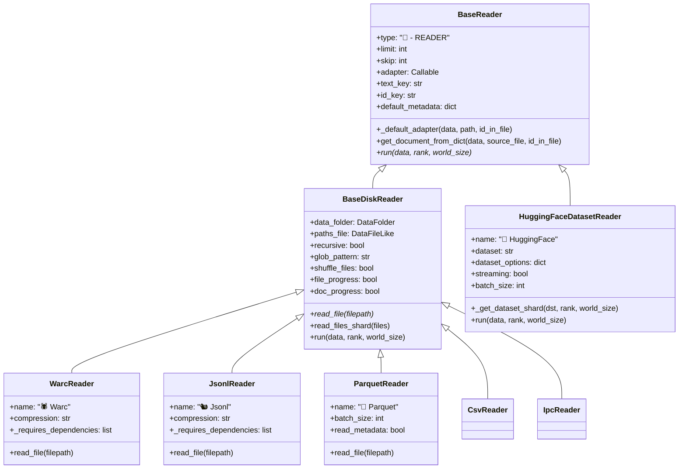
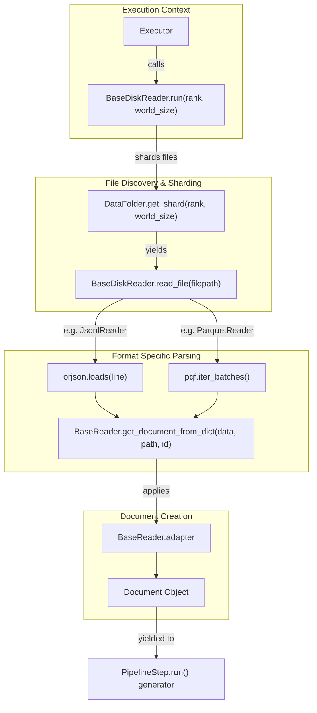

<!-- source: DeepWiki mcp.deepwiki.com · repo huggingface/datatrove · page 4.1 Data Readers · fetched 2026-10-26 -->

# Data Readers

Relevant source files

The following files were used as context for generating this wiki page:

- [src/datatrove/pipeline/readers/__init__.py](src/datatrove/pipeline/readers/__init__.py)
- [src/datatrove/pipeline/readers/base.py](src/datatrove/pipeline/readers/base.py)
- [src/datatrove/pipeline/readers/csv.py](src/datatrove/pipeline/readers/csv.py)
- [src/datatrove/pipeline/readers/huggingface.py](src/datatrove/pipeline/readers/huggingface.py)
- [src/datatrove/pipeline/readers/ipc.py](src/datatrove/pipeline/readers/ipc.py)
- [src/datatrove/pipeline/readers/jsonl.py](src/datatrove/pipeline/readers/jsonl.py)
- [src/datatrove/pipeline/readers/parquet.py](src/datatrove/pipeline/readers/parquet.py)
- [src/datatrove/pipeline/readers/warc.py](src/datatrove/pipeline/readers/warc.py)
- [tests/pipeline/readers/__init__.py](tests/pipeline/readers/__init__.py)
- [tests/utils.py](tests/utils.py)

Data readers are the entry point components in datatrove pipelines responsible for ingesting data from various sources and converting them into standardized `Document` objects. Readers typically serve as the first step in a processing pipeline, taking raw data from files, datasets, or other sources and producing a stream of documents for downstream processing.

For information about the pipeline execution framework that orchestrates readers, see [Pipeline Execution Architecture](#2). For details about content extraction from raw formats like HTML, see [Content Extractors](#4.2).

## Architecture Overview

The reader system is built around a hierarchical class structure with abstract base classes providing common functionality and concrete implementations for specific data formats.

### Reader Class Hierarchy

Sources: [src/datatrove/pipeline/readers/base.py:14-110](), [src/datatrove/pipeline/readers/base.py:113-248](), [src/datatrove/pipeline/readers/warc.py:11-85](), [src/datatrove/pipeline/readers/jsonl.py:9-95](), [src/datatrove/pipeline/readers/parquet.py:7-88](), [src/datatrove/pipeline/readers/huggingface.py:10-136]()

## Base Reader Classes

### BaseReader

The `BaseReader` class provides the foundational interface for all reader implementations [src/datatrove/pipeline/readers/base.py:14-27](). It defines the contract for converting raw data into `Document` objects and handles common configuration options like `limit` and `skip` [src/datatrove/pipeline/readers/base.py:41-42]().

| Parameter | Type | Description |
|-----------|------|-------------|
| `limit` | `int` | Maximum number of documents to read (-1 for unlimited) [src/datatrove/pipeline/readers/base.py:33]() |
| `skip` | `int` | Number of documents to skip at the beginning [src/datatrove/pipeline/readers/base.py:34]() |
| `adapter` | `Callable` | Custom function to transform raw data into Document format [src/datatrove/pipeline/readers/base.py:35]() |
| `text_key` | `str` | Key name for text content in source data (default: "text") [src/datatrove/pipeline/readers/base.py:36]() |
| `id_key` | `str` | Key name for document ID in source data (default: "id") [src/datatrove/pipeline/readers/base.py:37]() |
| `default_metadata` | `dict` | Metadata to add to all documents [src/datatrove/pipeline/readers/base.py:38]() |

The `_default_adapter` method handles the standard transformation from raw dictionaries to Document-compatible format, extracting text, ID, media, and metadata fields [src/datatrove/pipeline/readers/base.py:49-76]().

Sources: [src/datatrove/pipeline/readers/base.py:31-48](), [src/datatrove/pipeline/readers/base.py:49-76]()

### BaseDiskReader

The `BaseDiskReader` extends `BaseReader` with functionality for reading from file systems, supporting both local and remote storage through `DataFolder` [src/datatrove/pipeline/readers/base.py:113-134](). It provides file discovery, sharding, and progress tracking capabilities.

The class implements automatic file sharding for distributed processing through the `get_shard` method on `DataFolder` objects [src/datatrove/pipeline/readers/base.py:219-247](), ensuring each worker processes a distinct subset of files based on its `rank` and `world_size`.

Sources: [src/datatrove/pipeline/readers/base.py:135-164](), [src/datatrove/pipeline/readers/base.py:219-247]()

## Concrete Reader Implementations

### WarcReader

The `WarcReader` processes Web ARChive (WARC) files [src/datatrove/pipeline/readers/warc.py:11-33](). It extracts HTML content, URLs, timestamps, and other metadata from WARC records.

The `process_record` function handles MIME type filtering (e.g., `text/html`, `application/xhtml+xml`), character encoding detection using `cchardet`, and metadata extraction including `WARC-Record-ID`, `WARC-Target-URI`, and `WARC-Date` headers [src/datatrove/pipeline/readers/warc.py:87-140]().

Sources: [src/datatrove/pipeline/readers/warc.py:35-36](), [src/datatrove/pipeline/readers/warc.py:72-84](), [src/datatrove/pipeline/readers/warc.py:87-140]()

### JsonlReader

The `JsonlReader` processes JSON Lines files where each line contains a separate JSON document [src/datatrove/pipeline/readers/jsonl.py:9-32](). It uses the `orjson` library for high-performance JSON parsing [src/datatrove/pipeline/readers/jsonl.py:74]().

Key features:
- Supports compression formats (gzip, zstd) with automatic detection [src/datatrove/pipeline/readers/jsonl.py:41]().
- Graceful error handling for malformed JSON or encoding issues [src/datatrove/pipeline/readers/jsonl.py:89-94]().
- Base64 decoding for media bytes if present [src/datatrove/pipeline/readers/jsonl.py:83-85]().

Sources: [src/datatrove/pipeline/readers/jsonl.py:33-34](), [src/datatrove/pipeline/readers/jsonl.py:73-95]()

### ParquetReader and IpcReader

The `ParquetReader` uses `pyarrow.parquet` to read data in batches [src/datatrove/pipeline/readers/parquet.py:7-30](). It can optionally read only specific columns (`text_key` and `id_key`) to save memory if `read_metadata` is False [src/datatrove/pipeline/readers/parquet.py:77]().

Similarly, the `IpcReader` handles Apache Arrow IPC files, supporting both standard file access and streaming modes via `pa.ipc.open_file` and `pa.ipc.open_stream` [src/datatrove/pipeline/readers/ipc.py:7-65]().

Sources: [src/datatrove/pipeline/readers/parquet.py:71-87](), [src/datatrove/pipeline/readers/ipc.py:68-96]()

### HuggingFaceDatasetReader

The `HuggingFaceDatasetReader` integrates with the HuggingFace Datasets library [src/datatrove/pipeline/readers/huggingface.py:10-31](). It supports both streaming and non-streaming modes with automatic sharding for distributed processing.

The reader implements intelligent sharding in `_get_dataset_shard` [src/datatrove/pipeline/readers/huggingface.py:72-90]():
- For `Dataset` objects: Uses `shard()` method for non-contiguous sharding [src/datatrove/pipeline/readers/huggingface.py:77]().
- For `IterableDataset` with multiple shards: Shards at file level [src/datatrove/pipeline/readers/huggingface.py:87]().
- For single-shard datasets: Uses `split_dataset_by_node` for inter-file sharding [src/datatrove/pipeline/readers/huggingface.py:90]().

Sources: [src/datatrove/pipeline/readers/huggingface.py:33-59](), [src/datatrove/pipeline/readers/huggingface.py:72-90](), [src/datatrove/pipeline/readers/huggingface.py:92-135]()

## Data Flow and Logic

The following diagram maps the logical data flow to specific class methods:

Sources: [src/datatrove/pipeline/readers/base.py:219-247](), [src/datatrove/pipeline/readers/base.py:78-103](), [src/datatrove/pipeline/readers/jsonl.py:73-95](), [src/datatrove/pipeline/readers/parquet.py:71-87]()

## Adapter Pattern

Readers support custom adapter functions to transform source data into the expected `Document` format. The adapter is bound to the reader instance using `MethodType` [src/datatrove/pipeline/readers/base.py:45]().

The adapter receives three parameters: `data` (source dictionary), `path` (file path), and `id_in_file` (position identifier) [src/datatrove/pipeline/readers/base.py:21](). The default adapter preserves extra fields in the `metadata` dictionary [src/datatrove/pipeline/readers/base.py:75]().

Sources: [src/datatrove/pipeline/readers/base.py:45-47](), [src/datatrove/pipeline/readers/base.py:49-76]()

## Progress Tracking and Statistics

Readers integrate with the pipeline statistics system to track processing metrics:
- `input_files`: Number of files processed [src/datatrove/pipeline/readers/base.py:230]().
- `documents`: Number of documents yielded [src/datatrove/pipeline/readers/huggingface.py:132]().
- Processing time tracking through `track_time()` context manager [src/datatrove/pipeline/readers/jsonl.py:80](), [src/datatrove/pipeline/readers/parquet.py:80]().

Sources: [src/datatrove/pipeline/readers/base.py:200-216](), [src/datatrove/pipeline/readers/jsonl.py:80-86](), [src/datatrove/pipeline/readers/huggingface.py:117-135]()

---

