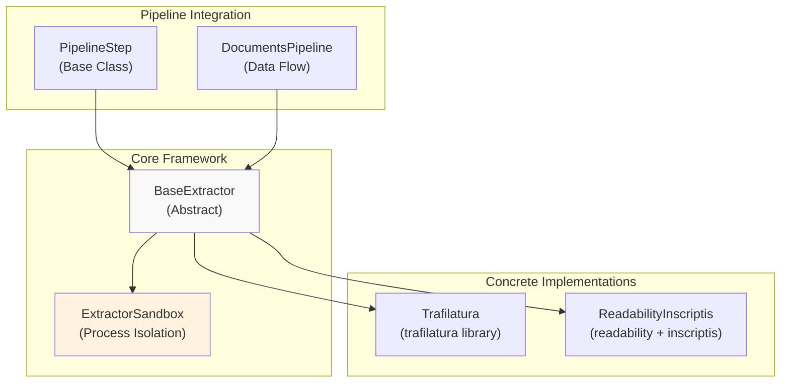
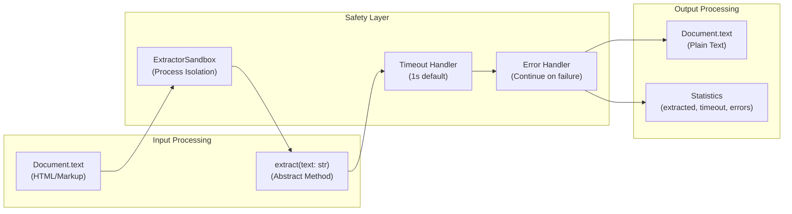
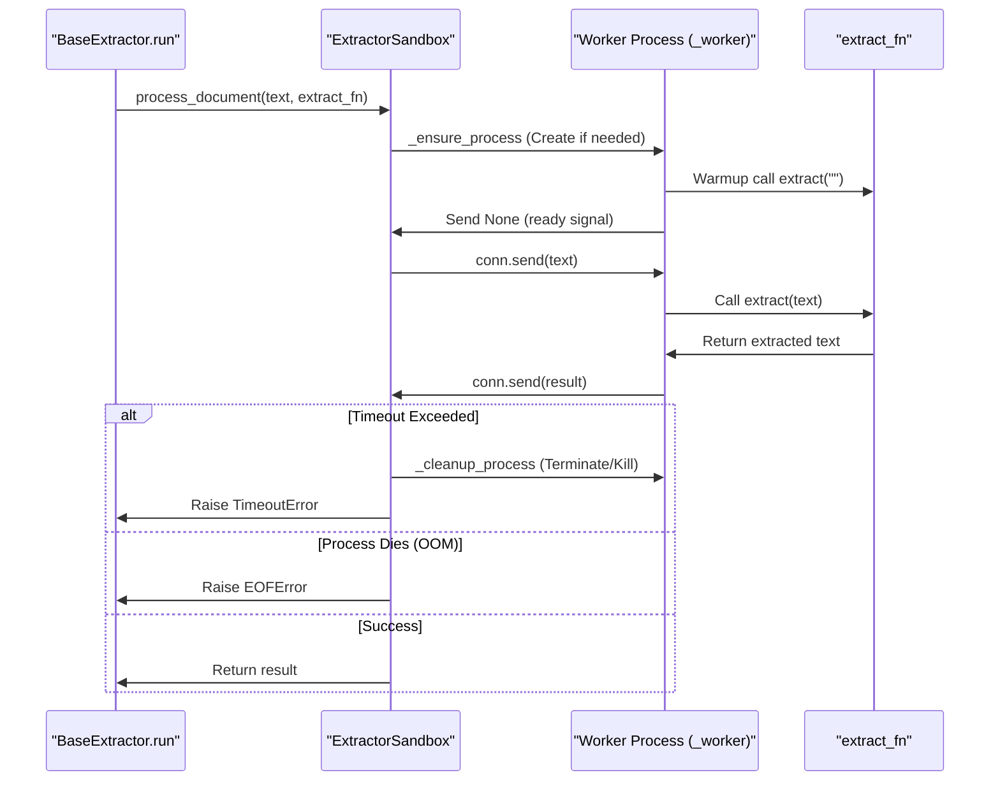
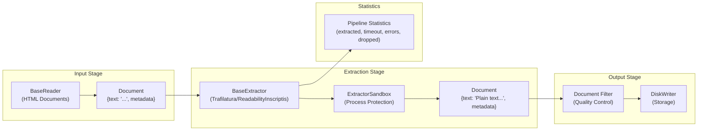

<!-- source: DeepWiki mcp.deepwiki.com · repo huggingface/datatrove · page 4.2 Content Extractors · fetched 2026-10-26 -->

# Content Extractors

<details>
<summary>Relevant source files</summary>

The following files were used as context for generating this wiki page:

- [src/datatrove/pipeline/extractors/__init__.py](src/datatrove/pipeline/extractors/__init__.py)
- [src/datatrove/pipeline/extractors/base.py](src/datatrove/pipeline/extractors/base.py)
- [src/datatrove/pipeline/extractors/modular.py](src/datatrove/pipeline/extractors/modular.py)
- [src/datatrove/pipeline/extractors/trafilatura.py](src/datatrove/pipeline/extractors/trafilatura.py)
- [tests/pipeline/stats/test_extractors.py](tests/pipeline/stats/test_extractors.py)

</details>


Content extractors are responsible for converting raw content (primarily HTML) into plain text within the datatrove processing pipeline. This module provides a standardized framework for text extraction with built-in safety mechanisms including process isolation and timeout handling.

For information about document filtering and quality control, see [Document Filters](4.3). For data ingestion from various sources, see [Data Readers](4.1).

## Overview

The extractor framework consists of an abstract base class that defines the extraction interface, a sandboxing mechanism for safe execution, and concrete implementations using popular extraction libraries. All extractors operate on individual documents within the pipeline, transforming HTML or other markup into clean plain text.

**Extractor Class Hierarchy**



Sources: [src/datatrove/pipeline/extractors/base.py:12-85](), [src/datatrove/pipeline/extractors/trafilatura.py:4-55](), [src/datatrove/pipeline/extractors/modular.py:6-51]()

## BaseExtractor Architecture

The `BaseExtractor` class provides the foundation for all extraction implementations. It extends `PipelineStep` and defines the core extraction workflow with safety mechanisms.

**Key Components:**

| Component | Purpose | Implementation |
|-----------|---------|----------------|
| `extract()` | Abstract method for actual extraction logic | Must be implemented by subclasses [base.py:29-38]() |
| `run()` | Pipeline execution method with error handling | [base.py:40-83]() |
| `timeout` | Configurable timeout per document | Default 1 second [base.py:18-25]() |
| Error Recovery | Handles timeouts, process failures, and exceptions | Continues processing on errors [base.py:58-75]() |

**BaseExtractor Interface**



Sources: [src/datatrove/pipeline/extractors/base.py:12-83]()

## Process Sandboxing

The `ExtractorSandbox` class provides process isolation for extraction operations, protecting against memory leaks, crashes, and runaway processes that could destabilize the pipeline.

**Sandboxing Features:**

- **Process Isolation**: Each extraction runs in a separate `multiprocessing.Process` [base.py:165]().
- **Timeout Protection**: Configurable per-document timeout using `parent_conn.poll(poll_timeout)` [base.py:142]().
- **OOM Protection**: On Linux, the worker process sets `oom_score_adj` to 1000, ensuring it is killed before the main pipeline process if memory runs low [base.py:114-115]().
- **Process Lifecycle**: Automatic cleanup and recreation of failed processes via `_ensure_process` [base.py:159-177]().
- **Exception Handling**: Proper propagation of extraction errors and `EOFError` when a child process dies unexpectedly [base.py:148-150]().

**Sandbox Process Flow**



Sources: [src/datatrove/pipeline/extractors/base.py:85-177]()

## Available Implementations

### Trafilatura Extractor

The `Trafilatura` class uses the [trafilatura](https://trafilatura.readthedocs.io/en/latest/index.html) library for HTML content extraction, optimized for web content and news articles.

**Configuration Options:**

| Parameter | Type | Default | Description |
|-----------|------|---------|-------------|
| `favour_precision` | bool | True | Prefer accuracy over recall [trafilatura.py:31]() |
| `include_images` | bool | False | Include image alt text (currently raises `NotImplementedError`) [trafilatura.py:35-36]() |
| `deduplicate` | bool | True | Remove duplicate content blocks [trafilatura.py:33]() |
| `timeout` | float | 1.0 | Extraction timeout in seconds [trafilatura.py:26]() |

```python
# Example configuration
extractor = Trafilatura(
    favour_precision=True,
    deduplicate=True,
    timeout=2.0
)
```

Sources: [src/datatrove/pipeline/extractors/trafilatura.py:4-55]()

### ReadabilityInscriptis Extractor

The `ReadabilityInscriptis` class combines Mozilla's readability algorithm (via `readability-lxml`) with `inscriptis` for clean text extraction. It first extracts the main content area using readability and then converts the resulting HTML to text using Inscriptis [modular.py:47-49]().

**Configuration Options:**

| Parameter | Type | Default | Description |
|-----------|------|---------|-------------|
| `max_new_lines` | int | 2 | Maximum consecutive newlines [modular.py:24]() |
| `min_text_length` | int | 25 | Minimum block length threshold for readability [modular.py:29]() |
| `min_text_score` | float | 20 | Minimum quality score threshold for readability [modular.py:30]() |
| `timeout` | float | 0.1 | Extraction timeout in seconds [modular.py:24]() |

**Quality Scoring Formula:**
```
score = sqrt(block_length - min_text_length)
total_score = sum(scores_of_all_blocks)
```

Sources: [src/datatrove/pipeline/extractors/modular.py:6-51]()

## Pipeline Integration

Extractors integrate into the `DocumentsPipeline`, processing documents in sequence and maintaining statistics for monitoring and debugging.

**Extraction Pipeline Flow**



**Statistics Tracking:**

- `total`: Total documents processed [base.py:53]().
- `extracted`: Successfully extracted documents [base.py:57]().
- `timeout`: Documents that exceeded the time limit [base.py:59]().
- `broken_process`: Process failures (e.g., OOM) requiring a restart [base.py:64]().
- `clean_error`: Generic extraction exceptions [base.py:68]().
- `forwarded`: Documents passed to the next pipeline step [base.py:78]().
- `dropped`: Documents with empty extracted text [base.py:82]().

Sources: [src/datatrove/pipeline/extractors/base.py:40-83](), [tests/pipeline/stats/test_extractors.py:11-22]()

---

