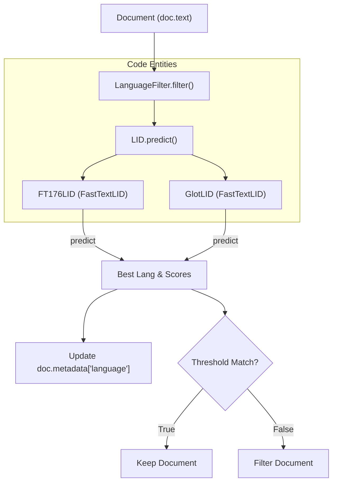
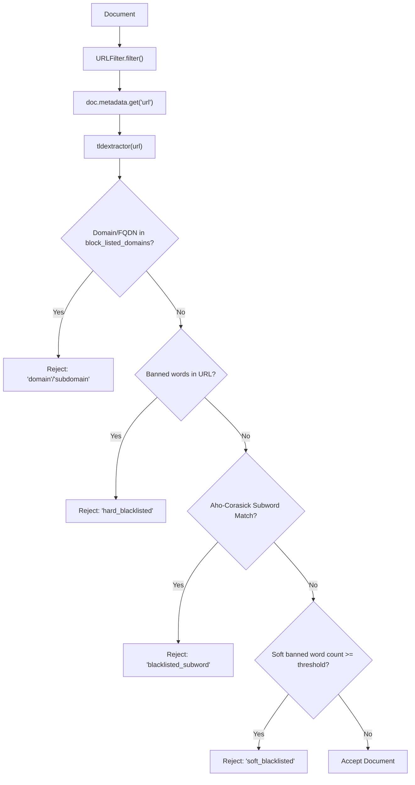

<!-- source: DeepWiki mcp.deepwiki.com · repo huggingface/datatrove · page 4.3 Document Filters · fetched 2026-10-26 -->

# Document Filters

<details>
<summary>Relevant source files</summary>

The following files were used as context for generating this wiki page:

- [examples/tokenize_from_hf_to_s3.py](examples/tokenize_from_hf_to_s3.py)
- [src/datatrove/pipeline/filters/__init__.py](src/datatrove/pipeline/filters/__init__.py)
- [src/datatrove/pipeline/filters/c4_filters.py](src/datatrove/pipeline/filters/c4_filters.py)
- [src/datatrove/pipeline/filters/fasttext_filter.py](src/datatrove/pipeline/filters/fasttext_filter.py)
- [src/datatrove/pipeline/filters/fineweb_quality_filter.py](src/datatrove/pipeline/filters/fineweb_quality_filter.py)
- [src/datatrove/pipeline/filters/gopher_quality_filter.py](src/datatrove/pipeline/filters/gopher_quality_filter.py)
- [src/datatrove/pipeline/filters/gopher_repetition_filter.py](src/datatrove/pipeline/filters/gopher_repetition_filter.py)
- [src/datatrove/pipeline/filters/lambda_filter.py](src/datatrove/pipeline/filters/lambda_filter.py)
- [src/datatrove/pipeline/filters/language_filter.py](src/datatrove/pipeline/filters/language_filter.py)
- [src/datatrove/pipeline/filters/regex_filter.py](src/datatrove/pipeline/filters/regex_filter.py)
- [src/datatrove/pipeline/filters/unigram_log_probs.py](src/datatrove/pipeline/filters/unigram_log_probs.py)
- [src/datatrove/pipeline/filters/url_filter.py](src/datatrove/pipeline/filters/url_filter.py)
- [src/datatrove/pipeline/formatters/__init__.py](src/datatrove/pipeline/formatters/__init__.py)
- [src/datatrove/pipeline/formatters/base.py](src/datatrove/pipeline/formatters/base.py)
- [src/datatrove/pipeline/formatters/ftfy.py](src/datatrove/pipeline/formatters/ftfy.py)
- [src/datatrove/pipeline/formatters/pii.py](src/datatrove/pipeline/formatters/pii.py)
- [src/datatrove/tools/failed_logs.py](src/datatrove/tools/failed_logs.py)
- [src/datatrove/tools/jobs_status.py](src/datatrove/tools/jobs_status.py)
- [src/datatrove/utils/lid.py](src/datatrove/utils/lid.py)
- [tests/pipeline/filters/test_filters.py](tests/pipeline/filters/test_filters.py)

</details>


Document Filters are a critical component of the DataTrove pipeline, providing mechanisms to remove unwanted content based on various quality criteria. These filters operate on `Document` objects after they have been read and processed by extractors, ensuring that only high-quality content continues through the pipeline.

## Filter Architecture

Document filters in DataTrove follow a common interface derived from the `BaseFilter` class. Each filter implements a `filter` method that receives a `Document` object and returns a boolean value indicating whether the document should be kept (`True`) or filtered out (`False`). Some filters may also return a string reason alongside the boolean result.

### Filter Hierarchy and Key Classes

```mermaid
classDiagram
    class "BaseFilter" {
        +__call__(doc) bool
        +filter(doc) bool
        +stat_update(stat_name)
    }
    
    class "LanguageFilter" {
        +filter(doc) bool
        -model: LID
    }
    
    class "URLFilter" {
        +filter(doc) bool|tuple
        -download_data()
    }
    
    class "GopherQualityFilter" {
        +filter(doc) bool|tuple
    }
    
    class "FineWebQualityFilter" {
        +filter(doc) bool|tuple
    }
    
    class "FastTextClassifierFilter" {
        +filter(doc) bool
    }
    
    class "UnigramLogProbFilter" {
        +filter(doc) bool
        -get_logprob(doc)
    }
    
    class "RegexFilter" {
        +filter(doc) bool
    }
    
    class "LambdaFilter" {
        +filter(doc) bool
        -filter_function: callable
    }
    
    BaseFilter <|-- LanguageFilter
    BaseFilter <|-- URLFilter
    BaseFilter <|-- GopherQualityFilter
    BaseFilter <|-- FineWebQualityFilter
    BaseFilter <|-- FastTextClassifierFilter
    BaseFilter <|-- UnigramLogProbFilter
    BaseFilter <|-- RegexFilter
    BaseFilter <|-- LambdaFilter
```

Sources: [src/datatrove/pipeline/filters/__init__.py:1-12](), [src/datatrove/pipeline/filters/language_filter.py:9-9](), [src/datatrove/pipeline/filters/url_filter.py:33-33](), [src/datatrove/pipeline/filters/fineweb_quality_filter.py:8-8]()

## Language Filtering

The `LanguageFilter` class uses language identification (LID) models to detect the language of documents and filter them based on specific language criteria. It supports `ft176` (FastText) and `glotlid` backends.



### Implementation Details:
- **Model Loading**: LID models are lazily loaded via `FastTextLID.model` property, which uses `cached_asset_path_or_download` to fetch weights [src/datatrove/utils/lid.py:38-51]().
- **Thresholding**: Documents are kept if the score for a whitelisted language exceeds `language_threshold` [src/datatrove/pipeline/filters/language_filter.py:61-65]().
- **Metadata**: Language labels and scores are added to `doc.metadata` [src/datatrove/pipeline/filters/language_filter.py:55-56]().

Sources: [src/datatrove/pipeline/filters/language_filter.py:9-66](), [src/datatrove/utils/lid.py:1-82]()

## URL Filtering

The `URLFilter` performs multi-stage filtering based on the `url` key in `doc.metadata`. It uses `tldextract` for domain parsing and `pyahocorasick` for efficient substring matching.

### Filtering Logic Flow



### Key Components:
- **Integrated Lists**: Downloads blocklists for domains, URLs, and banned words from Hugging Face assets if `use_integrated_lists` is enabled [src/datatrove/pipeline/filters/url_filter.py:80-102]().
- **Aho-Corasick**: Uses `self.banned_subwords_automaton` to check for forbidden substrings in a single pass over the normalized URL [src/datatrove/pipeline/filters/url_filter.py:128-130]().

Sources: [src/datatrove/pipeline/filters/url_filter.py:33-133]()

## Quality Heuristics (Gopher & FineWeb)

DataTrove implements heuristics from major research papers to identify high-quality text.

### Gopher Filters
The `GopherQualityFilter` and `GopherRepetitionFilter` implement rules from the Gopher paper (DeepMind).

| Filter Rule | Implementation Detail | Source |
| :--- | :--- | :--- |
| **Document Length** | `min_doc_words` and `max_doc_words` [src/datatrove/pipeline/filters/gopher_quality_filter.py:79-82]() |
| **Word Length** | `min_avg_word_length` and `max_avg_word_length` [src/datatrove/pipeline/filters/gopher_quality_filter.py:85-89]() |
| **Symbol Ratio** | `max_symbol_word_ratio` for `#` and `...` [src/datatrove/pipeline/filters/gopher_quality_filter.py:92-95]() |
| **Repetition** | Line/Paragraph fraction and N-gram character fraction [src/datatrove/pipeline/filters/gopher_repetition_filter.py:113-140]() |

### FineWeb Filter
The `FineWebQualityFilter` implements heuristics used for the FineWeb dataset.

- **Line Punctuation**: Rejects if too few lines end with terminal punctuation [src/datatrove/pipeline/filters/fineweb_quality_filter.py:38-40]().
- **Short Line Ratio**: Rejects if too many lines are below a character length threshold [src/datatrove/pipeline/filters/fineweb_quality_filter.py:42-44]().
- **Character Duplication**: Uses `find_duplicates` to calculate the ratio of repeated characters [src/datatrove/pipeline/filters/fineweb_quality_filter.py:46-49]().

Sources: [src/datatrove/pipeline/filters/gopher_quality_filter.py:1-126](), [src/datatrove/pipeline/filters/gopher_repetition_filter.py:1-143](), [src/datatrove/pipeline/filters/fineweb_quality_filter.py:1-57]()

## Specialized Filters

### FastText Classifier Filter
The `FastTextClassifierFilter` allows using custom-trained FastText models for domain-specific filtering (e.g., math, adult content).
- **Filter Modes**: Can filter on `DOCUMENT`, `PARAGRAPH`, or `SENTENCE` level [src/datatrove/pipeline/filters/fasttext_filter.py:48]().
- **Span Filtering**: It can partially filter a document by removing only the spans (paragraphs/sentences) that trigger a `remove_labels` condition [src/datatrove/pipeline/filters/fasttext_filter.py:103-108]().

### Unigram Log-Probability Filter
The `UnigramLogProbFilter` computes the average log probability of words based on a unigram frequency list [src/datatrove/pipeline/filters/unigram_log_probs.py:19-27]().
- **Frequency Data**: Downloads `unigram_freq.csv` from Google 1T corpus [src/datatrove/pipeline/filters/unigram_log_probs.py:43-60]().
- **Logic**: Documents with low average log-probability (indicating "gibberish" or non-natural language) are removed [src/datatrove/pipeline/filters/unigram_log_probs.py:70-79]().

### Regex and Lambda Filters
- **RegexFilter**: Removes documents if a regex match is found [src/datatrove/pipeline/filters/regex_filter.py:22-29]().
- **LambdaFilter**: Wraps a user-provided function for arbitrary logic [src/datatrove/pipeline/filters/lambda_filter.py:11-21]().

Sources: [src/datatrove/pipeline/filters/fasttext_filter.py:12-112](), [src/datatrove/pipeline/filters/unigram_log_probs.py:19-80](), [src/datatrove/pipeline/filters/regex_filter.py:8-30]()

## Pipeline Integration and Monitoring

Filters are standard `PipelineStep` objects. When a document is filtered, the pipeline typically stops processing that document and updates global statistics.

### Monitoring Tools
- **jobs_status.py**: Scans the `completions` directory in the logging folder to track task progress [src/datatrove/tools/jobs_status.py:28-97]().
- **failed_logs.py**: Identifies incomplete tasks by comparing `executor.json` world size with `completions` and displays the corresponding log files [src/datatrove/tools/failed_logs.py:27-71]().

Sources: [src/datatrove/tools/jobs_status.py:1-98](), [src/datatrove/tools/failed_logs.py:1-76]()

---

