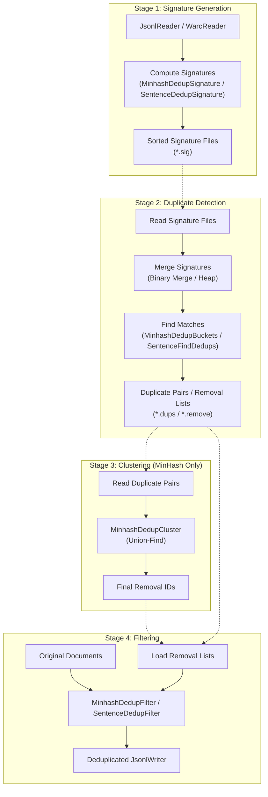
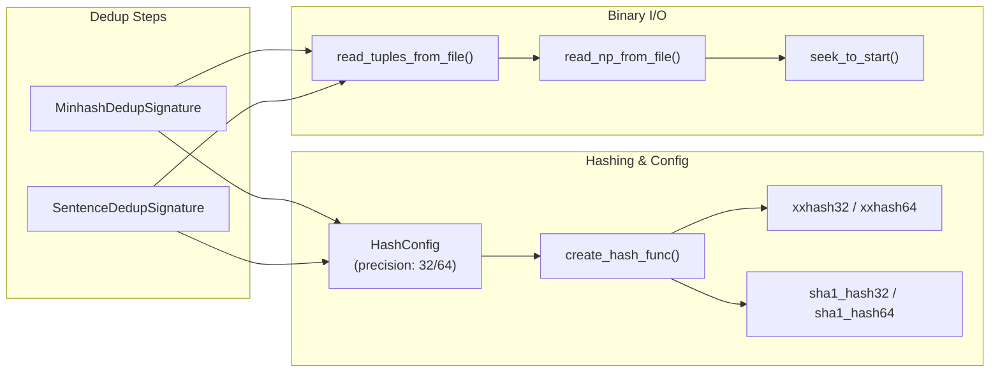

<!-- source: DeepWiki mcp.deepwiki.com · repo huggingface/datatrove · page 5 Deduplication Subsystems · fetched 2026-10-26 -->

# Deduplication Subsystems

Relevant source files

The following files were used as context for generating this wiki page:

- [examples/exact_substrings.py](examples/exact_substrings.py)
- [examples/minhash_deduplication.py](examples/minhash_deduplication.py)
- [examples/sentence_deduplication.py](examples/sentence_deduplication.py)
- [examples/url_deduplication.py](examples/url_deduplication.py)
- [src/datatrove/pipeline/dedup/__init__.py](src/datatrove/pipeline/dedup/__init__.py)
- [src/datatrove/pipeline/media/media_readers/warc.py](src/datatrove/pipeline/media/media_readers/warc.py)
- [src/datatrove/pipeline/media/readers/http_fetch.py](src/datatrove/pipeline/media/readers/http_fetch.py)
- [src/datatrove/utils/binaryio.py](src/datatrove/utils/binaryio.py)
- [src/datatrove/utils/hashes/sha1.py](src/datatrove/utils/hashes/sha1.py)
- [src/datatrove/utils/hashes/xxhash.py](src/datatrove/utils/hashes/xxhash.py)
- [src/datatrove/utils/hashing.py](src/datatrove/utils/hashing.py)
- [src/datatrove/utils/media.py](src/datatrove/utils/media.py)

## Purpose and Scope

This document provides an overview of DataTrove's complementary deduplication systems, their architectural patterns, and shared infrastructure. Deduplication is critical for removing redundant content from large text corpora, improving dataset quality and reducing training costs for language models.

DataTrove implements three primary deduplication strategies:
- **MinHash Near-Duplicate Deduplication** ([MinHash Near-Duplicate Deduplication](#5.1)) - Detects documents with high similarity using locality-sensitive hashing.
- **Sentence-Level Deduplication** ([Sentence-Level Deduplication](#5.2)) - Removes duplicate n-sentence spans within and across documents, following C4-style processing.
- **Exact Hash-Based Deduplication** ([Exact Hash-Based Deduplication](#5.3)) - Identifies documents with identical content or exact substrings.

Each system follows a multi-stage pipeline architecture and shares common infrastructure for hashing, text normalization, and binary I/O. All three support disk-based processing for datasets larger than memory and can build indexes for deduplication against external reference datasets.

**Sources:** [src/datatrove/pipeline/dedup/__init__.py:1-12](), [examples/sentence_deduplication.py:12-25]()

---

## Deduplication Strategies Overview

The strategies address different use cases and operate at different granularities:

| Strategy | Granularity | Detection Method | Use Case | Stages |
|----------|-------------|------------------|----------|--------|
| **Exact Dedup** | Document-level | Content hash (xxhash/sha1) | Remove identical documents | 3 |
| **MinHash Dedup** | Document-level | Locality-sensitive hashing (Buckets × Hashes) | Remove near-duplicate documents (~72% similarity) | 4 |
| **Sentence Dedup** | Sub-document spans | n-sentence span hashing | Remove duplicate sentence sequences (C4-style) | 3 |
| **Exact Substrings** | Byte-level | Suffix Arrays | Remove exact duplicate substrings | 3 |

**Key Differences:**

- **Exact Deduplication** is fastest and most precise but only catches identical documents. It uses `ExactDedupSignature` and `ExactFindDedups` [src/datatrove/pipeline/dedup/__init__.py:2]().
- **MinHash Deduplication** catches near-duplicates (e.g., documents with minor variations) but requires more computation across 4 stages [examples/minhash_deduplication.py:33-108]().
- **Sentence Deduplication** operates at finer granularity, removing specific duplicate spans while preserving unique content in the same document [examples/sentence_deduplication.py:12-25]().
- **Exact Substrings** uses suffix arrays (via external tools) to remove duplicate byte ranges [examples/exact_substrings.py:12-29]().

**Sources:** [src/datatrove/pipeline/dedup/__init__.py:1-12](), [examples/minhash_deduplication.py:17-21](), [examples/sentence_deduplication.py:28-33]()

---

## Multi-Stage Pipeline Architecture

All deduplication systems follow a common multi-stage pattern that enables distributed processing and disk-based computation. This pattern decouples signature generation from duplicate detection and final filtering.

**Diagram: Multi-Stage Deduplication Pipeline Pattern**

### Stage Responsibilities

**Stage 1 (Signature Generation):**
Processes input documents in parallel. Each worker computes signatures (hashes) and writes them to disk-based intermediate files.
- **Classes:** `MinhashDedupSignature`, `SentenceDedupSignature`, `ExactDedupSignature`, `UrlDedupSignature`.
- **Sources:** [src/datatrove/pipeline/dedup/__init__.py:2-12](), [examples/sentence_deduplication.py:39-46]()

**Stage 2 (Duplicate Detection):**
Reads signature files from all Stage 1 workers, merges them in sorted order, and detects matches.
- **Classes:** `MinhashDedupBuckets`, `SentenceFindDedups`, `ExactFindDedups`, `UrlFindDedups`.
- **Sources:** [src/datatrove/pipeline/dedup/__init__.py:2-12](), [examples/sentence_deduplication.py:48]()

**Stage 3 (Clustering / Removal List Generation):**
For MinHash, a single worker processes duplicate pairs to cluster transitive duplicates using union-find. For Sentence/URL dedup, this stage generates the final removal IDs or span markers.
- **Classes:** `MinhashDedupCluster`.
- **Sources:** [src/datatrove/pipeline/dedup/__init__.py:8](), [examples/minhash_deduplication.py:69-87]()

**Stage 4 (Filtering):**
Reads original documents and applies the removal lists generated in previous stages to produce the final dataset.
- **Classes:** `MinhashDedupFilter`, `SentenceDedupFilter`, `ExactDedupFilter`, `UrlDedupFilter`.
- **Sources:** [src/datatrove/pipeline/dedup/__init__.py:2-12](), [examples/sentence_deduplication.py:50-54]()

---

## Common Infrastructure and Components

Deduplication systems share core utilities for hashing and binary I/O to ensure consistency across distributed tasks.

**Diagram: Shared Hashing and I/O Infrastructure**

### Hashing Configuration (`HashConfig`)

The `HashConfig` class defines the hashing parameters used across all deduplication steps. It supports `xxhash` and `sha1` with 32-bit or 64-bit precision.
- **Source:** [src/datatrove/utils/hashing.py:11-41]()
- **Function:** `create_hash_func` returns the appropriate hashing callable based on the config [src/datatrove/utils/hashing.py:44-58]().

### Binary I/O Utilities

Deduplication involves reading large volumes of sorted hashes from disk.
- `read_tuples_from_file`: Efficiently parses binary files using `struct` formats [src/datatrove/utils/binaryio.py:10-31]().
- `read_np_from_file`: Reads data directly into NumPy arrays [src/datatrove/utils/binaryio.py:33-52]().
- `seek_to_start`: Performs binary search on sorted binary files to find the starting point for a specific hash [src/datatrove/utils/binaryio.py:54-95]().

---

## Index-Based Deduplication

All systems support building a reference index from one dataset to deduplicate a second dataset against it. This is useful for incremental updates or preventing test-set contamination.

**Workflow:**
1. **Build Index:** Use a specialized builder (e.g., `MinhashBuildIndex`) to process signatures into a optimized index format [src/datatrove/pipeline/dedup/__init__.py:5]().
2. **Apply Index:** In the duplicate detection stage (e.g., `MinhashDedupBuckets`), provide the `index_folder` path. Matches found in the index are treated as duplicates [examples/minhash_deduplication.py:54-58]().

**Sources:** [src/datatrove/pipeline/dedup/__init__.py:5](), [examples/sentence_deduplication.py:31]()

---

## Disk-Based Processing Model

To handle datasets that exceed system memory, DataTrove uses a disk-based merging strategy in Stage 2.
- Signatures are written to disk in Stage 1, partitioned by hash range or bucket.
- Stage 2 workers open multiple signature files simultaneously.
- A priority queue (heap) or sorted merge is used to identify duplicates without loading all signatures into RAM.
- **Sources:** [examples/sentence_deduplication.py:35](), [src/datatrove/utils/binaryio.py:54-95]()

---

## Child Pages

For detailed documentation on specific deduplication approaches, see the following pages:

- [MinHash Near-Duplicate Deduplication](#5.1) — Details on the 4-stage LSH pipeline, signature generation, and union-find clustering.
- [Sentence-Level Deduplication](#5.2) — Details on n-sentence span hashing, duplicate detection, and C4-style span removal.
- [Exact Hash-Based Deduplication](#5.3) — Details on `ExactDedup` stages, URL-based deduplication, and exact substring removal via suffix arrays.

---

