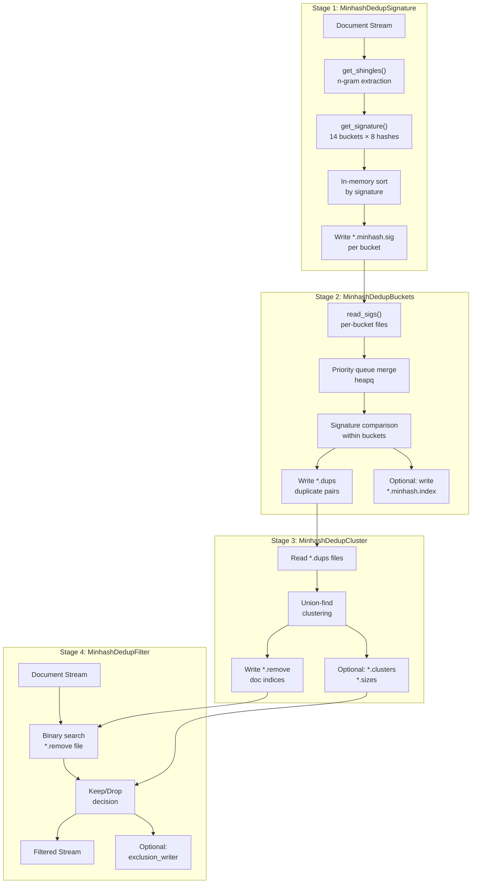
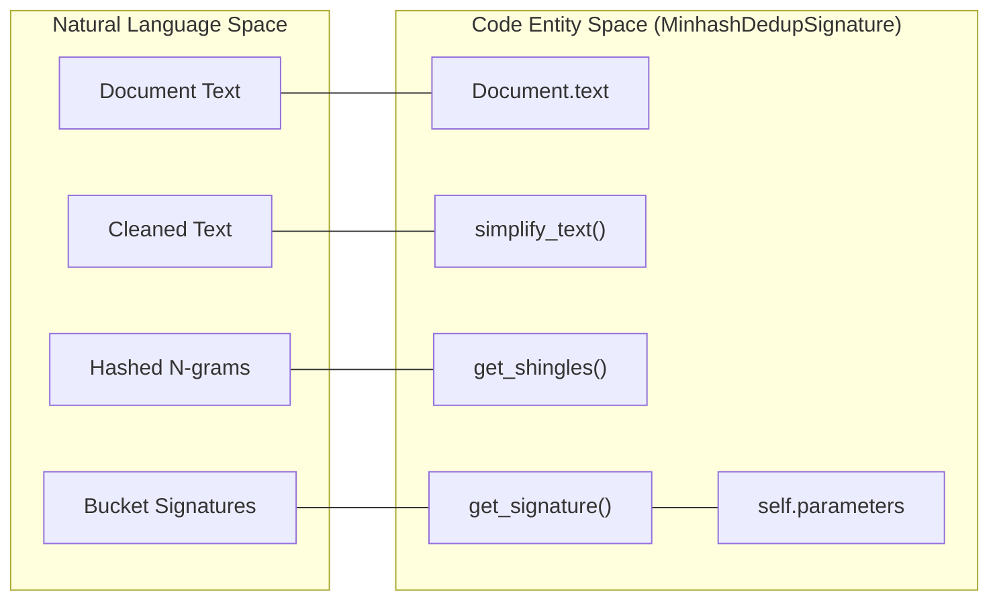
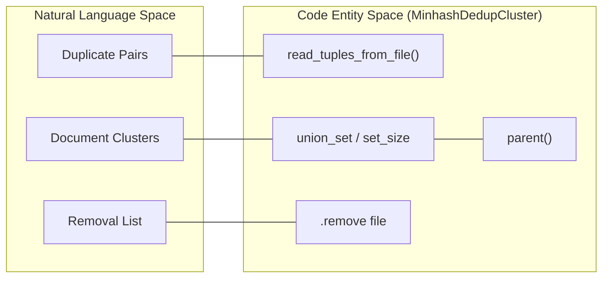

<!-- source: DeepWiki mcp.deepwiki.com · repo huggingface/datatrove · page 5.1 MinHash Near-Duplicate Deduplication · fetched 2026-10-26 -->

# MinHash Near-Duplicate Deduplication

<details>
<summary>Relevant source files</summary>

The following files were used as context for generating this wiki page:

- [src/datatrove/pipeline/dedup/bloom_filter.py](src/datatrove/pipeline/dedup/bloom_filter.py)
- [src/datatrove/pipeline/dedup/exact_substrings.py](src/datatrove/pipeline/dedup/exact_substrings.py)
- [src/datatrove/pipeline/dedup/minhash.py](src/datatrove/pipeline/dedup/minhash.py)
- [src/datatrove/pipeline/dedup/sentence_dedup.py](src/datatrove/pipeline/dedup/sentence_dedup.py)
- [src/datatrove/tools/fast_mh3/Cargo.lock](src/datatrove/tools/fast_mh3/Cargo.lock)
- [src/datatrove/tools/fast_mh3/Cargo.toml](src/datatrove/tools/fast_mh3/Cargo.toml)
- [src/datatrove/tools/fast_mh3/src/local_union_find.rs](src/datatrove/tools/fast_mh3/src/local_union_find.rs)
- [src/datatrove/tools/fast_mh3/src/s3_union_find.rs](src/datatrove/tools/fast_mh3/src/s3_union_find.rs)
- [src/datatrove/utils/text.py](src/datatrove/utils/text.py)
- [tests/pipeline/dedup/test_minhash.py](tests/pipeline/dedup/test_minhash.py)

</details>


## Purpose and Scope

This document describes the MinHash near-duplicate deduplication system in DataTrove, which detects and removes documents with high content similarity (typically ≥72% Jaccard similarity) using Locality-Sensitive Hashing (LSH). The system implements a 4-stage pipeline that processes datasets larger than memory through disk-based intermediate files.

For exact duplicate removal, see [Exact Hash-Based Deduplication](#5.3). For fine-grained deduplication of text spans within documents, see [Sentence-Level Deduplication](#5.2).

**Sources:** [src/datatrove/pipeline/dedup/minhash.py:1-746]()

## System Overview

MinHash deduplication uses a multi-stage architecture that separates signature generation, comparison, clustering, and filtering into independent pipeline steps. This design enables distributed processing and supports deduplication against reference indexes without reprocessing them.

### Data Flow Diagram



**Key characteristics:**
- **Disk-based:** Intermediate files enable processing datasets larger than memory [src/datatrove/pipeline/dedup/minhash.py:127-128]()
- **Distributable:** Stages 1, 2, and 4 support parallel workers; Stage 3 requires a single worker [src/datatrove/pipeline/dedup/minhash.py:503-506]()
- **Index support:** Can deduplicate against reference datasets without reprocessing [src/datatrove/pipeline/dedup/minhash.py:426-433]()
- **Configurable threshold:** Default parameters target ~72% Jaccard similarity (probability 0.924 for s=0.8) [src/datatrove/pipeline/dedup/minhash.py:30-35]()

**Sources:** [src/datatrove/pipeline/dedup/minhash.py:124-689](), [src/datatrove/pipeline/dedup/minhash.py:30-35]()

## Configuration

The `MinhashConfig` dataclass controls signature generation and comparison behavior:

| Parameter | Default | Description |
|-----------|---------|-------------|
| `n_grams` | 5 | Size of word n-grams used for shingling [src/datatrove/pipeline/dedup/minhash.py:51]() |
| `num_buckets` | 14 | Number of LSH buckets [src/datatrove/pipeline/dedup/minhash.py:52]() |
| `hashes_per_bucket` | 8 | Hashes per bucket (total: 14×8=112 hashes) [src/datatrove/pipeline/dedup/minhash.py:53]() |
| `seed` | 1 | Random seed for hash parameters (must match across workers) [src/datatrove/pipeline/dedup/minhash.py:54]() |
| `norm_config` | `TextNormConfig()` | Text normalization settings [src/datatrove/pipeline/dedup/minhash.py:56]() |
| `hash_config` | `HashConfig()` | Hash function configuration (32-bit or 64-bit) [src/datatrove/pipeline/dedup/minhash.py:57]() |

**Similarity threshold calculation:**

The probability that two documents with Jaccard similarity `s` will be detected as duplicates is approximately:
`P(detection) = 1 - (1 - s^hashes_per_bucket)^num_buckets` [src/datatrove/pipeline/dedup/minhash.py:34-35]()

With default parameters (14 buckets, 8 hashes per bucket):
- Threshold: `(1/14)^(1/8) ≈ 0.72` [src/datatrove/pipeline/dedup/minhash.py:32]()
- For `s=0.8`: `P ≈ 0.924` (92.4% detection rate) [src/datatrove/pipeline/dedup/minhash.py:34]()

**Sources:** [src/datatrove/pipeline/dedup/minhash.py:40-61](), [src/datatrove/pipeline/dedup/minhash.py:30-35]()

## Stage 1: Signature Generation

`MinhashDedupSignature` processes documents to generate MinHash signatures and writes them to disk in sorted order.

### Natural Language to Code Entity Mapping (Stage 1)



### Shingling Process

The `get_shingles()` method converts document text into a set of hashed n-grams:

1. **Normalization:** Apply `simplify_text()` with `norm_config` (lowercase, whitespace normalization, punctuation removal) [src/datatrove/pipeline/dedup/minhash.py:204-207]()
2. **Tokenization:** Use language-specific word tokenizer from `load_word_tokenizer(language)` [src/datatrove/pipeline/dedup/minhash.py:205]()
3. **N-gramming:** Generate overlapping n-grams of size `config.n_grams` (default 5) [src/datatrove/pipeline/dedup/minhash.py:206]()
4. **Hashing:** Hash each n-gram using `hash_func` (xxhash or blake2b) [src/datatrove/pipeline/dedup/minhash.py:203]()

**Sources:** [src/datatrove/pipeline/dedup/minhash.py:190-210]()

### Signature Generation

The `get_signature()` method applies MinHash to produce LSH signatures:

1. **Parameter generation:** Create random coefficients `a` and `b` using `np.random.RandomState(seed)` for universal hashing [src/datatrove/pipeline/dedup/minhash.py:165-170]()
2. **Permutation:** Compute `(shingles * a + b) % mersenne_prime` for all hashes [src/datatrove/pipeline/dedup/minhash.py:182]()
3. **MinHash:** Take minimum value per hash position across all shingles [src/datatrove/pipeline/dedup/minhash.py:187]()
4. **Bucketing:** Split hashes into `config.num_buckets` buckets [src/datatrove/pipeline/dedup/minhash.py:187]()

The use of Mersenne prime `2^61 - 1` for 64-bit hashes ensures uniform distribution in the hash space [src/datatrove/pipeline/dedup/minhash.py:28]().

**Sources:** [src/datatrove/pipeline/dedup/minhash.py:154-188](), [src/datatrove/pipeline/dedup/minhash.py:27-28]()

## Stage 2: Bucket Processing

`MinhashDedupBuckets` compares signatures within each bucket to find duplicate pairs, optionally building index files and supporting reference index deduplication.

### Worker Assignment and Hash Ranges

With `world_size` workers and `num_buckets` buckets, workers are assigned as:
- `workers_per_bucket = world_size // num_buckets` [src/datatrove/pipeline/dedup/minhash.py:361]()
- `bucket = rank // workers_per_bucket` [src/datatrove/pipeline/dedup/minhash.py:362]()
- `bucket_worker = rank % workers_per_bucket` [src/datatrove/pipeline/dedup/minhash.py:363]()

Multiple workers per bucket divide the hash space by reading split points from the first signature file [src/datatrove/pipeline/dedup/minhash.py:365-389]().

**Sources:** [src/datatrove/pipeline/dedup/minhash.py:360-389]()

### Signature Merging Algorithm

The core algorithm uses a priority queue (min-heap) to merge sorted signature files:

1. **Initialize:** Open all signature files (dataset + index), create readers using `read_sigs()` [src/datatrove/pipeline/dedup/minhash.py:441-447]()
2. **Populate queue:** Read first signature from each reader, add to `heapq` [src/datatrove/pipeline/dedup/minhash.py:452-456]()
3. **Process loop:**
   - Pop smallest signature `v` from heap [src/datatrove/pipeline/dedup/minhash.py:458]()
   - If `v.sig == last.sig`, write duplicate pair to `.dups` file [src/datatrove/pipeline/dedup/minhash.py:470-479]()
   - Fetch next signature from reader `v.reader_id`, push to heap [src/datatrove/pipeline/dedup/minhash.py:494-497]()

The `HashSig` dataclass implements heap ordering by signature tuple [src/datatrove/pipeline/dedup/minhash.py:63-82]().

**Sources:** [src/datatrove/pipeline/dedup/minhash.py:454-497](), [src/datatrove/pipeline/dedup/minhash.py:63-82]()

## Stage 3: Clustering

`MinhashDedupCluster` groups documents into clusters using union-find, where all duplicate pairs in a cluster collapse to a single representative.

### Natural Language to Code Entity Mapping (Stage 3)



### Union-Find Implementation

The implementation uses path compression and union by size for efficiency:

**`parent(x)` function:**
```python
def parent(x):
    if x not in union_set or union_set[x] == x:
        union_set[x] = x
        return x
    union_set[x] = parent(union_set[x]) # Path Compression
    return union_set[x]
```
[src/datatrove/pipeline/dedup/minhash.py:537-543]()

**`union(a, b)` logic:**
- Finds roots of both elements.
- Attaches smaller tree to larger tree (union by size) [src/datatrove/pipeline/dedup/minhash.py:553-557]().
- Special handling for `SENTINEL` (index matches): always make `SENTINEL` the root [src/datatrove/pipeline/dedup/minhash.py:549-551]().

**Sources:** [src/datatrove/pipeline/dedup/minhash.py:537-558]()

## Stage 4: Filtering

`MinhashDedupFilter` removes documents marked for deletion while optionally enriching metadata with cluster information.

### Removal Logic

The `.remove` file is a binary file containing sorted 32-bit unsigned integers (document indices). The filter reads sequentially and compares against the current document index [src/datatrove/pipeline/dedup/minhash.py:641-648]().

### Metadata Enrichment

When enabled, the filter adds metadata fields to passing documents:
- `doc.metadata["minhash_cluster_id"]`: sequential integer IDs [src/datatrove/pipeline/dedup/minhash.py:663-667]().
- `doc.metadata["minhash_cluster_size"]`: number of documents in the cluster [src/datatrove/pipeline/dedup/minhash.py:673-677]().

**Sources:** [src/datatrove/pipeline/dedup/minhash.py:649-677]()

## Index Building

`MinhashBuildIndex` creates a reference index without performing deduplication, useful for building indexes from clean datasets.

**Key differences from MinhashDedupBuckets:**
- Does not take document input; operates on existing signatures [src/datatrove/pipeline/dedup/minhash.py:691-693]().
- Requires exactly one task per bucket (`world_size == num_buckets`) [src/datatrove/pipeline/dedup/minhash.py:707-709]().
- Deduplicates consecutive identical signatures before writing to index [src/datatrove/pipeline/dedup/minhash.py:738-745]().

**Sources:** [src/datatrove/pipeline/dedup/minhash.py:691-745]()

## Binary I/O Utilities

The `read_sigs()` generator function provides efficient signature reading with binary search capabilities.

**Key features:**
1. **Binary search start:** `seek_to_start()` jumps to the `min_hash` position [src/datatrove/pipeline/dedup/minhash.py:106]().
2. **Buffered reading:** `lines_to_buffer` controls read chunk size [src/datatrove/pipeline/dedup/minhash.py:109]().
3. **Format flexibility:** Handles both `.sig` files (with doc_id) and `.index` files (without doc_id) [src/datatrove/pipeline/dedup/minhash.py:102]().

**Sources:** [src/datatrove/pipeline/dedup/minhash.py:84-121]()

## Performance Considerations

### Worker Allocation

- **Stage 1 & 4:** Standard data sharding parallelization.
- **Stage 2:** `world_size` must be divisible by `num_buckets` [src/datatrove/pipeline/dedup/minhash.py:361]().
- **Stage 3:** **Must use single worker** (world_size=1) due to global union-find [src/datatrove/pipeline/dedup/minhash.py:503-506]().

### Memory and Disk I/O

- **Memory:** Stage 3 requires approximately 32 bytes per duplicate document in the union-find structure.
- **Disk I/O:** `lines_to_buffer` controls the fsspec read buffer size [src/datatrove/pipeline/dedup/minhash.py:109](). Use `skip_existing_sigs=True` in Stage 1 to avoid redundant computation [src/datatrove/pipeline/dedup/minhash.py:212-213]().

**Sources:** [src/datatrove/pipeline/dedup/minhash.py:349-358](), [src/datatrove/pipeline/dedup/minhash.py:406-422](), [src/datatrove/pipeline/dedup/minhash.py:517-526]()

---

