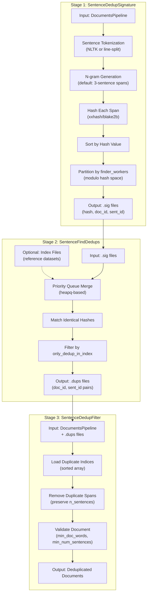
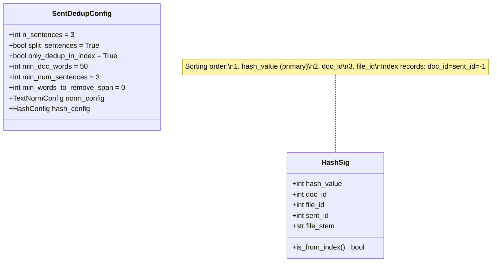
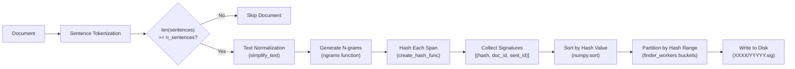
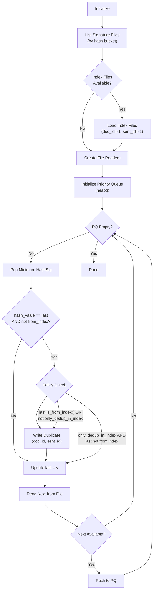
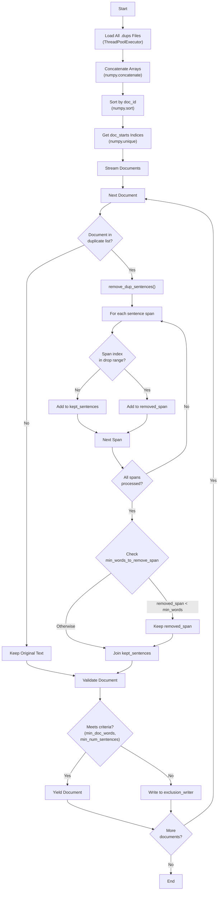
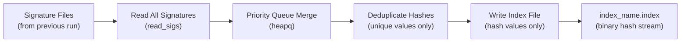

<!-- source: DeepWiki mcp.deepwiki.com · repo huggingface/datatrove · page 5.2 Sentence-Level Deduplication · fetched 2026-10-26 -->

# Sentence-Level Deduplication

<details>
<summary>Relevant source files</summary>

The following files were used as context for generating this wiki page:

- [examples/exact_substrings.py](examples/exact_substrings.py)
- [examples/minhash_deduplication.py](examples/minhash_deduplication.py)
- [examples/sentence_deduplication.py](examples/sentence_deduplication.py)
- [examples/url_deduplication.py](examples/url_deduplication.py)
- [src/datatrove/pipeline/dedup/__init__.py](src/datatrove/pipeline/dedup/__init__.py)
- [src/datatrove/pipeline/dedup/bloom_filter.py](src/datatrove/pipeline/dedup/bloom_filter.py)
- [src/datatrove/pipeline/dedup/exact_substrings.py](src/datatrove/pipeline/dedup/exact_substrings.py)
- [src/datatrove/pipeline/dedup/minhash.py](src/datatrove/pipeline/dedup/minhash.py)
- [src/datatrove/pipeline/dedup/sentence_dedup.py](src/datatrove/pipeline/dedup/sentence_dedup.py)
- [src/datatrove/utils/binaryio.py](src/datatrove/utils/binaryio.py)
- [src/datatrove/utils/text.py](src/datatrove/utils/text.py)
- [tests/pipeline/dedup/test_sentence_deduplication.py](tests/pipeline/dedup/test_sentence_deduplication.py)

</details>


## Purpose and Scope

Sentence-Level Deduplication is a fine-grained deduplication strategy that removes duplicate n-sentence spans from documents, as described in the C4 dataset paper (Raffel et al., 2020): "To deduplicate the data set, we discarded all but one of any three-sentence span occurring more than once in the data set." [src/datatrove/pipeline/dedup/sentence_dedup.py:1-4](). This approach targets redundant content at a finer granularity than document-level deduplication, making it particularly effective for removing repetitive boilerplate text, repeated disclaimers, and other recurring textual patterns within and across documents.

For document-level exact deduplication, see [Exact Hash-Based Deduplication](#5.3). For near-duplicate document detection using locality-sensitive hashing, see [MinHash Near-Duplicate Deduplication](#5.1).

**Sources:** [src/datatrove/pipeline/dedup/sentence_dedup.py:1-8]()

## Architecture Overview

The sentence deduplication system implements a three-stage pipeline architecture with disk-based intermediate storage to handle datasets larger than available memory. The system operates by hashing overlapping n-sentence spans, finding matching hashes across the dataset, and selectively removing duplicate spans from documents.

### Three-Stage Pipeline



**Sources:** [src/datatrove/pipeline/dedup/sentence_dedup.py:68-80](), [src/datatrove/pipeline/dedup/sentence_dedup.py:188-202](), [src/datatrove/pipeline/dedup/sentence_dedup.py:285-305]()

## Core Data Structures

### HashSig

The `HashSig` dataclass represents a single sentence span signature and implements the sorting order for the priority queue merge algorithm.



| Field | Type | Purpose |
|-------|------|---------|
| `hash_value` | `int` | Hash of the n-sentence span (primary sort key) |
| `doc_id` | `int` | Document index within file (secondary sort key) |
| `file_id` | `int` | File identifier for signature source |
| `sent_id` | `int` | Sentence position within document |
| `file_stem` | `str` | Original filename for output routing |

The sorting order is critical for the merge algorithm: signatures are sorted first by `hash_value` (to group duplicates), then by `doc_id` (so index records with `doc_id=-1` appear first), enabling efficient duplicate detection [src/datatrove/pipeline/dedup/sentence_dedup.py:53-62]().

**Sources:** [src/datatrove/pipeline/dedup/sentence_dedup.py:53-66]()

### SentDedupConfig

Configuration object controlling deduplication behavior:

| Parameter | Default | Description |
|-----------|---------|-------------|
| `n_sentences` | `3` | Number of sentences per span to hash [src/datatrove/pipeline/dedup/sentence_dedup.py:43]() |
| `split_sentences` | `True` | Use NLTK tokenization vs. line splitting [src/datatrove/pipeline/dedup/sentence_dedup.py:44]() |
| `only_dedup_in_index` | `True` | Only remove spans matching index, not inter-document duplicates [src/datatrove/pipeline/dedup/sentence_dedup.py:45]() |
| `min_doc_words` | `50` | Minimum word count to retain document after filtering [src/datatrove/pipeline/dedup/sentence_dedup.py:46]() |
| `min_num_sentences` | `3` | Minimum sentence count to retain document [src/datatrove/pipeline/dedup/sentence_dedup.py:47]() |
| `min_words_to_remove_span` | `0` | Minimum words in span to actually remove it (0=always remove) [src/datatrove/pipeline/dedup/sentence_dedup.py:48]() |
| `norm_config` | `TextNormConfig()` | Text normalization settings (case, punctuation, etc.) [src/datatrove/pipeline/dedup/sentence_dedup.py:49]() |
| `hash_config` | `HashConfig()` | Hash function configuration (algorithm, size) [src/datatrove/pipeline/dedup/sentence_dedup.py:50]() |

**Sources:** [src/datatrove/pipeline/dedup/sentence_dedup.py:41-51]()

## Stage 1: Signature Generation

The `SentenceDedupSignature` class implements the first stage, which processes documents to create hash signatures for overlapping sentence spans [src/datatrove/pipeline/dedup/sentence_dedup.py:68-76]().

### Workflow



### Key Methods

**get_hashes(doc, doc_idx)**

Generates hash signatures for a single document:

1. **Tokenize**: Split text into sentences using language-specific tokenizer or line breaks [src/datatrove/pipeline/dedup/sentence_dedup.py:134]().
2. **Normalize**: Apply text normalization via `simplify_text` [src/datatrove/pipeline/dedup/sentence_dedup.py:138]().
3. **Generate N-grams**: Create overlapping n-sentence spans using `ngrams(sentences_tokens, n_sentences)` [src/datatrove/pipeline/dedup/sentence_dedup.py:139]().
4. **Hash**: Apply hash function `self.hash_fc` to each span [src/datatrove/pipeline/dedup/sentence_dedup.py:141]().
5. **Return**: List of `(hash_value, doc_idx, sentence_idx)` tuples [src/datatrove/pipeline/dedup/sentence_dedup.py:146]().

**Sources:** [src/datatrove/pipeline/dedup/sentence_dedup.py:133-146]()

**save_hashes(rank, signatures)**

Partitions and saves signatures to disk:

1. **Convert**: Create numpy structured array with fields `(hash, doc, sent)` [src/datatrove/pipeline/dedup/sentence_dedup.py:102-104]().
2. **Sort**: Sort array by hash value for efficient merging [src/datatrove/pipeline/dedup/sentence_dedup.py:105]().
3. **Partition**: Divide hash space into `finder_workers` buckets using `searchsorted` [src/datatrove/pipeline/dedup/sentence_dedup.py:109-121]().
4. **Write**: Save each partition to `{hash_bucket:04d}/{rank:05d}.sig` [src/datatrove/pipeline/dedup/sentence_dedup.py:110-112]().

**Sources:** [src/datatrove/pipeline/dedup/sentence_dedup.py:100-131]()

## Stage 2: Duplicate Detection

The `SentenceFindDedups` class implements a heap-based merge algorithm to find duplicate sentence spans across all signature files [src/datatrove/pipeline/dedup/sentence_dedup.py:188-202]().

### Merge Algorithm



### Duplicate Detection Logic

The duplicate matching logic is controlled by three conditions:

1. **Hash Match**: Current signature's `hash_value` equals the previous signature's `hash_value` [src/datatrove/pipeline/dedup/sentence_dedup.py:274]().
2. **Not From Index**: Current signature is not from the reference index (`doc_id != -1`) [src/datatrove/pipeline/dedup/sentence_dedup.py:274]().
3. **Policy Check**:
   - If `last.is_from_index()`: Always record duplicate (matching against reference) [src/datatrove/pipeline/dedup/sentence_dedup.py:275]().
   - If `not only_dedup_in_index`: Record duplicate (matching both within and against index) [src/datatrove/pipeline/dedup/sentence_dedup.py:275]().

**Sources:** [src/datatrove/pipeline/dedup/sentence_dedup.py:274-282]()

### read_sigs Helper Function

The `read_sigs` generator function streams signatures from binary files:

```python
def read_sigs(
    file: AbstractBufferedFile,
    file_id: int,
    config: SentDedupConfig,
    index_file: bool = False,
    lines_to_buffer: int = 5,
) -> Generator[HashSig, None, None]
```

- **Regular files**: Yields `HashSig(hash_value, doc_id, file_id, sent_id, file_stem)` [src/datatrove/pipeline/dedup/sentence_dedup.py:185]().
- **Index files**: Yields `HashSig(hash_value, -1, file_id, -1, file_stem)` with special markers [src/datatrove/pipeline/dedup/sentence_dedup.py:183]().
- **Buffering**: Uses `read_tuples_from_file` with configurable buffer size [src/datatrove/pipeline/dedup/sentence_dedup.py:179]().

**Sources:** [src/datatrove/pipeline/dedup/sentence_dedup.py:168-186]()

## Stage 3: Document Filtering

The `SentenceDedupFilter` class reads the duplicate indices and removes matching sentence spans from documents while preserving document structure [src/datatrove/pipeline/dedup/sentence_dedup.py:285-305]().

### Filtering Process



### remove_dup_sentences Method

This method implements the core span removal logic:

1. **Tokenize**: Get sentence span boundaries using `tokenizer.span_tokenize()` or line splitting [src/datatrove/pipeline/dedup/sentence_dedup.py:330-332]().
2. **Track Duplicates**: Iterate through spans while maintaining a pointer to the duplicate list [src/datatrove/pipeline/dedup/sentence_dedup.py:338-360]().
3. **Drop Ranges**: When a duplicate is found at index `i`, mark spans `[i, i+n_sentences)` for removal [src/datatrove/pipeline/dedup/sentence_dedup.py:349-350]().
4. **Minimum Word Check**: If `min_words_to_remove_span > 0`, restore removed spans with fewer words [src/datatrove/pipeline/dedup/sentence_dedup.py:365-368]().
5. **Format Output**: Return both filtered text and formatted original (with `>>>` and `<<<` markers) [src/datatrove/pipeline/dedup/sentence_dedup.py:378]().

**Sources:** [src/datatrove/pipeline/dedup/sentence_dedup.py:329-378]()

### Document Validation

After span removal, documents are validated against multiple criteria:

| Criterion | Check | Purpose |
|-----------|-------|---------|
| **No Change** | `filtered_text == doc.text` | Unchanged documents always pass [src/datatrove/pipeline/dedup/sentence_dedup.py:426]() |
| **Min Words** | `len(word_tokenize(text)) >= min_doc_words` | Ensure sufficient content remains [src/datatrove/pipeline/dedup/sentence_dedup.py:432]() |
| **Min Sentences** | `len(split_into_sentences(text)) >= min_num_sentences` | Ensure structural integrity [src/datatrove/pipeline/dedup/sentence_dedup.py:438]() |
| **Non-Empty** | `filtered_text != ""` | Reject completely empty documents [src/datatrove/pipeline/dedup/sentence_dedup.py:440]() |

**Sources:** [src/datatrove/pipeline/dedup/sentence_dedup.py:425-451]()

## Index Building

The `SentenceDedupBuildIndex` class creates reference indices for deduplicating new datasets against existing clean datasets [src/datatrove/pipeline/dedup/sentence_dedup.py:454-463]().

### Index Building Process



**Key Differences from Stage 2:**

1. **No doc_id/sent_id**: Index files store only unique hash values [src/datatrove/pipeline/dedup/sentence_dedup.py:502]().
2. **Single Worker**: Must run with `world_size=1` for global uniqueness [src/datatrove/pipeline/dedup/sentence_dedup.py:481]().
3. **Special Markers**: When loaded in Stage 2, index hashes have `doc_id=sent_id=-1` [src/datatrove/pipeline/dedup/sentence_dedup.py:183]().

**Sources:** [src/datatrove/pipeline/dedup/sentence_dedup.py:454-503]()

## Execution Considerations

| Stage | Parallelization | Critical Parameters |
|-------|----------------|-------------------|
| **Stage 1** | Multiple workers | `finder_workers` determines partitioning [src/datatrove/pipeline/dedup/sentence_dedup.py:109]() |
| **Stage 2** | `finder_workers` tasks | Must match Stage 1 `finder_workers` [src/datatrove/pipeline/dedup/sentence_dedup.py:220]() |
| **Stage 3** | Multiple workers | Can use any number of workers [src/datatrove/pipeline/dedup/sentence_dedup.py:307]() |

**Sources:** [src/datatrove/pipeline/dedup/sentence_dedup.py:82-98](), [src/datatrove/pipeline/dedup/sentence_dedup.py:220-232]()

## Statistics and Monitoring

The system tracks several statistics during execution:

| Statistic | Stage | Description |
|-----------|-------|-------------|
| `total` | 1, 3 | Total documents processed [src/datatrove/pipeline/dedup/sentence_dedup.py:163](), [src/datatrove/pipeline/dedup/sentence_dedup.py:416]() |
| `removed_sentences` | 3 | Number of sentences removed from documents [src/datatrove/pipeline/dedup/sentence_dedup.py:375]() |
| `original_sentences` | 3 | Total number of sentences processed [src/datatrove/pipeline/dedup/sentence_dedup.py:376]() |

**Sources:** [src/datatrove/pipeline/dedup/sentence_dedup.py:163](), [src/datatrove/pipeline/dedup/sentence_dedup.py:375-376](), [src/datatrove/pipeline/dedup/sentence_dedup.py:444]()

---

