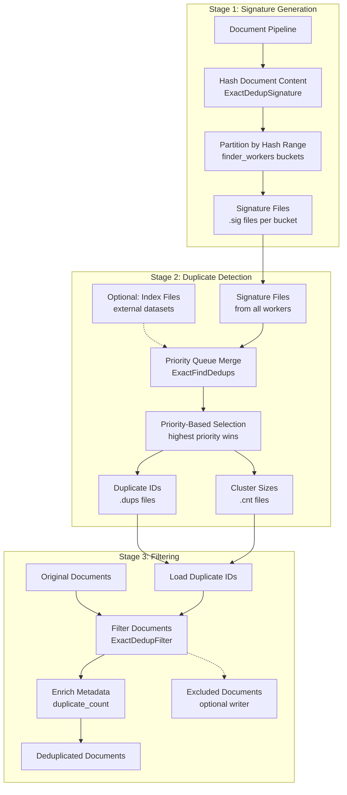
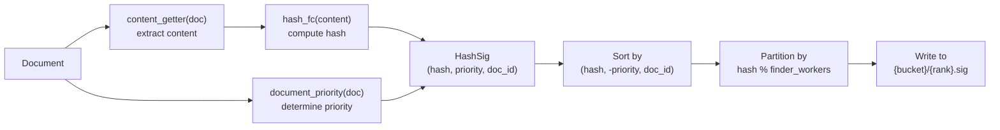
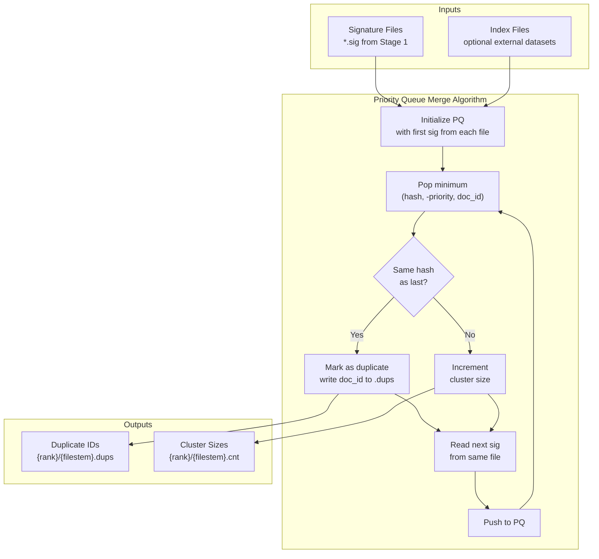

<!-- source: DeepWiki mcp.deepwiki.com · repo huggingface/datatrove · page 5.3 Exact Hash-Based Deduplication · fetched 2026-10-26 -->

# Exact Hash-Based Deduplication

<details>
<summary>Relevant source files</summary>

The following files were used as context for generating this wiki page:

- [src/datatrove/pipeline/dedup/bloom_filter.py](src/datatrove/pipeline/dedup/bloom_filter.py)
- [src/datatrove/pipeline/dedup/exact_dedup.py](src/datatrove/pipeline/dedup/exact_dedup.py)
- [src/datatrove/pipeline/dedup/exact_substrings.py](src/datatrove/pipeline/dedup/exact_substrings.py)
- [src/datatrove/pipeline/dedup/minhash.py](src/datatrove/pipeline/dedup/minhash.py)
- [src/datatrove/pipeline/dedup/sentence_dedup.py](src/datatrove/pipeline/dedup/sentence_dedup.py)
- [src/datatrove/pipeline/inference/servers/__init__.py](src/datatrove/pipeline/inference/servers/__init__.py)
- [src/datatrove/pipeline/inference/servers/custom_server.py](src/datatrove/pipeline/inference/servers/custom_server.py)
- [src/datatrove/utils/text.py](src/datatrove/utils/text.py)
- [tests/pipeline/dedup/test_exact_deduplication.py](tests/pipeline/dedup/test_exact_deduplication.py)
- [tests/pipeline/dedup/test_exact_substrings.py](tests/pipeline/dedup/test_exact_substrings.py)

</details>


## Purpose and Scope

Exact Hash-Based Deduplication identifies and removes documents with identical content using cryptographic hashing. This approach detects only exact matches (byte-for-byte identical text) and uses priority-based selection to determine which duplicate to keep when multiple copies exist. The system implements a three-stage disk-based pipeline to enable processing of datasets larger than available memory.

Additionally, DataTrove supports **Exact Substring Removal** using suffix arrays, which removes specific spans of duplicate text rather than entire documents.

For near-duplicate detection using fuzzy matching, see [MinHash Near-Duplicate Deduplication](#5.1). For removing duplicate text spans at the sentence level, see [Sentence-Level Deduplication](#5.2).

**Sources:** [src/datatrove/pipeline/dedup/exact_dedup.py:1-10](), [src/datatrove/pipeline/dedup/exact_substrings.py:1-15]()

---

## Architecture Overview

The exact deduplication system follows a multi-stage pipeline architecture with three main processing stages and an optional index building stage.

### Three-Stage Pipeline Architecture



Each stage can be parallelized across multiple workers, with Stage 2 operating on hash range partitions to avoid data dependencies.

**Sources:** [src/datatrove/pipeline/dedup/exact_dedup.py:69-426]()

---

## Stage 1: Signature Generation

### ExactDedupSignature Class

The `ExactDedupSignature` class computes content hashes for each document and saves them to disk, partitioned by hash range for parallel processing in Stage 2.



**Key Methods:**

| Method | Purpose |
|--------|---------|
| `get_hashes()` | Extracts content via `content_getter`, computes hash and priority [src/datatrove/pipeline/dedup/exact_dedup.py:141-146]() |
| `save_hashes()` | Sorts signatures and partitions into `finder_workers` buckets [src/datatrove/pipeline/dedup/exact_dedup.py:102-139]() |
| `run()` | Main entry point: processes document pipeline and saves signatures [src/datatrove/pipeline/dedup/exact_dedup.py:148-155]() |

### Hash Partitioning Logic

Signatures are partitioned by hash value to enable parallel processing in Stage 2. The hash range `[0, hash_config.max]` is divided into `finder_workers` buckets:

```
bucket_i contains hashes in range:
  [i * hashes_per_worker, (i+1) * hashes_per_worker)
  
where hashes_per_worker = hash_config.max / finder_workers
```

The last bucket includes all remaining hashes to handle the range maximum. This ensures each Stage 2 worker processes a disjoint subset of signatures.

**Sources:** [src/datatrove/pipeline/dedup/exact_dedup.py:118-139]()

### File Format

Signatures are written as binary files with extension `ExtensionHelperSD.stage_1_signature` (`.sig`). Each file contains sorted records of type:

```python
dtype = np.dtype([
    ("hash", hash_config.np_dtype),  # hash value (uint64/uint128)
    ("priority", "<u2"),              # priority (uint16, negated for sort)
    ("doc", "<u4")                    # document ID (uint32)
])
```

Records are sorted by `(hash, -priority, doc_id)` to ensure the highest priority document appears first for each hash.

**Sources:** [src/datatrove/pipeline/dedup/exact_dedup.py:65-67](), [src/datatrove/pipeline/dedup/exact_dedup.py:110-115]()

---

## Stage 2: Duplicate Detection

### ExactFindDedups Class

The `ExactFindDedups` class merges all signature files using a priority queue to identify duplicates. The first occurrence of each hash (with highest priority) is kept, and all subsequent occurrences are marked as duplicates.



### Priority Queue Merge

The algorithm uses `heapq` to maintain a min-heap of signatures from all files. The `HashSig` class defines comparison to order by `(hash_value, -priority, doc_id)`, ensuring:

1. Signatures are processed in hash order
2. For identical hashes, higher priority documents come first
3. Ties are broken by document ID for determinism

**Sources:** [src/datatrove/pipeline/dedup/exact_dedup.py:184-310](), [src/datatrove/pipeline/dedup/exact_dedup.py:56-62]()

### Index File Support

Index files allow deduplication against external datasets without reprocessing them. Index files contain only hash values (no priority or doc_id) and are treated as having maximum priority (65536) with doc_id -1.

When `config.only_dedup_in_index` is `True`, documents are only marked as duplicates if they match an index entry. This prevents removing duplicates within the current dataset.

**Sources:** [src/datatrove/pipeline/dedup/exact_dedup.py:242-256](), [src/datatrove/pipeline/dedup/exact_dedup.py:280-285]()

---

## Stage 3: Filtering

### ExactDedupFilter Class

The `ExactDedupFilter` class reads the original document pipeline and removes documents marked as duplicates in Stage 2. It also enriches kept documents with duplicate count metadata.

### Loading Strategy

The filter loads all duplicate IDs and cluster sizes into memory using NumPy arrays for efficient lookup:

1. **Parallel File Reading:** Uses `ThreadPoolExecutor` to read multiple files concurrently [src/datatrove/pipeline/dedup/exact_dedup.py:355-373]().
2. **Concatenation:** Combines arrays from all files with `np.concatenate` [src/datatrove/pipeline/dedup/exact_dedup.py:382-383]().
3. **Sorting:** Sorts arrays for sequential access during document processing [src/datatrove/pipeline/dedup/exact_dedup.py:384-386]().

**Sources:** [src/datatrove/pipeline/dedup/exact_dedup.py:346-393]()

---

## Exact Substring Removal

In addition to document-level deduplication, `datatrove` implements exact substring deduplication based on suffix arrays, as suggested by Lee et al. (2021). This removes specific ranges of tokens that appear more than once.

### Substring Pipeline Stages

1.  **`ESDatasetToSequence`**: Tokenizes documents and concatenates them into a single binary sequence file, separated by unique 12-byte markers. It also saves document lengths. [src/datatrove/pipeline/dedup/exact_substrings.py:42-83]()
2.  **`ESMergeSequences`**: Merges sequences from multiple Stage 1 workers into one large global sequence and tracks byte offsets. [src/datatrove/pipeline/dedup/exact_substrings.py:85-131]()
3.  **External Suffix Array Construction**: Uses external tools (e.g., `deduplicate-text-datasets` Rust scripts) to find duplicate ranges. [src/datatrove/pipeline/dedup/exact_substrings.py:1-15]()
4.  **`ESRangeRemover`**: Reads the original sequence and the identified duplicate ranges, removing tokens within those ranges before yielding the final documents. [src/datatrove/pipeline/dedup/exact_substrings.py:149-270]()

### Tokenization and Separators
Documents are prepared for the suffix array by prepending a separator containing the `doc_id` and `rank` followed by tokenized bytes:
```python
b_doc = b"\xff\xff" + struct.pack("<I", doc_id) + b"\xff\xff" + struct.pack("<I", rank) + tokens.tobytes()
```
**Sources:** [src/datatrove/pipeline/dedup/exact_substrings.py:35-39]()

---

## Configuration

### ExactDedupConfig Dataclass

| Field | Type | Purpose |
|-------|------|---------|
| `content_getter` | `Callable` | Extracts content to be hashed from a `Document` [src/datatrove/pipeline/dedup/exact_dedup.py:39]() |
| `document_priority` | `Callable` | Optional function to assign priority (1-65535) [src/datatrove/pipeline/dedup/exact_dedup.py:40]() |
| `hash_config` | `HashConfig` | Specifies hash algorithm and precision [src/datatrove/pipeline/dedup/exact_dedup.py:41]() |
| `only_dedup_in_index` | `bool` | If True, only remove documents matching the index [src/datatrove/pipeline/dedup/exact_dedup.py:42]() |

**Sources:** [src/datatrove/pipeline/dedup/exact_dedup.py:29-43]()

---

## Data Structures and File Formats

### HashSig Data Structure

The `HashSig` dataclass represents a single signature with comparison logic:

| Field | Type | Purpose |
|-------|------|---------|
| `hash_value` | `int` | Content hash |
| `priority` | `int` | Document priority (1-65535, or 65536 for index) |
| `doc_id` | `int` | Document index in pipeline, or -1 for index |
| `file_id` | `int` | Source file identifier |
| `file_stem` | `str` | Source file name (without extension) |

**Comparison Logic:**
The `__lt__` method defines ordering as `(hash_value, -priority, doc_id)`, ensuring signatures are grouped by hash value and higher priority comes first. [src/datatrove/pipeline/dedup/exact_dedup.py:56-62]()

**Sources:** [src/datatrove/pipeline/dedup/exact_dedup.py:45-63]()

### File Extensions (ExtensionHelperSD / ExtensionHelperES)

| Extension | Stage | Format | Description |
|-----------|-------|--------|-------------|
| `.sig` | Stage 1 | Binary | Signature files: `(hash, priority, doc_id)` tuples [src/datatrove/pipeline/dedup/exact_dedup.py:122]() |
| `.dups` | Stage 2 | Binary | Duplicate document IDs: stream of `uint32` [src/datatrove/pipeline/dedup/exact_dedup.py:282]() |
| `.cnt` | Stage 2 | Binary | Cluster sizes: `(doc_id, count)` tuples [src/datatrove/pipeline/dedup/exact_dedup.py:288]() |
| `.index` | Index | Binary | Index files: stream of hash values only [src/datatrove/pipeline/dedup/exact_dedup.py:479]() |
| `.es_sequence` | ES Stage 1 | Binary | Concatenated token sequence [src/datatrove/pipeline/dedup/exact_substrings.py:71]() |
| `.es_sequence_size` | ES Stage 1 | Binary | Byte sizes of each doc in sequence [src/datatrove/pipeline/dedup/exact_substrings.py:66]() |

**Sources:** [src/datatrove/pipeline/dedup/exact_dedup.py:122-479](), [src/datatrove/pipeline/dedup/exact_substrings.py:66-71]()

---

