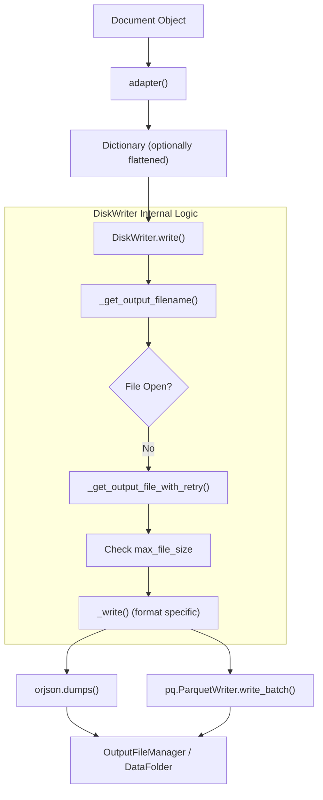

<!-- source: DeepWiki mcp.deepwiki.com · repo huggingface/datatrove · page 7 Data Writers and Output Management · fetched 2026-10-26 -->

# Data Writers and Output Management

<details>
<summary>Relevant source files</summary>

The following files were used as context for generating this wiki page:

- [examples/bucket_synthetic_data.py](examples/bucket_synthetic_data.py)
- [src/datatrove/pipeline/writers/__init__.py](src/datatrove/pipeline/writers/__init__.py)
- [src/datatrove/pipeline/writers/disk_base.py](src/datatrove/pipeline/writers/disk_base.py)
- [src/datatrove/pipeline/writers/huggingface.py](src/datatrove/pipeline/writers/huggingface.py)
- [src/datatrove/pipeline/writers/jsonl.py](src/datatrove/pipeline/writers/jsonl.py)
- [src/datatrove/pipeline/writers/parquet.py](src/datatrove/pipeline/writers/parquet.py)
- [src/datatrove/tools/inspect_data.py](src/datatrove/tools/inspect_data.py)
- [tests/manual/README.md](tests/manual/README.md)
- [tests/manual/__init__.py](tests/manual/__init__.py)
- [tests/manual/test_bucket_logging_dir.py](tests/manual/test_bucket_logging_dir.py)
- [tests/manual/test_bucket_slurm_pipeline.py](tests/manual/test_bucket_slurm_pipeline.py)
- [tests/manual/test_bucket_writer_live.py](tests/manual/test_bucket_writer_live.py)
- [tests/pipeline/writers/test_huggingface_bucket.py](tests/pipeline/writers/test_huggingface_bucket.py)

</details>


This document covers the data writer components of DataTrove, which are responsible for saving processed document data to various storage formats. Data writers form the final stage of the document processing pipeline, taking documents that have been read, extracted, filtered, and possibly deduplicated or tokenized, and persisting them to storage.

For information about reading data, see [Data Readers](./4.1.-Data-Readers).

## Architecture Overview

DataTrove implements a hierarchical writer architecture with a common base class and specialized implementations for different output formats. All writers inherit from `DiskWriter`, which in turn inherits from `PipelineStep`.

### Code Entity Relationship

The following diagram maps the logical writer components to their corresponding Python classes in the codebase.

```mermaid
classDiagram
    class PipelineStep {
        <<abstract>>
        [src/datatrove/pipeline/base.py]
        +run(data, rank, world_size)
    }
    class DiskWriter {
        <<abstract>>
        [src/datatrove/pipeline/writers/disk_base.py]
        +output_folder: DataFolder
        +output_filename: Template
        +compression: str
        +expand_metadata: bool
        +max_file_size: int
        +write(document, rank)
        #_write(document, file_handler, filename)*
    }
    class JsonlWriter {
        [src/datatrove/pipeline/writers/jsonl.py]
        +default_output_filename = "${rank}.jsonl"
        #_write(document, file_handler, filename)
    }
    class ParquetWriter {
        [src/datatrove/pipeline/writers/parquet.py]
        +batch_size: int
        +schema: Any
        #_write(document, file_handler, filename)
        #_write_batch(filename)
    }
    class HuggingFaceDatasetWriter {
        [src/datatrove/pipeline/writers/huggingface.py]
        +dataset: str
        +upload_files(*filenames)
        +close(rank)
    }
    class HuggingFaceBucketWriter {
        [src/datatrove/pipeline/writers/huggingface.py]
        +bucket: str
        +prefix: str
        +upload_files(*filenames)
    }
    
    PipelineStep <|-- DiskWriter
    DiskWriter <|-- JsonlWriter
    DiskWriter <|-- ParquetWriter
    ParquetWriter <|-- HuggingFaceDatasetWriter
    ParquetWriter <|-- HuggingFaceBucketWriter
```

Sources: [src/datatrove/pipeline/writers/disk_base.py:31-186](), [src/datatrove/pipeline/writers/jsonl.py:8-51](), [src/datatrove/pipeline/writers/parquet.py:11-127](), [src/datatrove/pipeline/writers/huggingface.py:23-228]()

## Base Writer: DiskWriter

The `DiskWriter` class [src/datatrove/pipeline/writers/disk_base.py:31]() serves as the abstract base class for all writers that save data to storage. It provides common functionality including:

- **Template-based filename generation**: Uses `string.Template` for variable substitution [src/datatrove/pipeline/writers/disk_base.py:124]().
- **Compression handling**: Guesses from filename or uses explicit settings [src/datatrove/pipeline/writers/disk_base.py:112-118]().
- **Document format adaptation**: Transforms `Document` objects into dictionaries [src/datatrove/pipeline/writers/disk_base.py:134-155]().
- **HF Hub Resilience**: Includes retry logic for transient Hugging Face Hub errors (e.g., 429 Rate Limits, 503 Service Unavailable) using exponential backoff [src/datatrove/pipeline/writers/disk_base.py:49-87]().
- **File size limiting**: Automatically splits files when `max_file_size` is reached [src/datatrove/pipeline/writers/disk_base.py:171-186]().

### File Naming and Templating

The `DiskWriter` uses Python's string templating to create output filenames. Templates can include:

- `${rank}`: The worker rank (crucial for parallel workers to avoid overwriting each other) [src/datatrove/pipeline/writers/disk_base.py:125-128]().
- `${id}`: The document's ID [src/datatrove/pipeline/writers/disk_base.py:172]().
- **Metadata**: Any metadata field from the document can be used as a tag `${tag}` [src/datatrove/pipeline/writers/disk_base.py:173]().

Sources: [src/datatrove/pipeline/writers/disk_base.py:124-128](), [src/datatrove/pipeline/writers/disk_base.py:166-175]()

### Document Adaptation

Before writing, documents pass through `self.adapter`. The `_default_adapter` [src/datatrove/pipeline/writers/disk_base.py:134]() converts the `Document` dataclass to a dictionary. If `expand_metadata` is `True`, metadata keys are merged into the top-level dictionary [src/datatrove/pipeline/writers/disk_base.py:144-145]().

Sources: [src/datatrove/pipeline/writers/disk_base.py:130-155]()

## Specific Writer Implementations

### JsonlWriter

The `JsonlWriter` [src/datatrove/pipeline/writers/jsonl.py:8]() writes documents in JSON Lines format. It uses `orjson` for high-performance serialization and handles base64 encoding for media bytes if present [src/datatrove/pipeline/writers/jsonl.py:44-50]().

Sources: [src/datatrove/pipeline/writers/jsonl.py:8-51]()

### ParquetWriter

The `ParquetWriter` [src/datatrove/pipeline/writers/parquet.py:11]() saves documents in Apache Parquet format. Key features:
- **Batching**: Buffers documents until `batch_size` is reached before writing a `pyarrow.RecordBatch` [src/datatrove/pipeline/writers/parquet.py:118-119]().
- **CDC Optimization**: Supports Content-Defined Chunking for better deduplication on the Hugging Face Hub via Xet [src/datatrove/pipeline/writers/parquet.py:74-76]().
- **Schema Management**: Can infer schema from the first document or use a provided `pyarrow.Schema` [src/datatrove/pipeline/writers/parquet.py:112]().

Sources: [src/datatrove/pipeline/writers/parquet.py:11-127]()

### HuggingFaceDatasetWriter

Intended for very large datasets, this writer [src/datatrove/pipeline/writers/huggingface.py:23]() stages files locally in a `local_working_dir` before uploading them to a Git-based HF dataset repository. It uses `preupload_lfs_files` and `create_commit` to manage the upload process [src/datatrove/pipeline/writers/huggingface.py:94-116]().

Sources: [src/datatrove/pipeline/writers/huggingface.py:23-141]()

### HuggingFaceBucketWriter

A high-level writer for Hugging Face storage buckets (S3-like mutable object storage backed by Xet) [src/datatrove/pipeline/writers/huggingface.py:144](). Unlike the Git-based writer, it uses `batch_bucket_files` for direct uploads without commits or revisions [src/datatrove/pipeline/writers/huggingface.py:148-151]().

Sources: [src/datatrove/pipeline/writers/huggingface.py:144-228]()

## Data Flow: Document to Disk

The following diagram illustrates the flow of a `Document` through the writer subsystem.



Sources: [src/datatrove/pipeline/writers/disk_base.py:166-186](), [src/datatrove/pipeline/writers/jsonl.py:44-50](), [src/datatrove/pipeline/writers/parquet.py:102-120]()

## Advanced Features

### File Size Management
Writers support the `max_file_size` parameter. When a file reaches this limit (checked in binary mode), the writer triggers `_on_file_switch` [src/datatrove/pipeline/writers/disk_base.py:171-186](). The next file will have a numeric prefix (e.g., `000_`, `001_`) prepended to the filename [src/datatrove/pipeline/writers/disk_base.py:183]().

Sources: [src/datatrove/pipeline/writers/disk_base.py:108](), [src/datatrove/pipeline/writers/disk_base.py:171-186]()

### HF Bucket Integration
DataTrove supports direct writing to `hf://buckets/` via `fsspec` integration. The `HuggingFaceBucketWriter` provides a specialized implementation for these buckets, supporting auto-creation and staged uploads [src/datatrove/pipeline/writers/huggingface.py:160-179]().

Sources: [examples/bucket_synthetic_data.py:24-43](), [src/datatrove/pipeline/writers/huggingface.py:144-155]()

### Data Inspection
The `inspect_data.py` tool provides a CLI utility to visualize samples written by these components. It uses the corresponding `Reader` classes to decode the files created by `JsonlWriter`, `ParquetWriter`, and others [src/datatrove/tools/inspect_data.py:53-97]().

Sources: [src/datatrove/tools/inspect_data.py:11-179]()

---

