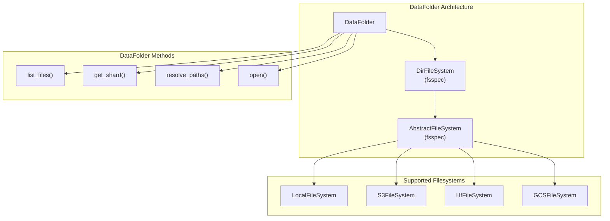
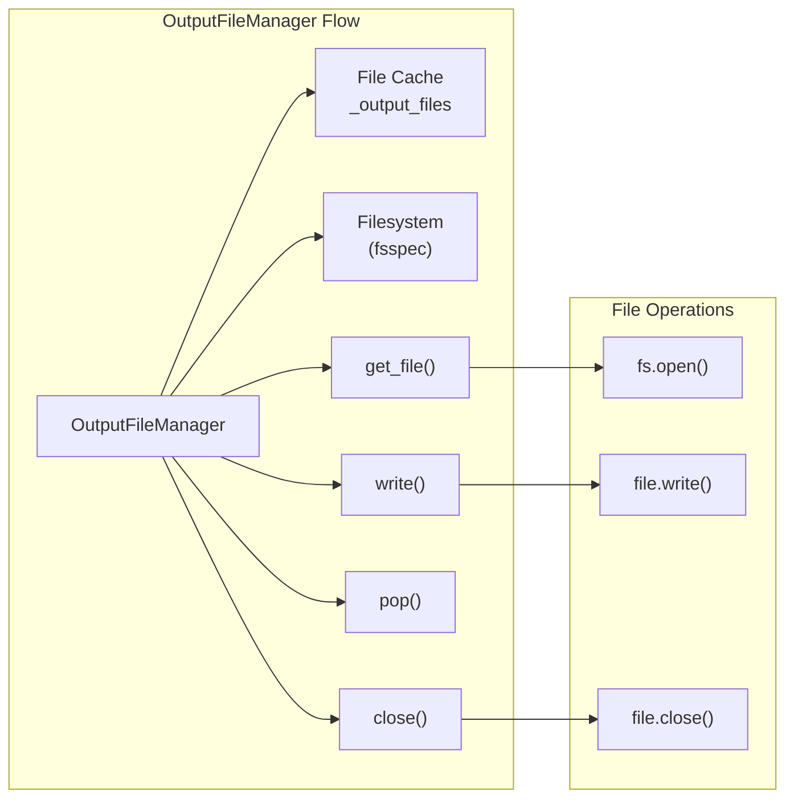
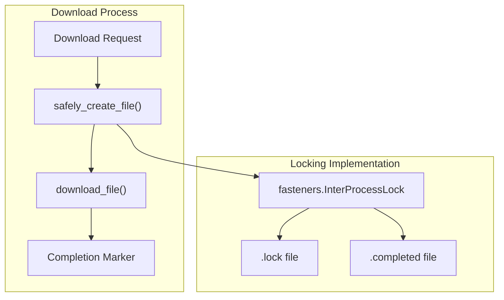

<!-- source: DeepWiki mcp.deepwiki.com · repo huggingface/datatrove · page 8 I/O and File System Abstraction · fetched 2026-10-26 -->

# I/O and File System Abstraction

Relevant source files

The following files were used as context for generating this wiki page:

- [pyproject.toml](pyproject.toml)
- [src/datatrove/io.py](src/datatrove/io.py)
- [src/datatrove/pipeline/inference/distributed/__init__.py](src/datatrove/pipeline/inference/distributed/__init__.py)
- [src/datatrove/tools/check_dataset.py](src/datatrove/tools/check_dataset.py)
- [src/datatrove/utils/_import_utils.py](src/datatrove/utils/_import_utils.py)
- [src/datatrove/utils/dataset.py](src/datatrove/utils/dataset.py)
- [src/datatrove/utils/logging.py](src/datatrove/utils/logging.py)
- [tests/pipeline/writers/test_disk_writer.py](tests/pipeline/writers/test_disk_writer.py)
- [tests/test_io.py](tests/test_io.py)
- [uv.lock](uv.lock)

This document covers the file system abstraction layer in `datatrove`, which provides unified access to local and remote storage systems through `fsspec` integration. The system enables seamless reading from and writing to various storage backends including local filesystems, cloud storage (S3, GCS), and Hugging Face Hub repositories.

For information about data reading from specific sources, see [Data Readers](). For data writing and output formatting, see [Data Writers]().

## Purpose and Scope

The I/O abstraction layer serves as the foundation for all file operations in `datatrove` pipelines. It provides:

- Unified interface for local and remote file systems through the `DataFolder` abstraction [src/datatrove/io.py:89-99]()
- Efficient management of multiple output files via `OutputFileManager` [src/datatrove/io.py:17-25]()
- Automatic directory creation and file path resolution [src/datatrove/io.py:105-117]()
- Integration with `fsspec` for supporting diverse storage backends [src/datatrove/io.py:101-116]()
- Thread-safe file operations with locking mechanisms for downloads [src/datatrove/io.py:330-360]()

## Core Abstractions

### DataFolder Class

The `DataFolder` class extends `fsspec`'s `DirFileSystem` to provide a high-level interface for directory-based file operations. It serves as the primary abstraction for handling collections of files in `datatrove` pipelines.

**DataFolder Architecture**

Sources: [src/datatrove/io.py:89-118]()

Key capabilities include:
- **File Discovery**: The `list_files()` method supports recursive listing with glob patterns and directory filtering [src/datatrove/io.py:119-162]().
- **Sharding**: The `get_shard()` method enables deterministic file distribution across multiple workers by selecting files at indices `rank::world_size` [src/datatrove/io.py:164-180]().
- **Path Resolution**: The `resolve_paths()` method converts relative paths into complete paths including protocols [src/datatrove/io.py:182-194]().
- **Auto-mkdir**: Automatic creation of parent directories when opening files in write mode [src/datatrove/io.py:117](), [src/datatrove/io.py:221-224]().

### OutputFileManager Class

The `OutputFileManager` provides efficient handling of multiple output files with automatic resource cleanup and file caching.

**OutputFileManager Data Flow**

Sources: [src/datatrove/io.py:17-87]()

The manager operates as a context manager [src/datatrove/io.py:74-75]() and maintains a cache of open file handles in `self._output_files` [src/datatrove/io.py:31]() to avoid repeated file opening operations. It supports compression inference [src/datatrove/io.py:43]() and ensures all files are closed on exit [src/datatrove/io.py:85-86]().

## FileSystem Integration

### fsspec Backend Support

The system leverages `fsspec` to provide transparent access to different storage backends. Protocol detection is handled via `url_to_fs` [src/datatrove/io.py:116]().

**Storage Backend Mapping**
| Protocol | Code Entity / Backend | Source |
|----------|-----------------------|--------|
| `file://` | `LocalFileSystem` | [src/datatrove/io.py:10]() |
| `s3://` | `s3fs.S3FileSystem` | [pyproject.toml:50-52]() |
| `hf://` | `huggingface_hub.HfFileSystem` | [src/datatrove/io.py:11]() |
| `gcs://` | `gcsfs.GCSFileSystem` | [src/datatrove/io.py:101-116]() |

Special optimizations exist for `HfFileSystem` operations, such as setting `expand_info=False` during file listing to improve performance [src/datatrove/io.py:143-144]().

### Caching and Performance

The system includes a helper `_get_true_fs` to unwrap `CachingFileSystem` or `DirFileSystem` wrappers to access the underlying filesystem instance [src/datatrove/io.py:411-416](). This is used to check for specific backend types like `HfFileSystem` [src/datatrove/io.py:143]().

## File Operation Utilities

### Download and Caching System

The system provides robust file downloading with progress tracking and process-safe caching via `safely_create_file` [src/datatrove/io.py:330-360]().

**Download Locking Mechanism**

Sources: [src/datatrove/io.py:330-360](), [src/datatrove/utils/dataset.py:17]()

The system uses `.lock` and `.completed` files to ensure that only one process downloads a specific resource at a time, preventing data corruption or redundant network usage [src/datatrove/io.py:336-357]().

### Shard Management

For distributed processing, the system provides `get_shard_from_paths_file` to read a list of paths from a file (potentially compressed) and distribute them across workers [src/datatrove/io.py:404-408]().

**Shard Distribution Logic**

Sources: [src/datatrove/io.py:404-408](), [tests/test_io.py:83-123]()

## Type System and Factory Functions

### Type Aliases

The library defines flexible type aliases to allow users to pass strings, tuples with options, or pre-initialized objects:
- `DataFolderLike`: `str | DataFolder | tuple[str, dict] | tuple[str, AbstractFileSystem]` [src/datatrove/io.py:245-248]()
- `DataFileLike`: `str | tuple[str, dict] | tuple[str, AbstractFileSystem]` [src/datatrove/io.py:249-250]()

### Factory Functions

Factory functions normalize these inputs into concrete objects:
- `get_datafolder(data_folder)`: Returns a `DataFolder` instance [src/datatrove/io.py:251-283]().
- `get_fs_with_filepath(file_path)`: Returns a tuple of `(AbstractFileSystem, str)` [src/datatrove/io.py:286-298]().

**Input Normalization Table**
| Input Type | Resulting Code Entity | Source |
|------------|-----------------------|--------|
| `str` | New `DataFolder` or `fs` via `url_to_fs` | [src/datatrove/io.py:277](), [src/datatrove/io.py:295]() |
| `tuple[str, dict]` | `DataFolder` with `storage_options` | [src/datatrove/io.py:273-275]() |
| `tuple[str, fs]` | `DataFolder` using provided `fs` | [src/datatrove/io.py:270-272]() |
| `DataFolder` | Returns object as-is | [src/datatrove/io.py:268-269]() |

Sources: [src/datatrove/io.py:251-298]()

---

