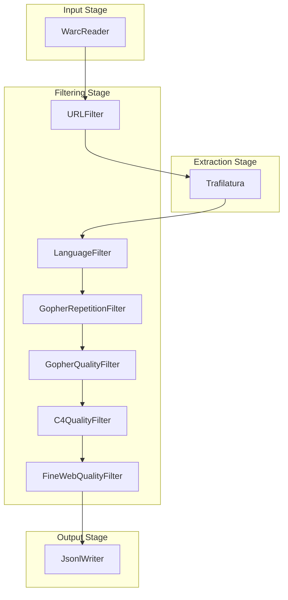
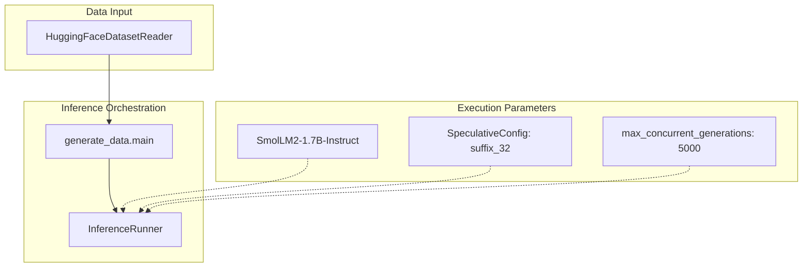
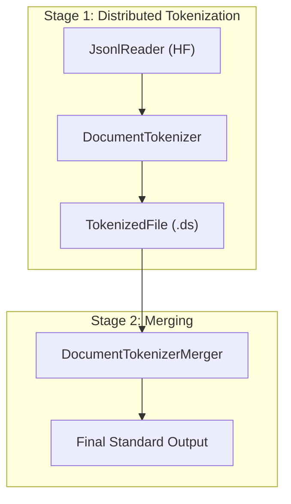

<!-- source: DeepWiki mcp.deepwiki.com · repo huggingface/datatrove · page 9 Example Pipelines and Use Cases · fetched 2026-10-26 -->

# Example Pipelines and Use Cases

Relevant source files

The following files were used as context for generating this wiki page:

- [examples/estimate_tokens.py](examples/estimate_tokens.py)
- [examples/exact_substrings.py](examples/exact_substrings.py)
- [examples/filter_hf_dataset.py](examples/filter_hf_dataset.py)
- [examples/fineweb.py](examples/fineweb.py)
- [examples/inference/finephrase.py](examples/inference/finephrase.py)
- [examples/inference/inference_chunked.py](examples/inference/inference_chunked.py)
- [examples/minhash_deduplication.py](examples/minhash_deduplication.py)
- [examples/process_common_crawl_dump.py](examples/process_common_crawl_dump.py)
- [examples/sentence_deduplication.py](examples/sentence_deduplication.py)
- [examples/smol_data.py](examples/smol_data.py)
- [examples/tokenize_c4.py](examples/tokenize_c4.py)
- [examples/url_deduplication.py](examples/url_deduplication.py)
- [src/datatrove/pipeline/dedup/__init__.py](src/datatrove/pipeline/dedup/__init__.py)
- [src/datatrove/utils/binaryio.py](src/datatrove/utils/binaryio.py)

This page provides concrete examples of complete DataTrove pipelines for common use cases. Each example demonstrates how to combine readers, processors, filters, and writers to accomplish specific data processing tasks. For detailed information about individual pipeline components, see the respective sections: [Data Readers](#4.1), [Content Extractors](#4.2), [Document Filters](#4.3), [Deduplication Subsystems](#5), and [Data Writers and Output Management](#7).

## Overview of Example Categories

DataTrove includes several production-ready example pipelines organized by use case:

| Use Case | Example Files | Primary Components |
|----------|--------------|-------------------|
| Web Data Processing | `fineweb.py`, `process_common_crawl_dump.py` | `WarcReader`, `Trafilatura`, `C4QualityFilter`, `JsonlWriter` |
| Synthetic Data Generation | `finephrase.py`, `inference_chunked.py` | `HuggingFaceDatasetReader`, `InferenceRunner`, `ParquetWriter` |
| Deduplication | `minhash_deduplication.py`, `sentence_deduplication.py`, `exact_substrings.py` | Dedup signature/filter stages |
| Tokenization | `tokenize_c4.py` | `JsonlReader`, `DocumentTokenizer`, `DocumentTokenizerMerger` |

---

## Web Data Processing Pipeline

The web data processing pipeline demonstrates reading raw web archives, extracting text, applying quality filters, and writing cleaned data.

### FineWeb Reproduction Pipeline

**FineWeb Pipeline Configuration Pattern**

The FineWeb example [examples/fineweb.py:28-73]() combines extraction and quality filtering:

1. **Input**: `WarcReader` reads Common Crawl WARC files from S3 [examples/fineweb.py:36-40]().
2. **URL Filtering**: `URLFilter` removes blacklisted URLs [examples/fineweb.py:41]().
3. **Extraction**: `Trafilatura` extracts clean text from HTML with `favour_precision=True` [examples/fineweb.py:42]().
4. **Language**: `LanguageFilter` ensures English content, writing non-English docs to a separate path [examples/fineweb.py:43-49]().
5. **Quality Cascade**: Multiple filters applied sequentially, each with an `exclusion_writer` to track removed data [examples/fineweb.py:50-62]():
   - `GopherRepetitionFilter` - Removes repetitive text.
   - `GopherQualityFilter` - Document-level quality heuristics.
   - `C4QualityFilter` - Line and sentence quality rules.
   - `FineWebQualityFilter` - Advanced filtering used for FineWeb.
6. **Output**: `JsonlWriter` saves the final processed documents [examples/fineweb.py:63]().

Sources: [examples/fineweb.py:28-73](), [examples/process_common_crawl_dump.py:23-51]()

---

## Synthetic Data Generation Pipelines

The inference system enables large-scale synthetic data generation using language models.

### FinePhrase Production Pipeline

**FinePhrase Configuration**

The FinePhrase example [examples/inference/finephrase.py:22-46]() uses a highly optimized configuration for large-scale generation:
- **Input**: `fineweb-edu` (sample-350BT) [examples/inference/finephrase.py:28-29]().
- **Model**: `SmolLM2-1.7B-Instruct` [examples/inference/finephrase.py:25]().
- **Optimization**: Uses speculative decoding (`suffix` method with 32 tokens) and high concurrency (5000 generations) [examples/inference/finephrase.py:35-40]().
- **Templates**: Defines multiple rewrite tasks (math, table, faq, tutorial) to generate varied synthetic data [examples/inference/finephrase.py:48-76]().

Sources: [examples/inference/finephrase.py:1-116]()

---

## Deduplication Pipelines

### MinHash Deduplication Pipeline

MinHash is implemented as a 4-stage pipeline [examples/fineweb.py:102-180]().

| Stage | Class | Purpose |
|-------|-------|---------|
| 1 | `MinhashDedupSignature` | Computes MinHash signatures for each document [examples/fineweb.py:107-109](). |
| 2 | `MinhashDedupBuckets` | Groups signatures into buckets to find potential matches [examples/fineweb.py:123-127](). |
| 3 | `MinhashDedupCluster` | Clusters matches into duplicate sets (runs on 1 task) [examples/fineweb.py:144-148](). |
| 4 | `MinhashDedupFilter` | Reads original data and removes duplicates based on cluster IDs [examples/fineweb.py:166](). |

Sources: [examples/fineweb.py:75-181](), [examples/minhash_deduplication.py:1-112]()

### Sentence Deduplication Pipeline

Sentence-level deduplication follows a 3-stage pattern [examples/sentence_deduplication.py:17-25]():

1. **Signature**: `SentenceDedupSignature` hashes N-sentence spans (default 3) [examples/sentence_deduplication.py:45]().
2. **Find**: `SentenceFindDedups` identifies duplicate spans across the dataset [examples/sentence_deduplication.py:48]().
3. **Filter**: `SentenceDedupFilter` removes the identified duplicate spans from the documents [examples/sentence_deduplication.py:52]().

Sources: [examples/sentence_deduplication.py:1-68]()

### Exact Substring Deduplication

This pipeline integrates with external tools for suffix array construction [examples/exact_substrings.py:13-34]():

1. **Mapping**: `ESDatasetToSequence` maps files into a single sequence with unique separators [examples/exact_substrings.py:44]().
2. **Merging**: `ESMergeSequences` combines sequences into one large file for suffix array building [examples/exact_substrings.py:48-52]().
3. **Removal**: After external duplicate finding, `ESRangeRemover` deletes duplicate byte ranges from the documents [examples/exact_substrings.py:65-67]().

Sources: [examples/exact_substrings.py:1-74]()

---

## Tokenization Pipeline

The tokenization workflow typically involves two stages to ensure efficient data storage and merging.

**Implementation Details**

- **Stage 1**: `DocumentTokenizer` processes raw text from `JsonlReader` (e.g., C4 from HuggingFace) and saves binary `.ds` files [examples/tokenize_c4.py:13-21]().
- **Stage 2**: `DocumentTokenizerMerger` takes the tokenized shards and merges them into a standardized format, often running on a single task to finalize the dataset [examples/tokenize_c4.py:34-38]().
- **Execution**: The merger stage depends on the successful completion of the tokenization stage [examples/tokenize_c4.py:45]().

Sources: [examples/tokenize_c4.py:1-48]()

---

## Data Mixture and Subsampling

DataTrove is used to create specific dataset mixtures (e.g., for the `smol-data` collection).

### Mixture Creation Workflow

The `smol_data.py` script demonstrates how to create a 50-30-20 mixture from multiple sources [examples/smol_data.py:1-15]():

1. **Source Sampling**: `SamplerFilter` is used to subsample individual datasets (e.g., FineWeb, DCLM) to a target token count (e.g., 100B) [examples/smol_data.py:144-151]().
2. **Schema Alignment**: `MIXTURE_SCHEMA` defines the intersection of columns across different sources to ensure compatibility [examples/smol_data.py:65-72]().
3. **Sequential Commits**: Components for a mixture are chained via Slurm dependencies to avoid concurrent write conflicts to the same Hugging Face repository [examples/smol_data.py:168-196]().

Sources: [examples/smol_data.py:1-200]()

---

