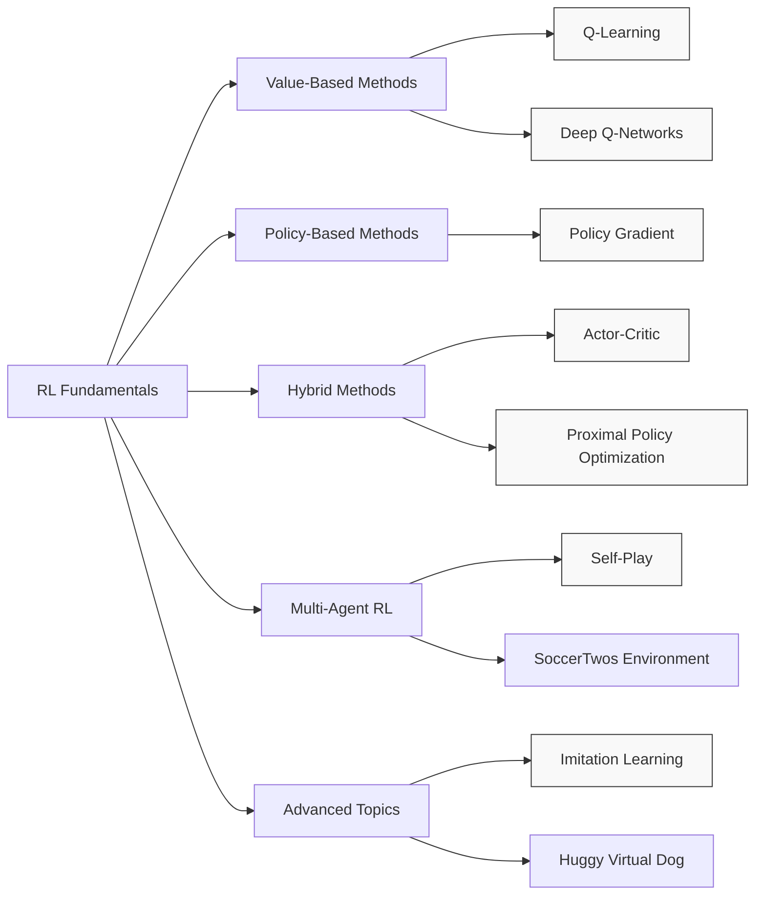
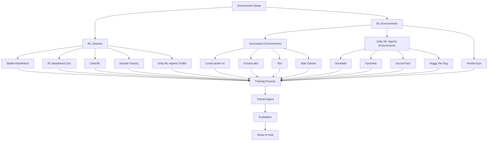

<!-- source: DeepWiki mcp.deepwiki.com · repo huggingface/deep-rl-class · page 1 Overview · fetched 2026-10-26 -->

# Overview

Relevant source files

The following files were used as context for generating this wiki page:

- [README.md](README.md)
- [units/en/unit0/discord101.mdx](units/en/unit0/discord101.mdx)
- [units/en/unit0/introduction.mdx](units/en/unit0/introduction.mdx)
- [units/en/unit0/setup.mdx](units/en/unit0/setup.mdx)
- [units/en/unit1/introduction.mdx](units/en/unit1/introduction.mdx)

The Deep Reinforcement Learning Course by Hugging Face is a comprehensive educational resource designed to teach Deep Reinforcement Learning (Deep RL) from beginner to expert level. This document provides an overview of the course structure, content, and resources available in the [huggingface/deep-rl-class](https://github.com/huggingface/deep-rl-class) repository.

For detailed information about getting started with the course, see [Getting Started](#1.2).

## Course Purpose and Scope

The Deep Reinforcement Learning Course aims to provide both theoretical foundations and practical implementations of Deep RL techniques. The course is:

- **Free and open-source**: All materials are freely accessible
- **Self-paced**: No deadlines, learn at your own speed
- **Practical**: Combines theory with hands-on exercises
- **Community-driven**: Includes Discord community support and challenges

While the course is now in a low-maintenance state, it remains a valuable resource for learning Deep RL concepts and implementations.

Sources: [README.md:15-26](), [units/en/unit0/introduction.mdx:5-18](), [units/en/unit0/introduction.mdx:39-51]()

## Course Structure

### Course Content Organization

```mermaid
graph TD
    Course["Deep RL Course"]
    Course --> Theory["Theory Units"]
    Course --> Practice["Hands-on Exercises"]
    Course --> Community["Community Resources"]
    
    Theory --> U1["Unit 1: RL Fundamentals"]
    Theory --> U2["Unit 2: Q-Learning"]
    Theory --> U3["Unit 3: Deep Q-Networks"]
    Theory --> U4["Unit 4: Policy Gradient"]
    Theory --> U5["Unit 5: Unity ML-Agents"]
    Theory --> U6["Unit 6: Actor-Critic"]
    Theory --> U7["Unit 7: Multi-Agent RL"]
    Theory --> U8["Unit 8: PPO"]
    Theory --> Bonus["Bonus Units"]
    
    Practice --> LunarLander["LunarLander with SB3"]
    Practice --> FrozenLake["Q-Learning with FrozenLake/Taxi"]
    Practice --> Atari["DQN with Atari Games"]
    Practice --> Unity["Training in Unity Environments"]
    Practice --> RoboEnv["A2C with Robotics Environments"]
    Practice --> Soccer["Multi-Agent SoccerTwos"]
    Practice --> PPOImpl["PPO Implementation"]
    Practice --> HuggyDog["Huggy: Virtual Dog Training"]
    
    Community --> Discord["Discord Server"]
    Community --> HFHub["Hugging Face Hub Integration"]
    Community --> Challenges["AI vs AI Challenges"]
```

Sources: [units/en/unit0/introduction.mdx:53-61](), [units/en/unit0/introduction.mdx:63-67]()

### Learning Pathways

The course offers two main learning paths:

1. **Self-audit**: Participate in all content without pursuing certification
2. **Certification process**:
   - **Certificate of Completion**: Complete 80% of assignments
   - **Certificate of Honors**: Complete 100% of assignments

Each unit is designed to be completed in approximately one week, requiring 3-4 hours of work.

Sources: [units/en/unit0/introduction.mdx:69-81](), [units/en/unit0/introduction.mdx:85-95](), [units/en/unit0/introduction.mdx:117-119]()

## Deep RL Methods Covered

The course follows a progression from fundamental RL concepts to advanced techniques:

Sources: [units/en/unit0/introduction.mdx:63-67](), [units/en/unit1/introduction.mdx:6-27]()

## Hands-on Exercises and Implementation

Each theoretical unit is paired with practical hands-on exercises where students implement the algorithms using established RL libraries:

Sources: [units/en/unit0/introduction.mdx:23-35](), [units/en/unit1/introduction.mdx:13-23]()

## Course Components

The course includes several key components:

| Component | Description |
|-----------|-------------|
| Theory Content | Foundational explanations of RL concepts and algorithms |
| Hands-on Exercises | Google Colab notebooks with practical implementations |
| Tutorial Videos | Companion videos explaining hands-on exercises |
| Challenges | Leaderboards and AI vs AI competitions |
| Community | Discord server for discussions and study groups |
| Hugging Face Hub | Platform for sharing trained models and demos |

Sources: [units/en/unit0/introduction.mdx:54-60](), [units/en/unit0/introduction.mdx:23-35]()

## Requirements and Setup

To participate in the course, you need:

1. A computer with internet connection
2. Google Colab (free version)
3. A Hugging Face account (for pushing and loading models)
4. (Optional) Discord account to join the community

The onboarding process involves:
1. Creating a Hugging Face account
2. Joining the Discord server for community support
3. Accessing the course materials at https://huggingface.co/deep-rl-course/unit0/introduction

Sources: [units/en/unit0/setup.mdx:1-28](), [units/en/unit0/introduction.mdx:107-113]()

## Discord Community

The course has an active Discord community with dedicated channels:

- `rl-announcements`: Course updates and information
- `rl-discussions`: General discussions about RL
- `rl-study-group`: Questions and exchanges with classmates
- `rl-i-made-this`: Sharing projects and models

Joining the Discord community is recommended for participating in study groups and getting support from peers and instructors.

Sources: [units/en/unit0/discord101.mdx:1-37](), [units/en/unit0/setup.mdx:12-26]()

## Maintenance Status

The Deep Reinforcement Learning course is currently in a low-maintenance state. Key points to note:

- All theory content and practical exercises remain accessible and effective
- Unit 7's AI vs AI feature is non-functional, but training agents is still possible
- The leaderboard is no longer operational
- The issue sections in the repository may provide solutions to bugs encountered in hands-on exercises

Sources: [README.md:15-27](), [units/en/unit0/introduction.mdx:39-51]()

---

