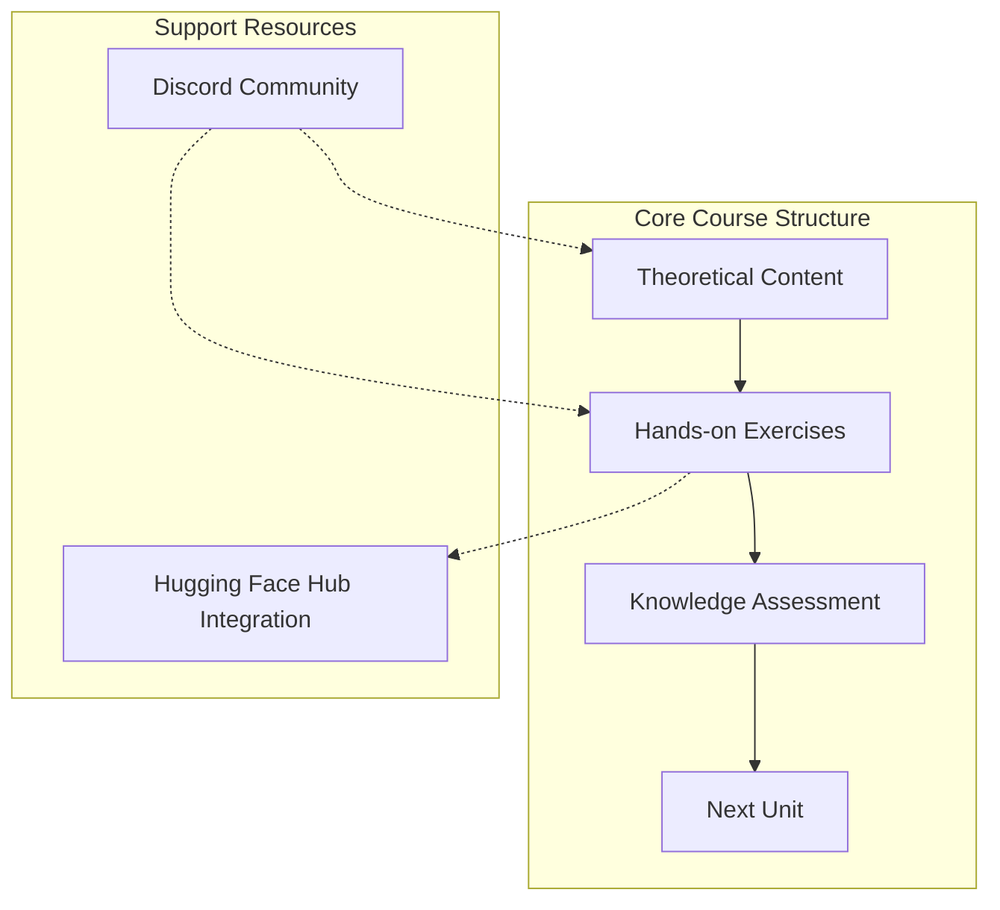
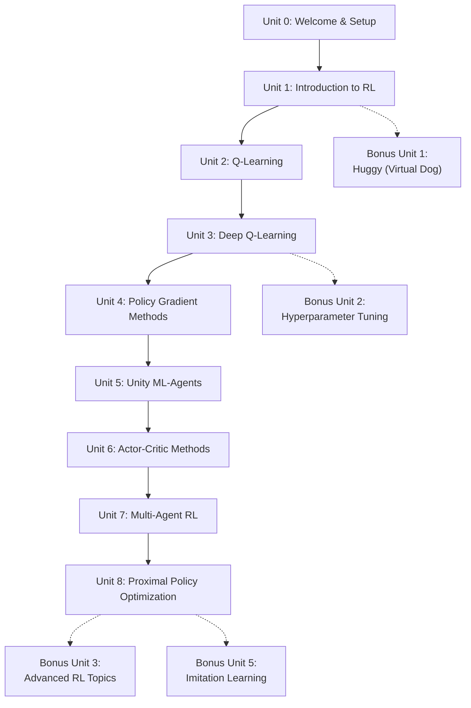
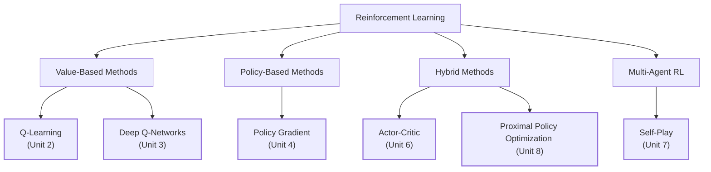
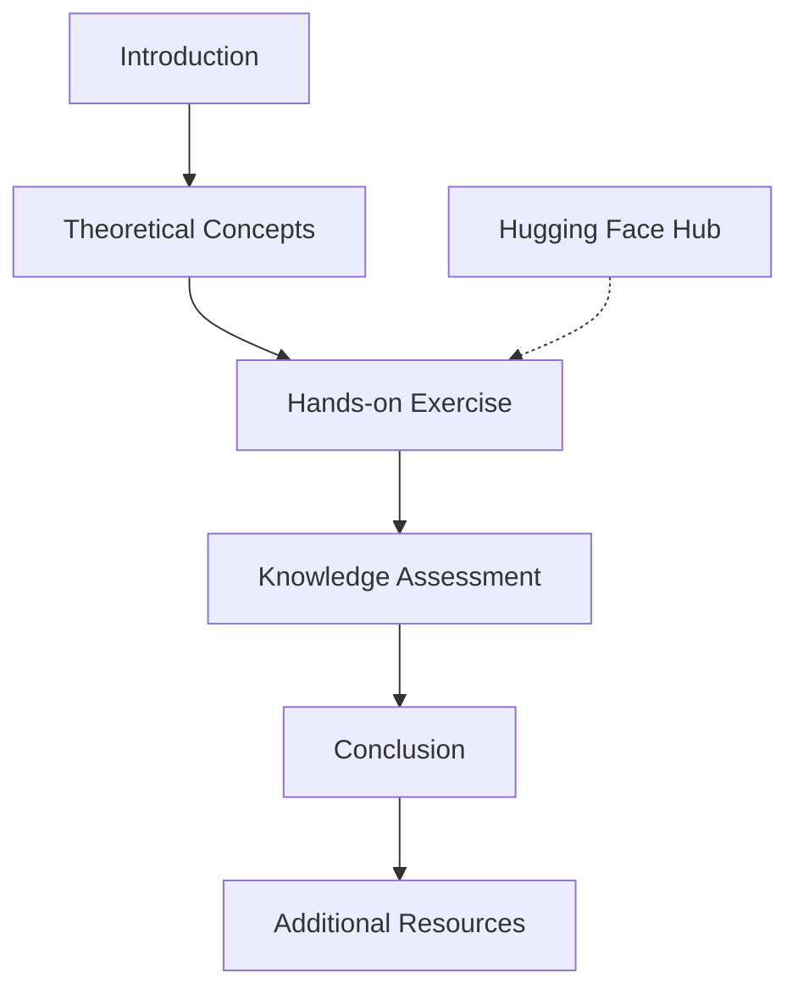
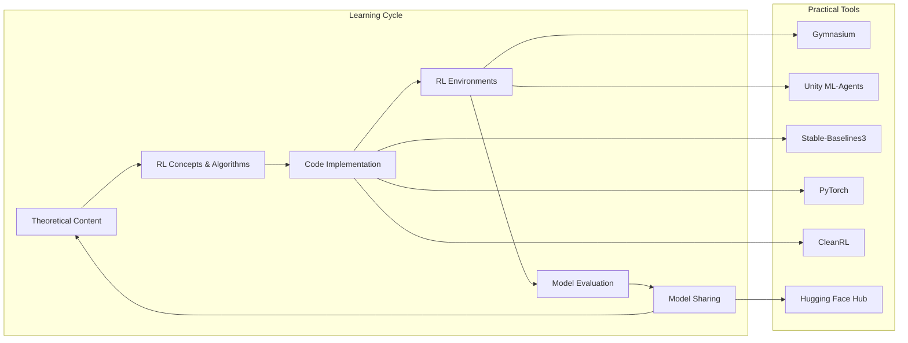

<!-- source: DeepWiki mcp.deepwiki.com · repo huggingface/deep-rl-class · page 1.1 Course Structure · fetched 2026-10-26 -->

# Course Structure

Relevant source files

The following files were used as context for generating this wiki page:

- [README.md](README.md)
- [units/en/_toctree.yml](units/en/_toctree.yml)
- [units/en/unit7/quiz.mdx](units/en/unit7/quiz.mdx)

This page provides a comprehensive overview of the Deep Reinforcement Learning Course organization, learning path progression, and content structure. For information about getting started with the course, see [Getting Started](#1.2), and for details on course completion certification, refer to [Certification Process](#1.3).

## Overview of Course Components

The Deep Reinforcement Learning Course consists of a carefully structured learning journey that combines theoretical foundations with hands-on implementation. The course is designed to progressively build knowledge from basic reinforcement learning concepts to advanced algorithms and techniques.

Sources: [README.md:6-17](). [units/en/_toctree.yml:1-261]().

## Units Progression and Topics

The course follows a logical progression from fundamental reinforcement learning concepts to advanced techniques, with each unit building on knowledge from previous units. Below is the course's main learning path:

Sources: [units/en/_toctree.yml:1-261]().

## Reinforcement Learning Methods Hierarchy

The course presents reinforcement learning techniques in a progressive manner, moving from basic algorithms to more complex approaches:

Sources: [units/en/_toctree.yml:9-204]().

## Detailed Unit Breakdown

Each unit follows a consistent structure to ensure effective learning:

| Unit | Main Focus | Environments/Tools | Key Algorithms |
|------|------------|-------------------|----------------|
| Unit 0 | Course Introduction & Setup | Discord | - |
| Unit 1 | RL Fundamentals | LunarLander, Stable-Baselines3 | - |
| Unit 2 | Q-Learning | FrozenLake, Taxi | Q-Learning |
| Unit 3 | Deep Q-Learning | Atari Games | DQN |
| Unit 4 | Policy Gradient | PyTorch, CartPole, PixelCopter | REINFORCE |
| Unit 5 | Unity ML-Agents | Snowball, Pyramids | Various |
| Unit 6 | Actor-Critic Methods | Panda-Gym Robotics | A2C |
| Unit 7 | Multi-Agent RL | SoccerTwos | Self-Play |
| Unit 8 | PPO | CleanRL, Sample Factory, Doom | PPO |

Sources: [units/en/_toctree.yml:1-204]().

## Bonus Units

The course includes specialized bonus units that cover additional topics:

1. **Bonus Unit 1**: Introduction to Huggy (Virtual Dog) - An interactive introduction to RL
2. **Bonus Unit 2**: Hyperparameter Tuning with Optuna - Optimizing model performance
3. **Bonus Unit 3**: Advanced RL Topics - Covering model-based RL, offline RL, RLHF, and more
5. **Bonus Unit 5**: Imitation Learning with Godot RL Agents - Learning from demonstrations

Sources: [units/en/_toctree.yml:37-254]().

## Unit Structure

Each regular unit in the course follows a consistent structure to provide both theoretical understanding and practical implementation:

Sources: [units/en/_toctree.yml:9-36](), [units/en/unit7/quiz.mdx:1-140]().

## Theory and Practice Integration

A key feature of the course is the tight integration between theoretical concepts and hands-on implementation:

Sources: [units/en/_toctree.yml:1-261]().

## Assessment Methods

The course employs quizzes for each unit to test understanding of concepts and reinforce learning:

1. **Multiple-choice questions**: Testing understanding of key concepts
2. **Open-ended questions**: Requiring explanations of algorithms and approaches
3. **Parameter identification**: Testing understanding of algorithm configurations

The quizzes help learners identify areas where they need to reinforce their knowledge and avoid the "illusion of competence" in learning.

Sources: [units/en/unit7/quiz.mdx:1-140]().

## Maintenance Status

It's important to note that the course is currently in a low-maintenance state, but remains an excellent resource for learning both theoretical and practical aspects of Deep Reinforcement Learning. Some specific features that are no longer operational include:

- Unit 7 (AI vs AI feature): While you can still train agents to play soccer, the AI vs AI competition feature is non-functional
- Leaderboard: The leaderboard system is no longer operational

All other theoretical content and practical exercises remain fully accessible and effective for learning.

Sources: [README.md:15-25]().

## Course Navigation Tips

For the best learning experience:

1. **Follow sequential order**: Units build upon previous knowledge
2. **Complete hands-on exercises**: Practical implementation reinforces theoretical understanding
3. **Utilize the Discord community**: For troubleshooting and discussion
4. **Check issue sections**: For community solutions to any bugs encountered in hands-on exercises

Sources: [README.md:27-27]().

---

