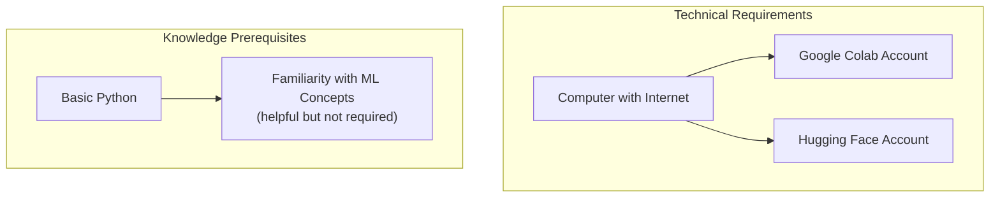
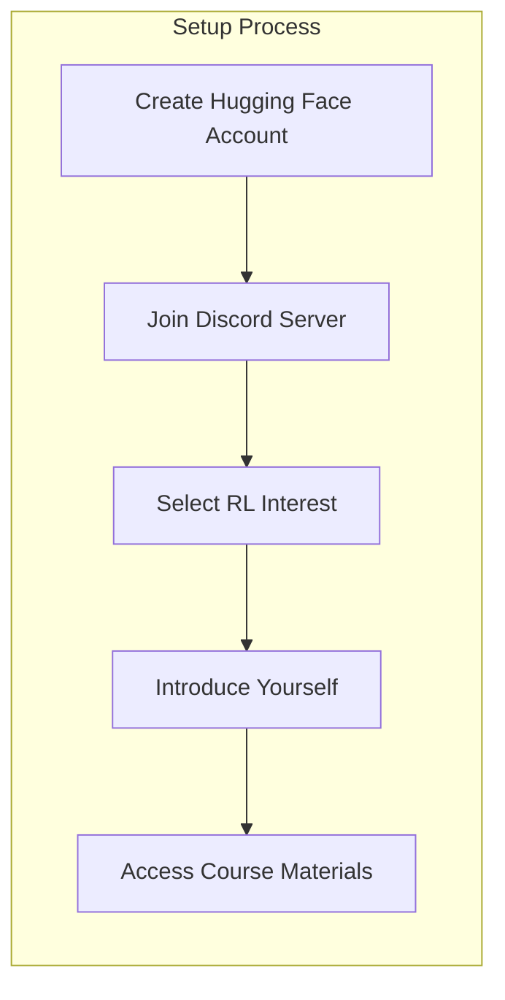
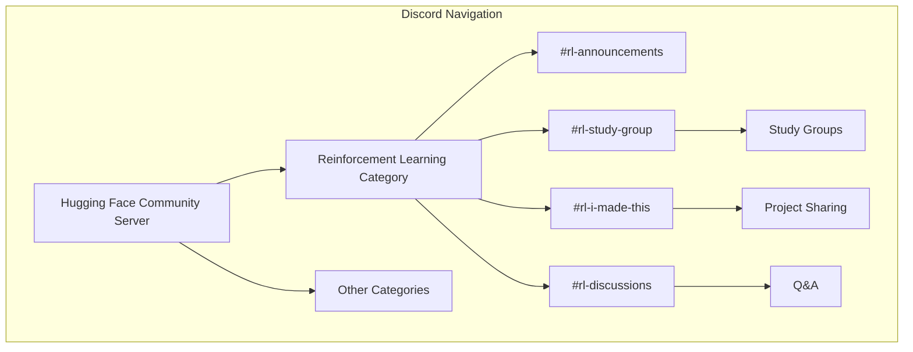
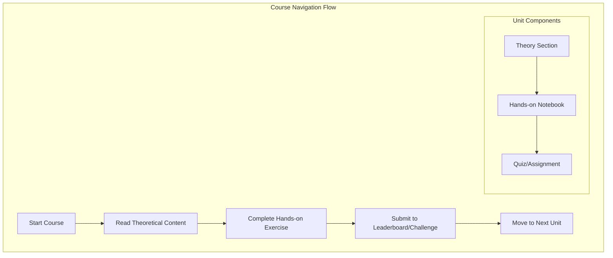
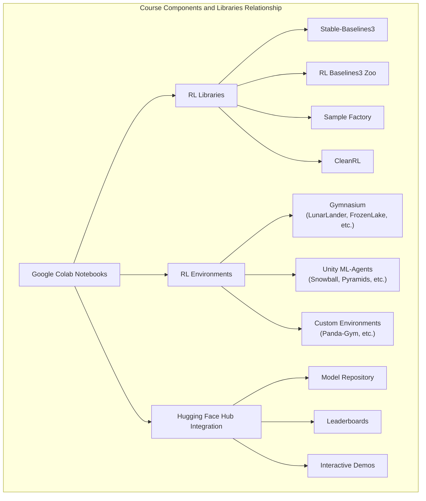
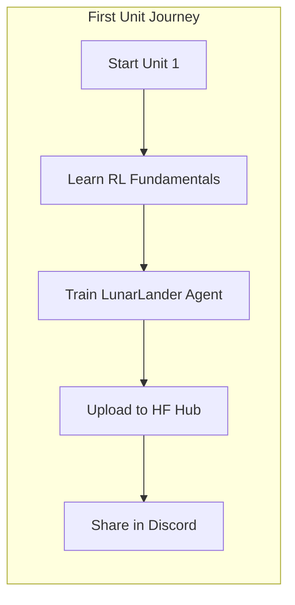

<!-- source: DeepWiki mcp.deepwiki.com · repo huggingface/deep-rl-class · page 1.2 Getting Started · fetched 2026-10-26 -->

# Getting Started

Relevant source files

The following files were used as context for generating this wiki page:

- [units/en/unit0/discord101.mdx](units/en/unit0/discord101.mdx)
- [units/en/unit0/introduction.mdx](units/en/unit0/introduction.mdx)
- [units/en/unit0/setup.mdx](units/en/unit0/setup.mdx)
- [units/en/unit1/introduction.mdx](units/en/unit1/introduction.mdx)

This page guides you through the initial setup process for the Deep Reinforcement Learning course. It covers the technical prerequisites, account creation, Discord onboarding, and how to prepare for your learning journey. For information about the course structure and syllabus, see [Course Structure](#1.1), and for details about certification, see [Certification Process](#1.3).

## Prerequisites

Before starting the course, ensure you have:

1. **A computer with internet connection**
2. **Google Colab (free version)** - Most hands-on exercises use Google Colab, and the free version is sufficient
3. **Hugging Face Account** - Required for pushing and loading models

No specialized hardware is required as the course exercises are designed to run on Google Colab's free tier.

Sources: [units/en/unit0/introduction.mdx:107-113]()

## Account Setup Process

The course requires two accounts to fully participate: a Hugging Face account and Discord access.

### 1. Creating a Hugging Face Account

1. Visit [https://huggingface.co/join](https://huggingface.co/join) to create a free account
2. Complete the registration process
3. Your account will allow you to:
   - Push trained models to the Hugging Face Hub
   - Participate in the leaderboard
   - Access interactive demos

### 2. Joining the Discord Community

The Discord server is the central hub for communication, where you can:
- Get help from the community and course staff
- Join study groups with fellow students
- Receive announcements about course updates
- Share your projects and achievements

To join:
1. Visit the invitation link: [https://discord.gg/ydHrjt3WP5](https://discord.gg/ydHrjt3WP5)
2. Create a Discord account if you don't have one
3. Select "Reinforcement Learning" as an interest to access course-specific channels
4. Introduce yourself in the `#introduce-yourself` channel

Sources: [units/en/unit0/setup.mdx:1-19](), [units/en/unit0/discord101.mdx:8-14]()

## Navigating Discord

The Discord server has several dedicated channels for the Deep RL course:

| Channel | Purpose |
|---------|---------|
| `#rl-announcements` | Course updates and important information |
| `#rl-discussions` | General discussions about reinforcement learning |
| `#rl-study-group` | Find and join study groups, ask questions |
| `#rl-i-made-this` | Share your projects and trained models |

If you're new to Discord, here are some helpful tips:
- Use markdown formatting for code blocks
- Start threads for longer conversations
- Voice channels are available for study groups
- You can directly message other participants

Sources: [units/en/unit0/discord101.mdx:17-26](), [units/en/unit0/setup.mdx:20-25]()

## Course Access and Navigation

The Deep RL course follows a logical progression through different reinforcement learning concepts. Here's how to navigate through the course:

### Course Structure

The course is structured with:
- **Theoretical units** - Covering RL concepts and algorithms
- **Hands-on exercises** - Google Colab notebooks with tutorial videos
- **Challenges** - Opportunities to benchmark your agents against others

Sources: [units/en/unit0/introduction.mdx:53-60]()

### Recommended Pace

Each unit is designed to be completed in approximately one week, requiring 3-4 hours of work. However, the course is self-paced with no deadlines, so you can progress at your own speed.

For optimal learning experience:
- Join a study group on Discord
- Complete quizzes and assignments as you go
- Define a personal schedule to maintain momentum

If you're aiming for certification, remember:
- Certificate of completion: Complete 80% of assignments
- Certificate of honors: Complete 100% of assignments

Sources: [units/en/unit0/introduction.mdx:117-119](), [units/en/unit0/introduction.mdx:96-105]()

## Hands-on Environment Setup

The hands-on exercises use various RL environments and libraries. Here's what you'll be working with throughout the course:

Sources: [units/en/unit0/introduction.mdx:25-28](), [units/en/unit1/introduction.mdx:13-16]()

## First Steps

After completing your setup:

1. **Start with Unit 1** - This introduces the foundations of Deep Reinforcement Learning
2. **Complete the first hands-on exercise** - Train a lunar lander agent using Stable-Baselines3
3. **Share your trained agent** - Upload it to the Hugging Face Hub
4. **Engage with the community** - Discuss what you've learned in the Discord server

Sources: [units/en/unit1/introduction.mdx:10-19]()

## Troubleshooting

If you encounter issues during setup or while working through the course:

1. **Check the issues section** of the GitHub repository where community solutions to common bugs are posted
2. **Ask for help in the `#rl-discussions` channel** on Discord
3. **Look for similar problems** that others might have already solved

Sources: [units/en/unit0/introduction.mdx:51-52](), [units/en/unit0/introduction.mdx:141-142]()

By following this guide, you should be fully prepared to start your journey in Deep Reinforcement Learning. Remember, the community is there to help you succeed, so don't hesitate to engage and ask questions!

---

