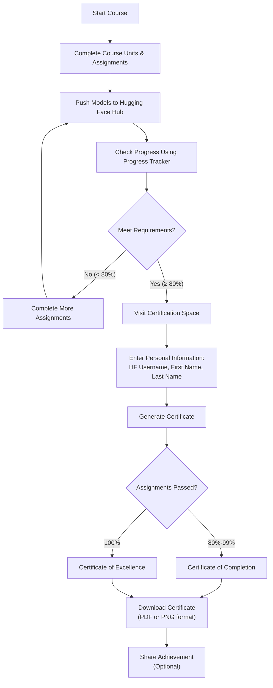
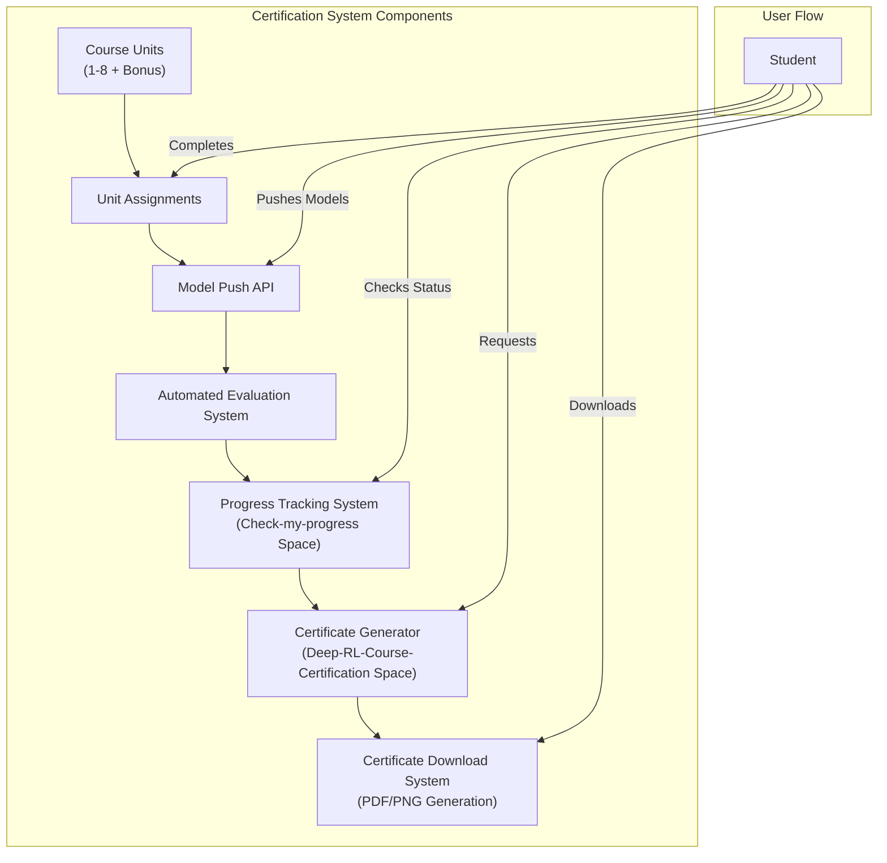
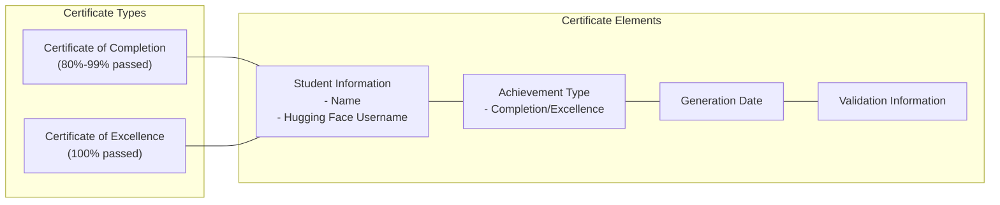

<!-- source: DeepWiki mcp.deepwiki.com · repo huggingface/deep-rl-class · page 1.3 Certification Process · fetched 2026-10-26 -->

# Certification Process

<details>
<summary>Relevant source files</summary>

The following files were used as context for generating this wiki page:

- [units/en/communication/certification.mdx](units/en/communication/certification.mdx)
- [units/en/communication/conclusion.mdx](units/en/communication/conclusion.mdx)

</details>


This document outlines the certification system for the Deep Reinforcement Learning Course, including the requirements for obtaining certificates, the verification process, and how to generate your certificate upon completion.

## Overview

The Deep RL Course offers a free certification process to validate your knowledge and skills in reinforcement learning. There are two types of certificates available based on your assignment completion rate. The certification process is self-paced with no deadlines.

### Certification Flow

The following diagram illustrates the end-to-end certification process:



Sources: [units/en/communication/certification.mdx:4-29]()

## Certification Requirements

The certification process is completely free and offers two levels of achievement:

| Certificate Type | Requirements |
|------------------|--------------|
| Certificate of Completion | Pass at least 80% of the assignments |
| Certificate of Excellence | Pass 100% of the assignments |

### Definition of "Passing" an Assignment

To pass an assignment, you must:
1. Push your trained model to the Hugging Face Hub
2. Achieve a result that meets or exceeds the minimum requirement for that specific unit

Sources: [units/en/communication/certification.mdx:4-13]()

## Technical Implementation

The certification system is integrated with the Hugging Face Hub infrastructure and includes the following components:



Sources: [units/en/communication/certification.mdx:13-29]()

## Obtaining Your Certificate

### Checking Your Progress

Before requesting your certificate, check your progress through the course using the Progress Tracker:

```
https://huggingface.co/spaces/ThomasSimonini/Check-my-progress-Deep-RL-Course
```

This tool shows which units you have successfully passed and those that still need completion.

Sources: [units/en/communication/certification.mdx:15]()

### Certificate Generation Process

Once you have completed the required percentage of assignments, follow these steps to obtain your certificate:

1. Visit the Deep RL Course Certification Space: 
   ```
   https://huggingface.co/spaces/huggingface-projects/Deep-RL-Course-Certification/
   ```

2. Enter your information:
   - Your Hugging Face username
   - Your first name
   - Your last name

3. Click "Generate my certificate"

4. The system will automatically:
   - Check your completion percentage across all assignments
   - Generate the appropriate certificate type based on your performance
   - Provide downloadable files in PDF and PNG formats

Sources: [units/en/communication/certification.mdx:17-27]()

## Certificate Types and Verification

The two types of certificates feature visual differences to indicate the level of achievement:



Sources: [units/en/communication/certification.mdx:22-27]()

### Sharing Your Achievement

After receiving your certificate, you are encouraged to share your achievement on social media platforms like Twitter and LinkedIn. When sharing on Twitter, you can tag @ThomasSimonini and @huggingface to connect with the course creator and the Hugging Face team.

Sources: [units/en/communication/certification.mdx:29](), [units/en/communication/conclusion.mdx:16-20]()

## Next Steps After Certification

Completing the course and receiving your certificate is just the beginning of your reinforcement learning journey. You can continue learning by:

- Exploring the bonus units for advanced topics (see [Bonus Units](#10))
- Joining the Discord server to connect with other learners
- Contributing to open-source reinforcement learning projects
- Applying your skills to new RL problems and environments

Sources: [units/en/communication/conclusion.mdx:6-14]()

---

