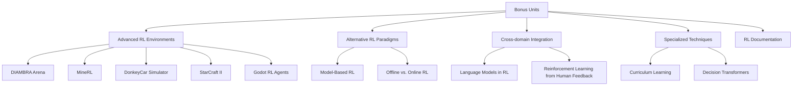
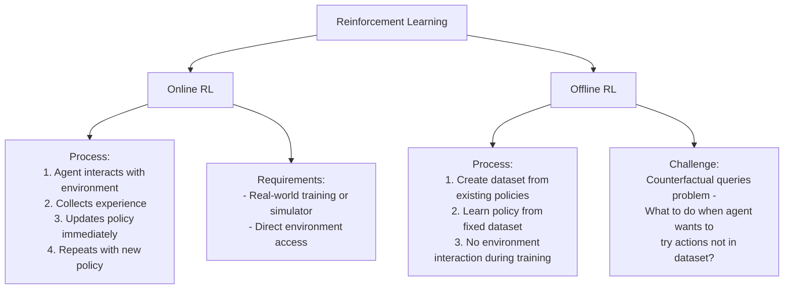
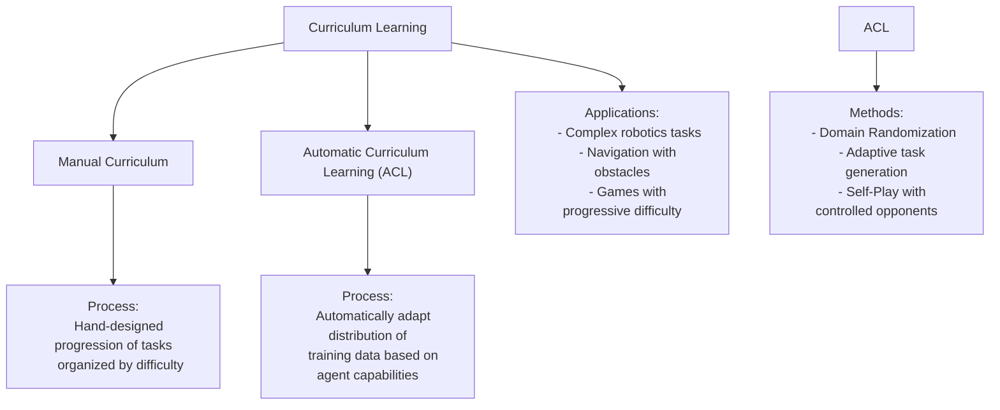
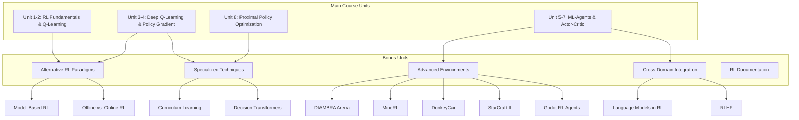

<!-- source: DeepWiki mcp.deepwiki.com · repo huggingface/deep-rl-class · page 10 Bonus Units · fetched 2026-10-26 -->

# Bonus Units

Relevant source files

The following files were used as context for generating this wiki page:

- [units/en/unitbonus3/curriculum-learning.mdx](units/en/unitbonus3/curriculum-learning.mdx)
- [units/en/unitbonus3/decision-transformers.mdx](units/en/unitbonus3/decision-transformers.mdx)
- [units/en/unitbonus3/envs-to-try.mdx](units/en/unitbonus3/envs-to-try.mdx)
- [units/en/unitbonus3/godotrl.mdx](units/en/unitbonus3/godotrl.mdx)
- [units/en/unitbonus3/introduction.mdx](units/en/unitbonus3/introduction.mdx)
- [units/en/unitbonus3/language-models.mdx](units/en/unitbonus3/language-models.mdx)
- [units/en/unitbonus3/model-based.mdx](units/en/unitbonus3/model-based.mdx)
- [units/en/unitbonus3/offline-online.mdx](units/en/unitbonus3/offline-online.mdx)
- [units/en/unitbonus3/rl-documentation.mdx](units/en/unitbonus3/rl-documentation.mdx)
- [units/en/unitbonus3/rlhf.mdx](units/en/unitbonus3/rlhf.mdx)

The Bonus Units section provides advanced and specialized topics in Deep Reinforcement Learning that extend beyond the core curriculum of the Deep RL Course. This section serves as a gateway to explore cutting-edge research areas, alternative RL approaches, and specialized techniques that represent the expanding frontiers of reinforcement learning. Unlike the main course units which follow a structured progression, these bonus topics can be explored independently based on your interests and specific needs.

## Overview of Bonus Topics

The Bonus Units cover various advanced topics representing different branches of reinforcement learning research and applications:

**Diagram: Bonus Units Taxonomy**

Sources: 
- units/en/unitbonus3/introduction.mdx
- units/en/unitbonus3/envs-to-try.mdx
- units/en/unitbonus3/godotrl.mdx
- units/en/unitbonus3/language-models.mdx
- units/en/unitbonus3/model-based.mdx
- units/en/unitbonus3/rlhf.mdx
- units/en/unitbonus3/rl-documentation.mdx
- units/en/unitbonus3/decision-transformers.mdx
- units/en/unitbonus3/curriculum-learning.mdx
- units/en/unitbonus3/offline-online.mdx

## Advanced RL Environments

The Bonus Units introduce several sophisticated environments for training and testing reinforcement learning agents.

### DIAMBRA Arena

DIAMBRA Arena is a software package featuring high-quality environments for RL research that provides:

- Standard interface to popular arcade emulated video games
- Python API fully compliant with OpenAI Gym/Gymnasium format
- Support for all major operating systems (Linux, Windows, MacOS)
- Both single-player and two-player modes
- Integration with major RL libraries like Stable Baselines 3 and Ray RLlib

DIAMBRA also offers a competition platform integrated with the Hugging Face Hub where users can submit trained agents to compete with others globally.

### MineRL

MineRL provides a Gym interface for interacting with Minecraft, along with datasets of human gameplay. It's particularly useful for studying complex 3D navigation, hierarchical tasks, and learning from human demonstrations.

### DonkeyCar Simulator

DonkeyCar Simulator is built on the Unity game platform for training autonomous driving agents. It connects to a Python process that uses trained models to control simulated cars, providing a controlled environment for learning driving skills.

### StarCraft II

StarCraft II offers a challenging real-time strategy environment used by DeepMind for their AlphaStar research. It tests agents' abilities in partial observability, long-term planning, and competitive scenarios.

### Godot RL Agents

Godot RL Agents allows for creating custom RL environments using the Godot game engine. Key features include:

- Interface between Godot-created games and Python-based ML algorithms
- Wrappers for multiple RL frameworks (StableBaselines3, CleanRL, Sample Factory, Ray RLlib)
- Support for memory-based agents with LSTM or attention-based interfaces
- Support for 2D and 3D games
- AI sensors to enhance agent observation capabilities

Sources:
- units/en/unitbonus3/envs-to-try.mdx:1-86
- units/en/unitbonus3/godotrl.mdx:1-55

## Alternative RL Paradigms

The Bonus Units explore fundamental alternatives to traditional reinforcement learning approaches.

### Model-Based Reinforcement Learning (MBRL)

Model-Based RL differs from model-free approaches by learning a dynamics model of the environment. The process involves:

1. Agent accumulates state and action data
2. Creates a dynamics model to reason about the world
3. Uses the model to make decisions by predicting future outcomes
4. Collects more data to improve the model

The dynamics model typically represents environment transitions as: s_{t+1} = f_θ(s_t, a_t)

### Offline vs. Online Reinforcement Learning

The Bonus Units contrast two fundamental approaches to data collection in RL:

**Diagram: Online vs. Offline RL Paradigms**

Sources:
- units/en/unitbonus3/model-based.mdx:1-33
- units/en/unitbonus3/offline-online.mdx:1-38

## Cross-Domain Integration

These topics explore how reinforcement learning can be integrated with other domains and techniques.

### Language Models in RL

Language models encode knowledge that can benefit RL agents:

- LMs provide world knowledge that RL agents can leverage
- RL can align and correct this knowledge through environment interaction
- This approach addresses limitations of tabula-rasa RL (sample inefficiency and unexpected behaviors)

Two key approaches discussed in the bonus units:
1. Adapting an LM to a textual environment using PPO
2. Using a frozen LM to guide an RL agent's exploration

### Reinforcement Learning from Human Feedback (RLHF)

RLHF integrates human preferences into an RL optimization process, addressing the challenge of modeling subjective human preferences. The technique has gained prominence in training language models like ChatGPT.

The typical RLHF process involves:
1. Training a reward model from human comparisons of outputs
2. Using RL (typically PPO) to optimize a policy based on the learned reward model

Sources:
- units/en/unitbonus3/language-models.mdx:1-46
- units/en/unitbonus3/rlhf.mdx:1-51

## Specialized Techniques

The Bonus Units introduce several specialized techniques representing cutting-edge approaches to reinforcement learning.

### Curriculum Learning for RL

Curriculum Learning organizes tasks in a progressive sequence to help agents incrementally acquire skills. This is particularly useful when:
- Tasks require incremental skill acquisition (e.g., bipedal robots learning to walk before running)
- Environment has variations in difficulty
- Agent needs to be robust to environmental changes

Automatic Curriculum Learning (ACL) takes this further by automatically adapting the distribution of training data to match the agent's capabilities.

**Diagram: Curriculum Learning in RL**

### Decision Transformers

Decision Transformers represent a paradigm shift in RL by reformulating it as a conditional sequence modeling problem:

- Uses a Transformer architecture to generate actions
- Conditioned on desired return, past states, and actions
- Generates future actions to achieve the specified return

This approach differs from traditional RL by using generative trajectory modeling instead of explicit reward maximization. Decision Transformers are integrated into the Hugging Face Transformers library and can be trained in an offline manner.

Sources:
- units/en/unitbonus3/curriculum-learning.mdx:1-55
- units/en/unitbonus3/decision-transformers.mdx:1-32

## RL Documentation

As RL systems become more complex and interact with humans, documenting their behavior becomes increasingly important.

### Reward Reports

The Bonus Units introduce "Reward Reports" for RL systems:

- Living documents for RL deployments that document design choices
- Focused on human factors of reward and time-varying feedback systems
- Complementary to model cards and datasheets used for ML models

Key components include:
- A change-log tracking system updates
- Update triggers encouraging monitoring
- Documentation of stakeholder involvement and impact

Sources:
- units/en/unitbonus3/rl-documentation.mdx:1-57

## Integration with Main Course Content

The Bonus Units extend and complement the main course curriculum, providing advanced perspectives on topics introduced in the core units.

**Diagram: Integration of Bonus Units with Main Course**

Sources:
- All files collectively

## Summary

The Bonus Units represent advanced topics that extend the Deep RL Course into cutting-edge research areas and specialized applications. They provide pathways for further exploration based on specific interests, whether in custom environment development, alternative RL paradigms, integration with other AI domains, or specialized techniques. By exploring these topics, you'll gain broader perspective on the field and discover areas for deeper study or practical application.

Sources:
- units/en/unitbonus3/introduction.mdx

---

