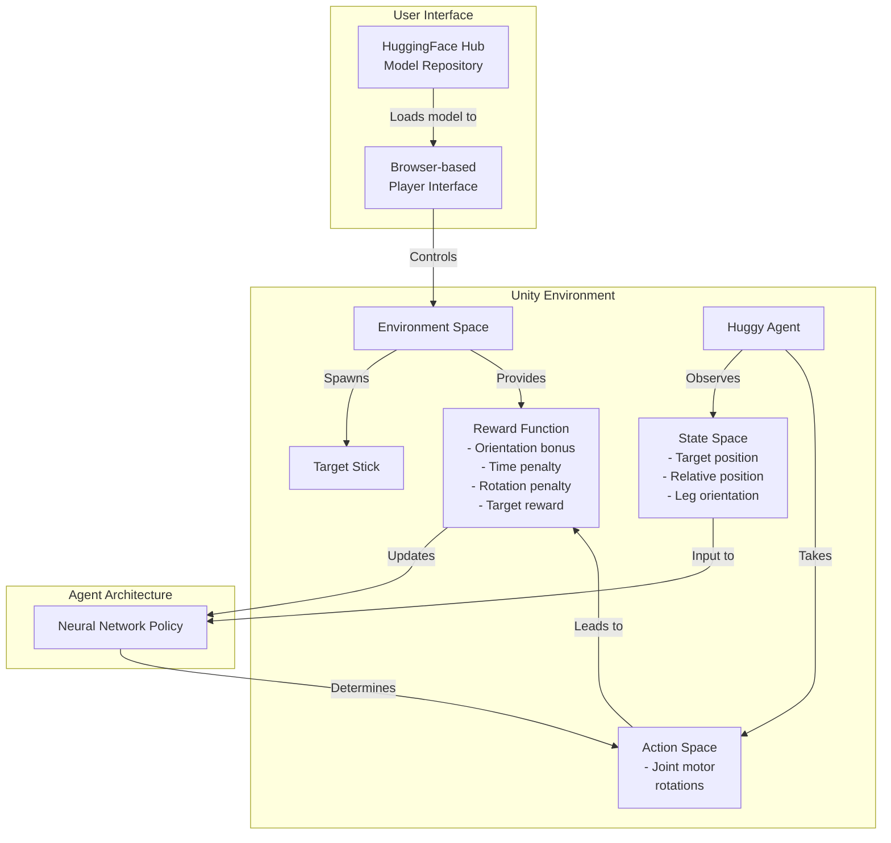
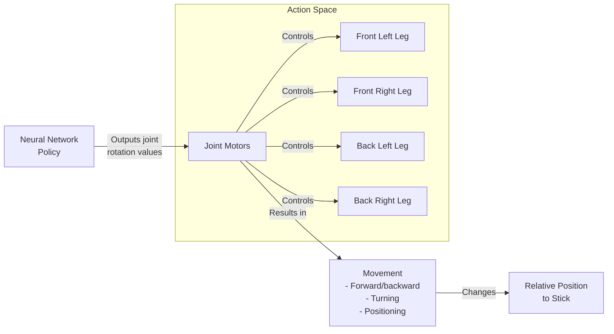
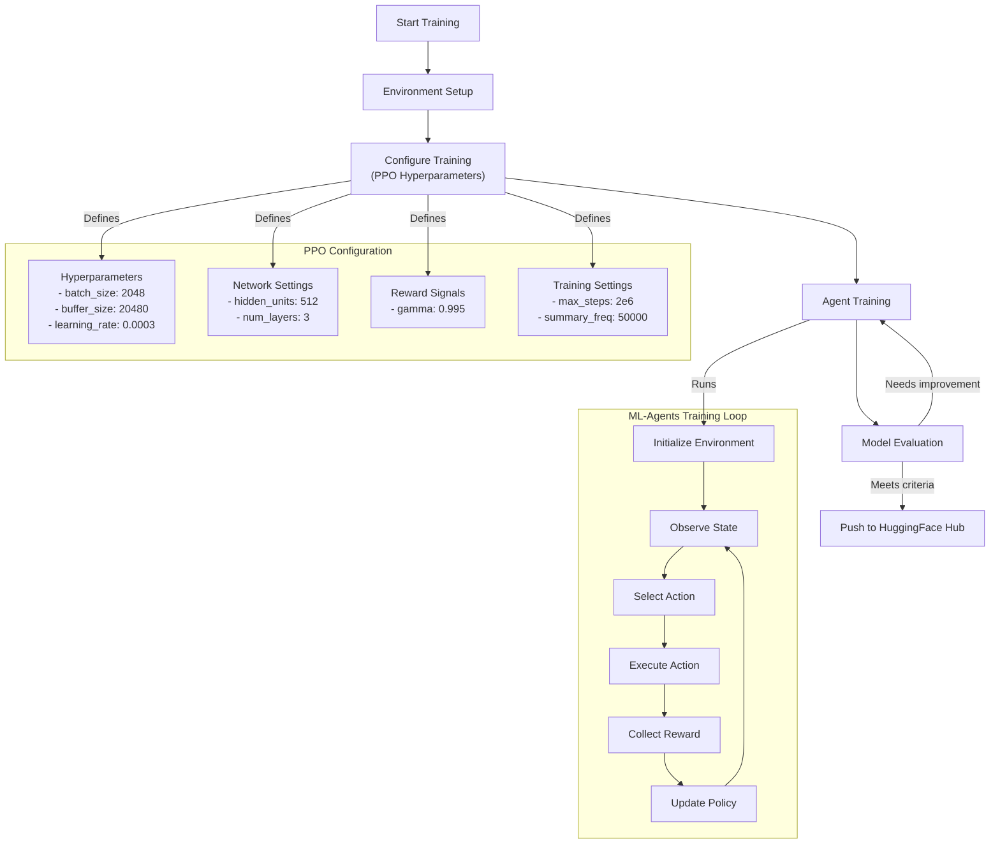
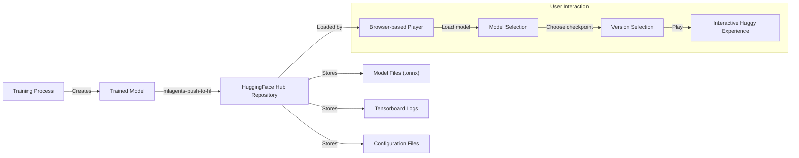

<!-- source: DeepWiki mcp.deepwiki.com · repo huggingface/deep-rl-class · page 10.1 Huggy: Training a Virtual Dog · fetched 2026-10-26 -->

# Huggy: Training a Virtual Dog

<details>
<summary>Relevant source files</summary>

The following files were used as context for generating this wiki page:

- [notebooks/bonus-unit1/bonus-unit1.ipynb](notebooks/bonus-unit1/bonus-unit1.ipynb)
- [units/en/live1/live1.mdx](units/en/live1/live1.mdx)
- [units/en/unitbonus1/conclusion.mdx](units/en/unitbonus1/conclusion.mdx)
- [units/en/unitbonus1/how-huggy-works.mdx](units/en/unitbonus1/how-huggy-works.mdx)
- [units/en/unitbonus1/introduction.mdx](units/en/unitbonus1/introduction.mdx)
- [units/en/unitbonus1/play.mdx](units/en/unitbonus1/play.mdx)
- [units/en/unitbonus1/train.mdx](units/en/unitbonus1/train.mdx)

</details>


## Purpose and Scope

This document provides a technical overview of the "Huggy the Dog" system - a virtual dog agent trained through reinforcement learning to fetch a stick. The system demonstrates fundamental reinforcement learning concepts through a visually engaging demonstration where users can train their own virtual dog and then interact with it directly in a web browser. 

This page focuses specifically on the technical components of the system including the environment's state and action spaces, reward function design, training configuration, and model deployment. For more basic reinforcement learning concepts, see [Reinforcement Learning Fundamentals](#2).

Sources: [units/en/unitbonus1/introduction.mdx:1-8](), [units/en/unitbonus1/how-huggy-works.mdx:1-7]()

## System Architecture

Huggy is built using the Unity game engine and the ML-Agents toolkit, which provides the reinforcement learning framework. The entire system comprises:

1. A Unity-based environment where Huggy can be trained
2. The ML-Agents reinforcement learning system that handles the training algorithm
3. A web-based interface for interacting with trained models

### Environment Overview

**Huggy the Dog Environment Diagram**


Sources: [units/en/unitbonus1/how-huggy-works.mdx:8-66]()

## Environment Components

### State Space

The state space defines what information Huggy receives about its environment. Unlike vision-based agents, Huggy doesn't "see" the environment through images but rather receives specific vector observations:

- The target (stick) position coordinates
- The relative position vector between Huggy and the target
- The orientation of each of Huggy's leg joints

This information enables Huggy to determine its proximity and orientation to the target, allowing the policy to decide which actions to take.

Sources: [units/en/unitbonus1/how-huggy-works.mdx:10-17](), [notebooks/bonus-unit1/bonus-unit1.ipynb:350-359]()

### Action Space

Huggy's action space consists of controlling the rotation of joint motors that drive its legs:

**Joint Motor Control Diagram**


To fetch the stick, Huggy must learn to coordinate the rotations of these joint motors to move efficiently toward the target without excessive spinning.

Sources: [units/en/unitbonus1/how-huggy-works.mdx:19-22](), [notebooks/bonus-unit1/bonus-unit1.ipynb:363-366]()

### Reward Function

The reward function is designed to reinforce behaviors that help Huggy achieve its goal of fetching the stick efficiently. The function consists of four components:

| Reward Component | Purpose | Implementation |
|-----------------|---------|----------------|
| Orientation Bonus | Rewards Huggy for getting closer to the target | Positive reward based on proximity to stick |
| Time Penalty | Forces Huggy to complete the task quickly | Small negative reward given per timestep |
| Rotation Penalty | Discourages excessive spinning | Negative reward for rapid rotation |
| Target Reward | Rewards goal completion | Large positive reward for reaching the stick |

These rewards work together to shape Huggy's behavior, encouraging efficient movement toward the target while minimizing unnecessary actions.

Sources: [units/en/unitbonus1/how-huggy-works.mdx:24-41](), [notebooks/bonus-unit1/bonus-unit1.ipynb:368-383]()

## Training Process

The training process uses the Proximal Policy Optimization (PPO) algorithm implemented in ML-Agents. 

**Training Pipeline Diagram**


Sources: [units/en/unitbonus1/train.mdx:157-234](), [notebooks/bonus-unit1/bonus-unit1.ipynb:392-446]()

### Training Configuration

The training process is defined by a YAML configuration file that specifies the hyperparameters, neural network architecture, and training settings. Key parameters include:

- **Algorithm**: PPO (Proximal Policy Optimization)
- **Batch size**: 2048
- **Learning rate**: 0.0003
- **Network architecture**: 3 hidden layers with 512 units each
- **Max training steps**: 2 million
- **Checkpoint interval**: Every 200,000 steps

These parameters were optimized for the Huggy environment to achieve efficient learning within a reasonable timeframe (30-45 minutes on a GPU).

Sources: [units/en/unitbonus1/train.mdx:194-238](), [notebooks/bonus-unit1/bonus-unit1.ipynb:392-446]()

### Training Execution

Training is executed using the ML-Agents `mlagents-learn` command, which:

1. Loads the configuration file
2. Initializes the environment executable
3. Runs the training loop without graphical visualization
4. Saves model checkpoints at regular intervals

```
mlagents-learn ./config/ppo/Huggy.yaml --env=./trained-envs-executables/linux/Huggy/Huggy --run-id="Huggy" --no-graphics
```

The training duration is typically 30-45 minutes when using a GPU, with the system automatically saving checkpoint models throughout the process.

Sources: [units/en/unitbonus1/train.mdx:240-265](), [notebooks/bonus-unit1/bonus-unit1.ipynb:478-516]()

## Model Deployment and Interaction

After training, the model is pushed to the Hugging Face Hub using the `mlagents-push-to-hf` command, which allows for:

1. Model sharing and versioning
2. Browser-based interaction through a Unity WebGL player
3. Community engagement and comparison of results

**Deployment and Interaction Flow**


Sources: [units/en/unitbonus1/train.mdx:267-345](), [units/en/unitbonus1/play.mdx:1-18]()

### Pushing to Hugging Face Hub

To share the trained model, users authenticate with the Hugging Face Hub and use the `mlagents-push-to-hf` command:

```
mlagents-push-to-hf --run-id="HuggyTraining" --local-dir="./results/Huggy" --repo-id="username/ppo-Huggy" --commit-message="Huggy"
```

This creates a Git repository containing:
- The trained model(s) in ONNX format
- Tensorboard logs for performance analysis
- Configuration files used during training

Sources: [units/en/unitbonus1/train.mdx:267-319](), [notebooks/bonus-unit1/bonus-unit1.ipynb:528-623]()

### Playing with Huggy

The trained Huggy model can be accessed and interacted with through a browser-based interface:

1. Visit https://huggingface.co/spaces/ThomasSimonini/Huggy
2. Click "Play with my Huggy model"
3. Enter your Hugging Face username
4. Select your model repository
5. Choose which model checkpoint to load (e.g., the latest model or earlier checkpoints to observe learning progression)

This provides an interactive demonstration of the trained reinforcement learning agent, allowing users to see the results of their training directly in the browser.

Sources: [units/en/unitbonus1/train.mdx:321-345](), [units/en/unitbonus1/play.mdx:1-18](), [notebooks/bonus-unit1/bonus-unit1.ipynb:625-666]()

## Technical Implementation

The implementation relies on several key technologies:

1. **Unity**: Game engine providing the physics simulation and rendering
2. **ML-Agents**: Unity toolkit for training intelligent agents
3. **Proximal Policy Optimization (PPO)**: The reinforcement learning algorithm
4. **Hugging Face Hub**: Platform for model storage and sharing
5. **WebGL**: Technology enabling browser-based interaction with Unity content

The training is typically done in Google Colab for simplicity and GPU access, while the interaction happens in a browser through a Unity WebGL player hosted on Hugging Face Spaces.

Sources: [units/en/unitbonus1/how-huggy-works.mdx:1-66](), [units/en/unitbonus1/train.mdx:13-16]()

## Conclusion

Huggy demonstrates the practical application of reinforcement learning principles in a visually engaging way. The system allows users to understand how different components of reinforcement learning (state space, action space, reward function) come together to create an agent capable of learning a specific task. The ability to train and then interact with the agent provides a complete end-to-end reinforcement learning experience.

Sources: [units/en/unitbonus1/conclusion.mdx:1-12]()

---

