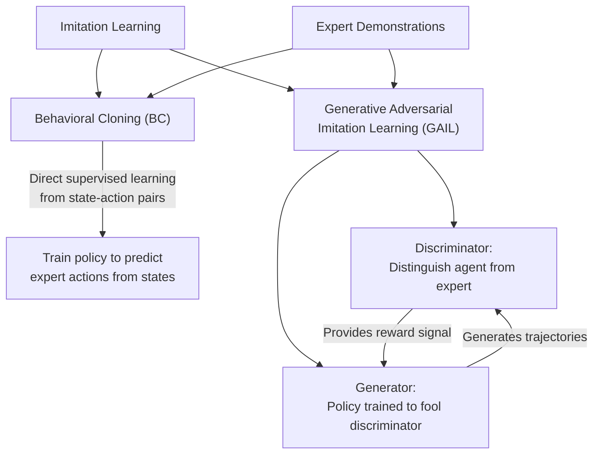
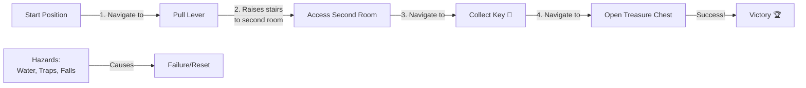
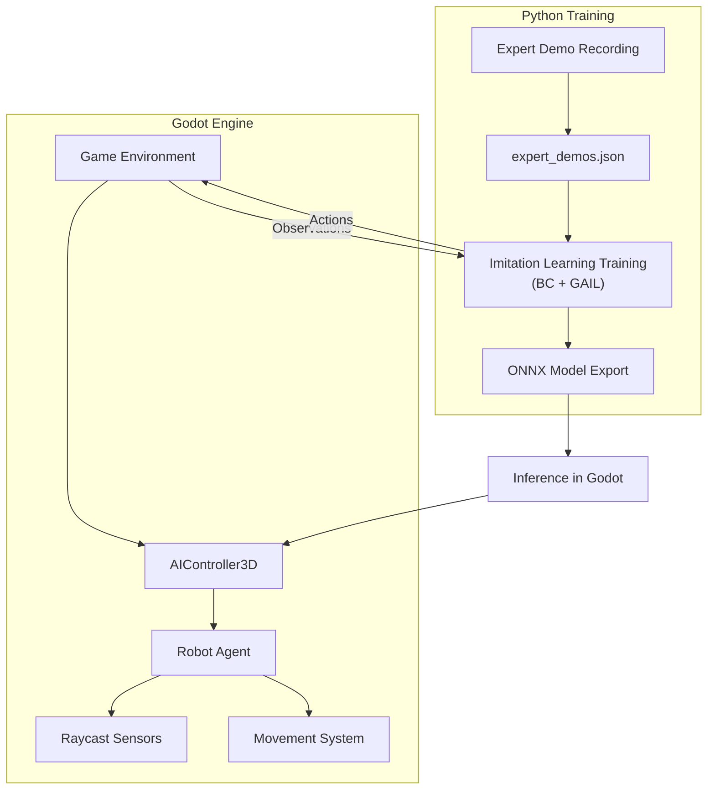
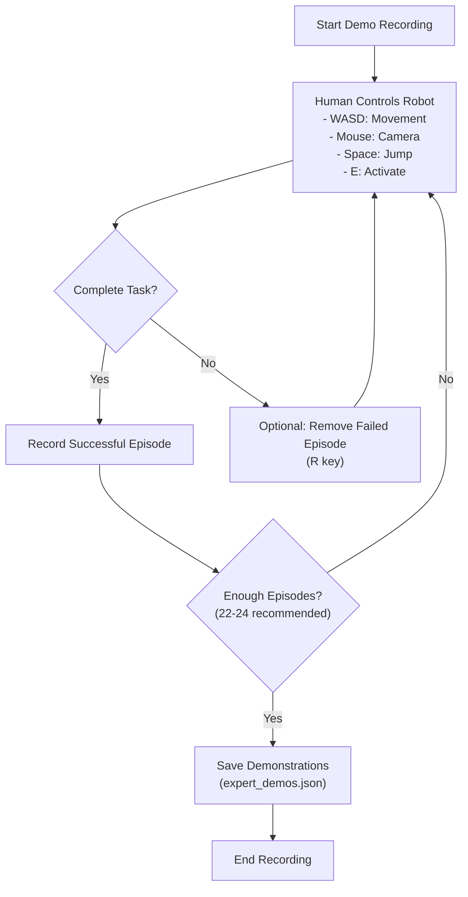
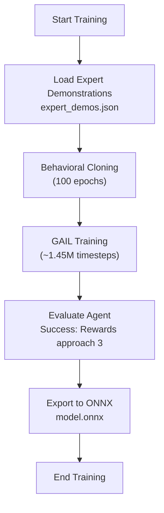

<!-- source: DeepWiki mcp.deepwiki.com · repo huggingface/deep-rl-class · page 10.2 Imitation Learning · fetched 2026-10-26 -->

# Imitation Learning

Relevant source files

The following files were used as context for generating this wiki page:

- [units/en/unitbonus5/conclusion.mdx](units/en/unitbonus5/conclusion.mdx)
- [units/en/unitbonus5/customize-the-environment.mdx](units/en/unitbonus5/customize-the-environment.mdx)
- [units/en/unitbonus5/getting-started.mdx](units/en/unitbonus5/getting-started.mdx)
- [units/en/unitbonus5/introduction.mdx](units/en/unitbonus5/introduction.mdx)
- [units/en/unitbonus5/the-environment.mdx](units/en/unitbonus5/the-environment.mdx)
- [units/en/unitbonus5/train-our-robot.mdx](units/en/unitbonus5/train-our-robot.mdx)

This document covers the concepts and implementation of imitation learning in the Deep Reinforcement Learning course. Imitation learning is a technique where agents learn to perform tasks by mimicking expert demonstrations rather than through traditional reinforcement learning rewards. This page focuses specifically on training a robot agent to complete a mini-game level using human-recorded demonstrations and the Godot RL Agents framework.

For information about standard reinforcement learning approaches like Deep Q-Learning, see [Deep Q-Learning](#4) or for policy-based methods, see [Policy Gradient Methods](#5).

## What is Imitation Learning?

Imitation Learning (IL) is a machine learning paradigm where an agent learns to perform a task by observing and imitating expert demonstrations, rather than learning from explicit rewards or objectives. This approach is particularly useful in scenarios where:

1. Defining a reward function is difficult
2. Exploration is inefficient or dangerous
3. Human expertise is available but difficult to formalize

There are two primary approaches to imitation learning used in this implementation:

Sources: units/en/unitbonus5/train-our-robot.mdx

### Behavioral Cloning (BC)

BC is a direct supervised learning approach where:
- The algorithm learns a mapping from observations to actions
- Training data consists of state-action pairs from expert demonstrations
- The model is trained to predict the expert's action given a state

### Generative Adversarial Imitation Learning (GAIL)

GAIL combines:
- A discriminator that learns to distinguish between expert and agent trajectories
- A generator (policy) that tries to produce behaviors indistinguishable from the expert
- An adversarial training process similar to GANs (Generative Adversarial Networks)

## The Environment

The tutorial environment is a Godot-based mini-game where a robot agent needs to complete a sequence of tasks:

Sources: units/en/unitbonus5/the-environment.mdx

The environment presents several challenges:
- Navigation through multiple rooms
- Object interaction (lever, key, chest)
- Hazard avoidance (water, traps, falling off platforms)
- Sequential task completion

Sources: units/en/unitbonus5/the-environment.mdx

## Implementation Architecture

The implementation involves several components that work together to enable imitation learning:

Sources: units/en/unitbonus5/getting-started.mdx, units/en/unitbonus5/train-our-robot.mdx

### AIController Implementation

The AIController is a key component that:
1. Defines the observation and action spaces for the agent
2. Handles the interaction between the Godot environment and the learning algorithms
3. Manages different control modes (human control, demo recording, AI control)

#### Observation Space

The observation space includes:

| Category | Observations | Description |
|---|---|---|
| Raycast Sensors | Variable length array | Distance measurements to detect walls, floors, etc. |
| Object Relations | Direction vectors (x,y,z) and distances | Relative position to chest, lever, key, and raft |
| Game State | Boolean values (0.0 or 1.0) | Lever pulled, chest opened, key collected, player on floor |
| Agent State | Vector3 (x,y,z) | Normalized local velocity of the player |

This is implemented in the `get_obs()` method:

Sources: units/en/unitbonus5/getting-started.mdx:34-90

#### Action Space

The action space is defined as:

| Action | Size | Type | Description |
|---|---|---|---|
| movement | 2 | continuous | Forward/backward and left/right movement |
| rotation | 1 | continuous | Horizontal rotation (y-axis) |
| jump | 1 | continuous | Jump action |
| use_action | 1 | continuous | Interaction with objects (lever, chest) |

This is implemented in the `get_action_space()` method:

Sources: units/en/unitbonus5/getting-started.mdx:140-146

## Expert Demonstration Recording

The first step in the imitation learning process is to record expert demonstrations:

Key aspects of the demo recording process:
- Use of a dedicated demo recording scene
- Human control with the same action space as the AI agent
- Recording of state-action pairs for each time step
- Option to remove failed episodes
- Recommendation to record 22-24 successful episodes

Sources: units/en/unitbonus5/getting-started.mdx:219-260

## Training Process

The training process combines Behavioral Cloning (BC) and Generative Adversarial Imitation Learning (GAIL):

The training is performed using a Python script that:
1. Loads the expert demonstrations
2. Performs BC pre-training for 100 epochs
3. Continues with GAIL for approximately 1.45 million timesteps
4. Exports the trained model to ONNX format

Key training parameters:
- `bc_epochs`: 100 (behavioral cloning epochs)
- `gail_timesteps`: 1,450,000 (GAIL training steps)
- `n_parallel`: 4 (number of parallel environments)
- `speedup`: 20 (environment speed factor)

Sources: units/en/unitbonus5/train-our-robot.mdx:1-32

## Model Deployment and Testing

After training, the model is deployed in Godot:

1. The ONNX model file is copied to the Godot project folder
2. The inference scene is configured to use the model
3. The agent is tested in the environment

The agent should be able to:
- Navigate to and pull the lever
- Find and collect the key from both possible positions
- Return to and open the chest
- Avoid hazards throughout the process

Sources: units/en/unitbonus5/train-our-robot.mdx:33-53

## Customization Options

The environment can be customized in several ways:

1. Modifying the level layout using modules
2. Adding or changing game objects (levers, keys, etc.)
3. Connecting signals for object interactions
4. Adding objects to the "resetable" group for proper episode resets

When customizing:
- Update the `level_size` variable in the AI controller
- Update observation and action spaces if necessary
- Reconfigure object references in the AIController

Sources: units/en/unitbonus5/customize-the-environment.mdx

## Conclusion

Imitation learning provides an alternative approach to standard reinforcement learning when expert demonstrations are available. The combination of BC and GAIL has proven effective in teaching the agent to complete complex sequential tasks without explicitly defining a reward function.

This implementation demonstrates how imitation learning can be applied to game environments using the Godot RL Agents framework, providing a foundation for applying similar techniques to other game development and robotics applications.

Sources: units/en/unitbonus5/conclusion.mdx

---

