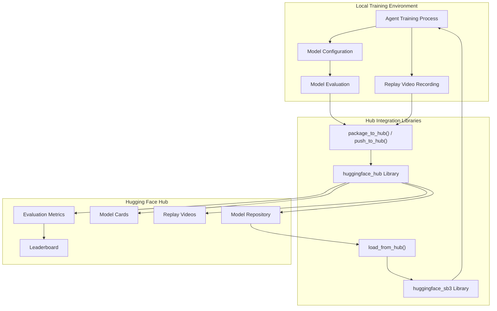
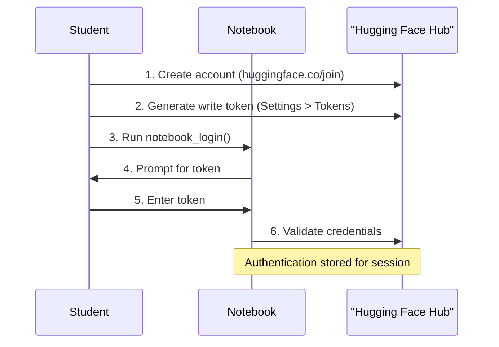
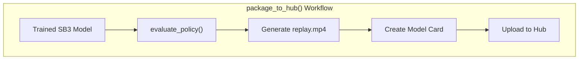
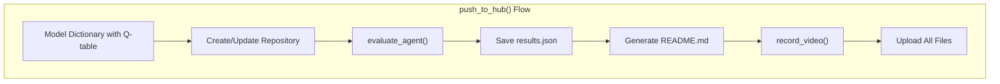
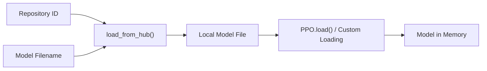
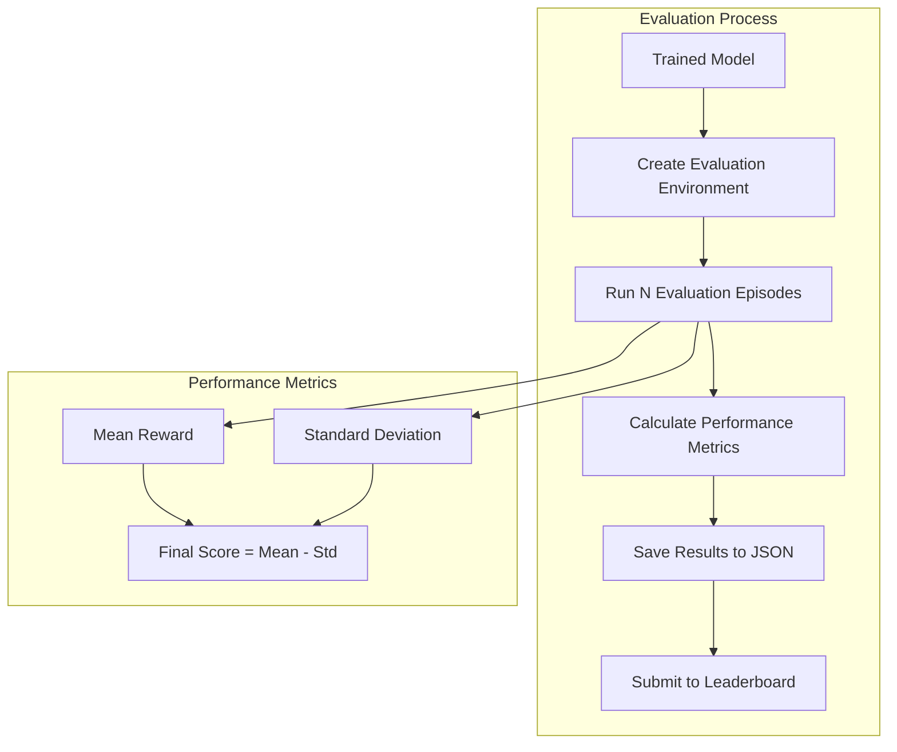

<!-- source: DeepWiki mcp.deepwiki.com · repo huggingface/deep-rl-class · page 11 Hugging Face Hub Integration · fetched 2026-10-26 -->

# Hugging Face Hub Integration

<details>
<summary>Relevant source files</summary>

The following files were used as context for generating this wiki page:

- [notebooks/unit1/requirements-unit1.txt](notebooks/unit1/requirements-unit1.txt)
- [notebooks/unit1/unit1.ipynb](notebooks/unit1/unit1.ipynb)
- [notebooks/unit2/requirements-unit2.txt](notebooks/unit2/requirements-unit2.txt)
- [notebooks/unit2/unit2.ipynb](notebooks/unit2/unit2.ipynb)
- [units/en/unit1/hands-on.mdx](units/en/unit1/hands-on.mdx)
- [units/en/unit2/hands-on.mdx](units/en/unit2/hands-on.mdx)

</details>


This document explains how the Deep Reinforcement Learning Course integrates with the Hugging Face Hub for model sharing, evaluation, and leaderboards. The Hub serves as a central platform allowing students to upload their trained RL models, generate visualization videos, and compare performance with others.

For information about specific environments or algorithms, see the respective course unit documentation.

## Architecture Overview

The Hugging Face Hub integration enables a bidirectional workflow between local training environments and the Hugging Face platform:



Sources:
- [units/en/unit1/hands-on.mdx:16-19]() - Initial description of uploading to Hub
- [units/en/unit2/hands-on.mdx:16-17]() - Leaderboard mention
- [notebooks/unit1/requirements-unit1.txt:4]() - huggingface_sb3 dependency
- [notebooks/unit2/requirements-unit2.txt:5]() - huggingface_hub dependency

## Integration Libraries

The Hugging Face Hub integration is powered by two primary libraries:

| Library | Purpose | Notable Functions |
|---------|---------|-------------------|
| **huggingface_sb3** | Integration with Stable-Baselines3 models | `package_to_hub()`, `load_from_hub()` |
| **huggingface_hub** | General Hub API access | `notebook_login()`, `HfApi()` functions |

Depending on the unit, different approaches are used for model uploading:
- Unit 1 (LunarLander): `package_to_hub()` for Stable-Baselines3 models
- Unit 2 (FrozenLake/Taxi): Custom `push_to_hub()` for Q-learning models

Sources:
- [units/en/unit1/hands-on.mdx:483-497]() - Description of package_to_hub
- [units/en/unit2/hands-on.mdx:582-587]() - Custom push_to_hub for Q-learning

## Authentication Process

Before uploading models to the Hub, students must authenticate:



The authentication code is implemented in both Unit 1 and Unit 2:

```python
from huggingface_hub import notebook_login

notebook_login()
!git config --global credential.helper store
```

Sources:
- [units/en/unit1/hands-on.mdx:501-514]() - Authentication process in Unit 1
- [units/en/unit2/hands-on.mdx:770-783]() - Authentication process in Unit 2

## Uploading Models to the Hub

### Stable-Baselines3 Models (Unit 1)

For Stable-Baselines3 models used in Unit 1, the `package_to_hub` function handles the upload process:



The function signature and example usage from Unit 1:

```python
package_to_hub(
    model=model,                    # Trained SB3 model object
    model_name=model_name,          # Name of saved model file
    model_architecture=model_architecture,  # Algorithm (PPO, A2C, etc.)
    env_id=env_id,                  # Environment identifier
    eval_env=eval_env,              # Environment for evaluation
    repo_id=repo_id,                # Hub repository ID (username/repo-name)
    commit_message=commit_message   # Description of the upload
)
```

Sources:
- [units/en/unit1/hands-on.mdx:537-564]() - package_to_hub usage
- [notebooks/unit1/unit1.ipynb:773-806]() - Implementation example

### Q-Learning Models (Unit 2)

For Q-learning models in Unit 2, a custom `push_to_hub` function performs similar operations:



The model dictionary structure and function usage:

```python
# Model dictionary containing hyperparameters and Q-table
model = {
    "env_id": env_id,               # Environment name
    "max_steps": max_steps,         # Maximum steps per episode
    "n_training_episodes": n_training_episodes,
    "n_eval_episodes": n_eval_episodes,
    "eval_seed": eval_seed,         # Seeds for reproducibility
    "learning_rate": learning_rate, # Alpha value
    "gamma": gamma,                 # Discount factor
    "max_epsilon": max_epsilon,     # Initial exploration rate
    "min_epsilon": min_epsilon,     # Final exploration rate
    "decay_rate": decay_rate,       # Exploration decay rate
    "qtable": Qtable_frozenlake,    # Learned state-action values
}

# Upload function
push_to_hub(
    repo_id=repo_id,                # Hub repository ID
    model=model,                    # Model dictionary
    env=env                         # Environment for recording
)
```

Sources:
- [units/en/unit2/hands-on.mdx:632-755]() - push_to_hub implementation
- [units/en/unit2/hands-on.mdx:791-824]() - Usage example

## Loading Models from the Hub

Models can be downloaded and loaded using the `load_from_hub` function:



Example for Stable-Baselines3 models:

```python
from huggingface_sb3 import load_from_hub
from stable_baselines3 import PPO

# Specify repository and filename
repo_id = "username/ppo-LunarLander-v2"
filename = "ppo-LunarLander-v2.zip"

# Handle version compatibility
custom_objects = {
    "learning_rate": 0.0,
    "lr_schedule": lambda _: 0.0,
    "clip_range": lambda _: 0.0,
}

# Download and load
checkpoint = load_from_hub(repo_id, filename)
model = PPO.load(checkpoint, custom_objects=custom_objects)
```

Sources:
- [units/en/unit1/hands-on.mdx:618-659]() - Loading models from Hub
- [notebooks/unit1/unit1.ipynb:641-658]() - Implementation example

## Model Evaluation and Leaderboards

Models are evaluated before uploading, and the results are sent to a leaderboard:



For Unit 1, the evaluation uses `evaluate_policy`:

```python
from stable_baselines3.common.evaluation import evaluate_policy

eval_env = Monitor(gym.make("LunarLander-v2"))
mean_reward, std_reward = evaluate_policy(
    model, eval_env, n_eval_episodes=10, deterministic=True
)
print(f"mean_reward={mean_reward:.2f} +/- {std_reward}")
```

For Unit 2, a custom `evaluate_agent` function is used:

```python
def evaluate_agent(env, max_steps, n_eval_episodes, Q, seed):
    """Evaluate agent for n_eval_episodes and return average reward and std"""
    episode_rewards = []
    for episode in range(n_eval_episodes):
        # Setup environment
        if seed:
            state, info = env.reset(seed=seed[episode])
        else:
            state, info = env.reset()
            
        total_rewards_ep = 0
        
        # Run episode
        for step in range(max_steps):
            action = greedy_policy(Q, state)
            new_state, reward, terminated, truncated, info = env.step(action)
            total_rewards_ep += reward
            
            if terminated or truncated:
                break
            state = new_state
            
        episode_rewards.append(total_rewards_ep)
    
    # Calculate statistics
    mean_reward = np.mean(episode_rewards)
    std_reward = np.std(episode_rewards)
    
    return mean_reward, std_reward
```

The leaderboard is accessible at:
https://huggingface.co/spaces/huggingface-projects/Deep-Reinforcement-Learning-Leaderboard

Sources:
- [units/en/unit1/hands-on.mdx:451-469]() - Evaluation in Unit 1
- [units/en/unit2/hands-on.mdx:537-569]() - Evaluation in Unit 2
- [units/en/unit1/hands-on.mdx:21-23]() - Leaderboard information

## Repository Structure

When a model is uploaded to the Hub, the repository contains these key files:

| File | Purpose | Generated By |
|------|---------|--------------|
| **README.md** | Model card with description and usage | package_to_hub/push_to_hub |
| **replay.mp4** | Video replay of the agent behavior | record_video function |
| **results.json** | Evaluation metrics | evaluate_policy/evaluate_agent |
| **model.zip / q-learning.pkl** | The actual model file | Model training |

Sources:
- [units/en/unit1/hands-on.mdx:490-495]() - Hub repository contents
- [units/en/unit2/hands-on.mdx:744-747]() - Model card generation

## Certification Process

Models must meet minimum performance criteria for course certification:

| Unit | Environment | Minimum Score |
|------|-------------|---------------|
| Unit 1 | LunarLander-v2 | ≥ 200 |
| Unit 2 | Taxi-v3 | ≥ 4.5 |

The score is calculated as: `mean_reward - std_reward`

Sources:
- [units/en/unit1/hands-on.mdx:21-23]() - Unit 1 certification criteria
- [units/en/unit2/hands-on.mdx:19-23]() - Unit 2 certification criteria

## Best Practices

When using the Hugging Face Hub integration, consider these recommendations:

1. **Repository Naming**:
   - Follow convention: `{username}/{algorithm}-{environment}[-variant]`
   - Examples: `username/ppo-LunarLander-v2`, `username/q-FrozenLake-v1-4x4-noSlippery`

2. **Authentication**:
   - Create a token with write permissions
   - Store credentials properly with git config
   - If using CLI instead of notebook: use `huggingface-cli login`

3. **Model Evaluation**:
   - Use sufficient evaluation episodes (10-100) for reliable metrics
   - Set appropriate render mode for video recording: `render_mode="rgb_array"`
   - For deterministic policies, set `deterministic=True` in evaluation

4. **Common Issues**:
   - Permission errors: Check token write permissions
   - Repository already exists: Use appropriate parameters
   - Video recording failures: Verify render mode is properly configured

Sources:
- [units/en/unit1/hands-on.mdx:499-516]() - Authentication process
- [units/en/unit1/hands-on.mdx:675-683]() - Best practices for training
- [units/en/unit2/hands-on.mdx:784-786]() - CLI versus notebook login

---

