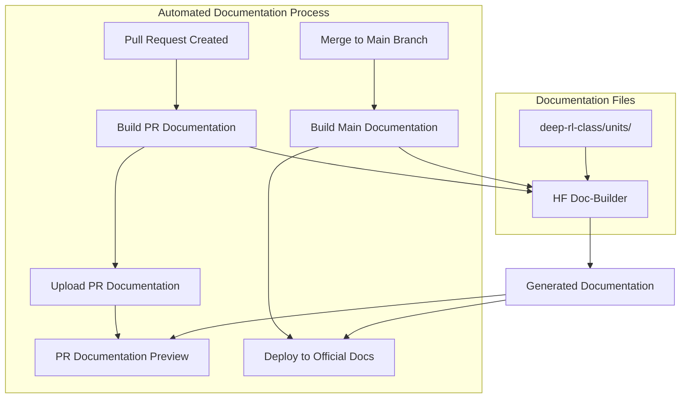
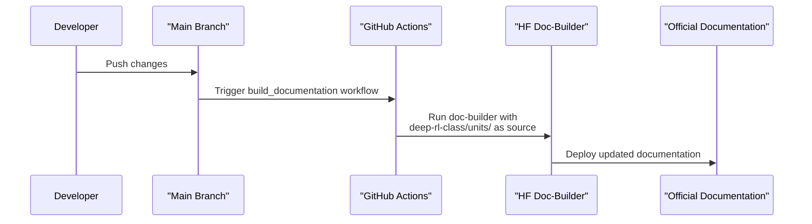
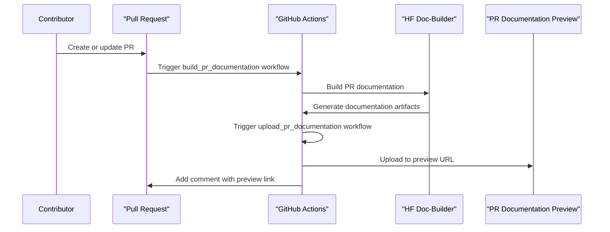
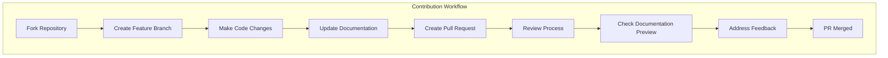

<!-- source: DeepWiki mcp.deepwiki.com · repo huggingface/deep-rl-class · page 12 Development and Maintenance · fetched 2026-10-26 -->

# Development and Maintenance

<details>
<summary>Relevant source files</summary>

The following files were used as context for generating this wiki page:

- [.github/workflows/build_documentation.yml](.github/workflows/build_documentation.yml)
- [.github/workflows/build_pr_documentation.yml](.github/workflows/build_pr_documentation.yml)
- [.github/workflows/upload_pr_documentation.yml](.github/workflows/upload_pr_documentation.yml)

</details>


This document describes the development and maintenance processes for the Deep Reinforcement Learning Course repository. It focuses on how the course documentation is built, deployed, and maintained through automated CI/CD workflows.

For information about the actual course content and structure, see [Overview](#1).

## Documentation Build System

The Deep RL Course uses Hugging Face's documentation infrastructure to automatically build and deploy documentation. This is handled through GitHub Actions workflows that ensure documentation stays in sync with code changes.



Sources: [.github/workflows/build_documentation.yml](), [.github/workflows/build_pr_documentation.yml](), [.github/workflows/upload_pr_documentation.yml]()

### Main Documentation Build Process

The main documentation build is triggered automatically whenever changes are pushed to the main branch. It uses the Hugging Face doc-builder workflow to generate the official documentation.



This process is defined in the build_documentation.yml workflow file, which specifies:

- Trigger: Push to main branch
- Documentation source: `deep-rl-class/units/`
- Package name: `deep-rl-course`
- Additional arguments: `--not_python_module`
- Language: English

Sources: [.github/workflows/build_documentation.yml]()

### Pull Request Documentation Process

For contributions via pull requests, a separate workflow builds documentation previews to help reviewers assess documentation changes before merging.



This two-step process involves:

1. **Build PR Documentation**: Builds documentation from the PR's branch
2. **Upload PR Documentation**: Uploads the built documentation to a preview URL and adds a comment to the PR

Sources: [.github/workflows/build_pr_documentation.yml](), [.github/workflows/upload_pr_documentation.yml]()

## Documentation Structure

The documentation for the Deep RL Course is primarily stored in the `deep-rl-class/units/` directory. This follows the course's unit-based structure.

| Path | Description |
|------|-------------|
| `deep-rl-class/units/` | Main documentation source files |
| `.github/workflows/` | CI/CD workflow configuration files |

The documentation is built using the Hugging Face doc-builder tool, which is designed for technical documentation of machine learning libraries and courses.

Sources: [.github/workflows/build_documentation.yml:15-15]()

## CI/CD Workflow Configuration

The repository uses three primary GitHub Actions workflows for documentation:

### 1. Main Documentation Build

```yaml
Trigger: Push to main branch
Workflow: build_documentation.yml
Key configurations:
  - Package: deep-rl-class
  - Package name: deep-rl-course
  - Path to docs: deep-rl-class/units/
  - Additional args: --not_python_module
  - Languages: en
```

Sources: [.github/workflows/build_documentation.yml:3-19]()

### 2. PR Documentation Build

```yaml
Trigger: Pull request creation or update
Workflow: build_pr_documentation.yml
Key configurations:
  - Same package and path settings as main build
  - Includes PR number and commit SHA for tracking
  - Has concurrency settings to prevent conflicts
```

Sources: [.github/workflows/build_pr_documentation.yml:3-20]()

### 3. PR Documentation Upload

```yaml
Trigger: Completion of "Build PR Documentation" workflow
Workflow: upload_pr_documentation.yml
Key configurations:
  - Package name: deep-rl-course
  - Hub base path: https://moon-ci-docs.huggingface.co
```

Sources: [.github/workflows/upload_pr_documentation.yml:3-16]()

## Development Best Practices

When contributing to the Deep RL Course repository, follow these best practices to ensure smooth documentation building and maintenance:

1. **Documentation alongside code**: When adding new features or examples, update the documentation in the corresponding `units/` directory
2. **Test documentation locally**: If possible, test documentation changes locally before submitting a PR
3. **Review PR previews**: Use the automatically generated documentation preview links to verify your changes
4. **Follow existing structure**: Maintain consistency with the existing documentation structure



## Troubleshooting Documentation Builds

If documentation fails to build properly, check the following common issues:

1. **Path issues**: Ensure the documentation source path is correct (`deep-rl-class/units/`)
2. **Syntax errors**: Check for Markdown syntax errors or invalid formatting
3. **Missing dependencies**: Ensure any referenced assets or dependencies are available
4. **Workflow failures**: Check the GitHub Actions logs for specific error messages

For issues with the CI/CD workflows themselves, you may need to consult the [Hugging Face doc-builder](https://github.com/huggingface/doc-builder) repository, which provides the underlying infrastructure.

Sources: [.github/workflows/build_documentation.yml](), [.github/workflows/build_pr_documentation.yml](), [.github/workflows/upload_pr_documentation.yml]()