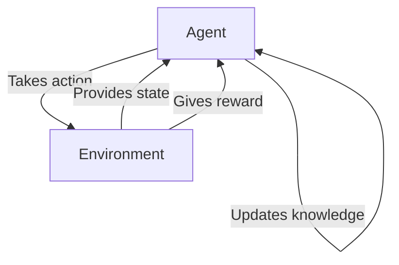
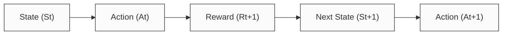
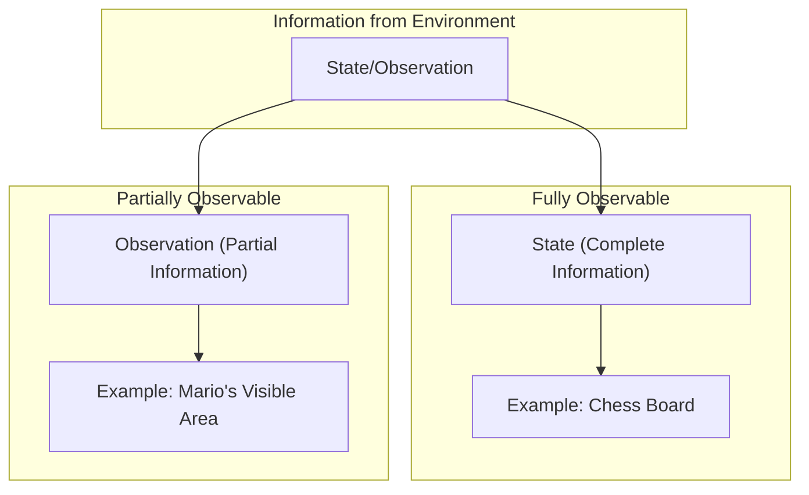
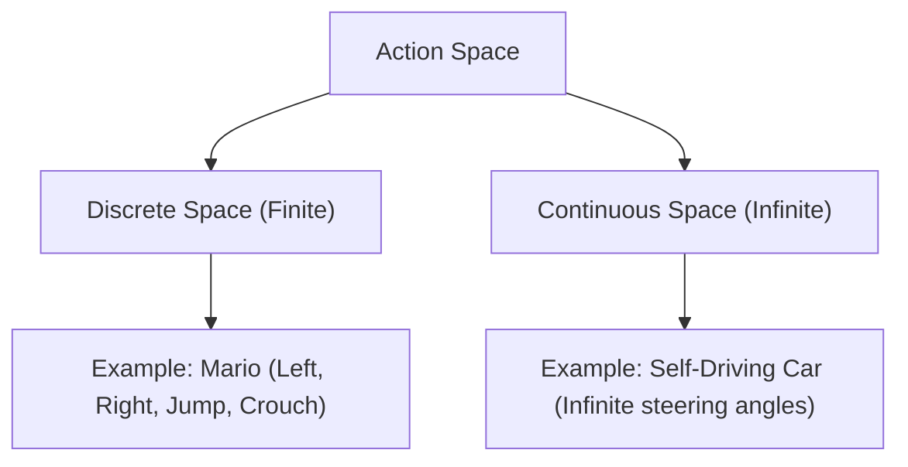
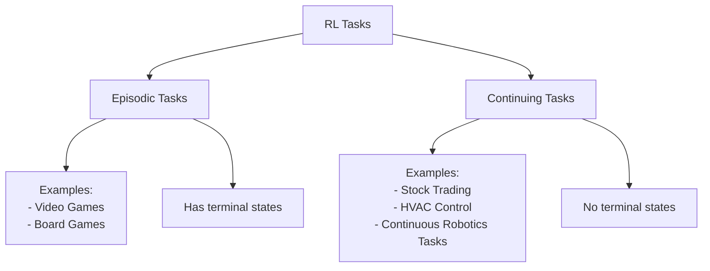
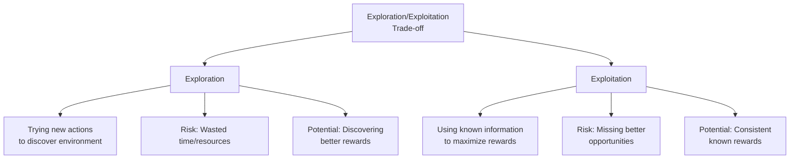
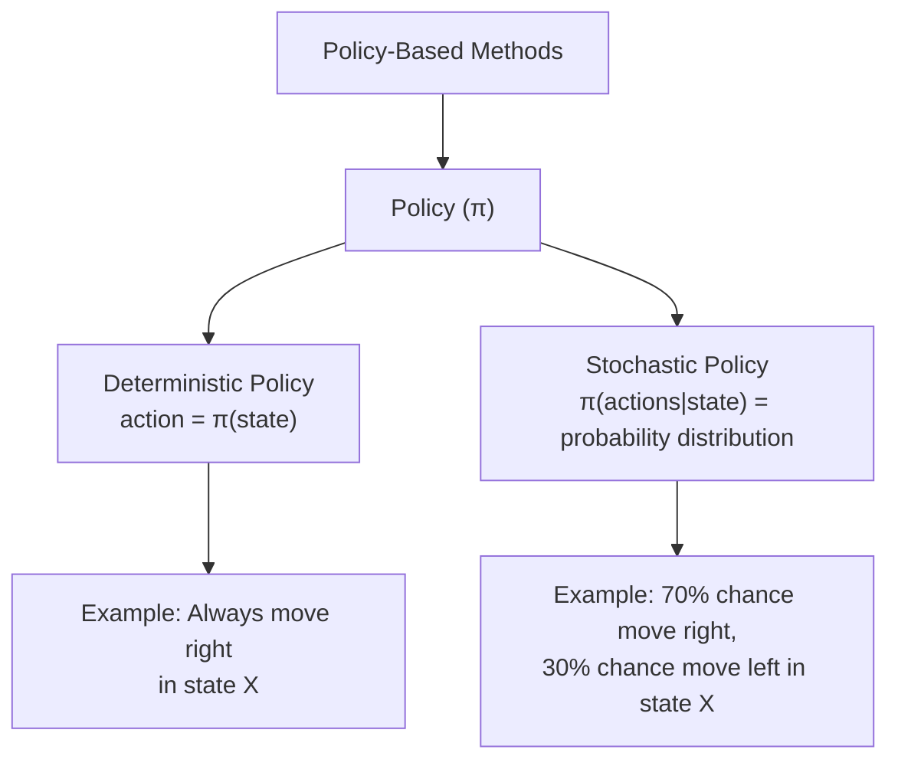
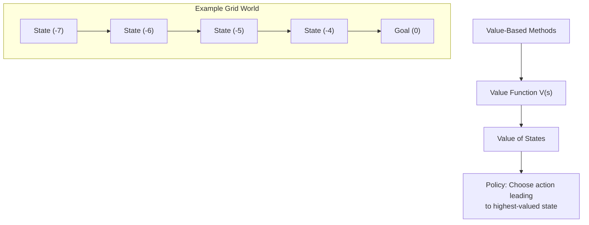
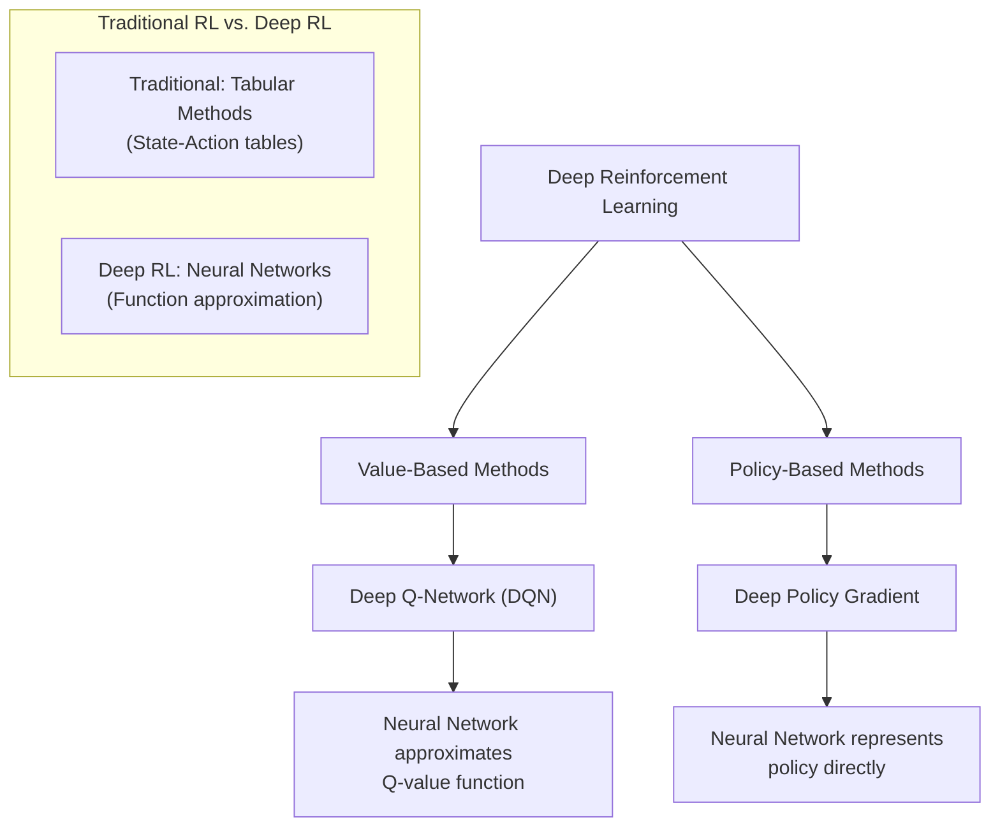

<!-- source: DeepWiki mcp.deepwiki.com · repo huggingface/deep-rl-class · page 2 Reinforcement Learning Fundamentals · fetched 2026-10-26 -->

# Reinforcement Learning Fundamentals

<details>
<summary>Relevant source files</summary>

The following files were used as context for generating this wiki page:

- [units/en/unit1/conclusion.mdx](units/en/unit1/conclusion.mdx)
- [units/en/unit1/deep-rl.mdx](units/en/unit1/deep-rl.mdx)
- [units/en/unit1/exp-exp-tradeoff.mdx](units/en/unit1/exp-exp-tradeoff.mdx)
- [units/en/unit1/quiz.mdx](units/en/unit1/quiz.mdx)
- [units/en/unit1/rl-framework.mdx](units/en/unit1/rl-framework.mdx)
- [units/en/unit1/summary.mdx](units/en/unit1/summary.mdx)
- [units/en/unit1/tasks.mdx](units/en/unit1/tasks.mdx)
- [units/en/unit1/two-methods.mdx](units/en/unit1/two-methods.mdx)
- [units/en/unit1/what-is-rl.mdx](units/en/unit1/what-is-rl.mdx)

</details>


This wiki page introduces the core concepts of reinforcement learning (RL) as covered in Unit 1 of the Deep Reinforcement Learning course. It provides a comprehensive explanation of the RL framework, components, and approaches that form the foundation for all subsequent units. For hands-on implementation with the LunarLander environment, see [LunarLander with Stable-Baselines3](#2.1).

## What is Reinforcement Learning?

Reinforcement Learning is a computational approach to learning from actions. An agent learns from the environment by interacting with it through trial and error and receiving rewards (positive or negative) as feedback for performing actions.



Sources: [units/en/unit1/what-is-rl.mdx:5-40]()

The formal definition:

> Reinforcement learning is a framework for solving control tasks (also called decision problems) by building agents that learn from the environment by interacting with it through trial and error and receiving rewards (positive or negative) as unique feedback.

Unlike supervised learning where models learn from labeled data, RL agents learn optimal behavior through direct interaction with their environment, guided only by the rewards they receive.

## The Reinforcement Learning Framework

### The RL Process

The RL process is a loop that produces a sequence of state, action, reward, and next state:



Let's break down this process:

1. The agent receives a **state** (S₀) from the environment
2. Based on that state, the agent takes an **action** (A₀)
3. The environment transitions to a **new state** (S₁)
4. The environment provides a **reward** (R₁) to the agent

This loop continues, generating sequences of state, action, reward, and next state tuples.

Sources: [units/en/unit1/rl-framework.mdx:3-24]()

### The Reward Hypothesis

The central idea in RL is the reward hypothesis, which states that all goals can be described as the maximization of expected cumulative reward.

The agent's objective is to learn a behavior (policy) that will maximize the expected return (cumulative reward). This is why in reinforcement learning, agents aim to take actions that maximize the expected cumulative reward.

Sources: [units/en/unit1/rl-framework.mdx:26-32]()

### Markov Property

In reinforcement learning, the process is typically modeled as a Markov Decision Process (MDP). The Markov Property implies that the future depends only on the current state and not on the sequence of events that preceded it.

This means our agent needs **only the current state** to decide what action to take, not the history of all states and actions that came before.

Sources: [units/en/unit1/rl-framework.mdx:35-40]()

## Core Components of Reinforcement Learning

### States and Observations

States and observations represent the information the agent receives from the environment.

There's an important distinction between states and observations:

| States | Observations |
|--------|--------------|
| Complete description of the environment | Partial description of the environment |
| No hidden information | May contain hidden information |
| Example: Chess board (fully observable) | Example: Part of a Mario level (partially observable) |

In a fully observed environment (like chess), the agent receives a state. In a partially observed environment (like Super Mario Bros), the agent receives an observation since it only sees part of the level.



Sources: [units/en/unit1/rl-framework.mdx:41-74]()

### Action Space

The action space represents all possible actions an agent can take in an environment. Actions can come from either:

1. **Discrete space**: Finite number of possible actions
   - Example: Left, right, up, down in Super Mario Bros

2. **Continuous space**: Infinite number of possible actions
   - Example: Precise steering angles in a self-driving car

Understanding the action space is crucial when selecting an appropriate RL algorithm.



Sources: [units/en/unit1/rl-framework.mdx:76-103]()

### Rewards and Discounting

Rewards are the fundamental feedback mechanism in RL. The agent's goal is to maximize the cumulative reward over time.

Since future rewards are less certain than immediate ones, we use discounting:

- We define a discount factor γ (gamma), typically between 0.95 and 0.99
- Future rewards are multiplied by γᵗ, where t is the time step
- Smaller γ: Agent focuses more on immediate rewards
- Larger γ: Agent values future rewards more

The discounted expected cumulative reward is represented as:

```
R = r₁ + γr₂ + γ²r₃ + ...
```

Sources: [units/en/unit1/rl-framework.mdx:105-144]()

## Types of Tasks

In reinforcement learning, tasks are specific instances of RL problems. They can be categorized into two types:

### Episodic Tasks

Episodic tasks have a clear starting point and ending point (terminal state), creating an episode.

- Example: Super Mario Bros - starts at the beginning of a level, ends when Mario dies or reaches the flagpole
- Each episode provides a complete sequence of experience for learning

### Continuing Tasks

Continuing tasks have no terminal state and continue indefinitely.

- Example: Stock trading bot - operates continuously with no natural endpoint
- The agent must learn while continuously interacting with the environment



Sources: [units/en/unit1/tasks.mdx:1-27]()

## The Exploration/Exploitation Trade-off

One of the fundamental challenges in reinforcement learning is balancing exploration and exploitation:

- **Exploration**: Trying new actions to discover more about the environment
- **Exploitation**: Using known information to maximize rewards

This trade-off can be understood with a simple example: Imagine a mouse in a maze looking for cheese. There might be small pieces of cheese (+1 reward) in easily accessible areas, but there could be a large pile of cheese (+1000 reward) hidden in a difficult-to-reach area.

If the agent only exploits (always goes for the known small cheese), it will never discover the large reward. But if it explores too much, it might waste time trying random actions when it could be consistently getting smaller rewards.



This concept is similar to choosing a restaurant: Do you go to a familiar one you know is good (exploitation) or try a new one that might be better or worse (exploration)?

Sources: [units/en/unit1/exp-exp-tradeoff.mdx:1-37]()

## Approaches to Solve RL Problems

There are two main approaches to solving reinforcement learning problems:

### Policy-Based Methods

Policy-based methods directly learn a policy function π that maps states to actions.

- The policy is the "brain" of the agent, telling it what action to take in each state
- Policies can be:
  - **Deterministic**: For a given state, always returns the same action
  - **Stochastic**: Outputs a probability distribution over actions



Sources: [units/en/unit1/two-methods.mdx:9-65]()

### Value-Based Methods

Value-based methods learn a value function that maps states to the expected value (cumulative reward) of being in that state.

- The value function estimates how good it is to be in a particular state
- The policy is derived from the value function by selecting actions that lead to states with higher values



In this approach, the agent will navigate toward higher-valued states - following the path from -7 to -6 to -5 and so on until reaching the goal.

Sources: [units/en/unit1/two-methods.mdx:68-90]()

## Deep Reinforcement Learning

Deep Reinforcement Learning incorporates deep neural networks into reinforcement learning methods, enhancing their capabilities to handle complex environments with high-dimensional state spaces.

The "Deep" in Deep RL refers to using deep neural networks to:
- Approximate value functions (in value-based methods)
- Directly represent policies (in policy-based methods)



The advantage of using deep neural networks is their ability to generalize across states and handle environments with large or continuous state spaces where tabular methods would be impractical.

Sources: [units/en/unit1/deep-rl.mdx:1-21]()

## Summary

Reinforcement learning is a computational approach to learning from actions, where agents learn by interacting with their environment through trial and error and receiving rewards as feedback.

Key concepts:
- The RL process is a loop of state, action, reward, and next state
- The goal is to maximize expected cumulative reward (based on the reward hypothesis)
- States represent complete information, observations represent partial information
- Action spaces can be discrete or continuous
- Tasks can be episodic or continuing
- There's a fundamental trade-off between exploration and exploitation
- Two main approaches: policy-based and value-based methods
- Deep RL incorporates neural networks to handle complex environments

The foundations covered in this page will be expanded upon in subsequent units, building from basic Q-Learning [Q-Learning](#3) to Deep Q-Learning [Deep Q-Learning](#4) and more advanced methods.

Sources: [units/en/unit1/summary.mdx:1-19]()

---

