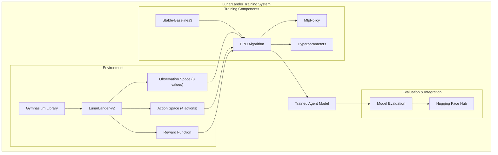
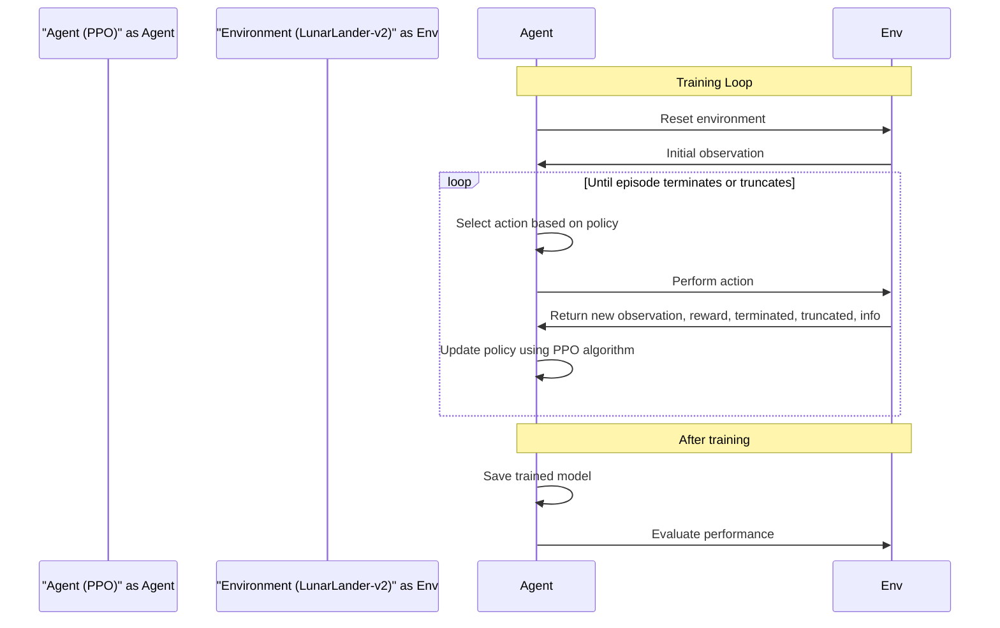
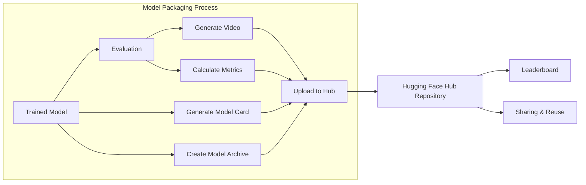

<!-- source: DeepWiki mcp.deepwiki.com · repo huggingface/deep-rl-class · page 2.1 LunarLander with Stable-Baselines3 · fetched 2026-10-26 -->

# LunarLander with Stable-Baselines3

<details>
<summary>Relevant source files</summary>

The following files were used as context for generating this wiki page:

- [notebooks/unit1/requirements-unit1.txt](notebooks/unit1/requirements-unit1.txt)
- [notebooks/unit1/unit1.ipynb](notebooks/unit1/unit1.ipynb)
- [units/en/unit1/hands-on.mdx](units/en/unit1/hands-on.mdx)

</details>


This document provides technical documentation for the LunarLander with Stable-Baselines3 system, which is the first hands-on exercise in the Deep Reinforcement Learning course. The system enables users to train a deep reinforcement learning agent to land correctly on the moon using the LunarLander-v2 environment and the Proximal Policy Optimization (PPO) algorithm.

## Purpose and Components

This system serves as an introduction to deep reinforcement learning implementation using established libraries. It covers:

1. Environment setup with Gymnasium
2. Agent training using Stable-Baselines3
3. Model evaluation 
4. Sharing trained models via Hugging Face Hub

Sources: [units/en/unit1/hands-on.mdx:41-66]()

## System Architecture

The following diagram illustrates the high-level architecture of the LunarLander with Stable-Baselines3 system:



Sources: [notebooks/unit1/unit1.ipynb:35-65](), [units/en/unit1/hands-on.mdx:283-345]()

## LunarLander Environment

The LunarLander-v2 environment, part of the Gymnasium library (formerly OpenAI Gym), simulates a lunar lander module that needs to land safely on a designated landing pad on the moon's surface.

### State and Action Spaces

| Component | Type | Details |
|-----------|------|---------|
| Observation Space | 8-dimensional vector | 1. Horizontal position (x)<br>2. Vertical position (y)<br>3. Horizontal velocity (x)<br>4. Vertical velocity (y)<br>5. Angle<br>6. Angular velocity<br>7. Left leg contact (boolean)<br>8. Right leg contact (boolean) |
| Action Space | Discrete, 4 actions | 0: Do nothing<br>1: Fire left orientation engine<br>2: Fire main engine<br>3: Fire right orientation engine |

Sources: [notebooks/unit1/unit1.ipynb:302-335](), [units/en/unit1/hands-on.mdx:306-334]() 

### Reward Structure

The reward function is designed to encourage proper landing behavior:

- **Per-step rewards**:
  - Increases as the lander gets closer to the landing pad
  - Increases as the lander's movement slows down
  - Decreases as the lander tilts (deviates from horizontal)
  - +10 points for each leg in contact with the ground
  - -0.03 points when a side engine fires
  - -0.3 points when the main engine fires

- **Terminal rewards**:
  - +100 points for safe landing
  - -100 points for crashing

An episode is considered successful if the total reward is at least 200 points.

Sources: [notebooks/unit1/unit1.ipynb:517-536](), [units/en/unit1/hands-on.mdx:335-350]()

## Reinforcement Learning Process

The system implements a standard reinforcement learning loop using the LunarLander environment:



Sources: [notebooks/unit1/unit1.ipynb:344-428](), [units/en/unit1/hands-on.mdx:221-281]()

## Stable-Baselines3 Implementation

The system uses Stable-Baselines3, a reliable deep reinforcement learning library that provides implementations of popular algorithms including PPO (Proximal Policy Optimization).

### PPO Algorithm Configuration

The PPO algorithm is configured with the following parameters:

```python
model = PPO(
    policy="MlpPolicy",
    env=env,
    n_steps=1024,
    batch_size=64,
    n_epochs=4,
    gamma=0.999,
    gae_lambda=0.98,
    ent_coef=0.01,
    verbose=1
)
```

Key configuration elements:
- `MlpPolicy`: Uses a Multi-Layer Perceptron neural network since the input is a vector
- `n_steps`: Number of steps to run for each environment per update
- `batch_size`: Minibatch size for gradient updates
- `gamma`: Discount factor for future rewards
- `ent_coef`: Entropy coefficient for exploration

Sources: [notebooks/unit1/unit1.ipynb:662-672](), [units/en/unit1/hands-on.mdx:412-426]()

### Training Process

The training process consists of the following key steps:

1. Create a vectorized environment with multiple instances for more diverse experiences
2. Initialize the PPO model with appropriate hyperparameters
3. Train the model for a specified number of timesteps (typically 1,000,000)
4. Save the trained model

```python
# Create vectorized environment
env = make_vec_env("LunarLander-v2", n_envs=16)

# Initialize and train the model
model.learn(total_timesteps=1000000)

# Save the model
model_name = "ppo-LunarLander-v2"
model.save(model_name)
```

Sources: [notebooks/unit1/unit1.ipynb:558-560](), [notebooks/unit1/unit1.ipynb:716-722](), [units/en/unit1/hands-on.mdx:444-448]()

## Model Evaluation

After training, the agent's performance is evaluated to ensure it has learned to land successfully:

1. A separate evaluation environment is created
2. The trained policy is run for multiple episodes
3. Mean reward and standard deviation are calculated

```python
eval_env = Monitor(gym.make("LunarLander-v2"))
mean_reward, std_reward = evaluate_policy(model, eval_env, n_eval_episodes=10, deterministic=True)
```

A successful model should achieve a mean reward of at least 200 points.

Sources: [notebooks/unit1/unit1.ipynb:779-781](), [units/en/unit1/hands-on.mdx:476-478]()

## Hugging Face Hub Integration

One of the key features of this system is the integration with the Hugging Face Hub, allowing users to share their trained models with the community.

### Model Packaging and Uploading

The system uses the `package_to_hub` function to:

1. Evaluate the trained model
2. Generate a replay video of the agent's performance
3. Create a model card with relevant information
4. Upload everything to the Hugging Face Hub



The `package_to_hub` function requires several parameters:
- `model`: The trained model
- `model_name`: Name of the trained model
- `model_architecture`: The algorithm used (PPO)
- `env_id`: Environment identifier (LunarLander-v2)
- `eval_env`: Environment for evaluation
- `repo_id`: Hugging Face Hub repository ID
- `commit_message`: Description of the upload

Sources: [notebooks/unit1/unit1.ipynb:975-981](), [units/en/unit1/hands-on.mdx:556-564]()

### Loading Models from the Hub

The system also allows users to load trained models from the Hugging Face Hub:

```python
from huggingface_sb3 import load_from_hub

repo_id = "username/model-repository"
filename = "ppo-LunarLander-v2.zip"

checkpoint = load_from_hub(repo_id, filename)
model = PPO.load(checkpoint)
```

This enables sharing and reuse of trained agents within the community.

Sources: [notebooks/unit1/unit1.ipynb:1059-1075](), [units/en/unit1/hands-on.mdx:657-658]()

## Dependencies

The system relies on the following key dependencies:

| Dependency | Purpose |
|------------|---------|
| gymnasium[box2d] | Provides the LunarLander-v2 environment |
| stable-baselines3 | Deep reinforcement learning library with PPO implementation |
| huggingface_sb3 | Integration with Hugging Face Hub for model sharing |

These dependencies are specified in the requirements file.

Sources: [notebooks/unit1/requirements-unit1.txt:1-4](), [units/en/unit1/hands-on.mdx:141-154]()

## Certification Requirements

To successfully complete this hands-on exercise for certification purposes, users must:

1. Train a LunarLander agent using PPO
2. Push the trained model to the Hugging Face Hub
3. Achieve a result of at least 200 points (calculated as mean_reward - standard_deviation)

The leaderboard allows users to compare their results with others in the community.

Sources: [units/en/unit1/hands-on.mdx:19-26](), [notebooks/unit1/unit1.ipynb:168-173]()

---

