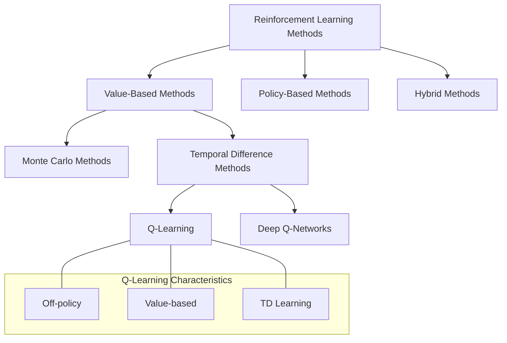
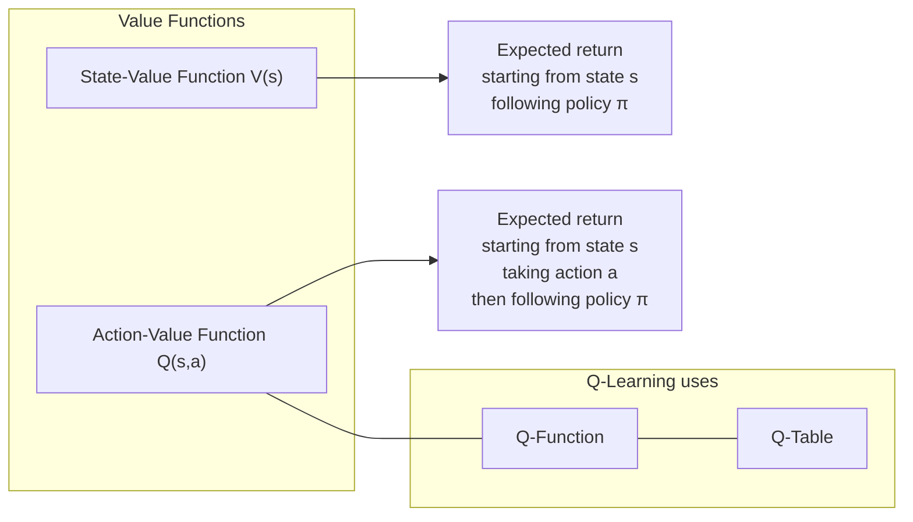
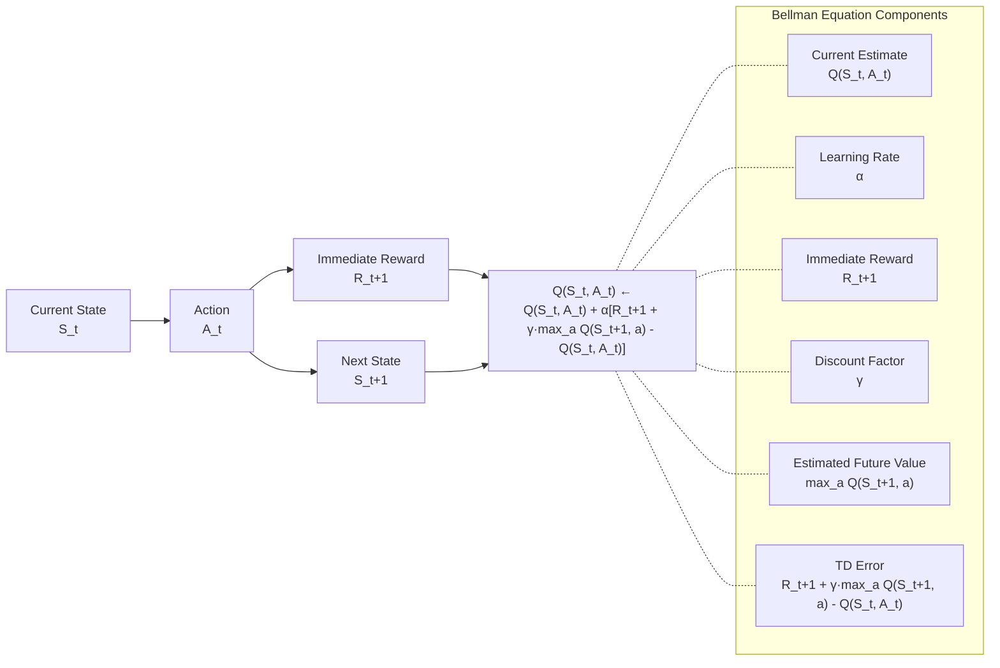
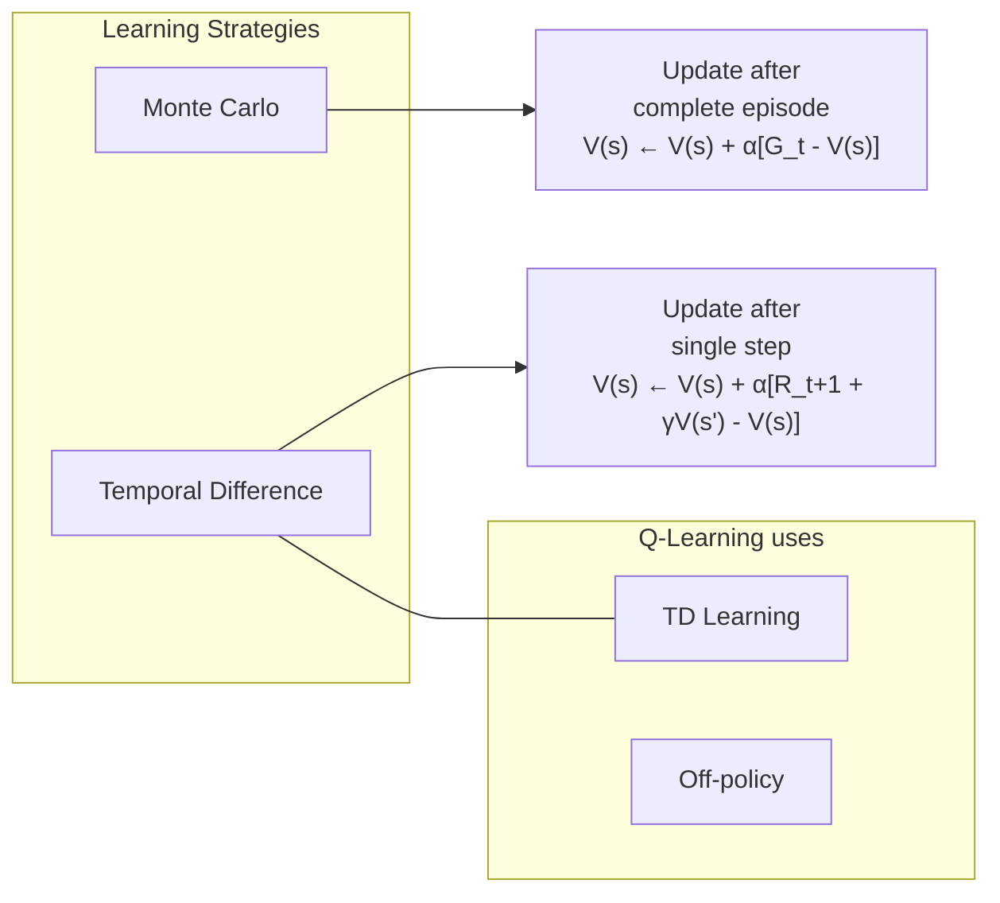
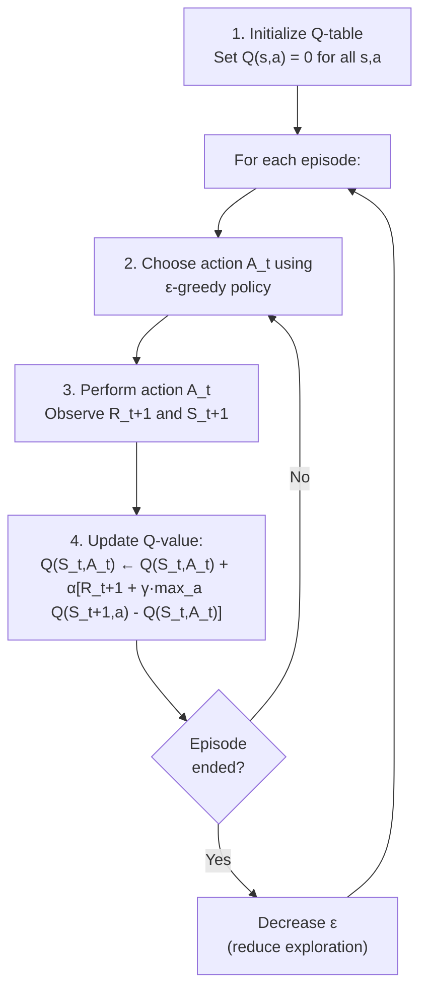
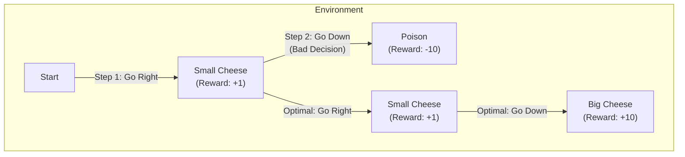

<!-- source: DeepWiki mcp.deepwiki.com · repo huggingface/deep-rl-class · page 3 Q-Learning · fetched 2026-10-26 -->

# Q-Learning

Relevant source files

The following files were used as context for generating this wiki page:

- [units/en/unit2/bellman-equation.mdx](units/en/unit2/bellman-equation.mdx)
- [units/en/unit2/glossary.mdx](units/en/unit2/glossary.mdx)
- [units/en/unit2/introduction.mdx](units/en/unit2/introduction.mdx)
- [units/en/unit2/mc-vs-td.mdx](units/en/unit2/mc-vs-td.mdx)
- [units/en/unit2/mid-way-recap.mdx](units/en/unit2/mid-way-recap.mdx)
- [units/en/unit2/q-learning-example.mdx](units/en/unit2/q-learning-example.mdx)
- [units/en/unit2/q-learning-recap.mdx](units/en/unit2/q-learning-recap.mdx)
- [units/en/unit2/q-learning.mdx](units/en/unit2/q-learning.mdx)
- [units/en/unit2/quiz2.mdx](units/en/unit2/quiz2.mdx)
- [units/en/unit2/two-types-value-based-methods.mdx](units/en/unit2/two-types-value-based-methods.mdx)

Q-Learning is a foundational value-based reinforcement learning algorithm that learns an optimal action-value function to solve sequential decision-making problems. This document explains the core concepts of Q-Learning, how it works, and its implementation in the Deep Reinforcement Learning course.

For implementation details and practical examples, see [Q-Learning Implementation](#3.1).

## What is Q-Learning?

Q-Learning is an **off-policy value-based method** that uses a **Temporal Difference (TD) approach** to train its action-value function. The name "Q-Learning" comes from the "Quality" of actions at particular states.

Key characteristics of Q-Learning:

- **Off-policy**: Uses different policies for acting (epsilon-greedy) and updating (greedy)
- **Value-based**: Finds the optimal policy indirectly by training an action-value function
- **TD approach**: Updates its action-value function at each step rather than at the end of episodes

Q-Learning trains a **Q-function**, which is an action-value function that determines the value of being at a particular state and taking a specific action. This function is represented internally by a **Q-table**, which stores values for all state-action pairs.

Sources: [units/en/unit2/q-learning.mdx:1-18](), [units/en/unit2/glossary.mdx:10-14]()

## Value-Based Methods in Reinforcement Learning

In value-based methods, we learn a value function that maps a state to the expected value of being at that state. There are two main types of value functions:

### State-Value vs Action-Value Functions

1. **State-Value Function (V-function)**:
   - Maps a state to the expected return if the agent starts in that state and follows the policy
   - Notation: V(s) = Expected return starting at state s and following policy π

2. **Action-Value Function (Q-function)**:
   - Maps a state-action pair to the expected return
   - Notation: Q(s,a) = Expected return starting at state s, taking action a, then following policy π
   - **Q-Learning specifically uses this type of value function**

The relationship between an optimal value function and optimal policy is direct: once we have an optimal Q-function, we automatically get an optimal policy by selecting the action with the highest Q-value at each state.

Sources: [units/en/unit2/two-types-value-based-methods.mdx:1-42](), [units/en/unit2/q-learning.mdx:10-18]()

## The Bellman Equation

The Bellman equation simplifies the calculation of state values or state-action values by making them recursive. Instead of calculating the expected return from scratch for each state, we can use the Bellman equation.

The Bellman equation for Q-Learning states that:

Q(S_t, A_t) ← Q(S_t, A_t) + α[R_t+1 + γ·max_a Q(S_t+1, a) - Q(S_t, A_t)]

Where:
- Q(S_t, A_t) is the current estimate of the state-action value
- α is the learning rate
- R_t+1 is the immediate reward after taking action A_t in state S_t
- γ is the discount factor (typically 0.9-0.99)
- max_a Q(S_t+1, a) is the maximum Q-value for the next state across all possible actions
- The expression [R_t+1 + γ·max_a Q(S_t+1, a) - Q(S_t, A_t)] is called the TD error

Instead of calculating each value as the sum of all expected future rewards (which would be computationally expensive), the Bellman equation allows us to calculate the value as the immediate reward plus the discounted value of the best next state-action pair.

Sources: [units/en/unit2/bellman-equation.mdx:1-63](), [units/en/unit2/q-learning.mdx:98-120]()

## Monte Carlo vs Temporal Difference Learning

Q-Learning uses Temporal Difference (TD) learning, which is important to understand in contrast with Monte Carlo methods.

### Monte Carlo
- Learns from **complete episodes**
- Updates the value function using the actual return G_t
- Formula: V(s) ← V(s) + α[G_t - V(s)]
- Must wait until the episode ends to learn

### Temporal Difference Learning
- Learns from **single steps** (S_t, A_t, R_t+1, S_t+1)
- Updates the value function using an estimated return (bootstrapping)
- Formula: V(s) ← V(s) + α[R_t+1 + γV(s') - V(s)]
- Can learn before knowing the final outcome

**Q-Learning uses TD learning** because it updates its Q-values after each step using the TD target [R_t+1 + γ·max_a Q(S_t+1, a)] rather than waiting for the full episode return.

Sources: [units/en/unit2/mc-vs-td.mdx:1-136](), [units/en/unit2/q-learning.mdx:4-8]()

## The Q-Learning Algorithm

The Q-Learning algorithm can be broken down into four main steps:

### 1. Initialize the Q-table
- Create a table with dimensions |S|×|A| (states × actions)
- Initialize all values to zero (or sometimes small random values)

### 2. Choose an action using the epsilon-greedy strategy
- With probability 1-ε: select the action with the highest Q-value (exploitation)
- With probability ε: select a random action (exploration)
- ε starts high (e.g., 1.0) and decays over time as the agent learns

### 3. Perform the action and observe
- Execute the chosen action A_t
- Observe the reward R_t+1 and next state S_t+1

### 4. Update the Q-value
- Update Q(S_t, A_t) using the formula:
  Q(S_t, A_t) ← Q(S_t, A_t) + α[R_t+1 + γ·max_a Q(S_t+1, a) - Q(S_t, A_t)]
- Note that max_a Q(S_t+1, a) uses a greedy policy for the update

### Off-Policy Learning in Q-Learning
Q-Learning is an off-policy algorithm because it uses:
- An **epsilon-greedy policy** for selecting actions during training (exploration/exploitation)
- A **greedy policy** for updating Q-values (always selects the action with the highest Q-value)

This difference between the policy used for acting and the policy used for updating makes Q-Learning off-policy.

Sources: [units/en/unit2/q-learning.mdx:63-158](), [units/en/unit2/q-learning-recap.mdx:1-25]()

## Q-Learning Example

Let's look at a simplified example of Q-Learning in a small maze environment:

### Training Step 1:
1. **Starting state**: Mouse is at the initial position
2. **Action selection**: Agent chooses to go right (exploration with ε=1.0)
3. **Reward and next state**: Receives reward +1 (small cheese), moves to new state
4. **Q-value update**: Using learning rate α=0.1 and discount factor γ=0.99
   - Q(Start, Right) = 0 + 0.1 × [1 + 0.99 × max(0,0,0,0) - 0] = 0.1

### Training Step 2:
1. **Current state**: Mouse is at position with small cheese
2. **Action selection**: Agent chooses to go down (exploration with ε=0.99)
3. **Reward and next state**: Receives reward -10 (poison), episode ends
4. **Q-value update**:
   - Q(Cheese1, Down) = 0 + 0.1 × [-10 + 0 - 0] = -1.0

After these two steps, the Q-table has already started to learn that going down at the first cheese state is a bad idea (-1.0). As training continues with more episodes, the Q-table values will converge toward the optimal policy.

Sources: [units/en/unit2/q-learning-example.mdx:1-84]()

## Q-Learning Limitations and Extensions

While Q-Learning is powerful for discrete state and action spaces, it has limitations:

1. **Tabular representation**: The Q-table grows exponentially with the state and action space size
2. **Discrete spaces**: Traditional Q-Learning works best with discrete state and action spaces
3. **Limited generalization**: Doesn't generalize well to similar but unseen states

To address these limitations, extensions of Q-Learning include:
- **Deep Q-Networks (DQN)**: Replace the Q-table with a neural network for function approximation
- **Double Q-Learning**: Reduce overestimation of Q-values
- **Prioritized Experience Replay**: Focus learning on important transitions

For more information on these extensions, see [Deep Q-Learning](#4).

Sources: [units/en/unit2/introduction.mdx:8-25]()

## Applications in the Course

In the Deep RL Course, Q-Learning is implemented and applied to two main environments:

1. **FrozenLake-v1 (non-slippery version)**:
   - Agent must navigate from start (S) to goal (G)
   - Must walk only on frozen tiles (F) and avoid holes (H)
   - Discrete state space with a manageable number of states

2. **Taxi-v3**:
   - Agent controls a taxi that must transport passengers from point A to point B
   - Navigation task in a grid-world environment
   - Perfect for tabular Q-Learning due to its discrete state and action spaces

These environments provide practical examples of Q-Learning implementation and serve as a foundation for understanding more complex reinforcement learning algorithms like Deep Q-Networks.

Sources: [units/en/unit2/introduction.mdx:10-16]()

---

