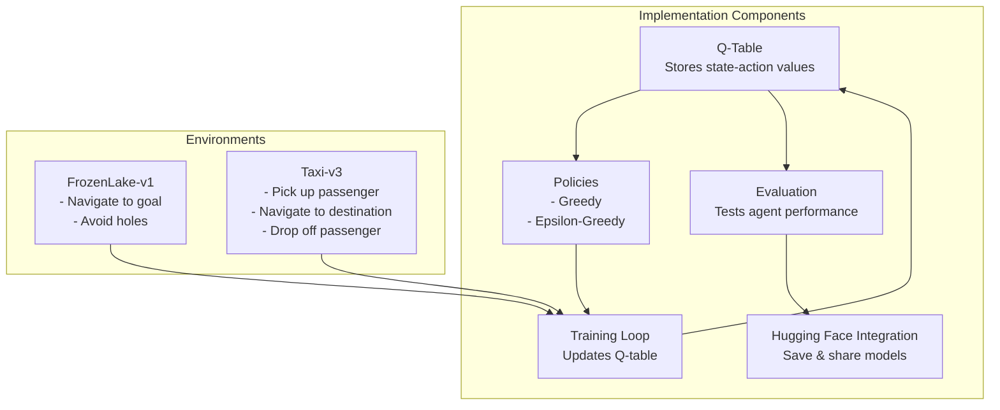
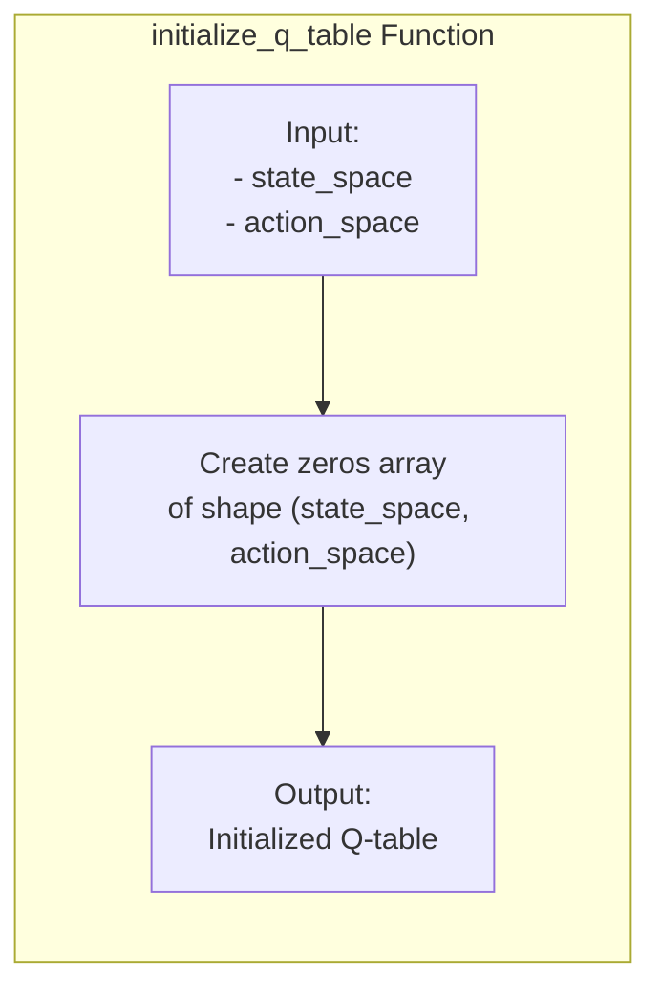
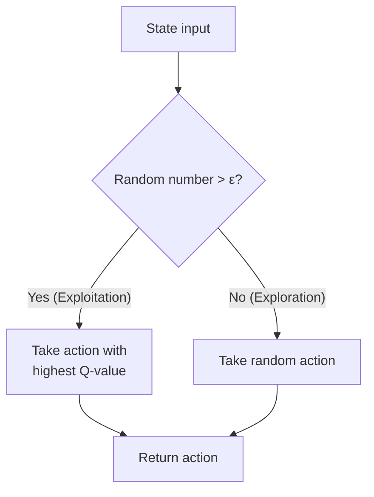
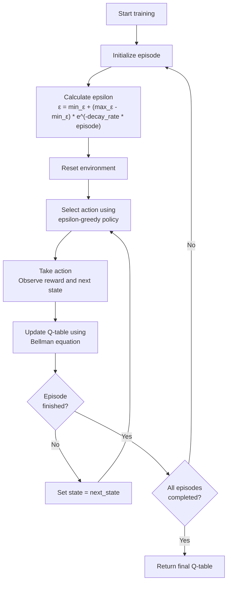
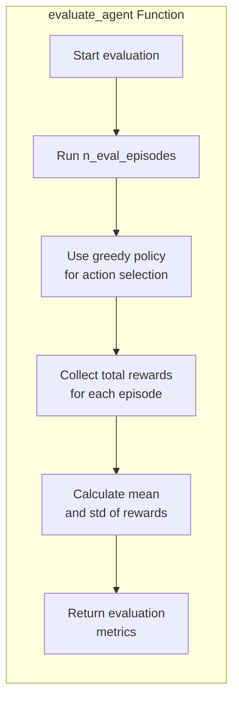
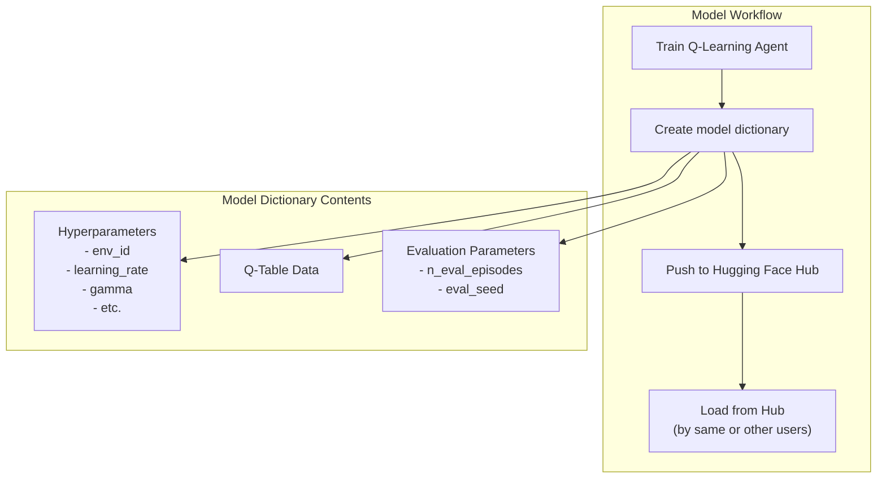

<!-- source: DeepWiki mcp.deepwiki.com · repo huggingface/deep-rl-class · page 3.1 Q-Learning Implementation · fetched 2026-10-26 -->

# Q-Learning Implementation

<details>
<summary>Relevant source files</summary>

The following files were used as context for generating this wiki page:

- [notebooks/unit2/requirements-unit2.txt](notebooks/unit2/requirements-unit2.txt)
- [notebooks/unit2/unit2.ipynb](notebooks/unit2/unit2.ipynb)
- [units/en/unit2/hands-on.mdx](units/en/unit2/hands-on.mdx)

</details>


This document details the hands-on implementation of Q-Learning in the Deep Reinforcement Learning course. It focuses specifically on coding a Q-Learning agent from scratch to solve two environments: FrozenLake-v1 and Taxi-v3. For theoretical background on Q-Learning, see [Q-Learning](#3).

## Overview

Q-Learning is a value-based reinforcement learning algorithm that uses a Q-table to store and update action-value estimations. This implementation demonstrates how to:

1. Create and initialize a Q-table
2. Implement greedy and epsilon-greedy policies
3. Build a training loop for Q-Learning
4. Evaluate agent performance
5. Share trained models via Hugging Face Hub

Sources: [units/en/unit2/hands-on.mdx:92-106](), [notebooks/unit2/unit2.ipynb:132-158]()

## Implementation Architecture

The Q-Learning implementation follows this general architecture:



Sources: [units/en/unit2/hands-on.mdx:15-17](), [notebooks/unit2/unit2.ipynb:19-35]()

## Q-Table Structure and Initialization

The Q-table is a matrix where:
- Rows represent states in the environment
- Columns represent possible actions
- Each cell contains the estimated Q-value for a state-action pair



The initialization code creates a zero-filled NumPy array with dimensions matching the state and action spaces:

```python
def initialize_q_table(state_space, action_space):
    Qtable = np.zeros((state_space, action_space))
    return Qtable
```

Sources: [units/en/unit2/hands-on.mdx:285-320](), [notebooks/unit2/unit2.ipynb:487-565]()

## Policies Implementation

Two policies are implemented for the Q-Learning agent:

1. **Greedy Policy**: Always selects the action with the highest Q-value for a given state (exploitation)
2. **Epsilon-Greedy Policy**: Balances exploration and exploitation by:
   - With probability ε: Select a random action (exploration)
   - With probability 1-ε: Select the action with the highest Q-value (exploitation)



Epsilon decreases over time to shift from exploration to exploitation as the agent learns.

### Greedy Policy

```python
def greedy_policy(Qtable, state):
    # Select action with highest state-action value
    action = np.argmax(Qtable[state][:])
    return action
```

### Epsilon-Greedy Policy

```python
def epsilon_greedy_policy(Qtable, state, epsilon):
    random_num = random.uniform(0, 1)
    if random_num > epsilon:
        # Exploitation: use greedy policy
        action = greedy_policy(Qtable, state)
    else:
        # Exploration: take random action
        action = env.action_space.sample()
    return action
```

Sources: [units/en/unit2/hands-on.mdx:331-408](), [notebooks/unit2/unit2.ipynb:584-708]()

## Training Loop Implementation

The training loop is the core of the Q-Learning algorithm, where the agent interacts with the environment and updates the Q-table based on the observed rewards and transitions.



The Q-table update uses the Bellman equation:

```
Q(s,a) = Q(s,a) + learning_rate * [reward + gamma * max_a' Q(s',a') - Q(s,a)]
```

The implementation in code:

```python
def train(n_training_episodes, min_epsilon, max_epsilon, decay_rate, env, max_steps, Qtable):
    for episode in tqdm(range(n_training_episodes)):
        # Calculate epsilon for this episode
        epsilon = min_epsilon + (max_epsilon - min_epsilon) * np.exp(-decay_rate * episode)
        
        # Reset environment
        state, info = env.reset()
        terminated = False
        truncated = False
        
        for step in range(max_steps):
            # Select action using epsilon-greedy policy
            action = epsilon_greedy_policy(Qtable, state, epsilon)
            
            # Take action and observe result
            new_state, reward, terminated, truncated, info = env.step(action)
            
            # Update Q-table using Bellman equation
            Qtable[state][action] = Qtable[state][action] + learning_rate * (
                reward + gamma * np.max(Qtable[new_state]) - Qtable[state][action]
            )
            
            # Check if episode is done
            if terminated or truncated:
                break
                
            # Move to next state
            state = new_state
            
    return Qtable
```

Sources: [units/en/unit2/hands-on.mdx:434-518](), [notebooks/unit2/unit2.ipynb:758-864]()

## Environment Configurations

The implementation uses two distinct environments from Gymnasium:

### FrozenLake-v1

- **Objective**: Navigate from start (S) to goal (G) by walking only on frozen tiles (F) and avoiding holes (H)
- **State Space**: 16 discrete states (in 4x4 grid)
- **Action Space**: 4 actions (left, down, right, up)
- **Reward Structure**: 
  - Reach goal: +1
  - Reach hole or frozen tile: 0

```python
env = gym.make("FrozenLake-v1", map_name="4x4", is_slippery=False, render_mode="rgb_array")
```

### Taxi-v3

- **Objective**: Pick up passenger at one location and drop them off at destination
- **State Space**: 500 discrete states (25 taxi positions × 5 passenger locations × 4 destinations)
- **Action Space**: 6 actions (move south, north, east, west, pickup, dropoff)
- **Reward Structure**:
  - Each step: -1
  - Successful passenger delivery: +20
  - Illegal pickup/dropoff: -10

```python
env = gym.make("Taxi-v3", render_mode="rgb_array")
```

Sources: [units/en/unit2/hands-on.mdx:193-276](), [units/en/unit2/hands-on.mdx:831-879](), [notebooks/unit2/unit2.ipynb:310-440](), [notebooks/unit2/unit2.ipynb:1355-1438]()

## Hyperparameters

Hyperparameters significantly impact the agent's learning process. Key hyperparameters include:

| Hyperparameter | FrozenLake-v1 | Taxi-v3 | Description |
|----------------|---------------|---------|-------------|
| `n_training_episodes` | 10,000 | 25,000 | Total number of training episodes |
| `learning_rate` | 0.7 | 0.7 | Learning rate for Q-value updates |
| `max_steps` | 99 | 99 | Maximum steps per episode |
| `gamma` | 0.95 | 0.95 | Discount factor for future rewards |
| `max_epsilon` | 1.0 | 1.0 | Initial exploration probability |
| `min_epsilon` | 0.05 | 0.05 | Minimum exploration probability |
| `decay_rate` | 0.0005 | 0.005 | Exponential decay rate for exploration |

Choosing appropriate hyperparameters is crucial for successful learning:
- Higher `n_training_episodes` allows more time for the agent to learn, especially in complex environments
- The `decay_rate` controls the exploration-exploitation trade-off over time
- `gamma` determines how much the agent values future rewards compared to immediate ones

Sources: [units/en/unit2/hands-on.mdx:413-430](), [units/en/unit2/hands-on.mdx:892-1012](), [notebooks/unit2/unit2.ipynb:732-750](), [notebooks/unit2/unit2.ipynb:1473-1494]()

## Evaluation Process

After training, the agent is evaluated to measure its performance:



The evaluation function:
- Runs the agent for a fixed number of evaluation episodes
- Uses the greedy policy (no exploration)
- Returns the mean and standard deviation of collected rewards

For certification purposes, the metric used is `mean_reward - std_reward`, with a passing threshold of ≥ 4.5 for the Taxi-v3 environment.

Sources: [units/en/unit2/hands-on.mdx:572-570](), [notebooks/unit2/unit2.ipynb:925-958]()

## Hugging Face Hub Integration

A key feature of this implementation is the ability to save, share, and load models using the Hugging Face Hub:



The model dictionary structure includes:
- Environment identifier
- All hyperparameters used in training
- The trained Q-table
- Evaluation parameters 

The `push_to_hub` function handles:
1. Creating or updating a repository on Hugging Face Hub
2. Serializing the model dictionary
3. Running evaluation to generate metrics
4. Recording a video replay of the agent
5. Generating a model card
6. Uploading all files to the Hub

This enables sharing trained agents with the community and maintaining a leaderboard for comparing different implementations.

Sources: [units/en/unit2/hands-on.mdx:584-755](), [units/en/unit2/hands-on.mdx:1024-1047](), [notebooks/unit2/unit2.ipynb:992-1197](), [notebooks/unit2/unit2.ipynb:1537-1552]()

## Loading Models from Hugging Face Hub

The implementation also provides functionality to load pre-trained models from the Hub:

```python
def load_from_hub(repo_id: str, filename: str) -> str:
    # Get the model from the Hub
    pickle_model = hf_hub_download(repo_id=repo_id, filename=filename)
    
    # Load the serialized model
    with open(pickle_model, 'rb') as f:
        downloaded_model_file = pickle.load(f)
        
    return downloaded_model_file
```

This allows users to:
1. Browse Q-Learning models on the Hub
2. Download and use models trained by others
3. Compare different training approaches

Sources: [units/en/unit2/hands-on.mdx:1071-1090](), [notebooks/unit2/unit2.ipynb:1634-1649]()

## Conclusion

This Q-Learning implementation provides a complete, from-scratch approach to building reinforcement learning agents for discrete environments. The implementation is modular, well-documented, and integrated with Hugging Face Hub for easy sharing and comparison.

While effective for environments with small, discrete state spaces like FrozenLake-v1 and Taxi-v3, this tabular Q-Learning approach becomes impractical for environments with large state spaces. For complex environments, Deep Q-Learning (see [Deep Q-Learning](#4)) provides a more scalable alternative by replacing the Q-table with a neural network function approximator.

Sources: [units/en/unit2/hands-on.mdx:1127-1143](), [notebooks/unit2/unit2.ipynb:1719-1734]()

---

