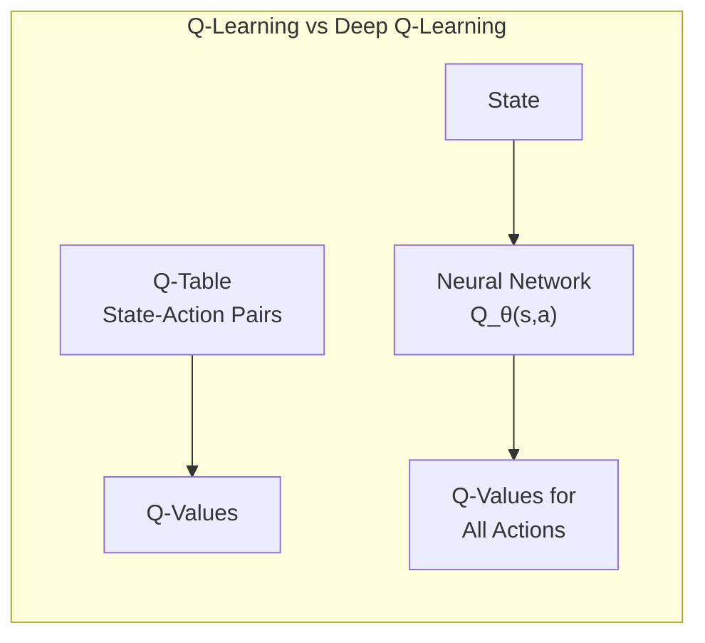
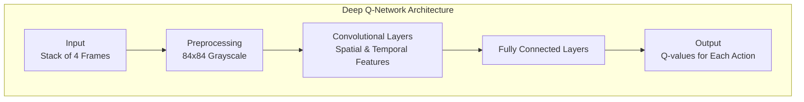
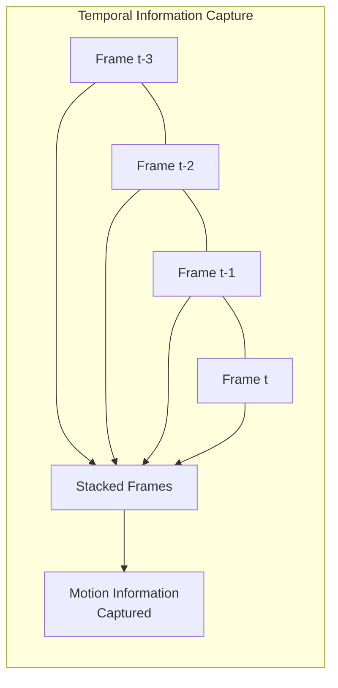
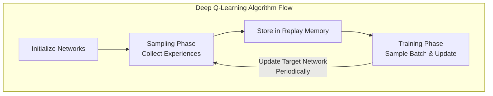
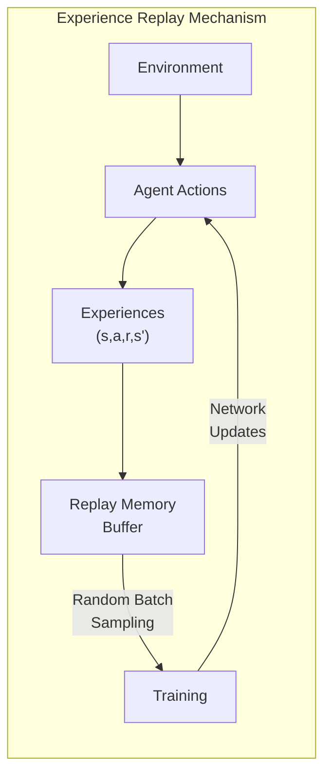
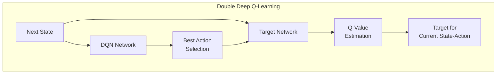

<!-- source: DeepWiki mcp.deepwiki.com · repo huggingface/deep-rl-class · page 4 Deep Q-Learning · fetched 2026-10-26 -->

# Deep Q-Learning

Relevant source files

The following files were used as context for generating this wiki page:

- [units/en/unit3/conclusion.mdx](units/en/unit3/conclusion.mdx)
- [units/en/unit3/deep-q-network.mdx](units/en/unit3/deep-q-network.mdx)
- [units/en/unit3/from-q-to-dqn.mdx](units/en/unit3/from-q-to-dqn.mdx)
- [units/en/unit3/introduction.mdx](units/en/unit3/introduction.mdx)
- [units/en/unit3/quiz.mdx](units/en/unit3/quiz.mdx)

Deep Q-Learning represents a significant advancement in reinforcement learning that addresses the limitations of traditional Q-Learning by replacing the Q-table with a neural network. This page documents the Deep Q-Learning algorithm and its architecture as implemented in the deep-rl-class repository. For information about implementing DQN with Atari games, see [DQN with Atari Games](#4.1).

## Purpose and Scope

Deep Q-Learning enables reinforcement learning agents to handle environments with large state spaces that would be impractical to represent using traditional Q-tables. It uses neural networks to approximate Q-values, making it suitable for complex tasks like playing Atari games where the state space can contain up to 10^11 states.

Sources: [units/en/unit3/introduction.mdx:8-14](), [units/en/unit3/from-q-to-dqn.mdx:21-31]()

## From Q-Learning to Deep Q-Learning

### Limitations of Tabular Q-Learning

Q-Learning is a tabular method that works by creating and updating a Q-table which maps state-action pairs to value estimates. While effective for environments with small, discrete state spaces (like FrozenLake with 16 states or Taxi-v3 with 500 states), it becomes impractical for environments with large state spaces:

- **Atari Environments**: Have an observation space with shape (210, 160, 3) with values from 0-255
- **State Space Size**: This creates 256^100800 possible observations (compared to approximately 10^80 atoms in the observable universe)
- **Memory Requirements**: Storing a Q-table for such environments would be prohibitively large

Sources: [units/en/unit3/from-q-to-dqn.mdx:3-25]()

### Neural Network Function Approximation

Deep Q-Learning addresses this limitation by approximating the Q-function using a neural network. Instead of a lookup table, we use a parametrized Q-function Q_θ(s,a) where:
- The network takes a state as input
- The network outputs Q-values for each possible action at that state
- The weights θ are learned through training

Sources: [units/en/unit3/from-q-to-dqn.mdx:27-34]()

## Deep Q-Network Architecture

The Deep Q-Network (DQN) architecture transforms raw game frames into action values through several processing steps:

Sources: [units/en/unit3/deep-q-network.mdx:1-41]()

### Input Preprocessing

To make training computationally feasible, the input game frames must be preprocessed:

1. **Dimensionality Reduction**: Frames are reduced to 84x84 pixels
2. **Grayscale Conversion**: Color channels (RGB) are reduced to a single grayscale channel
3. **Frame Stacking**: Four consecutive frames are stacked together
4. **Optional Cropping**: In some games, irrelevant screen portions can be cropped out

Sources: [units/en/unit3/deep-q-network.mdx:10-18]()

### Temporal Information Through Frame Stacking

Stacking four frames together is crucial for capturing temporal information - the movement and direction of objects in the game:

Without frame stacking, it would be impossible to determine direction of movement (e.g., a ball in Pong) from a single static frame.

Sources: [units/en/unit3/deep-q-network.mdx:22-31]()

### Network Structure

The DQN uses:

1. **Convolutional Layers**: Process the stacked frames to extract:
   - Spatial features within each frame
   - Temporal features across the stacked frames

2. **Fully Connected Layers**: Take the features extracted by the convolutional layers and output a Q-value for each possible action in the environment

This architecture allows the network to approximate, for any given state, the Q-values for all possible actions at that state.

Sources: [units/en/unit3/deep-q-network.mdx:32-41]()

## Deep Q-Learning Algorithm

The Deep Q-Learning algorithm introduces several innovations beyond the neural network architecture to make training stable and efficient.

Sources: [units/en/unit3/quiz.mdx:47-70]()

### Two Core Phases

The algorithm consists of two primary phases:

1. **Sampling Phase**: 
   - Agent interacts with the environment using an epsilon-greedy policy
   - Experiences (state, action, reward, next_state) are collected
   - Experiences are stored in a replay memory buffer

2. **Training Phase**:
   - Random batches of experiences are sampled from the replay memory
   - Network is updated using gradient descent to minimize the difference between:
     - Current Q-value estimates
     - Target Q-values calculated using the Bellman equation

Sources: [units/en/unit3/quiz.mdx:47-70]()

### Experience Replay

Experience replay is a critical component that:

1. **Improves Sample Efficiency**: Experiences can be reused multiple times for training
2. **Reduces Correlation**: Random sampling breaks the correlation between sequential experiences
3. **Prevents Forgetting**: Allows the agent to learn from a diverse set of experiences rather than only the most recent ones

Sources: [units/en/unit3/quiz.mdx:72-87]()

### Double Deep Q-Learning

Double Deep Q-Learning addresses the overestimation bias in standard DQN by decoupling action selection from action evaluation:

1. **Action Selection**: The main DQN network selects the action with the highest Q-value for the next state
2. **Value Estimation**: A separate target network evaluates the Q-value of that selected action

This technique helps prevent the overestimation of Q-values and leads to more stable training.

Sources: [units/en/unit3/quiz.mdx:89-101]()

## Training Deep Q-Learning Agents

In the course's practical component, Deep Q-Learning agents are trained to play Atari games using the RL-Zoo framework, which provides:

1. Scripts for training and evaluating agents
2. Hyperparameter tuning capabilities
3. Tools for plotting results and recording videos
4. Integration with the Hugging Face Hub for model sharing

The implementation enables students to train Deep Q-Learning agents on classic environments like Space Invaders, Pong, Seaquest, QBert, and Ms Pac Man.

Sources: [units/en/unit3/introduction.mdx:15-17](), [units/en/unit3/conclusion.mdx:7-9]()

## Summary

Deep Q-Learning represents a fundamental advancement in reinforcement learning by combining:

1. The Q-Learning algorithm's value-based approach
2. Neural networks for function approximation
3. Experience replay for efficient use of experiences
4. Target networks for training stability

These innovations enable reinforcement learning to tackle complex environments with large state spaces that would be impossible to solve with traditional tabular methods.

---

