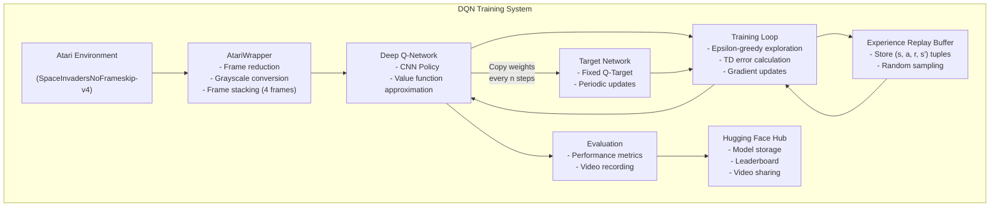
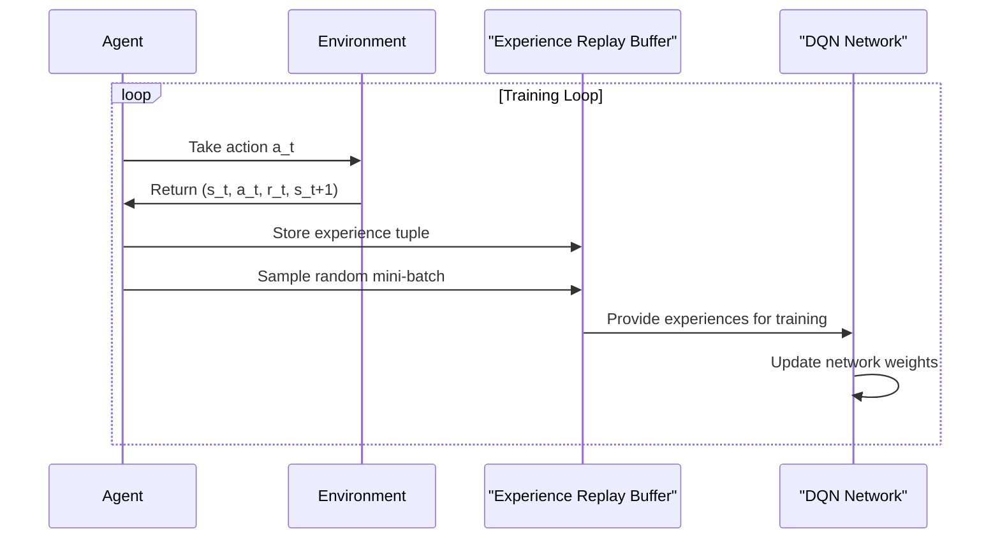
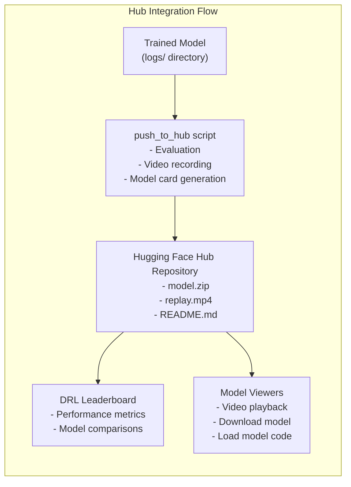

<!-- source: DeepWiki mcp.deepwiki.com · repo huggingface/deep-rl-class · page 4.1 DQN with Atari Games · fetched 2026-10-26 -->

# DQN with Atari Games

<details>
<summary>Relevant source files</summary>

The following files were used as context for generating this wiki page:

- [notebooks/unit3/unit3.ipynb](notebooks/unit3/unit3.ipynb)
- [units/en/unit3/deep-q-algorithm.mdx](units/en/unit3/deep-q-algorithm.mdx)
- [units/en/unit3/hands-on.mdx](units/en/unit3/hands-on.mdx)

</details>


## Purpose and Scope

This document describes the implementation of Deep Q-Learning (DQN) with Atari games using RL Baselines3 Zoo. It covers the training process, configuration, evaluation, and sharing of DQN agents for Atari environments like Space Invaders. This document focuses specifically on the practical implementation aspects rather than the theoretical foundations of DQN, which are covered in more detail in the theoretical unit 3 materials.

For the theoretical background on Deep Q-Learning, see the course materials in [Deep Q-Learning](#4).

Sources: [units/en/unit3/hands-on.mdx:11-18]()

## System Architecture Overview

The DQN implementation for Atari games consists of several interconnected components that work together to train an agent capable of playing games through reinforcement learning.



Sources: [units/en/unit3/deep-q-algorithm.mdx:3-26](), [notebooks/unit3/unit3.ipynb:288-341]()

## DQN Algorithm Implementation

The implementation uses RL Baselines3 Zoo, which provides a vanilla version of Deep Q-Learning with three critical components:

### Experience Replay

The Experience Replay mechanism stores experience tuples (state, action, reward, next state) in a buffer to:
1. Make efficient use of past experiences by reusing them in training
2. Reduce correlation between sequential experiences
3. Prevent catastrophic forgetting of earlier experiences



Sources: [units/en/unit3/deep-q-algorithm.mdx:29-52]()

### Fixed Q-Target

The implementation uses a separate target network to stabilize training:

1. Uses a separate network with fixed parameters for estimating TD targets
2. Periodically copies weights from the main DQN
3. Reduces oscillation in training by decoupling the moving target problem

Sources: [units/en/unit3/deep-q-algorithm.mdx:54-83]()

### Double DQN

While not explicitly used in the vanilla implementation, Double DQN is an important extension that addresses Q-value overestimation:

1. Uses the main network to select actions
2. Uses the target network to evaluate those actions
3. Reduces false positives from noisy Q-value estimations

Sources: [units/en/unit3/deep-q-algorithm.mdx:85-105]()

## Implementation with RL Baselines3 Zoo

The practical implementation involves several key components:

### Configuration File

Training requires a YAML configuration file that specifies the hyperparameters:

```yaml
SpaceInvadersNoFrameskip-v4:
  env_wrapper:
    - stable_baselines3.common.atari_wrappers.AtariWrapper
  frame_stack: 4
  policy: 'CnnPolicy'
  n_timesteps: 1000000  # 1M steps recommended for ~90 minutes of training
  buffer_size: 100000
  learning_rate: 1e-4
  batch_size: 32
  learning_starts: 100000
  target_update_interval: 1000
  train_freq: 4
  gradient_steps: 1
  exploration_fraction: 0.1
  exploration_final_eps: 0.01
  optimize_memory_usage: False
```

Key hyperparameters to focus on for optimization:
- `learning_rate`: Controls the step size for gradient updates
- `buffer_size`: Determines the experience replay memory capacity
- `batch_size`: Number of samples used in each training iteration

Sources: [notebooks/unit3/unit3.ipynb:288-341](), [units/en/unit3/hands-on.mdx:139-173]()

### Training Process

The training process uses RL Baselines3 Zoo's command-line interface:

```bash
python -m rl_zoo3.train --algo dqn --env SpaceInvadersNoFrameskip-v4 -f logs/ -c dqn.yml
```

This command:
1. Loads the DQN algorithm implementation
2. Creates the Atari environment with appropriate wrappers
3. Initializes networks according to the configuration
4. Executes the training loop
5. Saves checkpoints to the specified folder

The training involves collecting experiences, storing them in the replay buffer, and periodically updating the network weights to minimize the TD error.

Sources: [notebooks/unit3/unit3.ipynb:376-384](), [units/en/unit3/hands-on.mdx:177-189]()

### Evaluation

After training, the agent can be evaluated using:

```bash
python -m rl_zoo3.enjoy --algo dqn --env SpaceInvadersNoFrameskip-v4 --no-render --n-timesteps 5000 --folder logs/
```

This runs the agent for the specified number of timesteps and reports metrics such as:
- Mean reward
- Standard deviation of rewards
- Success rate

Sources: [notebooks/unit3/unit3.ipynb:398-426](), [units/en/unit3/hands-on.mdx:191-204]()

## Hugging Face Hub Integration

One of the key features of the implementation is the ability to share trained models through the Hugging Face Hub.



### Pushing to the Hub

The process requires:
1. Creating a Hugging Face account
2. Generating an access token with write permissions
3. Running the push command:

```bash
python -m rl_zoo3.push_to_hub --algo dqn --env SpaceInvadersNoFrameskip-v4 --repo-name [repo-name] -orga [username] -f logs/
```

This command:
- Evaluates the model
- Records a video of gameplay
- Generates a model card with metadata
- Uploads everything to the specified repository

Sources: [notebooks/unit3/unit3.ipynb:428-558](), [units/en/unit3/hands-on.mdx:206-259]()

### Benefits of Hub Integration

The Hub integration provides several advantages:
1. Showcasing trained agents with video previews
2. Sharing models for others to use
3. Accessing leaderboards to compare performance
4. Seeing detailed hyperparameter configurations

Sources: [notebooks/unit3/unit3.ipynb:564-584](), [units/en/unit3/hands-on.mdx:263-272]()

## Loading Pre-trained Models

The system allows loading pre-trained models from the Hub:

```bash
# Download model
python -m rl_zoo3.load_from_hub --algo dqn --env BeamRiderNoFrameskip-v4 -orga sb3 -f rl_trained/

# Evaluate the loaded model
python -m rl_zoo3.enjoy --algo dqn --env BeamRiderNoFrameskip-v4 -n 5000 -f rl_trained/ --no-render
```

This enables:
1. Building upon existing work
2. Comparing different implementations
3. Learning from successful models

Sources: [notebooks/unit3/unit3.ipynb:586-668](), [units/en/unit3/hands-on.mdx:274-305]()

## Additional Environments and Challenges

The system supports various Atari environments beyond Space Invaders:

| Environment | Description | Complexity |
|-------------|-------------|------------|
| BeamRiderNoFrameskip-v4 | Spaceship shooting game | Medium |
| BreakoutNoFrameskip-v4 | Brick-breaking game | Low |
| EnduroNoFrameskip-v4 | Racing game | High |
| PongNoFrameskip-v4 | Table tennis game | Low |

These environments provide different challenges and can be used to test the robustness of DQN implementations.

Sources: [notebooks/unit3/unit3.ipynb:683-700](), [units/en/unit3/hands-on.mdx:309-322]()

## Training Time and Resource Considerations

Training a DQN agent on Atari games requires significant computational resources:

- 1M timesteps takes approximately 90 minutes on a P100 GPU
- 10M timesteps (recommended for optimal performance) takes about 9 hours
- GPU acceleration is strongly recommended

Key factors affecting training time:
1. Number of timesteps
2. Replay buffer size
3. Network architecture complexity
4. GPU capabilities

Sources: [notebooks/unit3/unit3.ipynb:324-327](), [units/en/unit3/hands-on.mdx:166-167]()

## Conclusion

The DQN implementation with RL Baselines3 Zoo provides a robust system for training agents to play Atari games. The integration with Hugging Face Hub facilitates sharing, comparison, and building upon trained models, creating a collaborative ecosystem for reinforcement learning research and development.

For more advanced techniques like prioritized experience replay and dueling architectures, extensions to this implementation would be needed, as mentioned in the deep-q-algorithm documentation.

Sources: [units/en/unit3/deep-q-algorithm.mdx:105](), [units/en/unit3/hands-on.mdx:330-341]()

---

