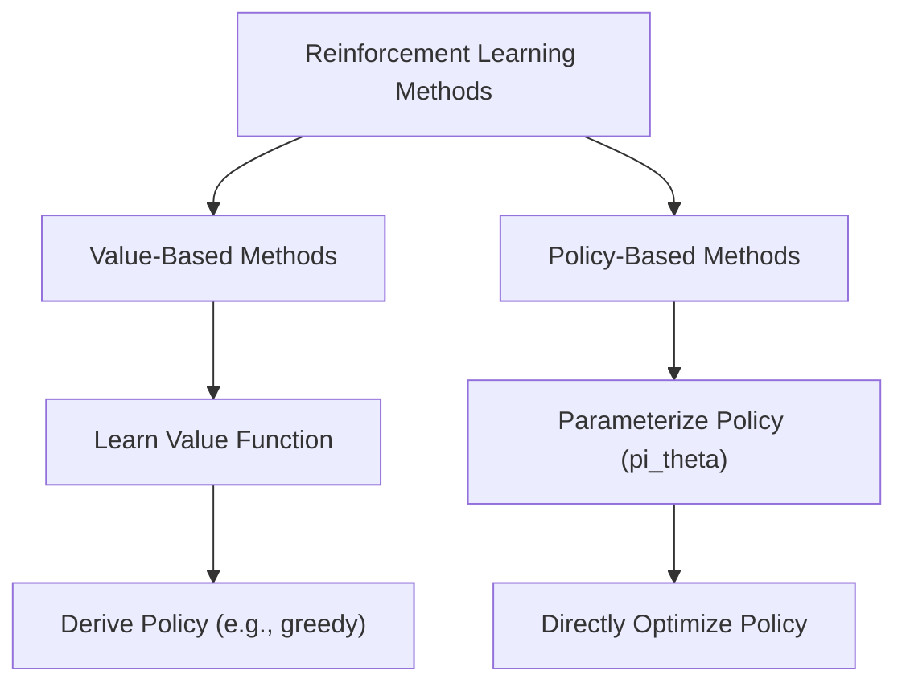
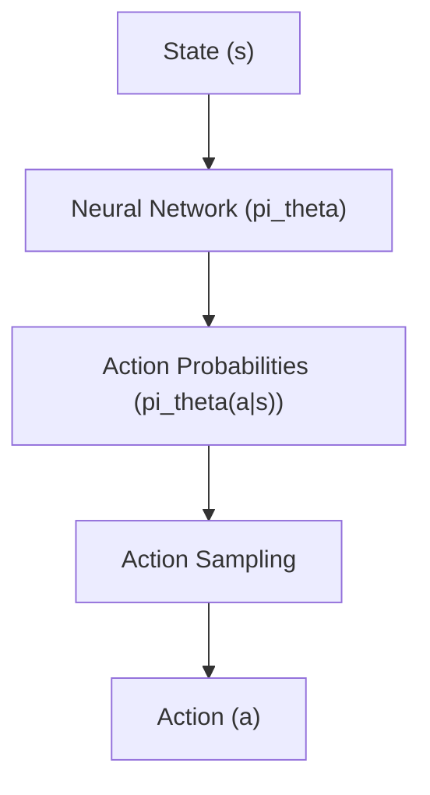
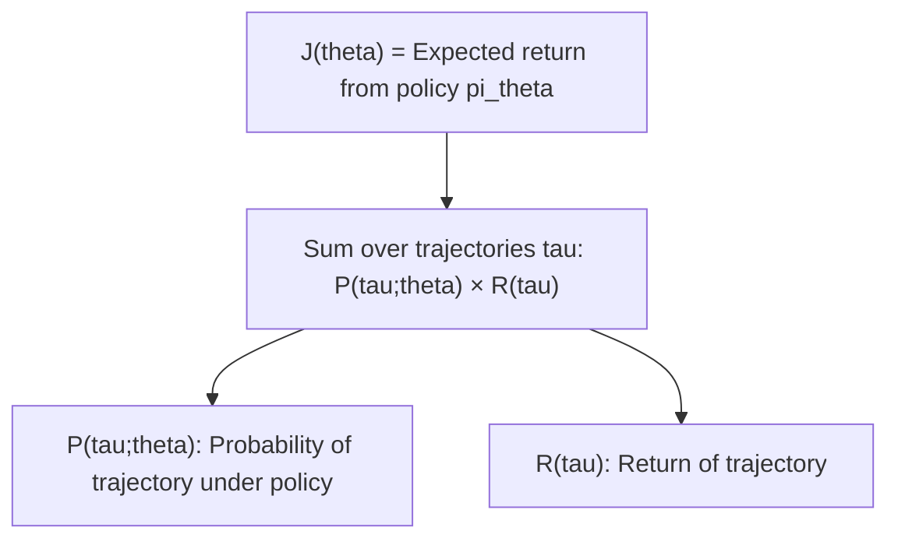
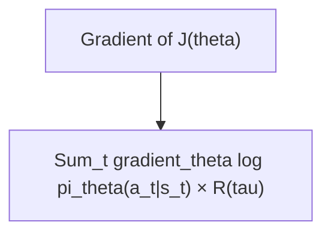
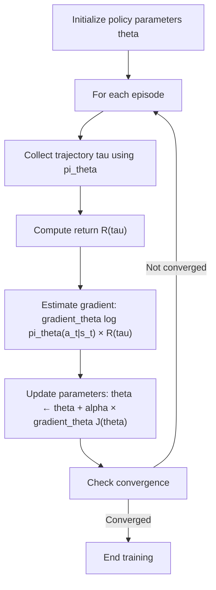
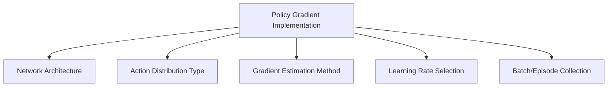

<!-- source: DeepWiki mcp.deepwiki.com · repo huggingface/deep-rl-class · page 5 Policy Gradient Methods · fetched 2026-10-26 -->

# Policy Gradient Methods

<details>
<summary>Relevant source files</summary>

The following files were used as context for generating this wiki page:

- [units/en/unit4/advantages-disadvantages.mdx](units/en/unit4/advantages-disadvantages.mdx)
- [units/en/unit4/introduction.mdx](units/en/unit4/introduction.mdx)
- [units/en/unit4/pg-theorem.mdx](units/en/unit4/pg-theorem.mdx)
- [units/en/unit4/policy-gradient.mdx](units/en/unit4/policy-gradient.mdx)
- [units/en/unit4/what-are-policy-based-methods.mdx](units/en/unit4/what-are-policy-based-methods.mdx)

</details>


## Purpose and Scope

Policy gradient methods are a class of reinforcement learning algorithms that directly optimize policy parameters to maximize expected returns, without requiring an intermediate value function. This document covers the concept, advantages, implementation details, and specifically focuses on the REINFORCE algorithm.

For information about value-based methods, see [Reinforcement Learning Fundamentals](#2), [Q-Learning](#3), and [Deep Q-Learning](#4).

## Policy-based vs Value-based Methods

Reinforcement learning offers two main approaches to finding optimal policies:



In **value-based methods**, we learn a value function and derive a policy from it (typically epsilon-greedy). The policy exists only as a function of the value estimates.

In **policy-based methods**, we directly parameterize the policy using a neural network that outputs action probabilities, and optimize it without learning a value function.

Sources: units/en/unit4/introduction.mdx:7-11, units/en/unit4/what-are-policy-based-methods.mdx:13-25

### Policy Parameterization

Policy gradient methods use a neural network to represent the policy:



For example, in CartPole-v1:
- Input: State features (cart position, velocity, pole angle, etc.)
- Output: Probability distribution over actions (move left/right)

Policy gradient aims to control this probability distribution so that good actions (those maximizing returns) are sampled more frequently in the future.

Sources: units/en/unit4/policy-gradient.mdx:5-15, units/en/unit4/what-are-policy-based-methods.mdx:20-25

## Policy-based vs Policy-gradient Methods

Policy-gradient methods are a subset of policy-based methods:

- **Policy-based methods**: Optimize parameters indirectly using techniques like hill climbing, simulated annealing, or evolution strategies.
- **Policy-gradient methods**: Optimize parameters directly by performing gradient ascent on an objective function.

Both methods search directly for optimal policies, but use different optimization approaches.

Sources: units/en/unit4/what-are-policy-based-methods.mdx:33-42

## Advantages and Disadvantages

### Advantages

1. **Simplicity of Integration**: Direct policy estimation without storing additional data.
2. **Stochastic Policy Learning**: 
   - Natural exploration without explicit exploration-exploitation trade-offs
   - Solution to perceptual aliasing (states that look similar but require different actions)
3. **Effective in Complex Action Spaces**: Handles high-dimensional and continuous action spaces efficiently
4. **Better Convergence Properties**: Policy changes smoothly over time

### Disadvantages

1. **Local Maxima**: Often converges to local rather than global optima
2. **Slower Training**: Takes longer to train compared to value-based methods
3. **High Variance**: Parameter updates can have high variance

Sources: units/en/unit4/advantages-disadvantages.mdx:5-73

## The Objective Function and Policy Gradient

### Objective Function

The objective function J(θ) measures policy performance as the expected return:



Our goal is to find parameters θ that maximize this objective function.

Sources: units/en/unit4/policy-gradient.mdx:42-67

### Policy Gradient Theorem

Computing the gradient directly is challenging because:
1. Calculating the probability of every possible trajectory is computationally expensive
2. Differentiating the state distribution (MDP dynamics) is difficult

The Policy Gradient Theorem reformulates the objective function in a differentiable form:



This gradient is used in gradient ascent to update parameters:
```
θ ← θ + α × gradient_theta J(θ)
```

Where α is the learning rate.

Sources: units/en/unit4/policy-gradient.mdx:70-93, units/en/unit4/pg-theorem.mdx:3-86

## The REINFORCE Algorithm

REINFORCE (Monte Carlo policy gradient) uses episode returns to update policy parameters:



This update can be interpreted as:
- `gradient_theta log pi_theta(a_t|s_t)` indicates how to change weights to increase/decrease action probability
- `R(tau)` acts as a scoring function:
  - High returns increase probabilities of state-action pairs
  - Low returns decrease probabilities of state-action pairs

Sources: units/en/unit4/policy-gradient.mdx:96-123

## Comparison: Value-based vs Policy-based Methods

| Aspect | Value-Based Methods | Policy-Based Methods |
|--------|---------------------|----------------------|
| Learning target | Value function | Policy function |
| Policy type | Deterministic (greedy) | Stochastic |
| Action space | Best for discrete, limited | Handles continuous, high-dimensional |
| Convergence | Can be unstable (max operator) | More stable, smoother changes |
| Exploration | Requires explicit mechanisms | Inherent in stochastic policy |
| Perceptual aliasing | Difficult to handle | Naturally addressed |

Sources: units/en/unit4/what-are-policy-based-methods.mdx:11-32, units/en/unit4/advantages-disadvantages.mdx:5-73

## Implementation Considerations

When implementing policy gradient methods, key considerations include:

1. **Policy Network Architecture**: Neural network design choices
2. **Action Distribution**: Representation of output probabilities
3. **Gradient Estimation**: Calculation methods and variance reduction
4. **Learning Rate**: Selection of appropriate step size
5. **Batch Size**: Single-episode vs multi-episode updates



In the next unit, we will explore actor-critic methods (covered in [Actor-Critic Methods](#7)), which combine value-based and policy-based approaches to address limitations of pure policy gradient methods.

Sources: units/en/unit4/policy-gradient.mdx:96-123, units/en/unit4/what-are-policy-based-methods.mdx:28

---

