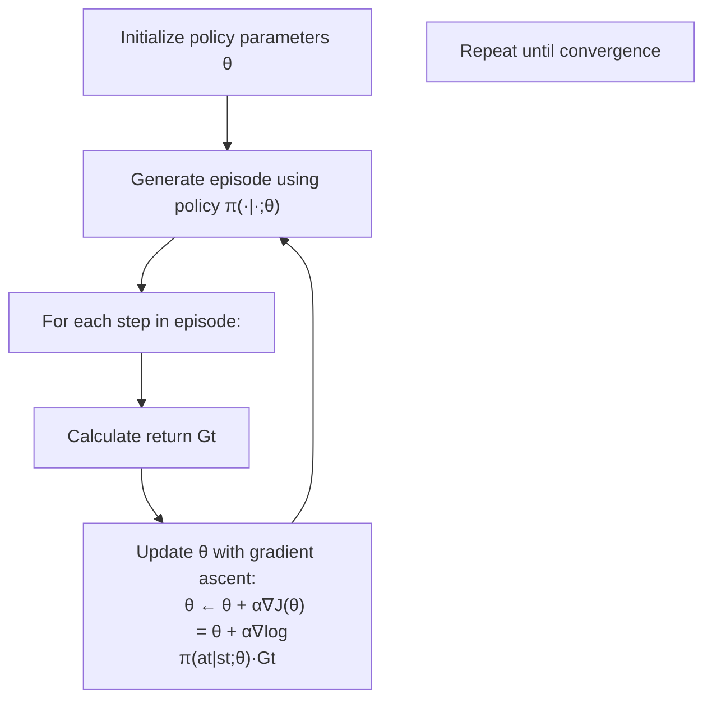
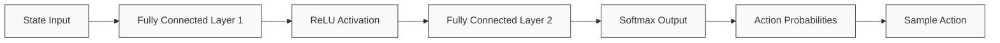
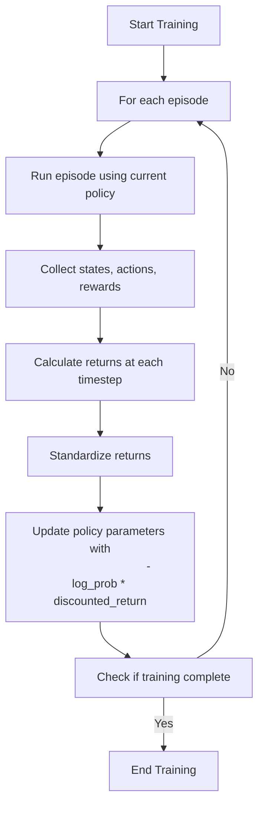
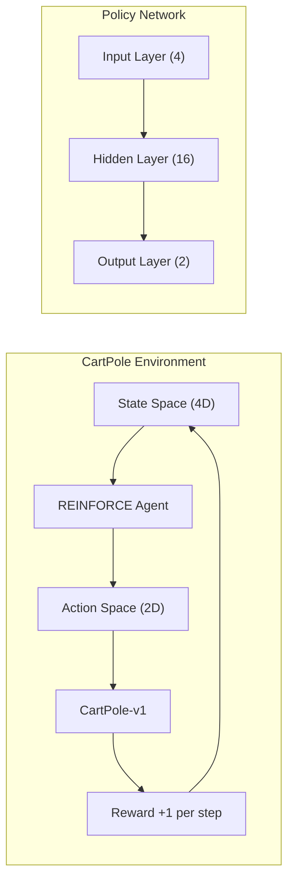
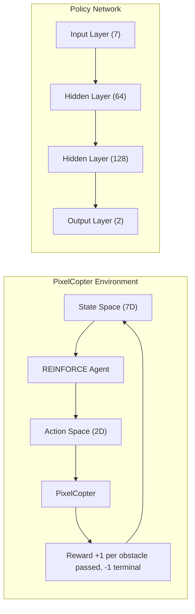
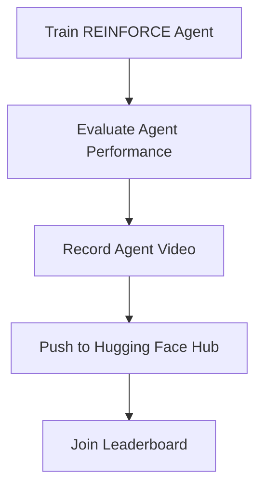

<!-- source: DeepWiki mcp.deepwiki.com · repo huggingface/deep-rl-class · page 5.1 REINFORCE Implementation · fetched 2026-10-26 -->

# REINFORCE Implementation

<details>
<summary>Relevant source files</summary>

The following files were used as context for generating this wiki page:

- [units/en/unit4/additional-readings.mdx](units/en/unit4/additional-readings.mdx)
- [units/en/unit4/conclusion.mdx](units/en/unit4/conclusion.mdx)
- [units/en/unit4/hands-on.mdx](units/en/unit4/hands-on.mdx)
- [units/en/unit4/quiz.mdx](units/en/unit4/quiz.mdx)

</details>


This document details the implementation of the REINFORCE algorithm (also known as Monte Carlo Policy Gradient) using PyTorch in the Deep Reinforcement Learning course. REINFORCE is a policy-based method that optimizes the policy directly without using an action-value function. The implementation focuses on training agents for CartPole-v1 and PixelCopter environments.

For theoretical background on Policy Gradient methods, see the main Policy Gradient Methods page [Policy Gradient Methods](#5).

## Algorithm Overview

REINFORCE is a policy gradient algorithm that uses complete episode returns to update policy parameters. It works by:

1. Sampling trajectories from the current policy
2. Computing returns at each timestep
3. Performing gradient ascent on policy parameters to maximize expected returns

The pseudocode for REINFORCE is:



Sources: [units/en/unit4/hands-on.mdx:373-381]()

## Policy Network Architecture

The REINFORCE implementation uses a neural network to represent the policy. The network takes state observations as input and outputs a probability distribution over possible actions.



The Policy class is defined with:
- An initialization method that creates the neural network layers
- A forward method that processes states through the network
- An act method that samples actions based on the probability distribution

Sources: [units/en/unit4/hands-on.mdx:276-321](), [units/en/unit4/hands-on.mdx:345-362]()

## Implementation Details

### Policy Class

The core Policy class is implemented as a PyTorch neural network module:

```python
class Policy(nn.Module):
    def __init__(self, s_size, a_size, h_size):
        super(Policy, self).__init__()
        self.fc1 = nn.Linear(s_size, h_size)
        self.fc2 = nn.Linear(h_size, a_size)

    def forward(self, x):
        x = F.relu(self.fc1(x))
        x = self.fc2(x)
        return F.softmax(x, dim=1)

    def act(self, state):
        state = torch.from_numpy(state).float().unsqueeze(0).to(device)
        probs = self.forward(state).cpu()
        m = Categorical(probs)
        action = m.sample()
        return action.item(), m.log_prob(action)
```

This implementation:
1. Creates two fully connected layers
2. Uses ReLU activation after the first layer
3. Applies softmax to the output to get a probability distribution
4. Samples actions using PyTorch's Categorical distribution

Sources: [units/en/unit4/hands-on.mdx:345-362]()

### Training Algorithm

The training function implements the core REINFORCE algorithm:



The key aspects of the training implementation include:

1. **Episode Generation**: Running the current policy to collect state-action-reward trajectories
2. **Return Calculation**: Computing discounted returns for each timestep efficiently
3. **Policy Update**: Performing gradient ascent (implemented as gradient descent on a negative objective)
4. **Return Standardization**: Normalizing returns to stabilize training

Sources: [units/en/unit4/hands-on.mdx:396-558]()

### Efficient Return Calculation

The implementation uses a dynamic programming approach to efficiently calculate the returns at each timestep:

```python
returns = deque(maxlen=max_t)
for t in range(n_steps)[::-1]:
    disc_return_t = returns[0] if len(returns) > 0 else 0
    returns.appendleft(gamma * disc_return_t + rewards[t])
```

This calculates returns in O(N) time by reusing previously computed results, following the formula:
G_t = r_(t+1) + gamma * G_(t+1)

Sources: [units/en/unit4/hands-on.mdx:418-449](), [units/en/unit4/hands-on.mdx:533-535]()

### Evaluation Method

The implementation includes an evaluation function that tests the trained policy:

```python
def evaluate_agent(env, max_steps, n_eval_episodes, policy):
    episode_rewards = []
    for episode in range(n_eval_episodes):
        state = env.reset()
        step = 0
        done = False
        total_rewards_ep = 0

        for step in range(max_steps):
            action, _ = policy.act(state)
            new_state, reward, done, info = env.step(action)
            total_rewards_ep += reward

            if done:
                break
            state = new_state
        episode_rewards.append(total_rewards_ep)
    mean_reward = np.mean(episode_rewards)
    std_reward = np.std(episode_rewards)

    return mean_reward, std_reward
```

This function:
1. Runs multiple episodes using the trained policy
2. Records total rewards for each episode
3. Returns the mean and standard deviation of the rewards

Sources: [units/en/unit4/hands-on.mdx:604-631]()

## Environment Integration

The implementation is tested on two environments with different complexity levels to demonstrate the algorithm's robustness.

### CartPole-v1



For CartPole-v1:
- **State Space**: 4-dimensional (cart position, cart velocity, pole angle, pole angular velocity)
- **Action Space**: 2 actions (push cart left or right)
- **Network Architecture**: Simple 2-layer network with 16 hidden units
- **Hyperparameters**: Learning rate of 1e-2, discount factor of 1.0

Sources: [units/en/unit4/hands-on.mdx:204-258](), [units/en/unit4/hands-on.mdx:566-577]()

### PixelCopter



For PixelCopter:
- **State Space**: 7-dimensional (player position, velocity, distances to obstacles, etc.)
- **Action Space**: 2 actions (accelerate up or do nothing)
- **Network Architecture**: Deeper 3-layer network with 64 initial hidden units
- **Hyperparameters**: Learning rate of 1e-4, discount factor of 0.99

This more complex environment requires a deeper network and more training episodes to achieve good performance.

Sources: [units/en/unit4/hands-on.mdx:855-881](), [units/en/unit4/hands-on.mdx:900-939](), [units/en/unit4/hands-on.mdx:946-957]()

## Model Sharing and Evaluation

The implementation includes functionality to:

1. Record videos of the trained agent's performance
2. Push trained models to the Hugging Face Hub
3. Participate in leaderboards



The `push_to_hub` function handles:
- Model evaluation
- Video recording
- Model card generation 
- Pushing all artifacts to the Hub

Sources: [units/en/unit4/hands-on.mdx:649-809]()

## Performance Benchmarks

For model certification, agents must achieve:
- CartPole-v1: Score ≥ 350
- PixelCopter: Score ≥ 5

The score is calculated as: mean_reward - std_reward

These benchmarks provide a way to measure the implementation's effectiveness and compare it against other approaches.

Sources: [units/en/unit4/hands-on.mdx:22-31]()

## Common Implementation Challenges

When implementing REINFORCE, some common challenges include:

1. **Action Sampling**: It's important to sample actions from the probability distribution rather than always choosing the highest probability action.
   ```python
   # Correct:
   action = m.sample()
   # Incorrect:
   action = np.argmax(m)
   ```

2. **Return Calculation**: Efficiently computing returns for each timestep requires careful implementation to avoid redundant computations.

3. **Gradient Ascent vs. Descent**: Although we want to maximize expected returns (gradient ascent), PyTorch is optimized for minimization problems. This is handled by negating the objective function.

Sources: [units/en/unit4/hands-on.mdx:338-368]()

## Conclusion

This REINFORCE implementation demonstrates how to code a policy gradient algorithm from scratch using PyTorch. The implementation is tested on environments of varying complexity to demonstrate its robustness and adaptability.

The key advantages of this approach include:
- Ability to learn stochastic policies
- Effective performance in environments with discrete action spaces
- Straightforward implementation using modern deep learning frameworks

For more complex environments, the implementation could be extended by using convolutional neural networks for visual inputs or adapting the network architecture based on the specific requirements of the environment.

---

