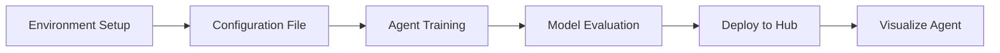
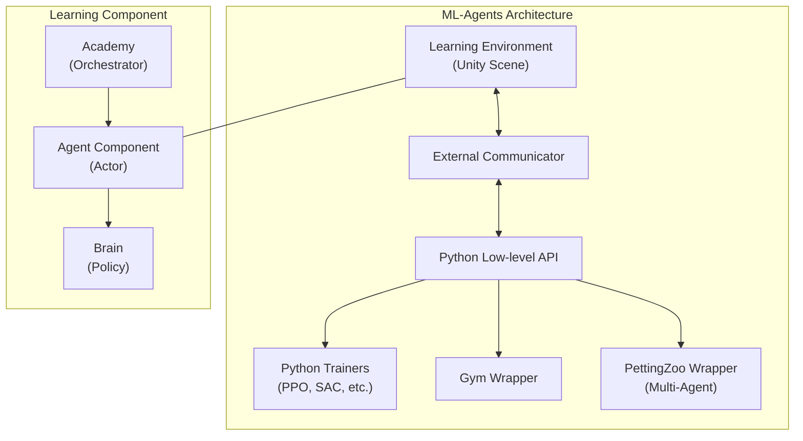
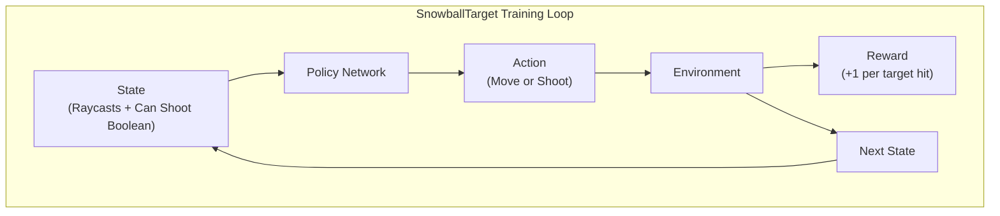
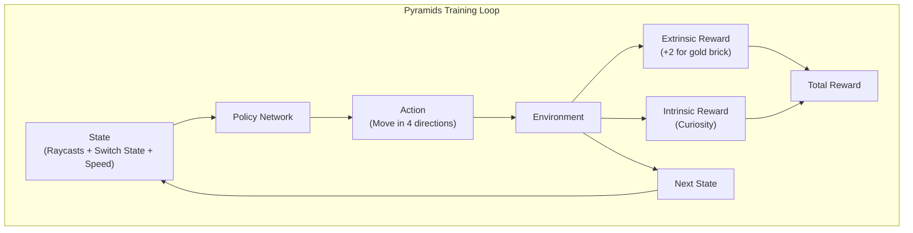
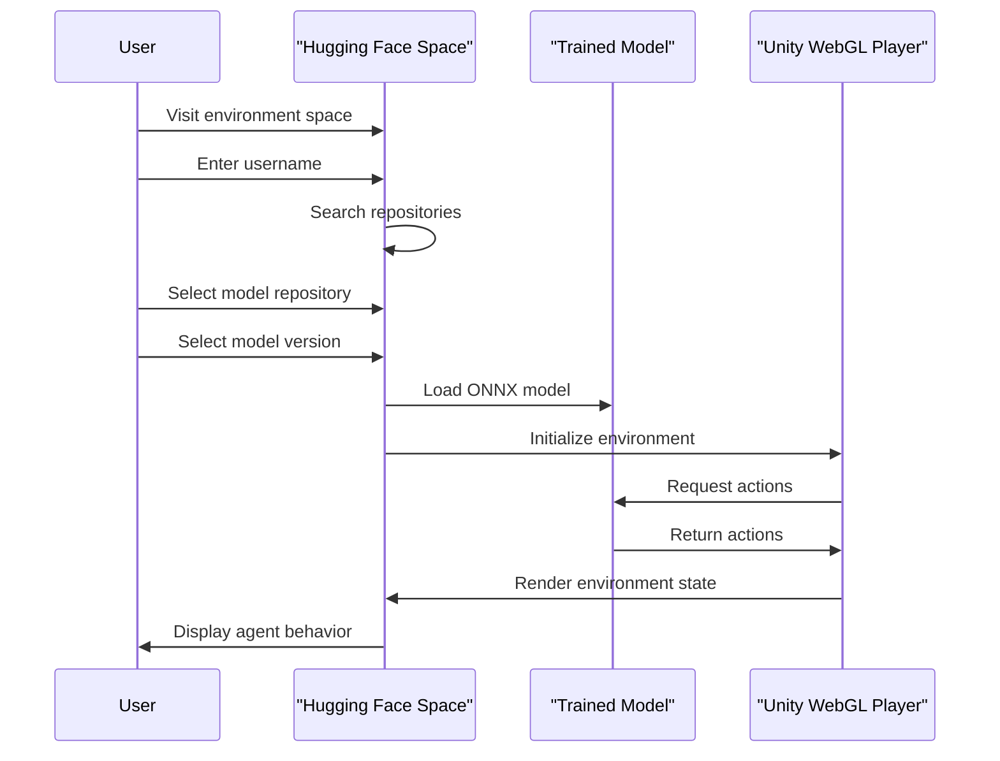

<!-- source: DeepWiki mcp.deepwiki.com · repo huggingface/deep-rl-class · page 6.1 Training Agents in Unity Environments · fetched 2026-10-26 -->

# Training Agents in Unity Environments

<details>
<summary>Relevant source files</summary>

The following files were used as context for generating this wiki page:

- [notebooks/unit5/unit5.ipynb](notebooks/unit5/unit5.ipynb)
- [units/en/unit5/bonus.mdx](units/en/unit5/bonus.mdx)
- [units/en/unit5/conclusion.mdx](units/en/unit5/conclusion.mdx)
- [units/en/unit5/curiosity.mdx](units/en/unit5/curiosity.mdx)
- [units/en/unit5/hands-on.mdx](units/en/unit5/hands-on.mdx)
- [units/en/unit5/how-mlagents-works.mdx](units/en/unit5/how-mlagents-works.mdx)
- [units/en/unit5/introduction.mdx](units/en/unit5/introduction.mdx)
- [units/en/unit5/pyramids.mdx](units/en/unit5/pyramids.mdx)
- [units/en/unit5/snowball-target.mdx](units/en/unit5/snowball-target.mdx)

</details>


This page explains the process of training reinforcement learning agents in Unity environments using the ML-Agents toolkit. You'll learn how to configure, train, and deploy agents in two different environments: SnowballTarget and Pyramids. For information on the fundamental concepts of ML-Agents, see [Introduction to Unity ML-Agents](#6).

## Overview of ML-Agents Training

ML-Agents training follows a structured workflow where agents learn through interaction with Unity environments. The process involves setting up environments, configuring hyperparameters, training using PPO algorithm, and deploying trained models to the Hugging Face Hub for visualization and sharing.



Sources: [units/en/unit5/hands-on.mdx:71-72](), [units/en/unit5/hands-on.mdx:159-182]()

## ML-Agents Architecture

ML-Agents uses a distributed architecture that bridges Unity environments with Python-based reinforcement learning algorithms.



Sources: [units/en/unit5/how-mlagents-works.mdx:17-30](), [units/en/unit5/how-mlagents-works.mdx:32-38]()

## Training Environments

The tutorial covers training in two distinct Unity environments, each with unique characteristics and learning objectives.

### SnowballTarget Environment

In the SnowballTarget environment, the agent (a bear named Julien) must learn to hit targets with snowballs. The agent needs to position itself correctly and time its shots, considering a cool-off period between shots.

**Observation Space**:
- Multiple raycasts to detect objects in the environment
- Boolean flag indicating whether shooting is available (cool-off system)

**Action Space**:
- Discrete actions for movement and shooting

**Reward Function**:
- +1 reward for each target hit with a snowball



Sources: [units/en/unit5/snowball-target.mdx:8-18](), [units/en/unit5/snowball-target.mdx:20-28](), [units/en/unit5/snowball-target.mdx:34-53](), [units/en/unit5/snowball-target.mdx:55-57]()

### Pyramids Environment

The Pyramids environment requires more complex behavior. The agent must press a button to spawn a pyramid, navigate to it, knock it over, and reach the gold brick at the top.

**Observation Space**:
- 148 raycasts detecting objects (switch, bricks, gold brick, walls)
- Boolean for switch state
- Vector containing the agent's speed

**Action Space**:
- Four discrete actions (movement directions)

**Reward Function**:
- +2 reward for reaching the gold brick
- Uses curiosity-driven exploration to handle sparse rewards



Sources: [units/en/unit5/pyramids.mdx:1-6](), [units/en/unit5/pyramids.mdx:8-21](), [units/en/unit5/pyramids.mdx:24-32](), [units/en/unit5/pyramids.mdx:36-39]()

## Training Process

The training process consists of several key steps outlined below.

### 1. Environment Setup

First, you need to set up the training environment:

1. Clone the ML-Agents repository
2. Set up a virtual environment with compatible Python version
3. Install ML-Agents dependencies
4. Download and prepare environment executables

```bash
# Clone ML-Agents repository
git clone --depth 1 https://github.com/Unity-Technologies/ml-agents

# Install ML-Agents packages
pip3 install -e ./ml-agents-envs
pip3 install -e ./ml-agents

# Download environment executables
wget [environment_url] -O ./training-envs-executables/linux/[Environment].zip
unzip -d ./training-envs-executables/linux/ ./training-envs-executables/linux/[Environment].zip
chmod -R 755 ./training-envs-executables/linux/[Environment]
```

Sources: [units/en/unit5/hands-on.mdx:88-91](), [units/en/unit5/hands-on.mdx:142-145](), [units/en/unit5/hands-on.mdx:152-180]()

### 2. Creating Configuration Files

Training hyperparameters are defined in YAML configuration files. These files specify critical parameters like learning rate, batch size, network architecture, and reward signals.

Example of SnowballTarget configuration file:

```yaml
behaviors:
  SnowballTarget:
    trainer_type: ppo
    summary_freq: 10000
    keep_checkpoints: 10
    checkpoint_interval: 50000
    max_steps: 200000
    time_horizon: 64
    threaded: true
    hyperparameters:
      learning_rate: 0.0003
      learning_rate_schedule: linear
      batch_size: 128
      buffer_size: 2048
      beta: 0.005
      epsilon: 0.2
      lambd: 0.95
      num_epoch: 3
    network_settings:
      normalize: false
      hidden_units: 256
      num_layers: 2
      vis_encode_type: simple
    reward_signals:
      extrinsic:
        gamma: 0.99
        strength: 1.0
```

For the Pyramids environment, an existing `PyramidsRND.yaml` configuration is used which includes additional settings for curiosity-driven exploration (RND - Random Network Distillation).

Sources: [units/en/unit5/hands-on.mdx:183-220](), [units/en/unit5/hands-on.mdx:359-368]()

### 3. Training the Agent

The training is executed using the `mlagents-learn` command with the following parameters:

- Configuration file path
- Environment executable path
- Run ID (unique identifier for the training session)
- No-graphics flag (to train without visual rendering)

```bash
mlagents-learn ./config/ppo/SnowballTarget.yaml --env=./training-envs-executables/linux/SnowballTarget/SnowballTarget --run-id="SnowballTarget1" --no-graphics
```

The training process can take from 10 minutes to 45 minutes depending on the environment complexity and configuration parameters.

Sources: [units/en/unit5/hands-on.mdx:455-468](), [units/en/unit5/hands-on.mdx:491]()

### 4. Pushing to Hugging Face Hub

After training, the model can be pushed to the Hugging Face Hub using the `mlagents-push-to-hf` command:

```bash
mlagents-push-to-hf --run-id="SnowballTarget1" --local-dir="./results/SnowballTarget1" --repo-id="username/ppo-SnowballTarget" --commit-message="First Push"
```

This command requires the following parameters:
- `--run-id`: Training run identifier
- `--local-dir`: Path to the saved model files
- `--repo-id`: Hugging Face repository name (username/repo-name)
- `--commit-message`: Git commit message

Sources: [units/en/unit5/hands-on.mdx:252-285](), [units/en/unit5/hands-on.mdx:576-577]()

## Visualizing Trained Agents

Trained agents can be visualized directly in a web browser using Hugging Face Spaces.



The process to visualize your agent:

1. Visit the environment's Space on Hugging Face:
   - SnowballTarget: https://huggingface.co/spaces/ThomasSimonini/ML-Agents-SnowballTarget
   - Pyramids: https://huggingface.co/spaces/unity/ML-Agents-Pyramids

2. Enter your Hugging Face username and select your model repository

3. Choose which model version to visualize (different checkpoints saved during training)

4. Watch your agent perform in the environment

Sources: [units/en/unit5/hands-on.mdx:309-327](), [units/en/unit5/hands-on.mdx:622-652](), [units/en/unit5/hands-on.mdx:808-811]()

## Training Outcomes and Benchmarks

For successful completion of the training, the following benchmarks are suggested:

| Environment | Target Benchmark |
|-------------|------------------|
| SnowballTarget | Mean Reward = 15 or 30 targets hit in an episode |
| Pyramids | Mean Reward = 1.75 |

These benchmarks indicate that the agent has learned an effective policy for the environment.

Sources: [units/en/unit5/hands-on.mdx:14-18](), [notebooks/unit5/unit5.ipynb:150-154]()

## Further Explorations

After mastering these environments, you can explore:

1. Training on other ML-Agents environments (there are 18 different environments available)
2. Experimenting with different hyperparameters
3. Creating custom Unity environments (if you have Unity experience)
4. Training multi-agent systems (which will be covered in a later unit)

Unity provides several other environments like Worm (teaching a worm to crawl) and Walker (teaching an agent to walk toward a goal).

Sources: [units/en/unit5/hands-on.mdx:394-405](), [units/en/unit5/conclusion.mdx:3-13]()

## Troubleshooting Common Issues

When training agents in Unity environments, you might encounter these common issues:

1. **Python Version Compatibility**: ML-Agents requires specific Python versions. If you encounter command not found errors, ensure your Python environment matches the requirements.

2. **CUDA/GPU Issues**: Check that your GPU is properly configured for training acceleration.

3. **Training Interruptions**: Use the `--resume` flag to continue training after interruptions.

4. **Model Loading Problems**: Ensure that your model name is specified correctly when visualizing (case-sensitive usernames and repository names).

Sources: [notebooks/unit5/unit5.ipynb:101-136](), [units/en/unit5/hands-on.mdx:468-471]()

---

