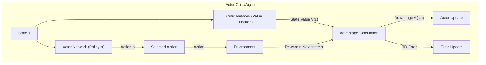
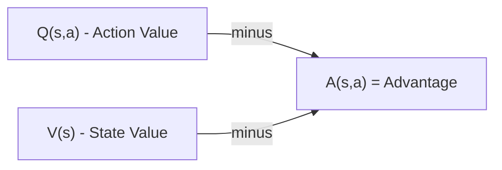
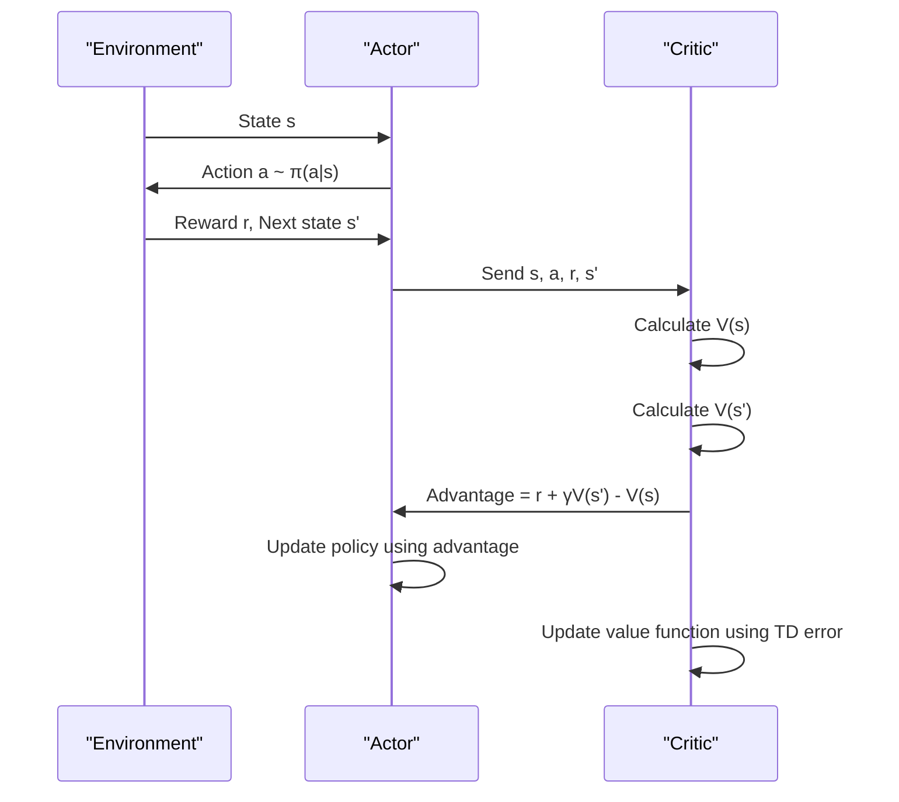
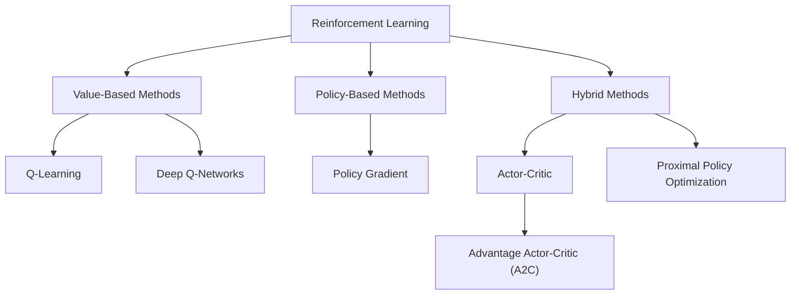

<!-- source: DeepWiki mcp.deepwiki.com · repo huggingface/deep-rl-class · page 7 Actor-Critic Methods · fetched 2026-10-26 -->

# Actor-Critic Methods

Relevant source files

The following files were used as context for generating this wiki page:

- [units/en/unit5/quiz.mdx](units/en/unit5/quiz.mdx)
- [units/en/unit6/quiz.mdx](units/en/unit6/quiz.mdx)

This document provides a comprehensive overview of Actor-Critic methods in reinforcement learning, as covered in Unit 6 of the Hugging Face Deep RL Course. Actor-Critic methods represent a powerful hybrid approach that combines elements of both value-based methods (like [Q-Learning](#3)) and policy-based methods (like [Policy Gradient Methods](#5)). For specific implementation details with robotics environments, see [A2C with Robotics Environments](#7.1).

## Introduction to Actor-Critic Architecture

Actor-Critic methods combine two neural networks:
1. An **Actor** that learns and determines which action to take
2. A **Critic** that evaluates those actions by learning a value function

This hybrid approach addresses limitations of pure policy-based and value-based methods, offering improved stability and sample efficiency.

Sources: [units/en/unit6/quiz.mdx:76-82]()

## How Actor-Critic Methods Work

The Actor-Critic algorithm follows a fundamental workflow:

1. The Actor receives the current state and selects an action based on its policy
2. The Critic evaluates this state-action pair and produces a value estimation
3. The environment returns a reward and new state
4. The advantage is calculated using the Critic's evaluation
5. Both networks are updated based on the advantage

This dual-network architecture allows each component to specialize in its role.

| Component | Function | Updates Based On |
|-----------|----------|-----------------|
| Actor     | Learns policy function π(a\|s) | Advantage values |
| Critic    | Learns value function V(s) or Q(s,a) | TD error / reward signals |

Sources: [units/en/unit6/quiz.mdx:95-98]()

## The Advantage Function

One key innovation in Actor-Critic methods is the use of the **Advantage** function, which measures how much better taking a specific action is compared to the average value of the state.

The advantage function is typically expressed as:

**A(s,a) = Q(s,a) - V(s)**

Where:
- **Q(s,a)** is the action-value function (expected return of taking action a in state s)
- **V(s)** is the state-value function (expected return from state s)

This approach provides a relative measure of action quality, reducing variance in policy gradients and improving training stability.

Sources: [units/en/unit6/quiz.mdx:110-119]()

## Advantage Actor-Critic (A2C)

A2C is a popular implementation of the Actor-Critic architecture that explicitly uses the advantage function to update the policy.

The A2C algorithm helps reduce variance in policy updates while maintaining an unbiased estimate of expected returns. This makes it particularly effective in environments with stochastic elements.

Sources: [units/en/unit6/quiz.mdx:100-103]()

## Actor-Critic in the RL Methods Taxonomy

Actor-Critic methods occupy an important position in the hierarchy of reinforcement learning algorithms, bridging value-based and policy-based approaches.

Sources: [units/en/unit6/quiz.mdx:85-103]()

## Addressing Bias-Variance Tradeoff

Actor-Critic methods effectively address the bias-variance tradeoff in reinforcement learning:

- **Bias**: How closely the reward signal reflects the true rewards from the environment
- **Variance**: How much noise affects the reward signal, especially in stochastic environments

By combining both value and policy approaches, Actor-Critic methods reduce variance compared to pure policy gradient methods, while maintaining lower bias than many value-based methods.

| Method Type | Bias | Variance | Sample Efficiency |
|-------------|------|----------|-------------------|
| Value-Based (e.g., Q-Learning) | Higher | Lower | Higher |
| Policy-Based (e.g., REINFORCE) | Lower | Higher | Lower |
| Actor-Critic | Moderate | Moderate | Moderate to High |

Sources: [units/en/unit6/quiz.mdx:22-46](), [units/en/unit6/quiz.mdx:100-103]()

## Monte Carlo vs. Actor-Critic

Unlike pure Monte Carlo methods that require complete episodes to calculate returns, Actor-Critic methods can perform updates at each step (TD learning), making them more sample-efficient.

| Aspect | Monte Carlo | Actor-Critic |
|--------|-------------|--------------|
| Update Timing | End of episode | At each step |
| Sample Efficiency | Lower | Higher |
| Variance | Higher | Lower |
| Bias | Lower | Slightly higher |
| Handles Stochasticity | Less effective | More effective |

The Actor-Critic approach addresses Monte Carlo's vulnerability to stochastic environments by using the Critic to provide more stable value estimates.

Sources: [units/en/unit6/quiz.mdx:51-70](), [units/en/unit6/quiz.mdx:100-103]()

## Summary

Actor-Critic methods represent a powerful hybrid approach in reinforcement learning that:

- Combines policy learning (Actor) with value estimation (Critic)
- Uses advantage functions to improve policy updates
- Reduces variance while maintaining reasonable bias
- Offers better stability in environments with stochastic elements
- Provides a foundation for advanced algorithms like PPO ([Proximal Policy Optimization](#9))

In the Deep RL Course, Actor-Critic methods serve as an important stepping stone toward more advanced algorithms and are applied to robotics environments to demonstrate their effectiveness in complex control tasks.

Sources: [units/en/unit6/quiz.mdx:85-103](), [units/en/unit6/quiz.mdx:110-119]()

---

