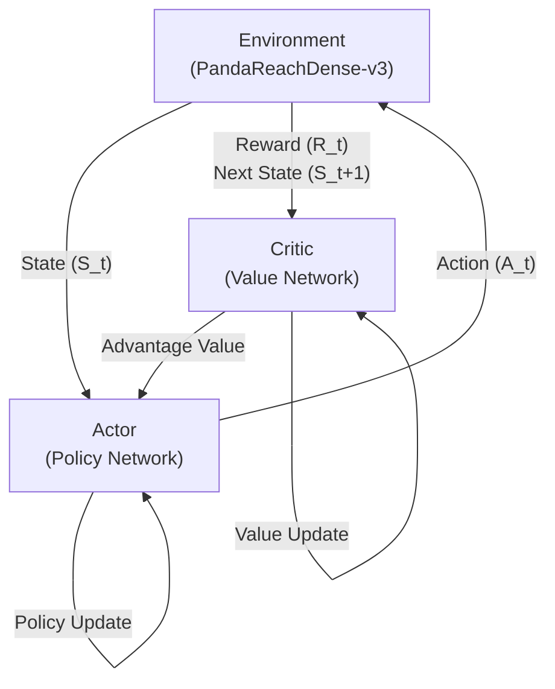
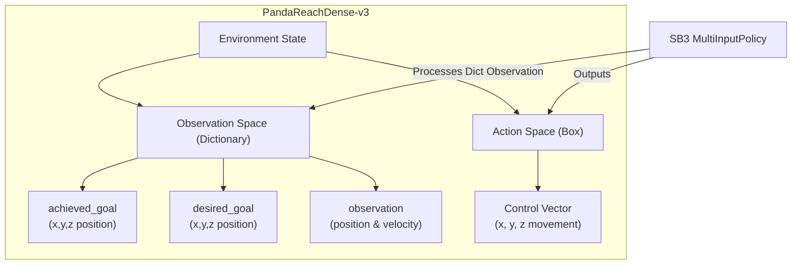
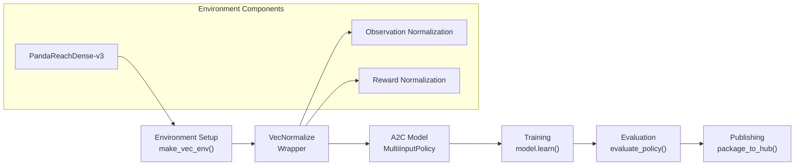

<!-- source: DeepWiki mcp.deepwiki.com · repo huggingface/deep-rl-class · page 7.1 A2C with Robotics Environments · fetched 2026-10-26 -->

# A2C with Robotics Environments

<details>
<summary>Relevant source files</summary>

The following files were used as context for generating this wiki page:

- [notebooks/unit6/requirements-unit6.txt](notebooks/unit6/requirements-unit6.txt)
- [units/en/unit6/additional-readings.mdx](units/en/unit6/additional-readings.mdx)
- [units/en/unit6/advantage-actor-critic.mdx](units/en/unit6/advantage-actor-critic.mdx)
- [units/en/unit6/conclusion.mdx](units/en/unit6/conclusion.mdx)
- [units/en/unit6/hands-on.mdx](units/en/unit6/hands-on.mdx)
- [units/en/unit6/introduction.mdx](units/en/unit6/introduction.mdx)
- [units/en/unit6/variance-problem.mdx](units/en/unit6/variance-problem.mdx)

</details>


## Purpose and Scope

This page documents the implementation and training of an Advantage Actor-Critic (A2C) agent in robotic simulation environments using Stable-Baselines3 and Panda-Gym. We focus on training a robotic arm to perform specific tasks, particularly reaching a target position with its end-effector. This implementation serves as a practical application of the Actor-Critic methods covered in the theoretical sections of the course.

For background theory on Actor-Critic methods, see [Actor-Critic Methods](#7).

Sources: units/en/unit6/introduction.mdx, units/en/unit6/hands-on.mdx

## A2C Architecture Overview

### Advantage Actor-Critic Framework



A2C is a hybrid architecture that combines policy-based and value-based methods:
- **Actor**: Controls how the agent behaves (policy function π_θ(s))
- **Critic**: Evaluates actions using the advantage function, which measures how much better an action is compared to the average value of the state

This combination helps reduce variance in policy gradient estimation compared to pure policy-based methods like REINFORCE, which we studied in an earlier unit.

Sources: units/en/unit6/advantage-actor-critic.mdx:3-22, units/en/unit6/advantage-actor-critic.mdx:55-70

## Robotics Environment: Panda-Gym

### Environment Structure



In the `PandaReachDense-v3` environment:
- A robotic arm must place its end-effector at a target position (green ball)
- Uses dense rewards (provides feedback at each timestep)
- End-effector displacement control (actions directly control end-effector movement)

The observation and action spaces have the following structure:

| Space Type | Structure | Description |
|------------|-----------|-------------|
| Observation | Dictionary | Contains achieved_goal, desired_goal, and observation values |
| Action | 3D Vector | Controls x, y, z movement of the end-effector |

Sources: units/en/unit6/hands-on.mdx:128-182

## Implementation Workflow

### Training Pipeline



The implementation process follows these key steps:
1. Create and configure the environment
2. Apply normalization for stable learning
3. Create and train the A2C model
4. Evaluate and deploy the trained agent

Sources: units/en/unit6/hands-on.mdx:40-50, units/en/unit6/hands-on.mdx:193-315

## Environment Setup and Normalization

### Creating the Vectorized Environment

The training environment is created as a vectorized environment to enable parallel training across multiple instances:

```python
env_id = "PandaReachDense-v3"
env = make_vec_env(env_id, n_envs=4)
```

### Input and Reward Normalization

Normalizing observations and rewards is crucial for stable and efficient learning in reinforcement learning. We use the `VecNormalize` wrapper:

```python
env = VecNormalize(env, norm_obs=True, norm_reward=True, clip_obs=10.)
```

This wrapper computes running averages and standard deviations of inputs and normalizes them accordingly, which significantly improves neural network training performance.

Sources: units/en/unit6/hands-on.mdx:184-207

## A2C Model Creation and Training

### Model Configuration

Since the `PandaReachDense-v3` environment uses a dictionary observation space, we must use the `MultiInputPolicy` instead of the standard `MlpPolicy`:

```python
model = A2C(
    policy="MultiInputPolicy",
    env=env,
    verbose=1
)
```

### Training Process

The model is trained for 1,000,000 timesteps:

```python
model.learn(1_000_000)
```

After training, both the model and normalization statistics are saved for later evaluation and deployment:

```python
model.save("a2c-PandaReachDense-v3")
env.save("vec_normalize.pkl")
```

Sources: units/en/unit6/hands-on.mdx:209-238

## Evaluation and Deployment

### Evaluating the Trained Agent

To properly evaluate the trained agent, we need to:
1. Load the saved model and normalization statistics
2. Configure the evaluation environment correctly:
   - Set `training=False` to prevent updating statistics during evaluation
   - Set `norm_reward=False` as reward normalization isn't needed at test time

```python
eval_env = DummyVecEnv([lambda: gym.make("PandaReachDense-v3")])
eval_env = VecNormalize.load("vec_normalize.pkl", eval_env)
eval_env.training = False
eval_env.norm_reward = False

model = A2C.load("a2c-PandaReachDense-v3")
mean_reward, std_reward = evaluate_policy(model, eval_env)
```

For the certification process in the course, a model must achieve a mean reward of at least -3.5 on the `PandaReachDense-v3` environment.

Sources: units/en/unit6/hands-on.mdx:242-267

### Publishing to Hugging Face Hub

The trained model can be shared with the community by publishing it to the Hugging Face Hub:

```python
package_to_hub(
    model=model,
    model_name=f"a2c-{env_id}",
    model_architecture="A2C",
    env_id=env_id,
    eval_env=eval_env,
    repo_id=f"YourUsername/a2c-{env_id}",
    commit_message="Initial commit",
)
```

This function:
- Evaluates the model
- Records a video replay of the agent
- Generates a model card with performance metrics
- Pushes everything to the Hugging Face Hub repository

Sources: units/en/unit6/hands-on.mdx:268-315

## Advanced Challenges

Beyond the basic `PandaReachDense-v3` environment, more complex robotic tasks can be explored:

| Environment | Task Description |
|-------------|-----------------|
| PandaPickAndPlace-v3 | The robotic arm must pick up an object and place it at a target location |

For real-world robotics applications, more sample-efficient algorithms like TQC (Truncated Quantile Critics) or SAC (Soft Actor-Critic) are typically preferred over A2C. This is because physical robots have limited operational lifespans, making sample efficiency critical to minimize wear and tear.

Sources: units/en/unit6/hands-on.mdx:317-392

## Dependencies and Requirements

The implementation requires the following libraries:

- stable-baselines3==2.0.0a4
- huggingface_sb3
- panda-gym
- huggingface_hub
- gymnasium

Sources: notebooks/unit6/requirements-unit6.txt

---

