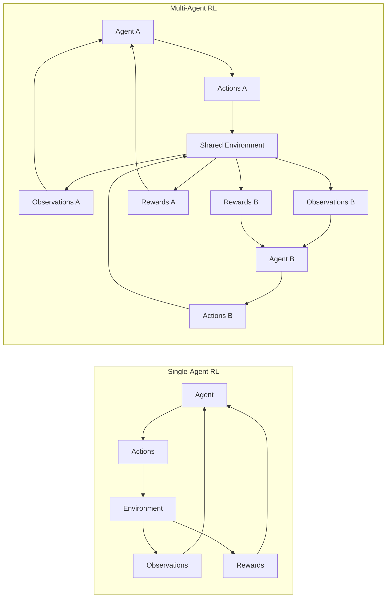
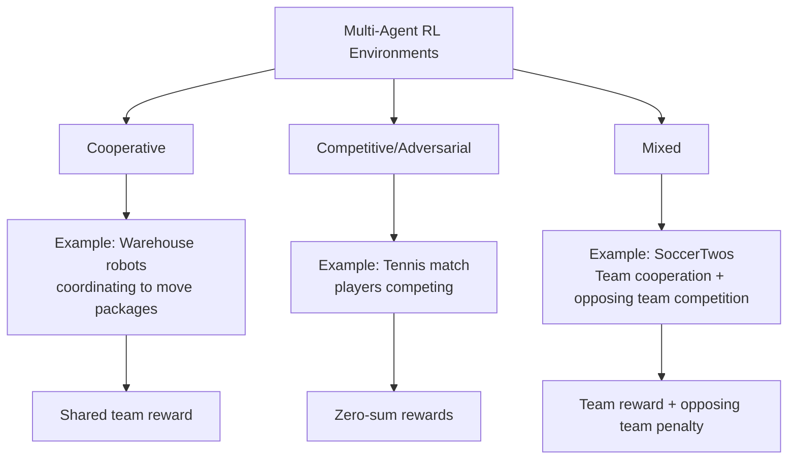
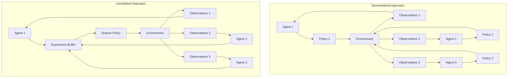
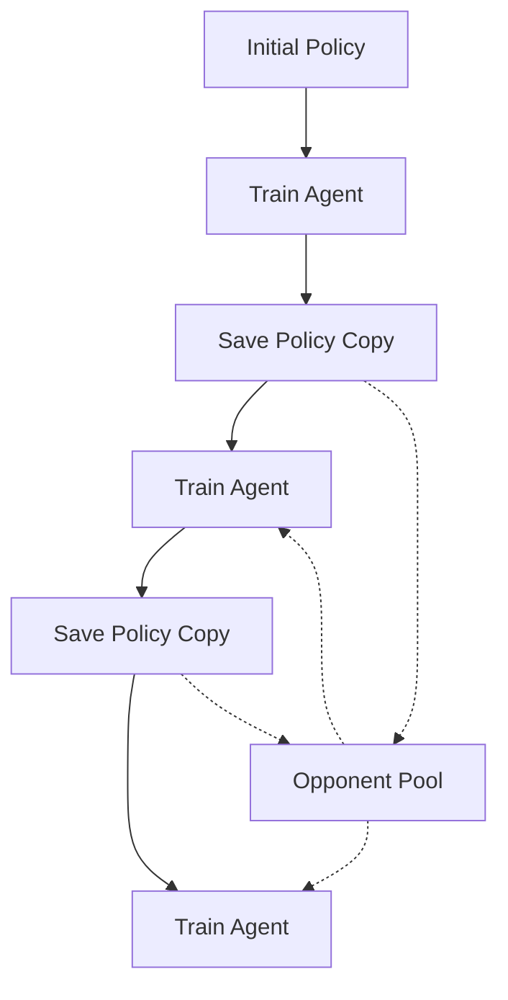
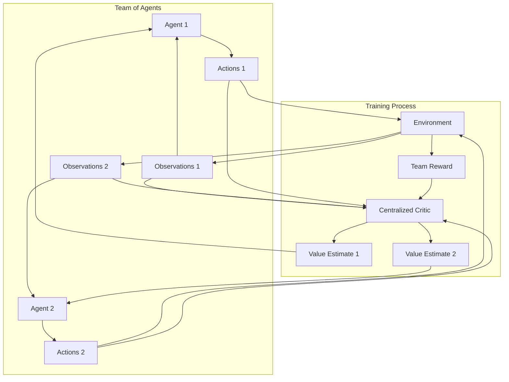
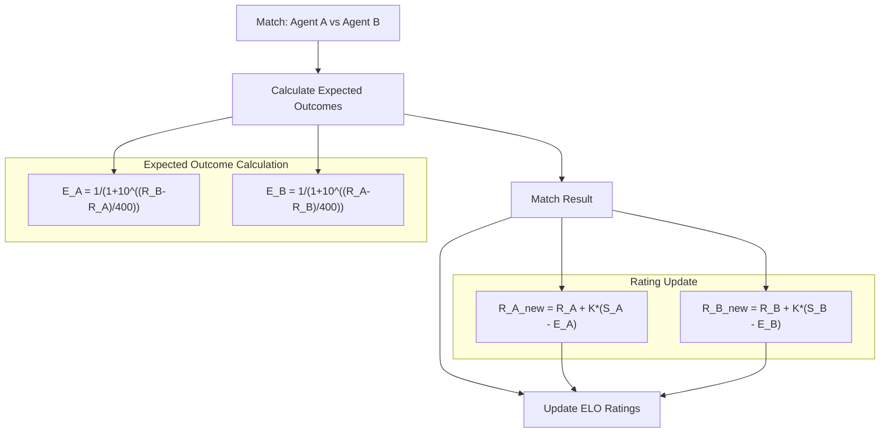
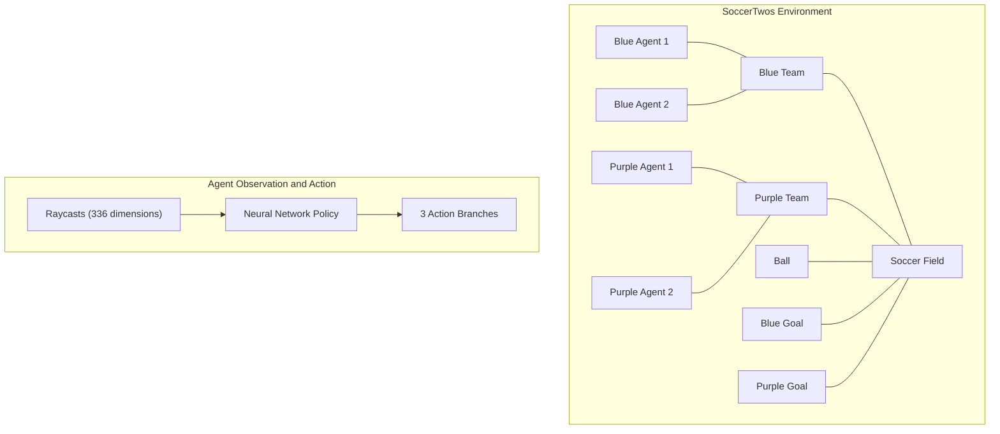
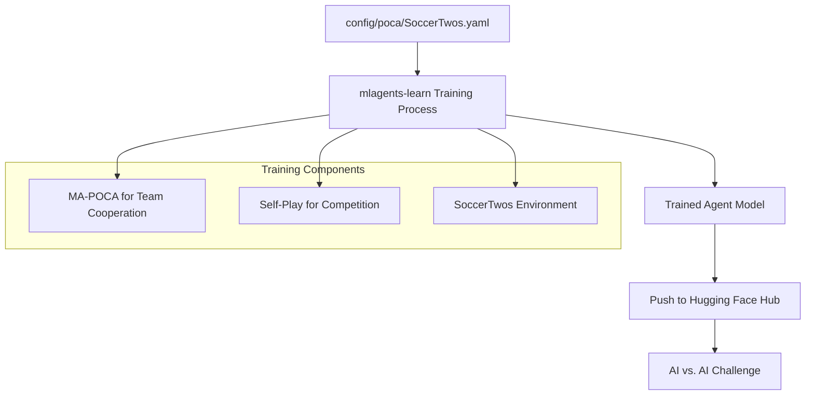
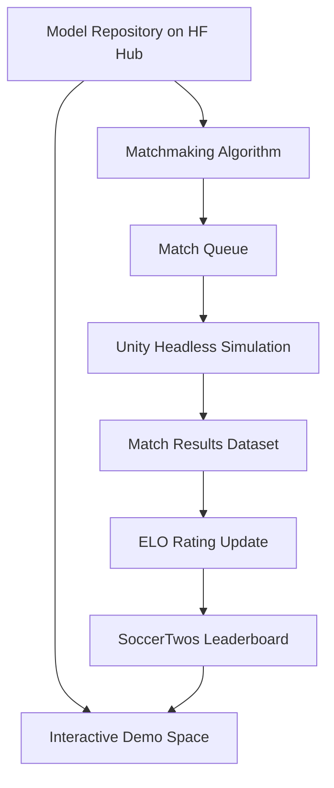

<!-- source: DeepWiki mcp.deepwiki.com · repo huggingface/deep-rl-class · page 8 Multi-Agent Reinforcement Learning · fetched 2026-10-26 -->

# Multi-Agent Reinforcement Learning

<details>
<summary>Relevant source files</summary>

The following files were used as context for generating this wiki page:

- [units/en/unit7/additional-readings.mdx](units/en/unit7/additional-readings.mdx)
- [units/en/unit7/conclusion.mdx](units/en/unit7/conclusion.mdx)
- [units/en/unit7/hands-on.mdx](units/en/unit7/hands-on.mdx)
- [units/en/unit7/introduction-to-marl.mdx](units/en/unit7/introduction-to-marl.mdx)
- [units/en/unit7/introduction.mdx](units/en/unit7/introduction.mdx)
- [units/en/unit7/multi-agent-setting.mdx](units/en/unit7/multi-agent-setting.mdx)
- [units/en/unit7/self-play.mdx](units/en/unit7/self-play.mdx)

</details>


This page covers the concepts and implementation of Multi-Agent Reinforcement Learning (MARL) in the Deep RL Course. It explains the fundamentals of training multiple agents that interact in a shared environment, focusing on both cooperative and competitive scenarios. For information about the specific implementation of Proximal Policy Optimization (PPO) in multi-agent settings, see [Proximal Policy Optimization](#9).

## Introduction to MARL

Multi-Agent Reinforcement Learning extends traditional reinforcement learning to settings where multiple agents operate simultaneously in a shared environment. Unlike single-agent systems covered in previous units, MARL introduces new dynamics where agents must consider not only their interactions with the environment but also with other agents.



Sources: units/en/unit7/introduction-to-marl.mdx, units/en/unit7/introduction.mdx

MARL is crucial for many real-world applications where multiple intelligent entities must interact:
- Warehouse automation with multiple robots
- Autonomous vehicle coordination
- Team-based competitive games

In this unit, we focus on training agents in the SoccerTwos environment, a 2vs2 soccer game where teams compete against each other.

## Types of Multi-Agent Environments

Multi-agent environments are categorized based on the interaction dynamics between agents:



Sources: units/en/unit7/introduction-to-marl.mdx

### Cooperative Environments
Agents work together to maximize a common benefit. For example, robots in a warehouse collaborating to efficiently load and unload packages.

### Competitive/Adversarial Environments
Agents aim to maximize their own benefits by minimizing their opponents' success. For example, a game of tennis where each agent wants to win against the other.

### Mixed Environments
Environments with both cooperative and competitive elements. In SoccerTwos, agents must cooperate with their teammates while competing against the opposing team.

## Designing Multi-Agent Systems

There are two primary approaches to designing multi-agent reinforcement learning systems:



Sources: units/en/unit7/multi-agent-setting.mdx

### Decentralized Approach
Each agent is trained independently, treating other agents as part of the environment dynamics. This approach:
- Simplifies implementation (agents are trained like single agents)
- Makes the environment non-stationary (as other agents learn and change)
- Creates challenges for convergence in learning algorithms

### Centralized Approach
A single policy is learned for all agents, or agents share information during training:
- Creates a stationary environment
- Enables more coordinated behaviors
- Uses collective experience to train a policy that benefits the whole system

## Self-Play for Training Competitive Agents

Self-play is a technique for training agents in competitive settings without requiring pre-trained opponents.



Sources: units/en/unit7/self-play.mdx

### How Self-Play Works
1. The agent starts with an initial policy
2. It plays against a copy of itself (same policy)
3. As the agent improves, copies of its policy are saved
4. The agent trains against these saved versions, gradually facing stronger opponents

Self-play addresses a key challenge in training competitive agents - finding opponents of appropriate difficulty. If opponents are too strong, the agent won't learn effectively; if too weak, the agent develops strategies that fail against better opponents.

### Key Self-Play Hyperparameters in Unity ML-Agents
- `save_steps`: How often to save a new policy version for the opponent pool
- `team_change`: How often to swap between teams
- `swap_steps`: How frequently to change opponents
- `window`: Number of past policies to keep in the opponent pool
- `play_against_latest_model_ratio`: Probability of playing against the most recent policy

## MA-POCA: Training Cooperative Agents

For training cooperative agents within teams, Unity ML-Agents developed MA-POCA (Multi-Agent POsthumous Credit Assignment).



Sources: units/en/unit7/hands-on.mdx

MA-POCA uses centralized learning with decentralized execution:
- Each agent makes decisions based only on local observations
- A centralized critic processes states of all team agents to evaluate individual contributions
- This helps determine how well each agent is doing within the context of the team
- Allows agents to learn cooperative behaviors despite receiving only team-level rewards

This solves a common issue in team environments where every agent on the team receives the same reward regardless of their individual contributions.

## The ELO Rating System for Evaluation

In adversarial games, tracking cumulative reward is not sufficient since it depends heavily on opponent skill. The ELO rating system provides a better measure of relative skill level.



Sources: units/en/unit7/self-play.mdx

### How ELO Works
- Each agent starts with an initial rating (typically 1200)
- After a match, points transfer from loser to winner
- Transfer amount depends on expected outcome based on current ratings:
  - If a higher-rated agent wins against a lower-rated one, few points transfer
  - If a lower-rated agent wins against a higher-rated one, many points transfer

ELO provides a balanced evaluation system that:
- Always keeps total points in the system constant
- Self-corrects when agents face opponents of varying skill levels
- Works for team games by calculating team average ratings

## SoccerTwos Environment

The SoccerTwos environment from Unity ML-Agents is a 2vs2 soccer game where teams compete to score goals.



Sources: units/en/unit7/hands-on.mdx

### Environment Details
- **Observation Space**: Vector of size 336
  - 11 ray-casts forward over 120 degrees (264 dimensions)
  - 3 ray-casts backward over 90 degrees (72 dimensions)
  - Ray-casts detect: Ball, Goals, Walls, and Agents
- **Action Space**: Three discrete branches controlling movement and rotation
- **Reward Function**: +1 when team scores, -1 when opponent scores

## Training Agents in SoccerTwos

Training effective agents in SoccerTwos requires combining Self-Play (for competitive improvement) with MA-POCA (for team cooperation).

The configuration file defines training parameters:

```yaml
behaviors:
  SoccerTwos:
    trainer_type: poca
    hyperparameters:
      batch_size: 2048
      buffer_size: 20480
      learning_rate: 0.0003
      beta: 0.005
      epsilon: 0.2
      lambd: 0.95
      num_epoch: 3
      learning_rate_schedule: constant
    network_settings:
      normalize: false
      hidden_units: 512
      num_layers: 2
      vis_encode_type: simple
    reward_signals:
      extrinsic:
        gamma: 0.99
        strength: 1.0
    keep_checkpoints: 5
    max_steps: 5000000
    time_horizon: 1000
    summary_freq: 10000
    self_play:
      save_steps: 50000
      team_change: 200000
      swap_steps: 2000
      window: 10
      play_against_latest_model_ratio: 0.5
      initial_elo: 1200.0
```



Sources: units/en/unit7/hands-on.mdx

### Training Process
1. Configure the hyperparameters in the YAML file
2. Run training using ML-Agents:
   ```bash
   mlagents-learn ./config/poca/SoccerTwos.yaml --env=./training-envs-executables/SoccerTwos --run-id="SoccerTwos" --no-graphics
   ```
3. Training typically takes 5-8 hours for 5M timesteps
4. The output is an ONNX model that can be pushed to the Hugging Face Hub

## AI vs. AI Challenge

The course includes an AI vs. AI challenge framework that allows trained agents to compete against each other.



Sources: units/en/unit7/hands-on.mdx

### How the Challenge Works
1. Every four hours, available models tagged with `ML-Agents-SoccerTwos` are fetched
2. A queue of matches is created using a matchmaking algorithm
3. Matches are simulated and results are recorded (win, loss, or draw)
4. ELO ratings are updated based on match outcomes
5. The leaderboard displays current rankings

Users can visualize matches between different models using an interactive demo space, which provides a way to observe agent behaviors and strategies.

The AI vs. AI framework provides a robust evaluation method by testing agents against a diverse set of opponents, giving a better measure of policy quality than testing against a fixed opponent.

Sources: units/en/unit7/hands-on.mdx

---

