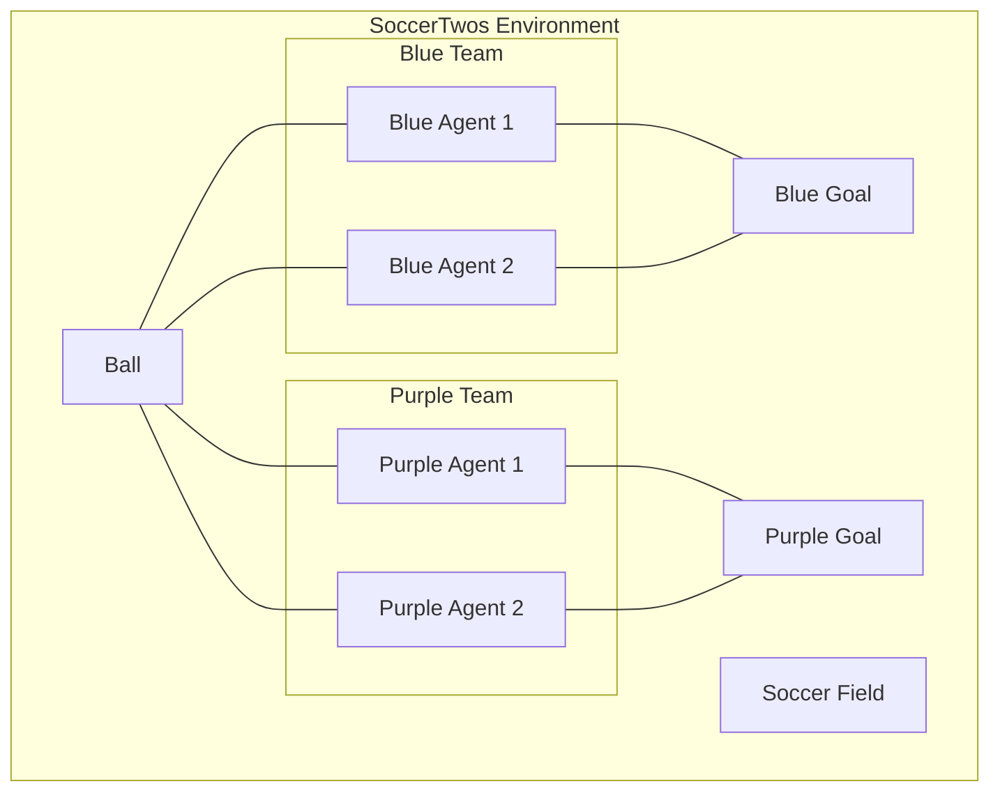
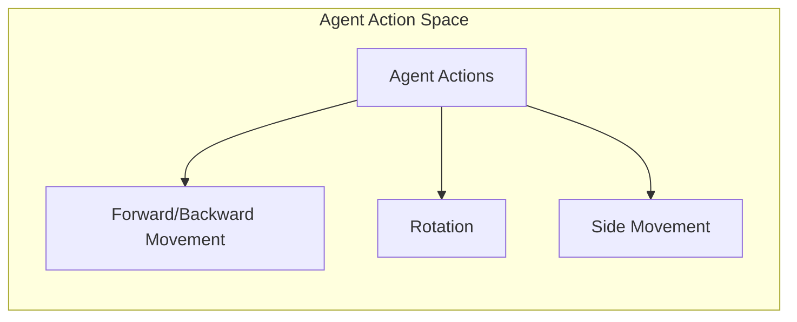
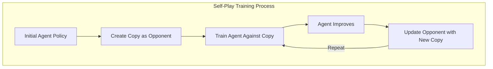
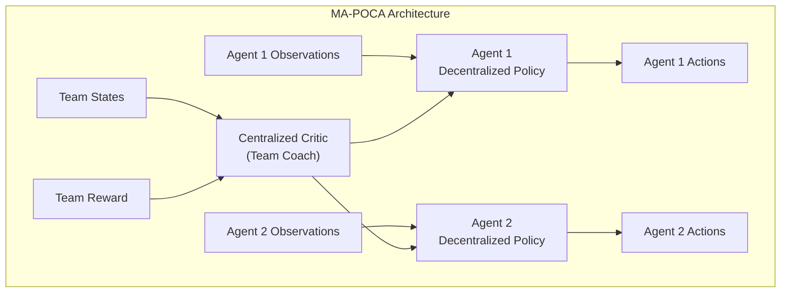
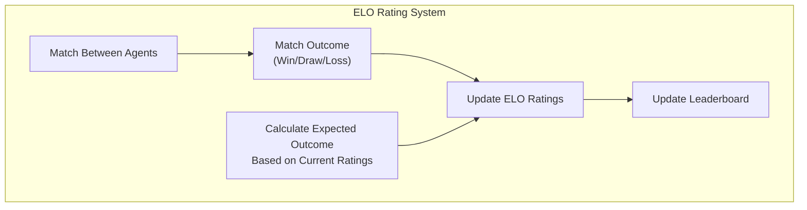
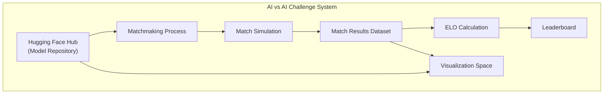
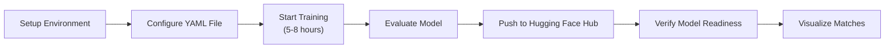

<!-- source: DeepWiki mcp.deepwiki.com · repo huggingface/deep-rl-class · page 8.1 SoccerTwos: AI vs AI Challenge · fetched 2026-10-26 -->

# SoccerTwos: AI vs AI Challenge

<details>
<summary>Relevant source files</summary>

The following files were used as context for generating this wiki page:

- [units/en/unit7/additional-readings.mdx](units/en/unit7/additional-readings.mdx)
- [units/en/unit7/conclusion.mdx](units/en/unit7/conclusion.mdx)
- [units/en/unit7/hands-on.mdx](units/en/unit7/hands-on.mdx)
- [units/en/unit7/introduction-to-marl.mdx](units/en/unit7/introduction-to-marl.mdx)
- [units/en/unit7/introduction.mdx](units/en/unit7/introduction.mdx)
- [units/en/unit7/multi-agent-setting.mdx](units/en/unit7/multi-agent-setting.mdx)
- [units/en/unit7/self-play.mdx](units/en/unit7/self-play.mdx)

</details>


## Purpose and Scope

This document details the SoccerTwos AI vs AI Challenge, a hands-on multi-agent reinforcement learning exercise where you train a 2vs2 soccer team to compete against opponents in an automated evaluation system. The challenge focuses on implementing self-play with MA-POCA (Multi-Agent POsthumous Credit Assignment) to develop agents that can cooperate with teammates while competing against opponents. This page covers the environment specifications, training approach, evaluation system, and step-by-step participation instructions.

For background on multi-agent reinforcement learning concepts, see [Multi-Agent Reinforcement Learning](#8). For information about Proximal Policy Optimization (PPO), see [Proximal Policy Optimization](#9).

## SoccerTwos Environment Overview

SoccerTwos is a multi-agent environment developed by the Unity ML-Agents team where two teams (blue and purple) of two agents each compete in a soccer match. The goal is to score goals against the opposing team while preventing them from scoring.



Sources: [units/en/unit7/hands-on.mdx:101-111](), [units/en/unit7/hands-on.mdx:36-40]()

### Observation Space

Each agent receives a vector observation of size 336, composed of:
- 11 ray-casts forward distributed over 120 degrees (264 state dimensions)
- 3 ray-casts backward distributed over 90 degrees (72 state dimensions)
- These ray-casts can detect 6 object types: Ball, Blue Goal, Purple Goal, Wall, Blue Agent, Purple Agent

Sources: [units/en/unit7/hands-on.mdx:119-132]()

### Action Space

The action space consists of three discrete branches:
1. Forward/backward movement
2. Rotation
3. Side movement



Sources: [units/en/unit7/hands-on.mdx:134-137]()

### Reward Function

The reward function incentivizes scoring goals and penalizes allowing goals:
- +1 when the team scores a goal
- -1 when the opposing team scores a goal

Sources: [units/en/unit7/hands-on.mdx:114-117]()

## Multi-Agent Learning Approach

### Self-Play

Self-play is used to train agents in SoccerTwos, allowing them to learn progressively against opponents of suitable difficulty.



Key self-play hyperparameters include:
- `save_steps`: Steps before saving a new opponent
- `team_change`: How often team assignments change
- `swap_steps`: How often opponents change
- `window`: Number of past policies to maintain
- `play_against_latest_model_ratio`: Probability of playing against current model vs historical one

Sources: [units/en/unit7/self-play.mdx:12-50]()

### MA-POCA Architecture

MA-POCA (Multi-Agent POsthumous Credit Assignment) is used to train cooperative behavior among teammates.



MA-POCA allows:
- Each agent to make decisions based on local observations
- Centralized critic to evaluate individual contributions to team success
- Appropriate credit assignment for team rewards

Sources: [units/en/unit7/hands-on.mdx:139-160]()

## ELO Rating System

The challenge uses an ELO rating system to evaluate and rank agents:

- ELO measures relative skill level between players
- Players gain or lose points based on match outcomes
- Initial ELO score is typically 1200
- Points exchanged depend on the expected outcome probability



Mathematical formulation:
- Expected score: E_A = 1/(1+10^((R_B-R_A)/400))
- New rating: R_A' = R_A + K*(S_A - E_A)
  - R_A is current rating
  - S_A is actual score (1 for win, 0.5 for draw, 0 for loss)
  - K is adjustment factor

Sources: [units/en/unit7/self-play.mdx:57-137]()

## AI vs AI Challenge Infrastructure

The AI vs AI challenge consists of three main components:



1. **Matchmaking Process**: 
   - Runs every 4 hours
   - Fetches all available models with the appropriate tag
   - Creates a queue of matches

2. **Leaderboard**:
   - Displays ELO ratings based on match results
   - Located at: https://huggingface.co/spaces/huggingface-projects/AIvsAI-SoccerTwos

3. **Visualization Space**:
   - Allows visualization of agents playing against each other
   - Located at: https://huggingface.co/spaces/unity/ML-Agents-SoccerTwos

Sources: [units/en/unit7/hands-on.mdx:15-34]()

## Training Process

### Configuration Setup

Training is defined by hyperparameters in a YAML configuration file:

```yaml
behaviors:
  SoccerTwos:
    trainer_type: poca
    hyperparameters:
      batch_size: 2048
      buffer_size: 20480
      learning_rate: 0.0003
      beta: 0.005
      epsilon: 0.2
      lambd: 0.95
      num_epoch: 3
      learning_rate_schedule: constant
    network_settings:
      normalize: false
      hidden_units: 512
      num_layers: 2
      vis_encode_type: simple
    reward_signals:
      extrinsic:
        gamma: 0.99
        strength: 1.0
    keep_checkpoints: 5
    max_steps: 5000000
    time_horizon: 1000
    summary_freq: 10000
    self_play:
      save_steps: 50000
      team_change: 200000
      swap_steps: 2000
      window: 10
      play_against_latest_model_ratio: 0.5
      initial_elo: 1200.0
```

Sources: [units/en/unit7/hands-on.mdx:172-207]()

### Training Command

The training process uses the ML-Agents CLI with the following command structure:

```bash
mlagents-learn <config_file> --env=<environment_executable> --run-id=<run_name> --no-graphics
```

The training:
- Takes approximately 5-8 hours for 5M timesteps
- Uses 8 copies of the environment in parallel
- Creates checkpoints that can be pushed to Hugging Face Hub

Sources: [units/en/unit7/hands-on.mdx:219-244]()

## Participation Steps

### Environment Setup

1. Create a Python environment (recommended Python 3.10.12)
   ```bash
   conda create --name rl python=3.10.12
   conda activate rl
   ```

2. Install ML-Agents
   ```bash
   git clone https://github.com/Unity-Technologies/ml-agents
   cd ml-agents
   pip install -e ./ml-agents-envs
   pip install -e ./ml-agents
   ```

3. Download the appropriate SoccerTwos executable for your operating system

Sources: [units/en/unit7/hands-on.mdx:56-98]()

### Training Workflow



Sources: [units/en/unit7/hands-on.mdx:56-321]()

### Pushing to Hugging Face Hub

After training, use the following command to push your model:

```bash
mlagents-push-to-hf --run-id=<run_id> --local-dir=<local_dir> --repo-id=<username>/<repo_name> --commit-message="<message>"
```

Requirements for AI vs AI Challenge participation:
1. Model must have the `ML-Agents-SoccerTwos` tag
2. Repository must contain a `SoccerTwos.onnx` file

Sources: [units/en/unit7/hands-on.mdx:246-310]()

### Visualizing Matches

After pushing your model:
1. Visit the visualization space: https://huggingface.co/spaces/unity/ML-Agents-SoccerTwos
2. Select your model and an opponent model
3. Watch the match to assess your agent's performance

Sources: [units/en/unit7/hands-on.mdx:312-323]()

## Competition Constraints

To ensure fair competition:
1. You cannot change the observation space or action space
2. You must use the Unity ML-Agents trainers (not custom trainers)
3. Use the provided executables for consistent evaluation

The main differentiator in the challenge is optimizing hyperparameters to train effective agents.

Sources: [units/en/unit7/hands-on.mdx:36-49]()

---

