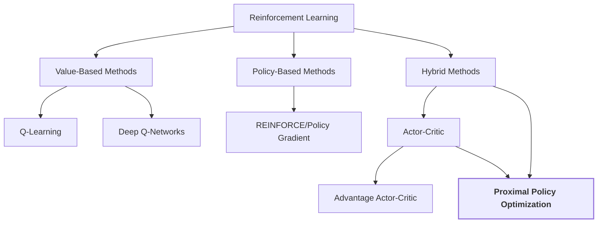
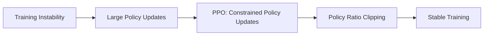
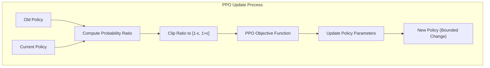
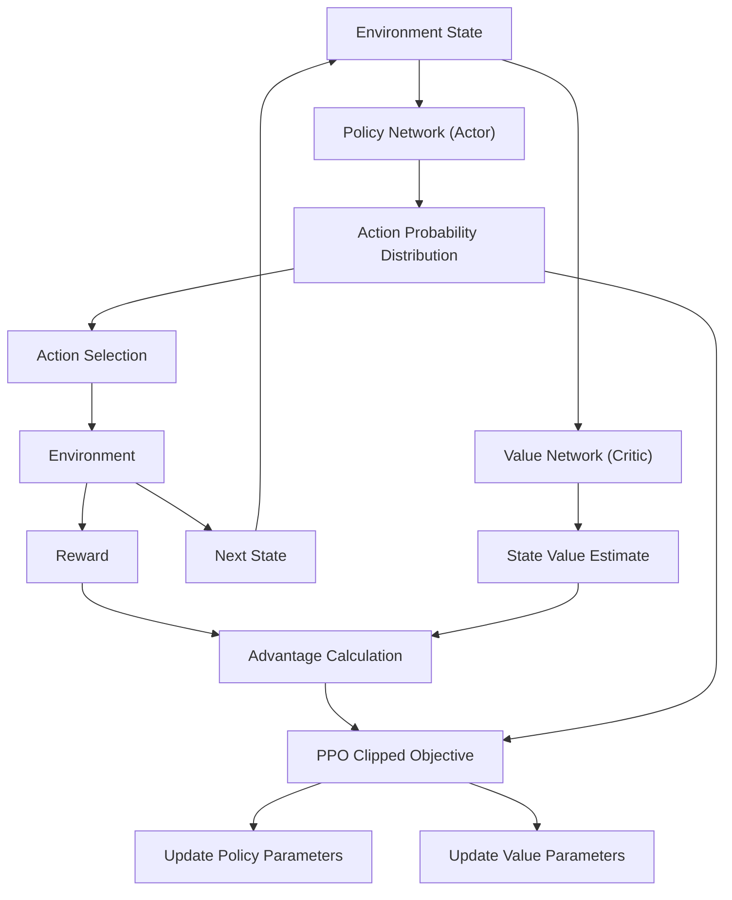
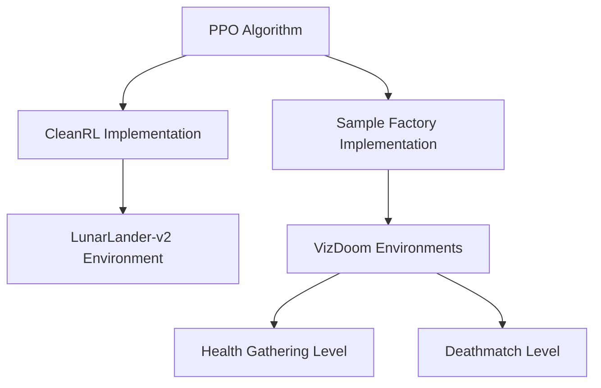

<!-- source: DeepWiki mcp.deepwiki.com · repo huggingface/deep-rl-class · page 9 Proximal Policy Optimization · fetched 2026-10-26 -->

# Proximal Policy Optimization

Relevant source files

The following files were used as context for generating this wiki page:

- [units/en/unit8/conclusion-sf.mdx](units/en/unit8/conclusion-sf.mdx)
- [units/en/unit8/introduction-sf.mdx](units/en/unit8/introduction-sf.mdx)
- [units/en/unit8/introduction.mdx](units/en/unit8/introduction.mdx)

## Purpose and Scope

Proximal Policy Optimization (PPO) is a policy gradient reinforcement learning algorithm designed to improve training stability by preventing large policy updates. This document explains the theory, architecture, and advantages of PPO as presented in Unit 8 of the Deep Reinforcement Learning Course. For the specific implementation details of PPO using CleanRL and Sample Factory, see [PPO Implementation](#9.1).

PPO builds upon concepts previously covered in [Actor-Critic Methods](#7), providing a more stable and efficient approach to policy optimization.

Sources: [units/en/unit8/introduction.mdx:5-12]()

## PPO in the Reinforcement Learning Landscape

PPO is positioned as a hybrid method in reinforcement learning, combining elements from both value-based and policy-based approaches.

Sources: [units/en/unit8/introduction.mdx:5-12]()

## PPO Algorithm: Motivation and Key Concepts

### Background and Motivation

Traditional policy gradient methods often suffer from instability during training due to large policy updates. Such large updates can cause performance to collapse when the new policy deviates too far from the old one. PPO addresses this challenge by:

1. Limiting the policy change magnitude in each update
2. Ensuring stable learning through policy clipping
3. Balancing exploration and exploitation more efficiently

Sources: [units/en/unit8/introduction.mdx:10-12]()

### Core Mechanism: Policy Ratio Clipping

The distinguishing feature of PPO is its objective function that includes a clipped probability ratio:

1. PPO computes a ratio between the probability of an action under the current policy and the probability under the old policy
2. This ratio is clipped to remain within a predefined range [1-ε, 1+ε], typically with ε = 0.1 or 0.2
3. The clipping prevents the policy from changing too drastically in a single update

Sources: [units/en/unit8/introduction.mdx:10-12]()

### PPO's Mathematical Formulation

PPO uses a clipped surrogate objective function:

L^CLIP(θ) = Ê_t[min(r_t(θ)Â_t, clip(r_t(θ), 1-ε, 1+ε)Â_t)]

Where:
- r_t(θ) is the probability ratio r_t(θ) = π_θ(a_t|s_t) / π_θ_old(a_t|s_t)
- Â_t is the estimated advantage function
- ε is the clipping parameter (typically 0.1 or 0.2)

This objective function takes the minimum of the unclipped and clipped objective, ensuring that the final update is never incentivized to move r_t outside of [1-ε, 1+ε].

## PPO Architecture

PPO builds on the Actor-Critic architecture, consisting of:

### Key Components

1. **Actor (Policy Network)**: Generates a probability distribution over actions given the current state
2. **Critic (Value Network)**: Estimates the value function to compute advantage estimates
3. **Advantage Estimator**: Computes how much better an action is compared to the average action in a state
4. **Clipping Mechanism**: Prevents excessive policy updates by restricting parameter changes

Sources: [units/en/unit8/introduction.mdx:5-9]()

## Advantages of PPO

### 1. Training Stability

PPO's primary advantage is improved training stability compared to other policy gradient methods like vanilla policy gradient or even basic actor-critic methods. By constraining the policy update, PPO avoids performance collapse that can occur with large policy changes.

### 2. Sample Efficiency

While not as sample-efficient as some off-policy methods like SAC or TD3, PPO is relatively sample-efficient for an on-policy algorithm. It makes better use of collected experience through multiple optimization epochs on the same batch of data.

### 3. Ease of Implementation

PPO strikes a good balance between implementation complexity and performance. It's simpler to implement than algorithms like TRPO (Trust Region Policy Optimization) while achieving comparable or better performance.

### 4. Hyperparameter Robustness

PPO is less sensitive to hyperparameter choices than many other deep RL algorithms, making it more reliable across different environments without extensive tuning.

### 5. Versatility

PPO has been successfully applied to a wide range of environments, from simple control tasks like LunarLander to complex 3D games like Doom (VizDoom), demonstrating its versatility.

Sources: [units/en/unit8/introduction.mdx:10-12](), [units/en/unit8/introduction-sf.mdx:5-7]()

## Implementation Approaches in the Course

In this course, PPO is implemented using two frameworks:

1. **CleanRL**: A lightweight, standalone implementation used with LunarLander-v2 environment. This implementation provides a clear understanding of PPO's core components.

2. **Sample Factory**: An asynchronous implementation designed for high-performance training, used with VizDoom environments. Sample Factory is optimized for environments requiring complex visual processing and high throughput.

Sources: [units/en/unit8/introduction.mdx:14-16](), [units/en/unit8/introduction-sf.mdx:5-7]()

## Common PPO Hyperparameters

The following table summarizes key hyperparameters used in PPO implementations:

| Hyperparameter | Typical Value | Purpose |
|----------------|---------------|---------|
| Clipping parameter (ε) | 0.1-0.2 | Controls how much the policy can change in one update |
| GAE lambda (λ) | 0.9-0.95 | Parameter for Generalized Advantage Estimation |
| Value function coefficient | 0.5-1.0 | Scales the value function loss relative to the policy loss |
| Entropy coefficient | 0.01-0.001 | Encourages exploration by penalizing determined actions |
| Learning rate | 2e-4 to 3e-4 | Controls the size of parameter updates |
| Number of epochs | 3-10 | How many times to reuse each batch of data |
| Batch size / Mini-batch size | Varies | Size of data chunks for updates |

Sources: [units/en/unit8/introduction.mdx:5-23]()

## Conclusion

Proximal Policy Optimization represents a significant advancement in reinforcement learning algorithms, particularly in addressing the stability issues that plagued earlier policy gradient methods. By constraining policy updates through ratio clipping, PPO delivers consistent performance improvements while remaining relatively simple to implement and tune.

In the context of this course, PPO serves as the culmination of your reinforcement learning journey, building upon the actor-critic foundation established in previous units and demonstrating how small algorithmic innovations can lead to substantial performance gains.

In the next section, we'll dive into the practical implementation of PPO using both CleanRL and Sample Factory frameworks. For implementation details, see [PPO Implementation](#9.1).

Sources: [units/en/unit8/introduction.mdx:10-23](), [units/en/unit8/conclusion-sf.mdx:3-11]()

---

