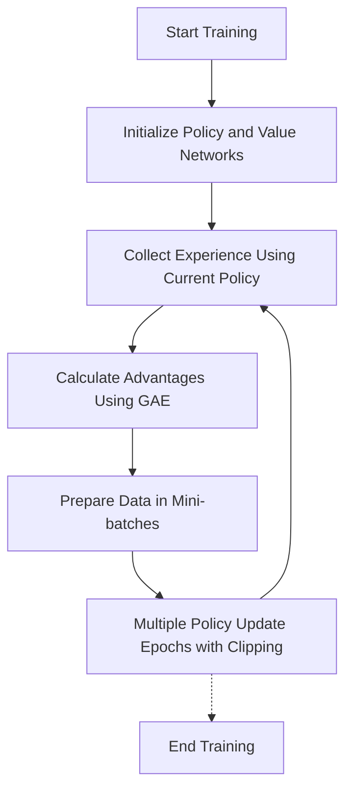
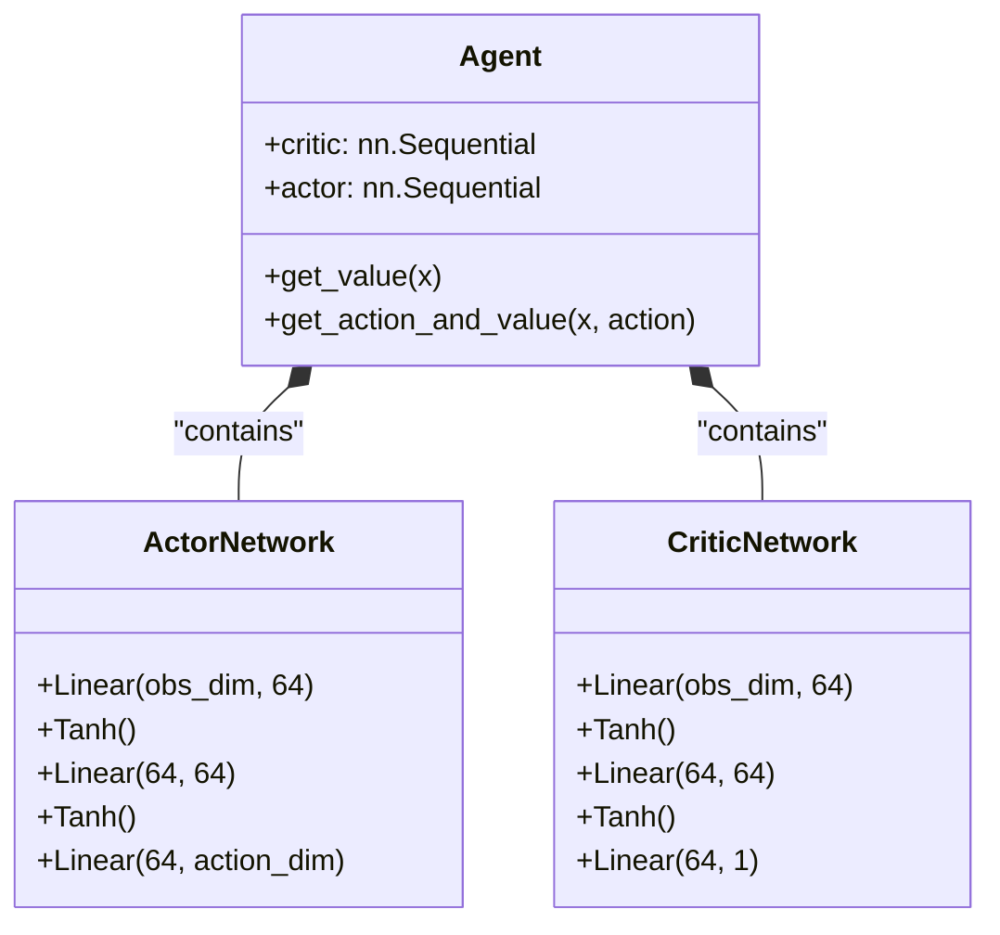
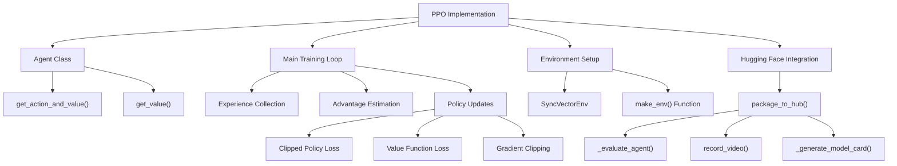
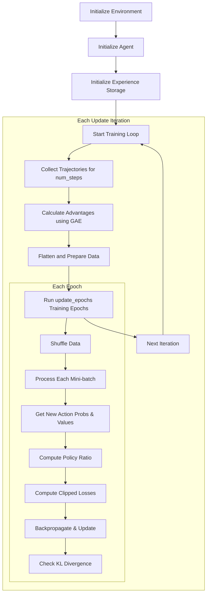
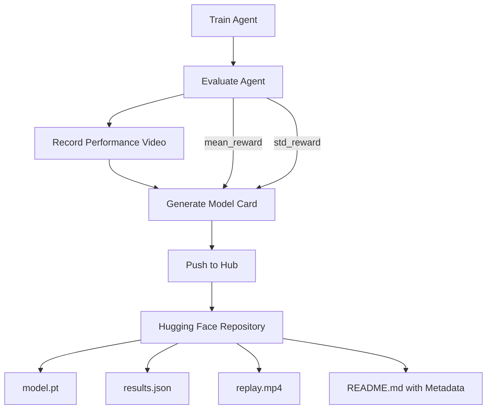

<!-- source: DeepWiki mcp.deepwiki.com · repo huggingface/deep-rl-class · page 9.1 PPO Implementation · fetched 2026-10-26 -->

# PPO Implementation

<details>
<summary>Relevant source files</summary>

The following files were used as context for generating this wiki page:

- [units/en/unit8/hands-on-cleanrl.mdx](units/en/unit8/hands-on-cleanrl.mdx)
- [units/en/unit8/hands-on-sf.mdx](units/en/unit8/hands-on-sf.mdx)

</details>


This document provides detailed technical documentation of the Proximal Policy Optimization (PPO) implementation in the Deep Reinforcement Learning Course. It covers implementing PPO from scratch using PyTorch with CleanRL's approach, training on the LunarLander-v2 environment, and integrating with the Hugging Face Hub.

For information about advanced PPO implementations using Sample Factory to play Doom, see the companion page on Sample Factory implementation.

## PPO Algorithm Overview

Proximal Policy Optimization (PPO) is a policy gradient method that addresses the issue of large policy updates by using a clipping mechanism in its objective function. It combines the benefits of trust region methods with the simplicity of first-order optimization.

### PPO Algorithm Flow



Sources: [units/en/unit8/hands-on-cleanrl.mdx:12-18](), [units/en/unit8/hands-on-cleanrl.mdx:877-1015]()

## Implementation Architecture

The implementation is a single-file, self-contained PPO implementation based on CleanRL, designed to be educational yet performant. The code has several key components:

### Agent Architecture

The agent uses a standard actor-critic architecture with separate network heads for the policy (actor) and value function (critic):



Sources: [units/en/unit8/hands-on-cleanrl.mdx:795-822]()

### Code Structure Overview

This diagram shows the relationship between code entities and their roles in the PPO implementation:



Sources: [units/en/unit8/hands-on-cleanrl.mdx:434-1030]()

## Key Implementation Details

### Environment Setup

The environment is set up using vectorized environments from Gym:

```python
# env setup
envs = gym.vector.SyncVectorEnv(
    [make_env(args.env_id, args.seed + i, i, args.capture_video, run_name) for i in range(args.num_envs)]
)
```

This creates multiple parallel environments for efficient data collection. The `make_env` function sets up individual environments with seed control and optional video recording.

Sources: [units/en/unit8/hands-on-cleanrl.mdx:774-786](), [units/en/unit8/hands-on-cleanrl.mdx:854-857]()

### Experience Storage

The implementation uses fixed-size tensors to store experiences:

```python
# Storage setup
obs = torch.zeros((args.num_steps, args.num_envs) + envs.single_observation_space.shape).to(device)
actions = torch.zeros((args.num_steps, args.num_envs) + envs.single_action_space.shape).to(device)
logprobs = torch.zeros((args.num_steps, args.num_envs)).to(device)
rewards = torch.zeros((args.num_steps, args.num_envs)).to(device)
dones = torch.zeros((args.num_steps, args.num_envs)).to(device)
values = torch.zeros((args.num_steps, args.num_envs)).to(device)
```

Sources: [units/en/unit8/hands-on-cleanrl.mdx:863-868]()

### Generalized Advantage Estimation (GAE)

The implementation uses GAE to compute advantages, balancing bias and variance:

```python
if args.gae:
    advantages = torch.zeros_like(rewards).to(device)
    lastgaelam = 0
    for t in reversed(range(args.num_steps)):
        if t == args.num_steps - 1:
            nextnonterminal = 1.0 - next_done
            nextvalues = next_value
        else:
            nextnonterminal = 1.0 - dones[t + 1]
            nextvalues = values[t + 1]
        delta = rewards[t] + args.gamma * nextvalues * nextnonterminal - values[t]
        advantages[t] = lastgaelam = delta + args.gamma * args.gae_lambda * nextnonterminal * lastgaelam
    returns = advantages + values
```

Sources: [units/en/unit8/hands-on-cleanrl.mdx:911-923]()

### PPO Clipping Objective

The PPO clipping mechanism prevents large policy updates:

```python
# Policy loss
pg_loss1 = -mb_advantages * ratio
pg_loss2 = -mb_advantages * torch.clamp(ratio, 1 - args.clip_coef, 1 + args.clip_coef)
pg_loss = torch.max(pg_loss1, pg_loss2).mean()
```

Where `ratio` is the likelihood ratio between the new and old policies:

```python
logratio = newlogprob - b_logprobs[mb_inds]
ratio = logratio.exp()
```

Sources: [units/en/unit8/hands-on-cleanrl.mdx:956-972]()

### Training Pipeline

The training process follows this flow:



Sources: [units/en/unit8/hands-on-cleanrl.mdx:877-1015]()

## Hugging Face Hub Integration

The implementation includes functions to evaluate the agent, record videos, and push to the Hub:



The integration handles:
1. Model evaluation using `_evaluate_agent()`
2. Video recording with `record_video()`
3. Model card generation through `_generate_model_card()`
4. Pushing all artifacts to the Hub via `upload_folder()`

Sources: [units/en/unit8/hands-on-cleanrl.mdx:533-621](), [units/en/unit8/hands-on-cleanrl.mdx:1023-1029]()

## Key Hyperparameters

The implementation includes numerous hyperparameters that can be tuned for performance:

| Parameter | Description | Default |
|-----------|-------------|---------|
| `--learning-rate` | Learning rate for Adam optimizer | 2.5e-4 |
| `--num-envs` | Number of parallel environments | 4 |
| `--num-steps` | Steps per environment per collection | 128 |
| `--gamma` | Discount factor | 0.99 |
| `--gae-lambda` | GAE lambda parameter | 0.95 |
| `--num-minibatches` | Number of mini-batches per epoch | 4 |
| `--update-epochs` | Number of policy update epochs | 4 |
| `--clip-coef` | PPO clipping coefficient | 0.2 |
| `--ent-coef` | Entropy coefficient | 0.01 |
| `--vf-coef` | Value function coefficient | 0.5 |
| `--max-grad-norm` | Maximum gradient norm | 0.5 |

Sources: [units/en/unit8/hands-on-cleanrl.mdx:467-523]()

## Using the Implementation

### Training an Agent

To train a PPO agent on LunarLander-v2 environment:

```bash
python ppo.py --env-id="LunarLander-v2" --repo-id="YOUR_REPO_ID" --total-timesteps=50000
```

This will:
1. Train the agent for 50,000 timesteps
2. Evaluate its performance
3. Record a video of the agent's behavior
4. Push the model and artifacts to the specified Hugging Face repository

Sources: [units/en/unit8/hands-on-cleanrl.mdx:1069-1070]()

### Hugging Face Authentication

To push your model to the Hub, you must authenticate:

```python
from huggingface_hub import notebook_login
notebook_login()
```

Or if not using a notebook:
```bash
huggingface-cli login
```

Sources: [units/en/unit8/hands-on-cleanrl.mdx:1045-1048]()

## LunarLander-v2 Environment

The implementation is tested on the LunarLander-v2 environment, which is a classic control problem:

- The agent controls a lunar lander with four discrete actions: do nothing, fire left engine, fire main engine, fire right engine
- The goal is to land safely between two flags without crashing
- The state space consists of 8 continuous variables including position, velocity, angle, and leg contact points
- The environment is considered solved when the agent achieves an average reward of +200 over 100 consecutive episodes

The environment serves as a good test bed for PPO due to its moderately complex dynamics and clear success metrics.

Sources: [units/en/unit8/hands-on-cleanrl.mdx:21-35]()

## Conclusion

This PPO implementation provides a clean, educational, yet performant approach to implementing the PPO algorithm. The integration with Hugging Face Hub simplifies sharing and evaluating trained models. The code design prioritizes clarity while maintaining all essential components of the PPO algorithm.

By studying this implementation, you can understand how PPO works in practice and apply it to various reinforcement learning problems. The code also serves as a starting point for customization and experimentation with different hyperparameters and environments.

Sources: [units/en/unit8/hands-on-cleanrl.mdx:12-18](), [units/en/unit8/hands-on-cleanrl.mdx:1073-1077]()

---

