# Page: Overview

# Overview

<details>
<summary>Relevant source files</summary>

The following files were used as context for generating this wiki page:

- [README.md](README.md)
- [units/en/unit0/discord101.mdx](units/en/unit0/discord101.mdx)
- [units/en/unit0/introduction.mdx](units/en/unit0/introduction.mdx)
- [units/en/unit0/setup.mdx](units/en/unit0/setup.mdx)
- [units/en/unit1/introduction.mdx](units/en/unit1/introduction.mdx)

</details>


The Deep Reinforcement Learning Course by Hugging Face is a comprehensive educational resource designed to teach Deep Reinforcement Learning (Deep RL) from beginner to expert level. This document provides an overview of the course structure, content, and resources available in the [huggingface/deep-rl-class](https://github.com/huggingface/deep-rl-class) repository.

For detailed information about getting started with the course, see [Getting Started](#1.2).

## Course Purpose and Scope

The Deep Reinforcement Learning Course aims to provide both theoretical foundations and practical implementations of Deep RL techniques. The course is:

- **Free and open-source**: All materials are freely accessible
- **Self-paced**: No deadlines, learn at your own speed
- **Practical**: Combines theory with hands-on exercises
- **Community-driven**: Includes Discord community support and challenges

While the course is now in a low-maintenance state, it remains a valuable resource for learning Deep RL concepts and implementations.

Sources: [README.md:15-26](), [units/en/unit0/introduction.mdx:5-18](), [units/en/unit0/introduction.mdx:39-51]()

## Course Structure

### Course Content Organization

```mermaid
graph TD
    Course["Deep RL Course"]
    Course --> Theory["Theory Units"]
    Course --> Practice["Hands-on Exercises"]
    Course --> Community["Community Resources"]
    
    Theory --> U1["Unit 1: RL Fundamentals"]
    Theory --> U2["Unit 2: Q-Learning"]
    Theory --> U3["Unit 3: Deep Q-Networks"]
    Theory --> U4["Unit 4: Policy Gradient"]
    Theory --> U5["Unit 5: Unity ML-Agents"]
    Theory --> U6["Unit 6: Actor-Critic"]
    Theory --> U7["Unit 7: Multi-Agent RL"]
    Theory --> U8["Unit 8: PPO"]
    Theory --> Bonus["Bonus Units"]
    
    Practice --> LunarLander["LunarLander with SB3"]
    Practice --> FrozenLake["Q-Learning with FrozenLake/Taxi"]
    Practice --> Atari["DQN with Atari Games"]
    Practice --> Unity["Training in Unity Environments"]
    Practice --> RoboEnv["A2C with Robotics Environments"]
    Practice --> Soccer["Multi-Agent SoccerTwos"]
    Practice --> PPOImpl["PPO Implementation"]
    Practice --> HuggyDog["Huggy: Virtual Dog Training"]
    
    Community --> Discord["Discord Server"]
    Community --> HFHub["Hugging Face Hub Integration"]
    Community --> Challenges["AI vs AI Challenges"]
```

Sources: [units/en/unit0/introduction.mdx:53-61](), [units/en/unit0/introduction.mdx:63-67]()

### Learning Pathways

The course offers two main learning paths:

1. **Self-audit**: Participate in all content without pursuing certification
2. **Certification process**:
   - **Certificate of Completion**: Complete 80% of assignments
   - **Certificate of Honors**: Complete 100% of assignments

Each unit is designed to be completed in approximately one week, requiring 3-4 hours of work.

Sources: [units/en/unit0/introduction.mdx:69-81](), [units/en/unit0/introduction.mdx:85-95](), [units/en/unit0/introduction.mdx:117-119]()

## Deep RL Methods Covered

The course follows a progression from fundamental RL concepts to advanced techniques:

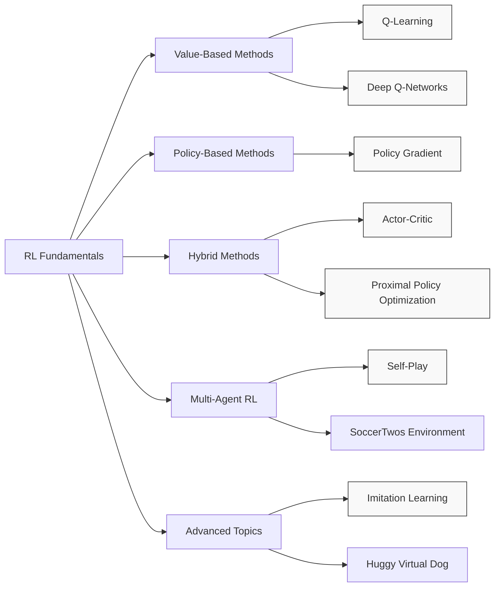

Sources: [units/en/unit0/introduction.mdx:63-67](), [units/en/unit1/introduction.mdx:6-27]()

## Hands-on Exercises and Implementation

Each theoretical unit is paired with practical hands-on exercises where students implement the algorithms using established RL libraries:

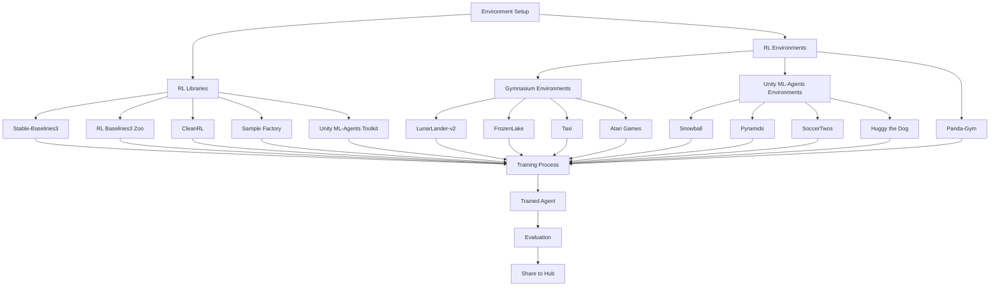

Sources: [units/en/unit0/introduction.mdx:23-35](), [units/en/unit1/introduction.mdx:13-23]()

## Course Components

The course includes several key components:

| Component | Description |
|-----------|-------------|
| Theory Content | Foundational explanations of RL concepts and algorithms |
| Hands-on Exercises | Google Colab notebooks with practical implementations |
| Tutorial Videos | Companion videos explaining hands-on exercises |
| Challenges | Leaderboards and AI vs AI competitions |
| Community | Discord server for discussions and study groups |
| Hugging Face Hub | Platform for sharing trained models and demos |

Sources: [units/en/unit0/introduction.mdx:54-60](), [units/en/unit0/introduction.mdx:23-35]()

## Requirements and Setup

To participate in the course, you need:

1. A computer with internet connection
2. Google Colab (free version)
3. A Hugging Face account (for pushing and loading models)
4. (Optional) Discord account to join the community

The onboarding process involves:
1. Creating a Hugging Face account
2. Joining the Discord server for community support
3. Accessing the course materials at https://huggingface.co/deep-rl-course/unit0/introduction

Sources: [units/en/unit0/setup.mdx:1-28](), [units/en/unit0/introduction.mdx:107-113]()

## Discord Community

The course has an active Discord community with dedicated channels:

- `rl-announcements`: Course updates and information
- `rl-discussions`: General discussions about RL
- `rl-study-group`: Questions and exchanges with classmates
- `rl-i-made-this`: Sharing projects and models

Joining the Discord community is recommended for participating in study groups and getting support from peers and instructors.

Sources: [units/en/unit0/discord101.mdx:1-37](), [units/en/unit0/setup.mdx:12-26]()

## Maintenance Status

The Deep Reinforcement Learning course is currently in a low-maintenance state. Key points to note:

- All theory content and practical exercises remain accessible and effective
- Unit 7's AI vs AI feature is non-functional, but training agents is still possible
- The leaderboard is no longer operational
- The issue sections in the repository may provide solutions to bugs encountered in hands-on exercises

Sources: [README.md:15-27](), [units/en/unit0/introduction.mdx:39-51]()

---

# Page: Course Structure

# Course Structure

<details>
<summary>Relevant source files</summary>

The following files were used as context for generating this wiki page:

- [README.md](README.md)
- [units/en/_toctree.yml](units/en/_toctree.yml)
- [units/en/unit7/quiz.mdx](units/en/unit7/quiz.mdx)

</details>


This page provides a comprehensive overview of the Deep Reinforcement Learning Course organization, learning path progression, and content structure. For information about getting started with the course, see [Getting Started](#1.2), and for details on course completion certification, refer to [Certification Process](#1.3).

## Overview of Course Components

The Deep Reinforcement Learning Course consists of a carefully structured learning journey that combines theoretical foundations with hands-on implementation. The course is designed to progressively build knowledge from basic reinforcement learning concepts to advanced algorithms and techniques.

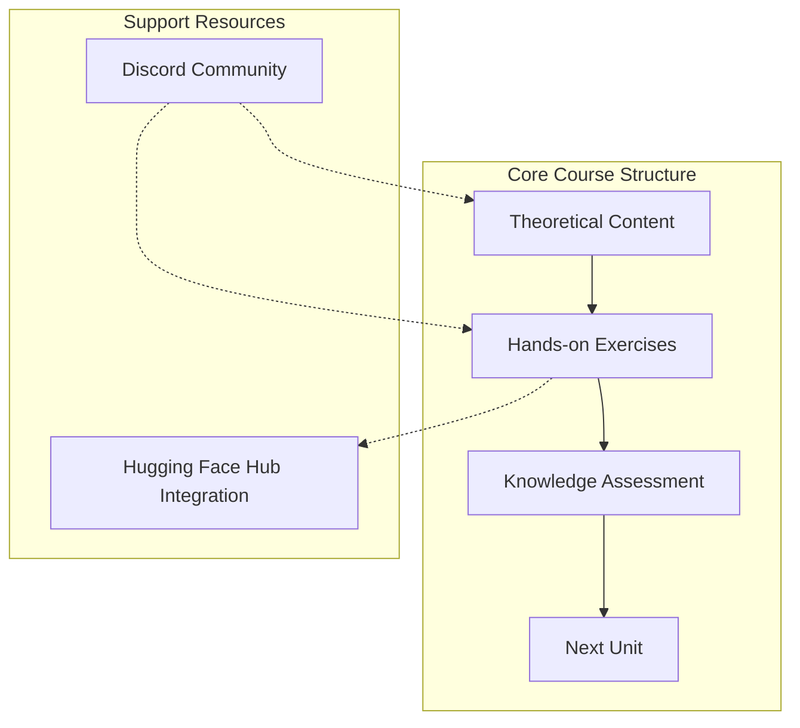

Sources: [README.md:6-17](). [units/en/_toctree.yml:1-261]().

## Units Progression and Topics

The course follows a logical progression from fundamental reinforcement learning concepts to advanced techniques, with each unit building on knowledge from previous units. Below is the course's main learning path:

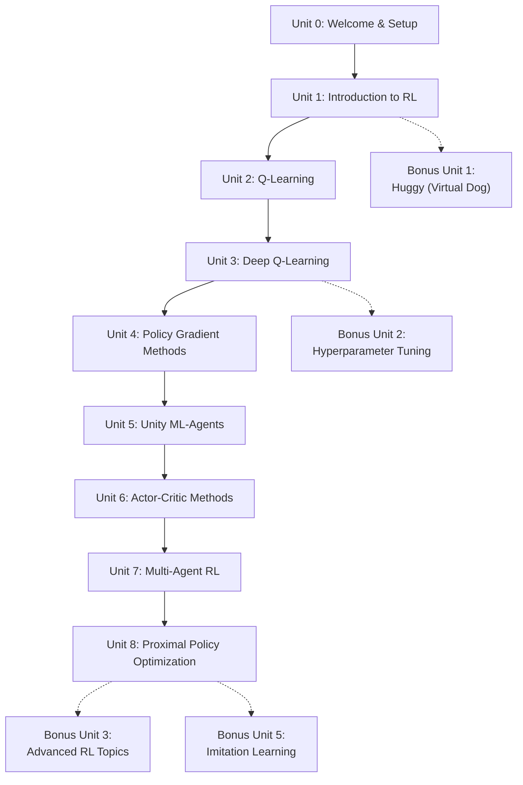

Sources: [units/en/_toctree.yml:1-261]().

## Reinforcement Learning Methods Hierarchy

The course presents reinforcement learning techniques in a progressive manner, moving from basic algorithms to more complex approaches:

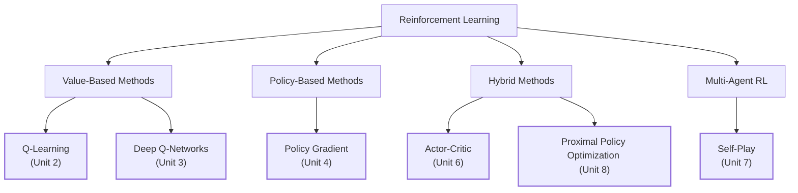

Sources: [units/en/_toctree.yml:9-204]().

## Detailed Unit Breakdown

Each unit follows a consistent structure to ensure effective learning:

| Unit | Main Focus | Environments/Tools | Key Algorithms |
|------|------------|-------------------|----------------|
| Unit 0 | Course Introduction & Setup | Discord | - |
| Unit 1 | RL Fundamentals | LunarLander, Stable-Baselines3 | - |
| Unit 2 | Q-Learning | FrozenLake, Taxi | Q-Learning |
| Unit 3 | Deep Q-Learning | Atari Games | DQN |
| Unit 4 | Policy Gradient | PyTorch, CartPole, PixelCopter | REINFORCE |
| Unit 5 | Unity ML-Agents | Snowball, Pyramids | Various |
| Unit 6 | Actor-Critic Methods | Panda-Gym Robotics | A2C |
| Unit 7 | Multi-Agent RL | SoccerTwos | Self-Play |
| Unit 8 | PPO | CleanRL, Sample Factory, Doom | PPO |

Sources: [units/en/_toctree.yml:1-204]().

## Bonus Units

The course includes specialized bonus units that cover additional topics:

1. **Bonus Unit 1**: Introduction to Huggy (Virtual Dog) - An interactive introduction to RL
2. **Bonus Unit 2**: Hyperparameter Tuning with Optuna - Optimizing model performance
3. **Bonus Unit 3**: Advanced RL Topics - Covering model-based RL, offline RL, RLHF, and more
5. **Bonus Unit 5**: Imitation Learning with Godot RL Agents - Learning from demonstrations

Sources: [units/en/_toctree.yml:37-254]().

## Unit Structure

Each regular unit in the course follows a consistent structure to provide both theoretical understanding and practical implementation:

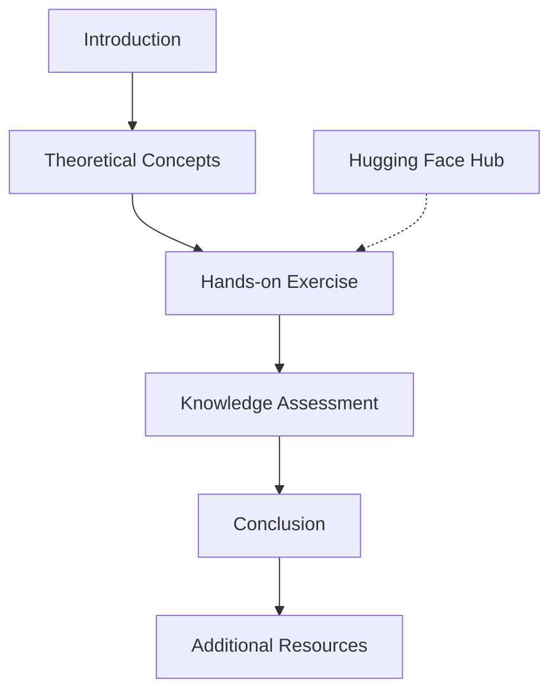

Sources: [units/en/_toctree.yml:9-36](), [units/en/unit7/quiz.mdx:1-140]().

## Theory and Practice Integration

A key feature of the course is the tight integration between theoretical concepts and hands-on implementation:

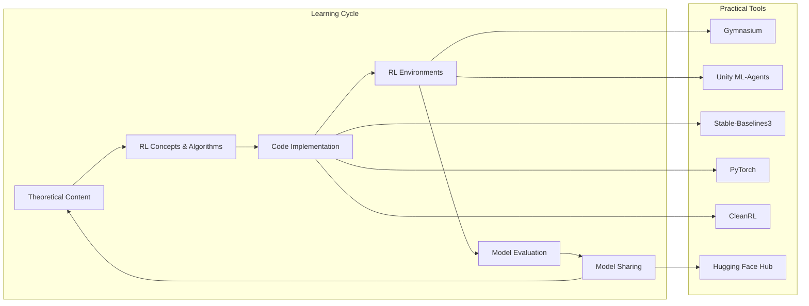

Sources: [units/en/_toctree.yml:1-261]().

## Assessment Methods

The course employs quizzes for each unit to test understanding of concepts and reinforce learning:

1. **Multiple-choice questions**: Testing understanding of key concepts
2. **Open-ended questions**: Requiring explanations of algorithms and approaches
3. **Parameter identification**: Testing understanding of algorithm configurations

The quizzes help learners identify areas where they need to reinforce their knowledge and avoid the "illusion of competence" in learning.

Sources: [units/en/unit7/quiz.mdx:1-140]().

## Maintenance Status

It's important to note that the course is currently in a low-maintenance state, but remains an excellent resource for learning both theoretical and practical aspects of Deep Reinforcement Learning. Some specific features that are no longer operational include:

- Unit 7 (AI vs AI feature): While you can still train agents to play soccer, the AI vs AI competition feature is non-functional
- Leaderboard: The leaderboard system is no longer operational

All other theoretical content and practical exercises remain fully accessible and effective for learning.

Sources: [README.md:15-25]().

## Course Navigation Tips

For the best learning experience:

1. **Follow sequential order**: Units build upon previous knowledge
2. **Complete hands-on exercises**: Practical implementation reinforces theoretical understanding
3. **Utilize the Discord community**: For troubleshooting and discussion
4. **Check issue sections**: For community solutions to any bugs encountered in hands-on exercises

Sources: [README.md:27-27]().

---

# Page: Getting Started

# Getting Started

<details>
<summary>Relevant source files</summary>

The following files were used as context for generating this wiki page:

- [units/en/unit0/discord101.mdx](units/en/unit0/discord101.mdx)
- [units/en/unit0/introduction.mdx](units/en/unit0/introduction.mdx)
- [units/en/unit0/setup.mdx](units/en/unit0/setup.mdx)
- [units/en/unit1/introduction.mdx](units/en/unit1/introduction.mdx)

</details>


This page guides you through the initial setup process for the Deep Reinforcement Learning course. It covers the technical prerequisites, account creation, Discord onboarding, and how to prepare for your learning journey. For information about the course structure and syllabus, see [Course Structure](#1.1), and for details about certification, see [Certification Process](#1.3).

## Prerequisites

Before starting the course, ensure you have:

1. **A computer with internet connection**
2. **Google Colab (free version)** - Most hands-on exercises use Google Colab, and the free version is sufficient
3. **Hugging Face Account** - Required for pushing and loading models

No specialized hardware is required as the course exercises are designed to run on Google Colab's free tier.

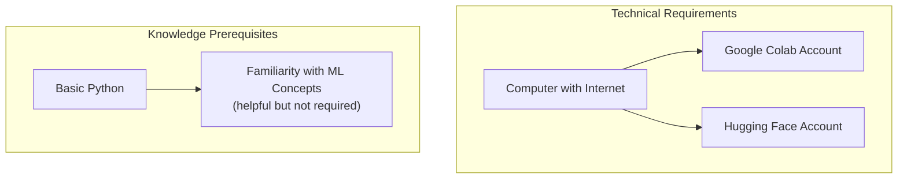

Sources: [units/en/unit0/introduction.mdx:107-113]()

## Account Setup Process

The course requires two accounts to fully participate: a Hugging Face account and Discord access.

### 1. Creating a Hugging Face Account

1. Visit [https://huggingface.co/join](https://huggingface.co/join) to create a free account
2. Complete the registration process
3. Your account will allow you to:
   - Push trained models to the Hugging Face Hub
   - Participate in the leaderboard
   - Access interactive demos

### 2. Joining the Discord Community

The Discord server is the central hub for communication, where you can:
- Get help from the community and course staff
- Join study groups with fellow students
- Receive announcements about course updates
- Share your projects and achievements

To join:
1. Visit the invitation link: [https://discord.gg/ydHrjt3WP5](https://discord.gg/ydHrjt3WP5)
2. Create a Discord account if you don't have one
3. Select "Reinforcement Learning" as an interest to access course-specific channels
4. Introduce yourself in the `#introduce-yourself` channel

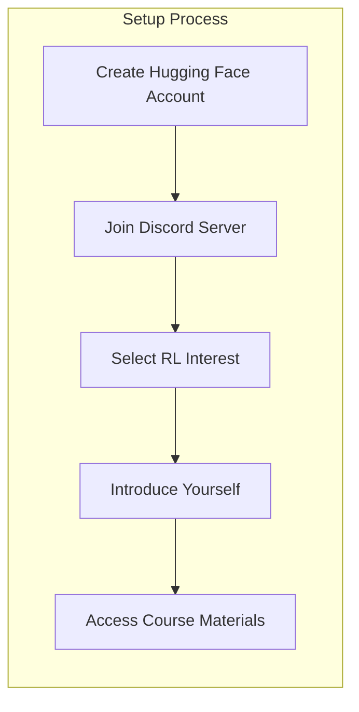

Sources: [units/en/unit0/setup.mdx:1-19](), [units/en/unit0/discord101.mdx:8-14]()

## Navigating Discord

The Discord server has several dedicated channels for the Deep RL course:

| Channel | Purpose |
|---------|---------|
| `#rl-announcements` | Course updates and important information |
| `#rl-discussions` | General discussions about reinforcement learning |
| `#rl-study-group` | Find and join study groups, ask questions |
| `#rl-i-made-this` | Share your projects and trained models |

If you're new to Discord, here are some helpful tips:
- Use markdown formatting for code blocks
- Start threads for longer conversations
- Voice channels are available for study groups
- You can directly message other participants

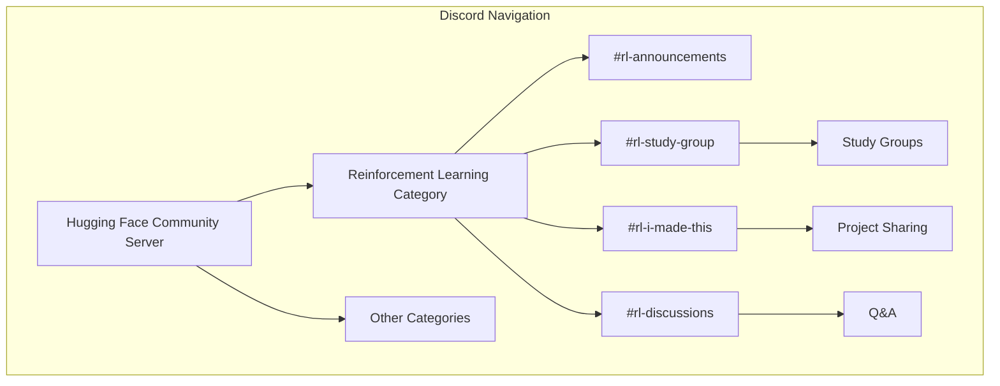

Sources: [units/en/unit0/discord101.mdx:17-26](), [units/en/unit0/setup.mdx:20-25]()

## Course Access and Navigation

The Deep RL course follows a logical progression through different reinforcement learning concepts. Here's how to navigate through the course:

### Course Structure

The course is structured with:
- **Theoretical units** - Covering RL concepts and algorithms
- **Hands-on exercises** - Google Colab notebooks with tutorial videos
- **Challenges** - Opportunities to benchmark your agents against others

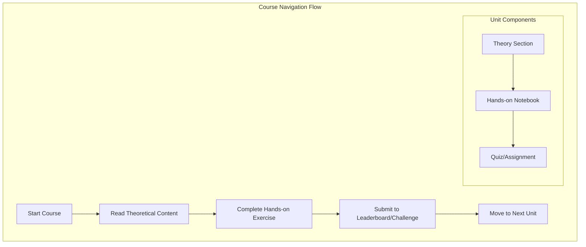

Sources: [units/en/unit0/introduction.mdx:53-60]()

### Recommended Pace

Each unit is designed to be completed in approximately one week, requiring 3-4 hours of work. However, the course is self-paced with no deadlines, so you can progress at your own speed.

For optimal learning experience:
- Join a study group on Discord
- Complete quizzes and assignments as you go
- Define a personal schedule to maintain momentum

If you're aiming for certification, remember:
- Certificate of completion: Complete 80% of assignments
- Certificate of honors: Complete 100% of assignments

Sources: [units/en/unit0/introduction.mdx:117-119](), [units/en/unit0/introduction.mdx:96-105]()

## Hands-on Environment Setup

The hands-on exercises use various RL environments and libraries. Here's what you'll be working with throughout the course:

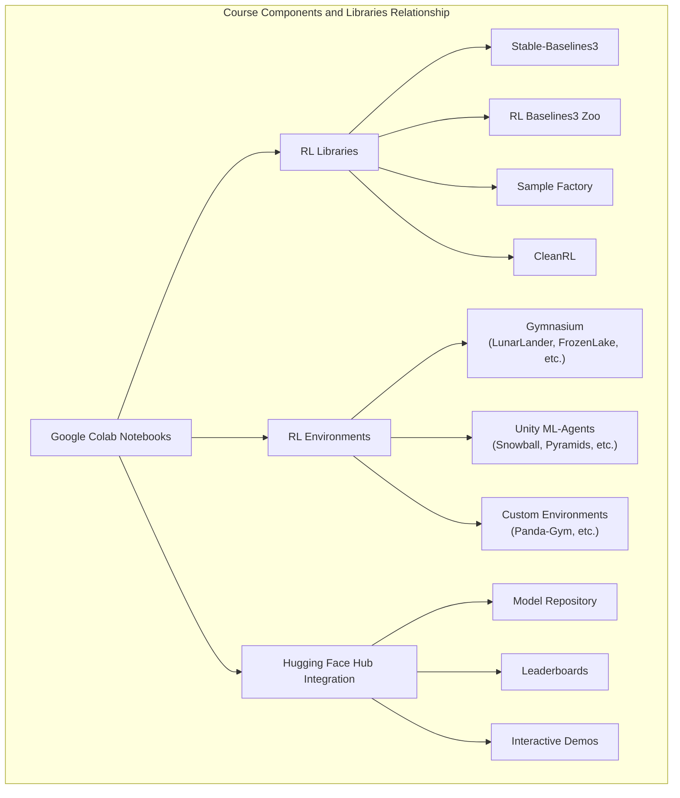

Sources: [units/en/unit0/introduction.mdx:25-28](), [units/en/unit1/introduction.mdx:13-16]()

## First Steps

After completing your setup:

1. **Start with Unit 1** - This introduces the foundations of Deep Reinforcement Learning
2. **Complete the first hands-on exercise** - Train a lunar lander agent using Stable-Baselines3
3. **Share your trained agent** - Upload it to the Hugging Face Hub
4. **Engage with the community** - Discuss what you've learned in the Discord server

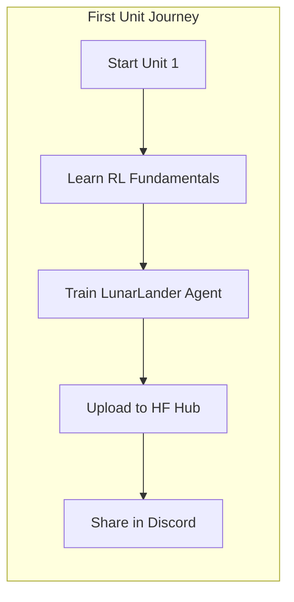

Sources: [units/en/unit1/introduction.mdx:10-19]()

## Troubleshooting

If you encounter issues during setup or while working through the course:

1. **Check the issues section** of the GitHub repository where community solutions to common bugs are posted
2. **Ask for help in the `#rl-discussions` channel** on Discord
3. **Look for similar problems** that others might have already solved

Sources: [units/en/unit0/introduction.mdx:51-52](), [units/en/unit0/introduction.mdx:141-142]()

By following this guide, you should be fully prepared to start your journey in Deep Reinforcement Learning. Remember, the community is there to help you succeed, so don't hesitate to engage and ask questions!

---

# Page: Certification Process

# Certification Process

<details>
<summary>Relevant source files</summary>

The following files were used as context for generating this wiki page:

- [units/en/communication/certification.mdx](units/en/communication/certification.mdx)
- [units/en/communication/conclusion.mdx](units/en/communication/conclusion.mdx)

</details>


This document outlines the certification system for the Deep Reinforcement Learning Course, including the requirements for obtaining certificates, the verification process, and how to generate your certificate upon completion.

## Overview

The Deep RL Course offers a free certification process to validate your knowledge and skills in reinforcement learning. There are two types of certificates available based on your assignment completion rate. The certification process is self-paced with no deadlines.

### Certification Flow

The following diagram illustrates the end-to-end certification process:

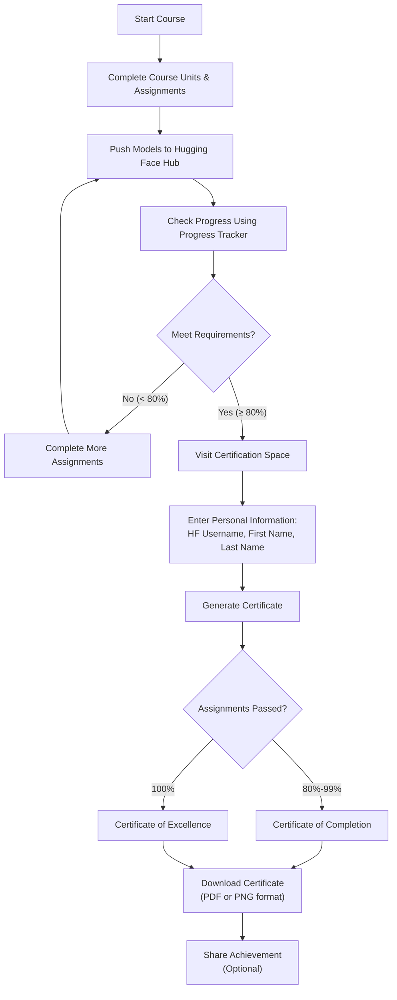

Sources: [units/en/communication/certification.mdx:4-29]()

## Certification Requirements

The certification process is completely free and offers two levels of achievement:

| Certificate Type | Requirements |
|------------------|--------------|
| Certificate of Completion | Pass at least 80% of the assignments |
| Certificate of Excellence | Pass 100% of the assignments |

### Definition of "Passing" an Assignment

To pass an assignment, you must:
1. Push your trained model to the Hugging Face Hub
2. Achieve a result that meets or exceeds the minimum requirement for that specific unit

Sources: [units/en/communication/certification.mdx:4-13]()

## Technical Implementation

The certification system is integrated with the Hugging Face Hub infrastructure and includes the following components:

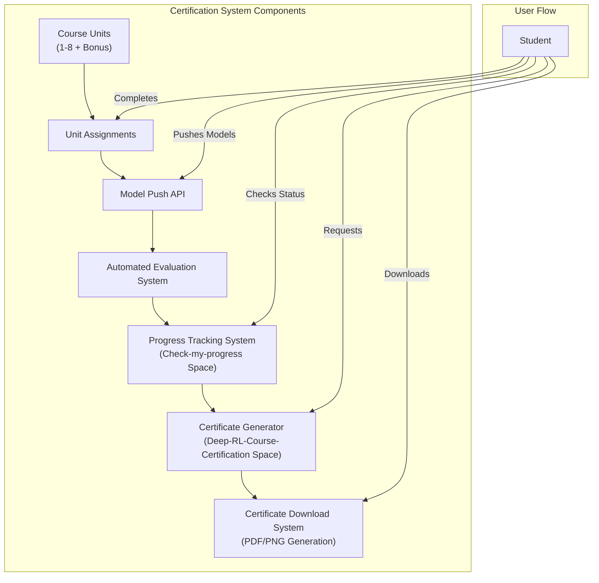

Sources: [units/en/communication/certification.mdx:13-29]()

## Obtaining Your Certificate

### Checking Your Progress

Before requesting your certificate, check your progress through the course using the Progress Tracker:

```
https://huggingface.co/spaces/ThomasSimonini/Check-my-progress-Deep-RL-Course
```

This tool shows which units you have successfully passed and those that still need completion.

Sources: [units/en/communication/certification.mdx:15]()

### Certificate Generation Process

Once you have completed the required percentage of assignments, follow these steps to obtain your certificate:

1. Visit the Deep RL Course Certification Space: 
   ```
   https://huggingface.co/spaces/huggingface-projects/Deep-RL-Course-Certification/
   ```

2. Enter your information:
   - Your Hugging Face username
   - Your first name
   - Your last name

3. Click "Generate my certificate"

4. The system will automatically:
   - Check your completion percentage across all assignments
   - Generate the appropriate certificate type based on your performance
   - Provide downloadable files in PDF and PNG formats

Sources: [units/en/communication/certification.mdx:17-27]()

## Certificate Types and Verification

The two types of certificates feature visual differences to indicate the level of achievement:

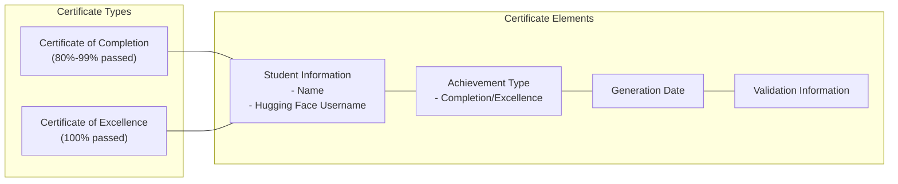

Sources: [units/en/communication/certification.mdx:22-27]()

### Sharing Your Achievement

After receiving your certificate, you are encouraged to share your achievement on social media platforms like Twitter and LinkedIn. When sharing on Twitter, you can tag @ThomasSimonini and @huggingface to connect with the course creator and the Hugging Face team.

Sources: [units/en/communication/certification.mdx:29](), [units/en/communication/conclusion.mdx:16-20]()

## Next Steps After Certification

Completing the course and receiving your certificate is just the beginning of your reinforcement learning journey. You can continue learning by:

- Exploring the bonus units for advanced topics (see [Bonus Units](#10))
- Joining the Discord server to connect with other learners
- Contributing to open-source reinforcement learning projects
- Applying your skills to new RL problems and environments

Sources: [units/en/communication/conclusion.mdx:6-14]()

---

# Page: Reinforcement Learning Fundamentals

# Reinforcement Learning Fundamentals

<details>
<summary>Relevant source files</summary>

The following files were used as context for generating this wiki page:

- [units/en/unit1/conclusion.mdx](units/en/unit1/conclusion.mdx)
- [units/en/unit1/deep-rl.mdx](units/en/unit1/deep-rl.mdx)
- [units/en/unit1/exp-exp-tradeoff.mdx](units/en/unit1/exp-exp-tradeoff.mdx)
- [units/en/unit1/quiz.mdx](units/en/unit1/quiz.mdx)
- [units/en/unit1/rl-framework.mdx](units/en/unit1/rl-framework.mdx)
- [units/en/unit1/summary.mdx](units/en/unit1/summary.mdx)
- [units/en/unit1/tasks.mdx](units/en/unit1/tasks.mdx)
- [units/en/unit1/two-methods.mdx](units/en/unit1/two-methods.mdx)
- [units/en/unit1/what-is-rl.mdx](units/en/unit1/what-is-rl.mdx)

</details>


This wiki page introduces the core concepts of reinforcement learning (RL) as covered in Unit 1 of the Deep Reinforcement Learning course. It provides a comprehensive explanation of the RL framework, components, and approaches that form the foundation for all subsequent units. For hands-on implementation with the LunarLander environment, see [LunarLander with Stable-Baselines3](#2.1).

## What is Reinforcement Learning?

Reinforcement Learning is a computational approach to learning from actions. An agent learns from the environment by interacting with it through trial and error and receiving rewards (positive or negative) as feedback for performing actions.

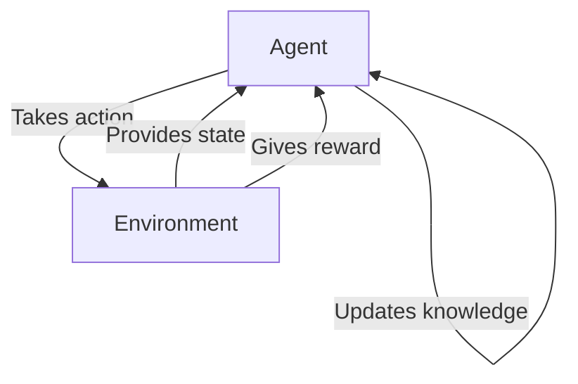

Sources: [units/en/unit1/what-is-rl.mdx:5-40]()

The formal definition:

> Reinforcement learning is a framework for solving control tasks (also called decision problems) by building agents that learn from the environment by interacting with it through trial and error and receiving rewards (positive or negative) as unique feedback.

Unlike supervised learning where models learn from labeled data, RL agents learn optimal behavior through direct interaction with their environment, guided only by the rewards they receive.

## The Reinforcement Learning Framework

### The RL Process

The RL process is a loop that produces a sequence of state, action, reward, and next state:

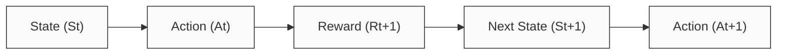

Let's break down this process:

1. The agent receives a **state** (S₀) from the environment
2. Based on that state, the agent takes an **action** (A₀)
3. The environment transitions to a **new state** (S₁)
4. The environment provides a **reward** (R₁) to the agent

This loop continues, generating sequences of state, action, reward, and next state tuples.

Sources: [units/en/unit1/rl-framework.mdx:3-24]()

### The Reward Hypothesis

The central idea in RL is the reward hypothesis, which states that all goals can be described as the maximization of expected cumulative reward.

The agent's objective is to learn a behavior (policy) that will maximize the expected return (cumulative reward). This is why in reinforcement learning, agents aim to take actions that maximize the expected cumulative reward.

Sources: [units/en/unit1/rl-framework.mdx:26-32]()

### Markov Property

In reinforcement learning, the process is typically modeled as a Markov Decision Process (MDP). The Markov Property implies that the future depends only on the current state and not on the sequence of events that preceded it.

This means our agent needs **only the current state** to decide what action to take, not the history of all states and actions that came before.

Sources: [units/en/unit1/rl-framework.mdx:35-40]()

## Core Components of Reinforcement Learning

### States and Observations

States and observations represent the information the agent receives from the environment.

There's an important distinction between states and observations:

| States | Observations |
|--------|--------------|
| Complete description of the environment | Partial description of the environment |
| No hidden information | May contain hidden information |
| Example: Chess board (fully observable) | Example: Part of a Mario level (partially observable) |

In a fully observed environment (like chess), the agent receives a state. In a partially observed environment (like Super Mario Bros), the agent receives an observation since it only sees part of the level.

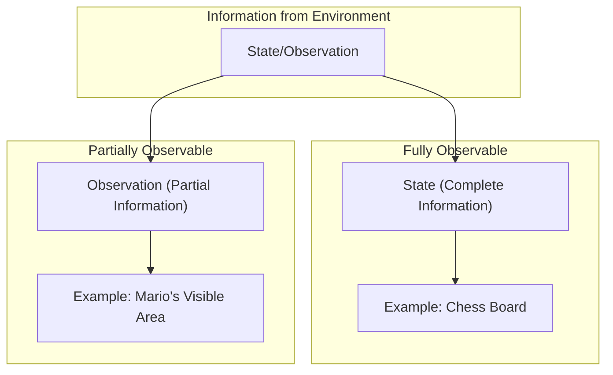

Sources: [units/en/unit1/rl-framework.mdx:41-74]()

### Action Space

The action space represents all possible actions an agent can take in an environment. Actions can come from either:

1. **Discrete space**: Finite number of possible actions
   - Example: Left, right, up, down in Super Mario Bros

2. **Continuous space**: Infinite number of possible actions
   - Example: Precise steering angles in a self-driving car

Understanding the action space is crucial when selecting an appropriate RL algorithm.

```mermaid
graph TD
    AS["Action Space"] --> DS["Discrete Space (Finite)"]
    AS --> CS["Continuous Space (Infinite)"]
    
    DS --> MARIO["Example: Mario (Left, Right, Jump, Crouch)"]
    CS --> CAR["Example: Self-Driving Car (Infinite steering angles)"]
```

Sources: [units/en/unit1/rl-framework.mdx:76-103]()

### Rewards and Discounting

Rewards are the fundamental feedback mechanism in RL. The agent's goal is to maximize the cumulative reward over time.

Since future rewards are less certain than immediate ones, we use discounting:

- We define a discount factor γ (gamma), typically between 0.95 and 0.99
- Future rewards are multiplied by γᵗ, where t is the time step
- Smaller γ: Agent focuses more on immediate rewards
- Larger γ: Agent values future rewards more

The discounted expected cumulative reward is represented as:

```
R = r₁ + γr₂ + γ²r₃ + ...
```

Sources: [units/en/unit1/rl-framework.mdx:105-144]()

## Types of Tasks

In reinforcement learning, tasks are specific instances of RL problems. They can be categorized into two types:

### Episodic Tasks

Episodic tasks have a clear starting point and ending point (terminal state), creating an episode.

- Example: Super Mario Bros - starts at the beginning of a level, ends when Mario dies or reaches the flagpole
- Each episode provides a complete sequence of experience for learning

### Continuing Tasks

Continuing tasks have no terminal state and continue indefinitely.

- Example: Stock trading bot - operates continuously with no natural endpoint
- The agent must learn while continuously interacting with the environment

```mermaid
graph TD
    T["RL Tasks"] --> E["Episodic Tasks"]
    T --> C["Continuing Tasks"]
    
    E --> GAME["Examples:<br>- Video Games<br>- Board Games"]
    C --> ROBOT["Examples:<br>- Stock Trading<br>- HVAC Control<br>- Continuous Robotics Tasks"]
    
    E --> ES["Has terminal states"]
    C --> CS["No terminal states"]
```

Sources: [units/en/unit1/tasks.mdx:1-27]()

## The Exploration/Exploitation Trade-off

One of the fundamental challenges in reinforcement learning is balancing exploration and exploitation:

- **Exploration**: Trying new actions to discover more about the environment
- **Exploitation**: Using known information to maximize rewards

This trade-off can be understood with a simple example: Imagine a mouse in a maze looking for cheese. There might be small pieces of cheese (+1 reward) in easily accessible areas, but there could be a large pile of cheese (+1000 reward) hidden in a difficult-to-reach area.

If the agent only exploits (always goes for the known small cheese), it will never discover the large reward. But if it explores too much, it might waste time trying random actions when it could be consistently getting smaller rewards.

```mermaid
graph TD
    EE["Exploration/Exploitation<br>Trade-off"] --> EXP["Exploration"]
    EE --> EXL["Exploitation"]
    
    EXP --> ENEW["Trying new actions<br>to discover environment"]
    EXL --> EKNOWN["Using known information<br>to maximize rewards"]
    
    EXP --> ERISK["Risk: Wasted time/resources"]
    EXP --> EREWARD["Potential: Discovering<br>better rewards"]
    
    EXL --> EXRISK["Risk: Missing better<br>opportunities"]
    EXL --> EXREWARD["Potential: Consistent<br>known rewards"]
```

This concept is similar to choosing a restaurant: Do you go to a familiar one you know is good (exploitation) or try a new one that might be better or worse (exploration)?

Sources: [units/en/unit1/exp-exp-tradeoff.mdx:1-37]()

## Approaches to Solve RL Problems

There are two main approaches to solving reinforcement learning problems:

### Policy-Based Methods

Policy-based methods directly learn a policy function π that maps states to actions.

- The policy is the "brain" of the agent, telling it what action to take in each state
- Policies can be:
  - **Deterministic**: For a given state, always returns the same action
  - **Stochastic**: Outputs a probability distribution over actions

```mermaid
graph TD
    PBM["Policy-Based Methods"] --> P["Policy (π)"]
    P --> DP["Deterministic Policy<br>action = π(state)"]
    P --> SP["Stochastic Policy<br>π(actions|state) = probability distribution"]
    
    DP --> DPE["Example: Always move right<br>in state X"]
    SP --> SPE["Example: 70% chance move right,<br>30% chance move left in state X"]
```

Sources: [units/en/unit1/two-methods.mdx:9-65]()

### Value-Based Methods

Value-based methods learn a value function that maps states to the expected value (cumulative reward) of being in that state.

- The value function estimates how good it is to be in a particular state
- The policy is derived from the value function by selecting actions that lead to states with higher values

```mermaid
graph TD
    VBM["Value-Based Methods"] --> V["Value Function V(s)"]
    V --> VS["Value of States"]
    VS --> BEST["Policy: Choose action leading<br>to highest-valued state"]
    
    subgraph "Example Grid World"
        S1["State (-7)"] --> S2["State (-6)"]
        S2 --> S3["State (-5)"]
        S3 --> S4["State (-4)"]
        S4 --> GOAL["Goal (0)"]
    end
```

In this approach, the agent will navigate toward higher-valued states - following the path from -7 to -6 to -5 and so on until reaching the goal.

Sources: [units/en/unit1/two-methods.mdx:68-90]()

## Deep Reinforcement Learning

Deep Reinforcement Learning incorporates deep neural networks into reinforcement learning methods, enhancing their capabilities to handle complex environments with high-dimensional state spaces.

The "Deep" in Deep RL refers to using deep neural networks to:
- Approximate value functions (in value-based methods)
- Directly represent policies (in policy-based methods)

```mermaid
graph TD
    DRL["Deep Reinforcement Learning"] --> VB["Value-Based Methods"]
    DRL --> PB["Policy-Based Methods"]
    
    VB --> DQN["Deep Q-Network (DQN)"]
    DQN --> DQNNN["Neural Network approximates<br>Q-value function"]
    
    PB --> DPG["Deep Policy Gradient"]
    DPG --> DPGNN["Neural Network represents<br>policy directly"]
    
    subgraph "Traditional RL vs. Deep RL"
        TRL["Traditional: Tabular Methods<br>(State-Action tables)"]
        DEEPRL["Deep RL: Neural Networks<br>(Function approximation)"]
    end
```

The advantage of using deep neural networks is their ability to generalize across states and handle environments with large or continuous state spaces where tabular methods would be impractical.

Sources: [units/en/unit1/deep-rl.mdx:1-21]()

## Summary

Reinforcement learning is a computational approach to learning from actions, where agents learn by interacting with their environment through trial and error and receiving rewards as feedback.

Key concepts:
- The RL process is a loop of state, action, reward, and next state
- The goal is to maximize expected cumulative reward (based on the reward hypothesis)
- States represent complete information, observations represent partial information
- Action spaces can be discrete or continuous
- Tasks can be episodic or continuing
- There's a fundamental trade-off between exploration and exploitation
- Two main approaches: policy-based and value-based methods
- Deep RL incorporates neural networks to handle complex environments

The foundations covered in this page will be expanded upon in subsequent units, building from basic Q-Learning [Q-Learning](#3) to Deep Q-Learning [Deep Q-Learning](#4) and more advanced methods.

Sources: [units/en/unit1/summary.mdx:1-19]()

---

# Page: LunarLander with Stable-Baselines3

# LunarLander with Stable-Baselines3

<details>
<summary>Relevant source files</summary>

The following files were used as context for generating this wiki page:

- [notebooks/unit1/requirements-unit1.txt](notebooks/unit1/requirements-unit1.txt)
- [notebooks/unit1/unit1.ipynb](notebooks/unit1/unit1.ipynb)
- [units/en/unit1/hands-on.mdx](units/en/unit1/hands-on.mdx)

</details>


This document provides technical documentation for the LunarLander with Stable-Baselines3 system, which is the first hands-on exercise in the Deep Reinforcement Learning course. The system enables users to train a deep reinforcement learning agent to land correctly on the moon using the LunarLander-v2 environment and the Proximal Policy Optimization (PPO) algorithm.

## Purpose and Components

This system serves as an introduction to deep reinforcement learning implementation using established libraries. It covers:

1. Environment setup with Gymnasium
2. Agent training using Stable-Baselines3
3. Model evaluation 
4. Sharing trained models via Hugging Face Hub

Sources: [units/en/unit1/hands-on.mdx:41-66]()

## System Architecture

The following diagram illustrates the high-level architecture of the LunarLander with Stable-Baselines3 system:

```mermaid
flowchart TB
    subgraph "LunarLander Training System"
        subgraph "Environment"
            gym["Gymnasium Library"] --> lunarlander["LunarLander-v2"]
            lunarlander --> obs["Observation Space (8 values)"]
            lunarlander --> act["Action Space (4 actions)"]
            lunarlander --> rew["Reward Function"]
        end

        subgraph "Training Components"
            sb3["Stable-Baselines3"] --> ppo["PPO Algorithm"]
            ppo --> mlpPolicy["MlpPolicy"]
            ppo --> hyperparams["Hyperparameters"]
        end

        subgraph "Evaluation & Integration"
            eval["Model Evaluation"]
            hfhub["Hugging Face Hub"]
            eval --> hfhub
        end

        obs --> ppo
        act --> ppo
        rew --> ppo
        
        ppo --> model["Trained Agent Model"]
        model --> eval
    end
```

Sources: [notebooks/unit1/unit1.ipynb:35-65](), [units/en/unit1/hands-on.mdx:283-345]()

## LunarLander Environment

The LunarLander-v2 environment, part of the Gymnasium library (formerly OpenAI Gym), simulates a lunar lander module that needs to land safely on a designated landing pad on the moon's surface.

### State and Action Spaces

| Component | Type | Details |
|-----------|------|---------|
| Observation Space | 8-dimensional vector | 1. Horizontal position (x)<br>2. Vertical position (y)<br>3. Horizontal velocity (x)<br>4. Vertical velocity (y)<br>5. Angle<br>6. Angular velocity<br>7. Left leg contact (boolean)<br>8. Right leg contact (boolean) |
| Action Space | Discrete, 4 actions | 0: Do nothing<br>1: Fire left orientation engine<br>2: Fire main engine<br>3: Fire right orientation engine |

Sources: [notebooks/unit1/unit1.ipynb:302-335](), [units/en/unit1/hands-on.mdx:306-334]() 

### Reward Structure

The reward function is designed to encourage proper landing behavior:

- **Per-step rewards**:
  - Increases as the lander gets closer to the landing pad
  - Increases as the lander's movement slows down
  - Decreases as the lander tilts (deviates from horizontal)
  - +10 points for each leg in contact with the ground
  - -0.03 points when a side engine fires
  - -0.3 points when the main engine fires

- **Terminal rewards**:
  - +100 points for safe landing
  - -100 points for crashing

An episode is considered successful if the total reward is at least 200 points.

Sources: [notebooks/unit1/unit1.ipynb:517-536](), [units/en/unit1/hands-on.mdx:335-350]()

## Reinforcement Learning Process

The system implements a standard reinforcement learning loop using the LunarLander environment:

```mermaid
sequenceDiagram
    participant "Agent (PPO)" as Agent
    participant "Environment (LunarLander-v2)" as Env
    
    Note over Agent,Env: Training Loop
    
    Agent->>Env: Reset environment
    Env->>Agent: Initial observation
    
    loop Until episode terminates or truncates
        Agent->>Agent: Select action based on policy
        Agent->>Env: Perform action
        Env->>Agent: Return new observation, reward, terminated, truncated, info
        Agent->>Agent: Update policy using PPO algorithm
    end
    
    Note over Agent,Env: After training
    
    Agent->>Agent: Save trained model
    Agent->>Env: Evaluate performance
```

Sources: [notebooks/unit1/unit1.ipynb:344-428](), [units/en/unit1/hands-on.mdx:221-281]()

## Stable-Baselines3 Implementation

The system uses Stable-Baselines3, a reliable deep reinforcement learning library that provides implementations of popular algorithms including PPO (Proximal Policy Optimization).

### PPO Algorithm Configuration

The PPO algorithm is configured with the following parameters:

```python
model = PPO(
    policy="MlpPolicy",
    env=env,
    n_steps=1024,
    batch_size=64,
    n_epochs=4,
    gamma=0.999,
    gae_lambda=0.98,
    ent_coef=0.01,
    verbose=1
)
```

Key configuration elements:
- `MlpPolicy`: Uses a Multi-Layer Perceptron neural network since the input is a vector
- `n_steps`: Number of steps to run for each environment per update
- `batch_size`: Minibatch size for gradient updates
- `gamma`: Discount factor for future rewards
- `ent_coef`: Entropy coefficient for exploration

Sources: [notebooks/unit1/unit1.ipynb:662-672](), [units/en/unit1/hands-on.mdx:412-426]()

### Training Process

The training process consists of the following key steps:

1. Create a vectorized environment with multiple instances for more diverse experiences
2. Initialize the PPO model with appropriate hyperparameters
3. Train the model for a specified number of timesteps (typically 1,000,000)
4. Save the trained model

```python
# Create vectorized environment
env = make_vec_env("LunarLander-v2", n_envs=16)

# Initialize and train the model
model.learn(total_timesteps=1000000)

# Save the model
model_name = "ppo-LunarLander-v2"
model.save(model_name)
```

Sources: [notebooks/unit1/unit1.ipynb:558-560](), [notebooks/unit1/unit1.ipynb:716-722](), [units/en/unit1/hands-on.mdx:444-448]()

## Model Evaluation

After training, the agent's performance is evaluated to ensure it has learned to land successfully:

1. A separate evaluation environment is created
2. The trained policy is run for multiple episodes
3. Mean reward and standard deviation are calculated

```python
eval_env = Monitor(gym.make("LunarLander-v2"))
mean_reward, std_reward = evaluate_policy(model, eval_env, n_eval_episodes=10, deterministic=True)
```

A successful model should achieve a mean reward of at least 200 points.

Sources: [notebooks/unit1/unit1.ipynb:779-781](), [units/en/unit1/hands-on.mdx:476-478]()

## Hugging Face Hub Integration

One of the key features of this system is the integration with the Hugging Face Hub, allowing users to share their trained models with the community.

### Model Packaging and Uploading

The system uses the `package_to_hub` function to:

1. Evaluate the trained model
2. Generate a replay video of the agent's performance
3. Create a model card with relevant information
4. Upload everything to the Hugging Face Hub

```mermaid
flowchart LR
    subgraph "Model Packaging Process"
        direction TB
        model["Trained Model"] --> eval["Evaluation"]
        eval --> video["Generate Video"]
        eval --> metrics["Calculate Metrics"]
        model --> modelCard["Generate Model Card"]
        model --> zipFile["Create Model Archive"]
        
        video --> upload["Upload to Hub"]
        metrics --> upload
        modelCard --> upload
        zipFile --> upload
    end
    
    upload --> hub["Hugging Face Hub Repository"]
    hub --> leaderboard["Leaderboard"]
    hub --> share["Sharing & Reuse"]
```

The `package_to_hub` function requires several parameters:
- `model`: The trained model
- `model_name`: Name of the trained model
- `model_architecture`: The algorithm used (PPO)
- `env_id`: Environment identifier (LunarLander-v2)
- `eval_env`: Environment for evaluation
- `repo_id`: Hugging Face Hub repository ID
- `commit_message`: Description of the upload

Sources: [notebooks/unit1/unit1.ipynb:975-981](), [units/en/unit1/hands-on.mdx:556-564]()

### Loading Models from the Hub

The system also allows users to load trained models from the Hugging Face Hub:

```python
from huggingface_sb3 import load_from_hub

repo_id = "username/model-repository"
filename = "ppo-LunarLander-v2.zip"

checkpoint = load_from_hub(repo_id, filename)
model = PPO.load(checkpoint)
```

This enables sharing and reuse of trained agents within the community.

Sources: [notebooks/unit1/unit1.ipynb:1059-1075](), [units/en/unit1/hands-on.mdx:657-658]()

## Dependencies

The system relies on the following key dependencies:

| Dependency | Purpose |
|------------|---------|
| gymnasium[box2d] | Provides the LunarLander-v2 environment |
| stable-baselines3 | Deep reinforcement learning library with PPO implementation |
| huggingface_sb3 | Integration with Hugging Face Hub for model sharing |

These dependencies are specified in the requirements file.

Sources: [notebooks/unit1/requirements-unit1.txt:1-4](), [units/en/unit1/hands-on.mdx:141-154]()

## Certification Requirements

To successfully complete this hands-on exercise for certification purposes, users must:

1. Train a LunarLander agent using PPO
2. Push the trained model to the Hugging Face Hub
3. Achieve a result of at least 200 points (calculated as mean_reward - standard_deviation)

The leaderboard allows users to compare their results with others in the community.

Sources: [units/en/unit1/hands-on.mdx:19-26](), [notebooks/unit1/unit1.ipynb:168-173]()

---

# Page: Q-Learning

# Q-Learning

<details>
<summary>Relevant source files</summary>

The following files were used as context for generating this wiki page:

- [units/en/unit2/bellman-equation.mdx](units/en/unit2/bellman-equation.mdx)
- [units/en/unit2/glossary.mdx](units/en/unit2/glossary.mdx)
- [units/en/unit2/introduction.mdx](units/en/unit2/introduction.mdx)
- [units/en/unit2/mc-vs-td.mdx](units/en/unit2/mc-vs-td.mdx)
- [units/en/unit2/mid-way-recap.mdx](units/en/unit2/mid-way-recap.mdx)
- [units/en/unit2/q-learning-example.mdx](units/en/unit2/q-learning-example.mdx)
- [units/en/unit2/q-learning-recap.mdx](units/en/unit2/q-learning-recap.mdx)
- [units/en/unit2/q-learning.mdx](units/en/unit2/q-learning.mdx)
- [units/en/unit2/quiz2.mdx](units/en/unit2/quiz2.mdx)
- [units/en/unit2/two-types-value-based-methods.mdx](units/en/unit2/two-types-value-based-methods.mdx)

</details>


Q-Learning is a foundational value-based reinforcement learning algorithm that learns an optimal action-value function to solve sequential decision-making problems. This document explains the core concepts of Q-Learning, how it works, and its implementation in the Deep Reinforcement Learning course.

For implementation details and practical examples, see [Q-Learning Implementation](#3.1).

## What is Q-Learning?

Q-Learning is an **off-policy value-based method** that uses a **Temporal Difference (TD) approach** to train its action-value function. The name "Q-Learning" comes from the "Quality" of actions at particular states.

```mermaid
flowchart TD
    RL["Reinforcement Learning Methods"]
    VB["Value-Based Methods"]
    PB["Policy-Based Methods"]
    Hybrid["Hybrid Methods"]
    
    QL["Q-Learning"]
    DQN["Deep Q-Networks"]
    MC["Monte Carlo Methods"]
    TD["Temporal Difference Methods"]
    
    RL --> VB
    RL --> PB
    RL --> Hybrid
    
    VB --> MC
    VB --> TD
    
    TD --> QL
    TD --> DQN
    
    subgraph "Q-Learning Characteristics"
        C1["Off-policy"]
        C2["Value-based"]
        C3["TD Learning"]
    end
    
    QL --- C1
    QL --- C2
    QL --- C3
```

Key characteristics of Q-Learning:

- **Off-policy**: Uses different policies for acting (epsilon-greedy) and updating (greedy)
- **Value-based**: Finds the optimal policy indirectly by training an action-value function
- **TD approach**: Updates its action-value function at each step rather than at the end of episodes

Q-Learning trains a **Q-function**, which is an action-value function that determines the value of being at a particular state and taking a specific action. This function is represented internally by a **Q-table**, which stores values for all state-action pairs.

Sources: [units/en/unit2/q-learning.mdx:1-18](), [units/en/unit2/glossary.mdx:10-14]()

## Value-Based Methods in Reinforcement Learning

In value-based methods, we learn a value function that maps a state to the expected value of being at that state. There are two main types of value functions:

### State-Value vs Action-Value Functions

```mermaid
flowchart LR
    subgraph "Value Functions"
        SVF["State-Value Function V(s)"]
        AVF["Action-Value Function Q(s,a)"]
    end
    
    SVF --> SV["Expected return\nstarting from state s\nfollowing policy π"]
    AVF --> AV["Expected return\nstarting from state s\ntaking action a\nthen following policy π"]
    
    subgraph "Q-Learning uses"
        QFunc["Q-Function"]
        QTable["Q-Table"]
    end
    
    AVF --- QFunc
    QFunc --- QTable
```

1. **State-Value Function (V-function)**:
   - Maps a state to the expected return if the agent starts in that state and follows the policy
   - Notation: V(s) = Expected return starting at state s and following policy π

2. **Action-Value Function (Q-function)**:
   - Maps a state-action pair to the expected return
   - Notation: Q(s,a) = Expected return starting at state s, taking action a, then following policy π
   - **Q-Learning specifically uses this type of value function**

The relationship between an optimal value function and optimal policy is direct: once we have an optimal Q-function, we automatically get an optimal policy by selecting the action with the highest Q-value at each state.

Sources: [units/en/unit2/two-types-value-based-methods.mdx:1-42](), [units/en/unit2/q-learning.mdx:10-18]()

## The Bellman Equation

The Bellman equation simplifies the calculation of state values or state-action values by making them recursive. Instead of calculating the expected return from scratch for each state, we can use the Bellman equation.

```mermaid
flowchart LR
    State["Current State\nS_t"] --> Action["Action\nA_t"]
    Action --> Reward["Immediate Reward\nR_t+1"]
    Action --> NextState["Next State\nS_t+1"]
    
    Reward --> BellmanUpdate["Q(S_t, A_t) ←\nQ(S_t, A_t) + α[R_t+1 + γ·max_a Q(S_t+1, a) - Q(S_t, A_t)]"]
    NextState --> BellmanUpdate
    
    subgraph "Bellman Equation Components"
        C1["Current Estimate\nQ(S_t, A_t)"]
        C2["Learning Rate\nα"]
        C3["Immediate Reward\nR_t+1"]
        C4["Discount Factor\nγ"]
        C5["Estimated Future Value\nmax_a Q(S_t+1, a)"]
        C6["TD Error\nR_t+1 + γ·max_a Q(S_t+1, a) - Q(S_t, A_t)"]
    end
    
    BellmanUpdate -.- C1
    BellmanUpdate -.- C2
    BellmanUpdate -.- C3
    BellmanUpdate -.- C4
    BellmanUpdate -.- C5
    BellmanUpdate -.- C6
```

The Bellman equation for Q-Learning states that:

Q(S_t, A_t) ← Q(S_t, A_t) + α[R_t+1 + γ·max_a Q(S_t+1, a) - Q(S_t, A_t)]

Where:
- Q(S_t, A_t) is the current estimate of the state-action value
- α is the learning rate
- R_t+1 is the immediate reward after taking action A_t in state S_t
- γ is the discount factor (typically 0.9-0.99)
- max_a Q(S_t+1, a) is the maximum Q-value for the next state across all possible actions
- The expression [R_t+1 + γ·max_a Q(S_t+1, a) - Q(S_t, A_t)] is called the TD error

Instead of calculating each value as the sum of all expected future rewards (which would be computationally expensive), the Bellman equation allows us to calculate the value as the immediate reward plus the discounted value of the best next state-action pair.

Sources: [units/en/unit2/bellman-equation.mdx:1-63](), [units/en/unit2/q-learning.mdx:98-120]()

## Monte Carlo vs Temporal Difference Learning

Q-Learning uses Temporal Difference (TD) learning, which is important to understand in contrast with Monte Carlo methods.

```mermaid
flowchart LR
    subgraph "Learning Strategies"
        MC["Monte Carlo"]
        TD["Temporal Difference"]
    end
    
    MC --> MCUpdate["Update after\ncomplete episode\nV(s) ← V(s) + α[G_t - V(s)]"]
    TD --> TDUpdate["Update after\nsingle step\nV(s) ← V(s) + α[R_t+1 + γV(s') - V(s)]"]
    
    subgraph "Q-Learning uses"
        TDL["TD Learning"]
        Off["Off-policy"]
    end
    
    TD --- TDL
```

### Monte Carlo
- Learns from **complete episodes**
- Updates the value function using the actual return G_t
- Formula: V(s) ← V(s) + α[G_t - V(s)]
- Must wait until the episode ends to learn

### Temporal Difference Learning
- Learns from **single steps** (S_t, A_t, R_t+1, S_t+1)
- Updates the value function using an estimated return (bootstrapping)
- Formula: V(s) ← V(s) + α[R_t+1 + γV(s') - V(s)]
- Can learn before knowing the final outcome

**Q-Learning uses TD learning** because it updates its Q-values after each step using the TD target [R_t+1 + γ·max_a Q(S_t+1, a)] rather than waiting for the full episode return.

Sources: [units/en/unit2/mc-vs-td.mdx:1-136](), [units/en/unit2/q-learning.mdx:4-8]()

## The Q-Learning Algorithm

The Q-Learning algorithm can be broken down into four main steps:

```mermaid
flowchart TD
    Init["1. Initialize Q-table\nSet Q(s,a) = 0 for all s,a"] --> Loop["For each episode:"]
    Loop --> SelectAction["2. Choose action A_t using\nε-greedy policy"]
    SelectAction --> PerformAction["3. Perform action A_t\nObserve R_t+1 and S_t+1"]
    PerformAction --> UpdateQ["4. Update Q-value:\nQ(S_t,A_t) ← Q(S_t,A_t) + α[R_t+1 + γ·max_a Q(S_t+1,a) - Q(S_t,A_t)]"]
    UpdateQ --> CheckEnd{"Episode\nended?"}
    CheckEnd -->|"No"| SelectAction
    CheckEnd -->|"Yes"| DecayEpsilon["Decrease ε\n(reduce exploration)"]
    DecayEpsilon --> Loop
```

### 1. Initialize the Q-table
- Create a table with dimensions |S|×|A| (states × actions)
- Initialize all values to zero (or sometimes small random values)

### 2. Choose an action using the epsilon-greedy strategy
- With probability 1-ε: select the action with the highest Q-value (exploitation)
- With probability ε: select a random action (exploration)
- ε starts high (e.g., 1.0) and decays over time as the agent learns

### 3. Perform the action and observe
- Execute the chosen action A_t
- Observe the reward R_t+1 and next state S_t+1

### 4. Update the Q-value
- Update Q(S_t, A_t) using the formula:
  Q(S_t, A_t) ← Q(S_t, A_t) + α[R_t+1 + γ·max_a Q(S_t+1, a) - Q(S_t, A_t)]
- Note that max_a Q(S_t+1, a) uses a greedy policy for the update

### Off-Policy Learning in Q-Learning
Q-Learning is an off-policy algorithm because it uses:
- An **epsilon-greedy policy** for selecting actions during training (exploration/exploitation)
- A **greedy policy** for updating Q-values (always selects the action with the highest Q-value)

This difference between the policy used for acting and the policy used for updating makes Q-Learning off-policy.

Sources: [units/en/unit2/q-learning.mdx:63-158](), [units/en/unit2/q-learning-recap.mdx:1-25]()

## Q-Learning Example

Let's look at a simplified example of Q-Learning in a small maze environment:

```mermaid
flowchart TD
    subgraph "Environment"
        Start["Start"] -->|"Step 1: Go Right"| Cheese1["Small Cheese\n(Reward: +1)"]
        Cheese1 -->|"Step 2: Go Down\n(Bad Decision)"| Poison["Poison\n(Reward: -10)"]
        Cheese1 -->|"Optimal: Go Right"| Cheese2["Small Cheese\n(Reward: +1)"]
        Cheese2 -->|"Optimal: Go Down"| BigCheese["Big Cheese\n(Reward: +10)"]
    end
```

### Training Step 1:
1. **Starting state**: Mouse is at the initial position
2. **Action selection**: Agent chooses to go right (exploration with ε=1.0)
3. **Reward and next state**: Receives reward +1 (small cheese), moves to new state
4. **Q-value update**: Using learning rate α=0.1 and discount factor γ=0.99
   - Q(Start, Right) = 0 + 0.1 × [1 + 0.99 × max(0,0,0,0) - 0] = 0.1

### Training Step 2:
1. **Current state**: Mouse is at position with small cheese
2. **Action selection**: Agent chooses to go down (exploration with ε=0.99)
3. **Reward and next state**: Receives reward -10 (poison), episode ends
4. **Q-value update**:
   - Q(Cheese1, Down) = 0 + 0.1 × [-10 + 0 - 0] = -1.0

After these two steps, the Q-table has already started to learn that going down at the first cheese state is a bad idea (-1.0). As training continues with more episodes, the Q-table values will converge toward the optimal policy.

Sources: [units/en/unit2/q-learning-example.mdx:1-84]()

## Q-Learning Limitations and Extensions

While Q-Learning is powerful for discrete state and action spaces, it has limitations:

1. **Tabular representation**: The Q-table grows exponentially with the state and action space size
2. **Discrete spaces**: Traditional Q-Learning works best with discrete state and action spaces
3. **Limited generalization**: Doesn't generalize well to similar but unseen states

To address these limitations, extensions of Q-Learning include:
- **Deep Q-Networks (DQN)**: Replace the Q-table with a neural network for function approximation
- **Double Q-Learning**: Reduce overestimation of Q-values
- **Prioritized Experience Replay**: Focus learning on important transitions

For more information on these extensions, see [Deep Q-Learning](#4).

Sources: [units/en/unit2/introduction.mdx:8-25]()

## Applications in the Course

In the Deep RL Course, Q-Learning is implemented and applied to two main environments:

1. **FrozenLake-v1 (non-slippery version)**:
   - Agent must navigate from start (S) to goal (G)
   - Must walk only on frozen tiles (F) and avoid holes (H)
   - Discrete state space with a manageable number of states

2. **Taxi-v3**:
   - Agent controls a taxi that must transport passengers from point A to point B
   - Navigation task in a grid-world environment
   - Perfect for tabular Q-Learning due to its discrete state and action spaces

These environments provide practical examples of Q-Learning implementation and serve as a foundation for understanding more complex reinforcement learning algorithms like Deep Q-Networks.

Sources: [units/en/unit2/introduction.mdx:10-16]()

---

# Page: Q-Learning Implementation

# Q-Learning Implementation

<details>
<summary>Relevant source files</summary>

The following files were used as context for generating this wiki page:

- [notebooks/unit2/requirements-unit2.txt](notebooks/unit2/requirements-unit2.txt)
- [notebooks/unit2/unit2.ipynb](notebooks/unit2/unit2.ipynb)
- [units/en/unit2/hands-on.mdx](units/en/unit2/hands-on.mdx)

</details>


This document details the hands-on implementation of Q-Learning in the Deep Reinforcement Learning course. It focuses specifically on coding a Q-Learning agent from scratch to solve two environments: FrozenLake-v1 and Taxi-v3. For theoretical background on Q-Learning, see [Q-Learning](#3).

## Overview

Q-Learning is a value-based reinforcement learning algorithm that uses a Q-table to store and update action-value estimations. This implementation demonstrates how to:

1. Create and initialize a Q-table
2. Implement greedy and epsilon-greedy policies
3. Build a training loop for Q-Learning
4. Evaluate agent performance
5. Share trained models via Hugging Face Hub

Sources: [units/en/unit2/hands-on.mdx:92-106](), [notebooks/unit2/unit2.ipynb:132-158]()

## Implementation Architecture

The Q-Learning implementation follows this general architecture:

```mermaid
flowchart TD
    subgraph "Implementation Components"
        QTable["Q-Table\nStores state-action values"]
        Policies["Policies\n- Greedy\n- Epsilon-Greedy"]
        TrainingLoop["Training Loop\nUpdates Q-table"]
        Evaluation["Evaluation\nTests agent performance"]
        HFIntegration["Hugging Face Integration\nSave & share models"]
    end

    subgraph "Environments"
        FrozenLake["FrozenLake-v1\n- Navigate to goal\n- Avoid holes"]
        Taxi["Taxi-v3\n- Pick up passenger\n- Navigate to destination\n- Drop off passenger"]
    end

    QTable --> Policies
    Policies --> TrainingLoop
    TrainingLoop --> QTable
    QTable --> Evaluation
    Evaluation --> HFIntegration
    FrozenLake --> TrainingLoop
    Taxi --> TrainingLoop
```

Sources: [units/en/unit2/hands-on.mdx:15-17](), [notebooks/unit2/unit2.ipynb:19-35]()

## Q-Table Structure and Initialization

The Q-table is a matrix where:
- Rows represent states in the environment
- Columns represent possible actions
- Each cell contains the estimated Q-value for a state-action pair

```mermaid
flowchart LR
    subgraph "initialize_q_table Function"
        Input["Input:\n- state_space\n- action_space"]
        Process["Create zeros array\nof shape (state_space, action_space)"]
        Output["Output:\nInitialized Q-table"]
    end

    Input --> Process --> Output
```

The initialization code creates a zero-filled NumPy array with dimensions matching the state and action spaces:

```python
def initialize_q_table(state_space, action_space):
    Qtable = np.zeros((state_space, action_space))
    return Qtable
```

Sources: [units/en/unit2/hands-on.mdx:285-320](), [notebooks/unit2/unit2.ipynb:487-565]()

## Policies Implementation

Two policies are implemented for the Q-Learning agent:

1. **Greedy Policy**: Always selects the action with the highest Q-value for a given state (exploitation)
2. **Epsilon-Greedy Policy**: Balances exploration and exploitation by:
   - With probability ε: Select a random action (exploration)
   - With probability 1-ε: Select the action with the highest Q-value (exploitation)

```mermaid
flowchart TD
    Start["State input"] --> EpsilonCheck{"Random number > ε?"}
    EpsilonCheck -->|"Yes (Exploitation)"| Greedy["Take action with\nhighest Q-value"]
    EpsilonCheck -->|"No (Exploration)"| Random["Take random action"]
    Greedy --> Action["Return action"]
    Random --> Action
```

Epsilon decreases over time to shift from exploration to exploitation as the agent learns.

### Greedy Policy

```python
def greedy_policy(Qtable, state):
    # Select action with highest state-action value
    action = np.argmax(Qtable[state][:])
    return action
```

### Epsilon-Greedy Policy

```python
def epsilon_greedy_policy(Qtable, state, epsilon):
    random_num = random.uniform(0, 1)
    if random_num > epsilon:
        # Exploitation: use greedy policy
        action = greedy_policy(Qtable, state)
    else:
        # Exploration: take random action
        action = env.action_space.sample()
    return action
```

Sources: [units/en/unit2/hands-on.mdx:331-408](), [notebooks/unit2/unit2.ipynb:584-708]()

## Training Loop Implementation

The training loop is the core of the Q-Learning algorithm, where the agent interacts with the environment and updates the Q-table based on the observed rewards and transitions.

```mermaid
flowchart TD
    Start["Start training"] --> InitEpisode["Initialize episode"]
    InitEpisode --> CalcEpsilon["Calculate epsilon\nε = min_ε + (max_ε - min_ε) * e^(-decay_rate * episode)"]
    CalcEpsilon --> ResetEnv["Reset environment"]
    ResetEnv --> SelectAction["Select action using\nepsilon-greedy policy"]
    SelectAction --> TakeAction["Take action\nObserve reward and next state"]
    TakeAction --> UpdateQ["Update Q-table using\nBellman equation"]
    UpdateQ --> CheckDone{"Episode\nfinished?"}
    CheckDone -->|"No"| NextState["Set state = next_state"]
    NextState --> SelectAction
    CheckDone -->|"Yes"| CheckEpisodes{"All episodes\ncompleted?"}
    CheckEpisodes -->|"No"| InitEpisode
    CheckEpisodes -->|"Yes"| End["Return final Q-table"]
```

The Q-table update uses the Bellman equation:

```
Q(s,a) = Q(s,a) + learning_rate * [reward + gamma * max_a' Q(s',a') - Q(s,a)]
```

The implementation in code:

```python
def train(n_training_episodes, min_epsilon, max_epsilon, decay_rate, env, max_steps, Qtable):
    for episode in tqdm(range(n_training_episodes)):
        # Calculate epsilon for this episode
        epsilon = min_epsilon + (max_epsilon - min_epsilon) * np.exp(-decay_rate * episode)
        
        # Reset environment
        state, info = env.reset()
        terminated = False
        truncated = False
        
        for step in range(max_steps):
            # Select action using epsilon-greedy policy
            action = epsilon_greedy_policy(Qtable, state, epsilon)
            
            # Take action and observe result
            new_state, reward, terminated, truncated, info = env.step(action)
            
            # Update Q-table using Bellman equation
            Qtable[state][action] = Qtable[state][action] + learning_rate * (
                reward + gamma * np.max(Qtable[new_state]) - Qtable[state][action]
            )
            
            # Check if episode is done
            if terminated or truncated:
                break
                
            # Move to next state
            state = new_state
            
    return Qtable
```

Sources: [units/en/unit2/hands-on.mdx:434-518](), [notebooks/unit2/unit2.ipynb:758-864]()

## Environment Configurations

The implementation uses two distinct environments from Gymnasium:

### FrozenLake-v1

- **Objective**: Navigate from start (S) to goal (G) by walking only on frozen tiles (F) and avoiding holes (H)
- **State Space**: 16 discrete states (in 4x4 grid)
- **Action Space**: 4 actions (left, down, right, up)
- **Reward Structure**: 
  - Reach goal: +1
  - Reach hole or frozen tile: 0

```python
env = gym.make("FrozenLake-v1", map_name="4x4", is_slippery=False, render_mode="rgb_array")
```

### Taxi-v3

- **Objective**: Pick up passenger at one location and drop them off at destination
- **State Space**: 500 discrete states (25 taxi positions × 5 passenger locations × 4 destinations)
- **Action Space**: 6 actions (move south, north, east, west, pickup, dropoff)
- **Reward Structure**:
  - Each step: -1
  - Successful passenger delivery: +20
  - Illegal pickup/dropoff: -10

```python
env = gym.make("Taxi-v3", render_mode="rgb_array")
```

Sources: [units/en/unit2/hands-on.mdx:193-276](), [units/en/unit2/hands-on.mdx:831-879](), [notebooks/unit2/unit2.ipynb:310-440](), [notebooks/unit2/unit2.ipynb:1355-1438]()

## Hyperparameters

Hyperparameters significantly impact the agent's learning process. Key hyperparameters include:

| Hyperparameter | FrozenLake-v1 | Taxi-v3 | Description |
|----------------|---------------|---------|-------------|
| `n_training_episodes` | 10,000 | 25,000 | Total number of training episodes |
| `learning_rate` | 0.7 | 0.7 | Learning rate for Q-value updates |
| `max_steps` | 99 | 99 | Maximum steps per episode |
| `gamma` | 0.95 | 0.95 | Discount factor for future rewards |
| `max_epsilon` | 1.0 | 1.0 | Initial exploration probability |
| `min_epsilon` | 0.05 | 0.05 | Minimum exploration probability |
| `decay_rate` | 0.0005 | 0.005 | Exponential decay rate for exploration |

Choosing appropriate hyperparameters is crucial for successful learning:
- Higher `n_training_episodes` allows more time for the agent to learn, especially in complex environments
- The `decay_rate` controls the exploration-exploitation trade-off over time
- `gamma` determines how much the agent values future rewards compared to immediate ones

Sources: [units/en/unit2/hands-on.mdx:413-430](), [units/en/unit2/hands-on.mdx:892-1012](), [notebooks/unit2/unit2.ipynb:732-750](), [notebooks/unit2/unit2.ipynb:1473-1494]()

## Evaluation Process

After training, the agent is evaluated to measure its performance:

```mermaid
flowchart LR
    subgraph "evaluate_agent Function"
        Start["Start evaluation"] --> InitEpisodes["Run n_eval_episodes"]
        InitEpisodes --> UseGreedyPolicy["Use greedy policy\nfor action selection"]
        UseGreedyPolicy --> CollectRewards["Collect total rewards\nfor each episode"]
        CollectRewards --> Calculate["Calculate mean\nand std of rewards"]
        Calculate --> Output["Return evaluation\nmetrics"]
    end
```

The evaluation function:
- Runs the agent for a fixed number of evaluation episodes
- Uses the greedy policy (no exploration)
- Returns the mean and standard deviation of collected rewards

For certification purposes, the metric used is `mean_reward - std_reward`, with a passing threshold of ≥ 4.5 for the Taxi-v3 environment.

Sources: [units/en/unit2/hands-on.mdx:572-570](), [notebooks/unit2/unit2.ipynb:925-958]()

## Hugging Face Hub Integration

A key feature of this implementation is the ability to save, share, and load models using the Hugging Face Hub:

```mermaid
flowchart TD
    subgraph "Model Workflow"
        Train["Train Q-Learning Agent"] --> CreateModel["Create model dictionary"]
        CreateModel --> PushHub["Push to Hugging Face Hub"]
        PushHub --> LoadHub["Load from Hub\n(by same or other users)"]
    end
    
    subgraph "Model Dictionary Contents"
        Hyperparams["Hyperparameters\n- env_id\n- learning_rate\n- gamma\n- etc."]
        QTableData["Q-Table Data"]
        EvalParams["Evaluation Parameters\n- n_eval_episodes\n- eval_seed"]
    end
    
    CreateModel --> Hyperparams
    CreateModel --> QTableData
    CreateModel --> EvalParams
```

The model dictionary structure includes:
- Environment identifier
- All hyperparameters used in training
- The trained Q-table
- Evaluation parameters 

The `push_to_hub` function handles:
1. Creating or updating a repository on Hugging Face Hub
2. Serializing the model dictionary
3. Running evaluation to generate metrics
4. Recording a video replay of the agent
5. Generating a model card
6. Uploading all files to the Hub

This enables sharing trained agents with the community and maintaining a leaderboard for comparing different implementations.

Sources: [units/en/unit2/hands-on.mdx:584-755](), [units/en/unit2/hands-on.mdx:1024-1047](), [notebooks/unit2/unit2.ipynb:992-1197](), [notebooks/unit2/unit2.ipynb:1537-1552]()

## Loading Models from Hugging Face Hub

The implementation also provides functionality to load pre-trained models from the Hub:

```python
def load_from_hub(repo_id: str, filename: str) -> str:
    # Get the model from the Hub
    pickle_model = hf_hub_download(repo_id=repo_id, filename=filename)
    
    # Load the serialized model
    with open(pickle_model, 'rb') as f:
        downloaded_model_file = pickle.load(f)
        
    return downloaded_model_file
```

This allows users to:
1. Browse Q-Learning models on the Hub
2. Download and use models trained by others
3. Compare different training approaches

Sources: [units/en/unit2/hands-on.mdx:1071-1090](), [notebooks/unit2/unit2.ipynb:1634-1649]()

## Conclusion

This Q-Learning implementation provides a complete, from-scratch approach to building reinforcement learning agents for discrete environments. The implementation is modular, well-documented, and integrated with Hugging Face Hub for easy sharing and comparison.

While effective for environments with small, discrete state spaces like FrozenLake-v1 and Taxi-v3, this tabular Q-Learning approach becomes impractical for environments with large state spaces. For complex environments, Deep Q-Learning (see [Deep Q-Learning](#4)) provides a more scalable alternative by replacing the Q-table with a neural network function approximator.

Sources: [units/en/unit2/hands-on.mdx:1127-1143](), [notebooks/unit2/unit2.ipynb:1719-1734]()

---

# Page: Deep Q-Learning

# Deep Q-Learning

<details>
<summary>Relevant source files</summary>

The following files were used as context for generating this wiki page:

- [units/en/unit3/conclusion.mdx](units/en/unit3/conclusion.mdx)
- [units/en/unit3/deep-q-network.mdx](units/en/unit3/deep-q-network.mdx)
- [units/en/unit3/from-q-to-dqn.mdx](units/en/unit3/from-q-to-dqn.mdx)
- [units/en/unit3/introduction.mdx](units/en/unit3/introduction.mdx)
- [units/en/unit3/quiz.mdx](units/en/unit3/quiz.mdx)

</details>


Deep Q-Learning represents a significant advancement in reinforcement learning that addresses the limitations of traditional Q-Learning by replacing the Q-table with a neural network. This page documents the Deep Q-Learning algorithm and its architecture as implemented in the deep-rl-class repository. For information about implementing DQN with Atari games, see [DQN with Atari Games](#4.1).

## Purpose and Scope

Deep Q-Learning enables reinforcement learning agents to handle environments with large state spaces that would be impractical to represent using traditional Q-tables. It uses neural networks to approximate Q-values, making it suitable for complex tasks like playing Atari games where the state space can contain up to 10^11 states.

Sources: [units/en/unit3/introduction.mdx:8-14](), [units/en/unit3/from-q-to-dqn.mdx:21-31]()

## From Q-Learning to Deep Q-Learning

### Limitations of Tabular Q-Learning

Q-Learning is a tabular method that works by creating and updating a Q-table which maps state-action pairs to value estimates. While effective for environments with small, discrete state spaces (like FrozenLake with 16 states or Taxi-v3 with 500 states), it becomes impractical for environments with large state spaces:

- **Atari Environments**: Have an observation space with shape (210, 160, 3) with values from 0-255
- **State Space Size**: This creates 256^100800 possible observations (compared to approximately 10^80 atoms in the observable universe)
- **Memory Requirements**: Storing a Q-table for such environments would be prohibitively large

Sources: [units/en/unit3/from-q-to-dqn.mdx:3-25]()

### Neural Network Function Approximation

Deep Q-Learning addresses this limitation by approximating the Q-function using a neural network. Instead of a lookup table, we use a parametrized Q-function Q_θ(s,a) where:
- The network takes a state as input
- The network outputs Q-values for each possible action at that state
- The weights θ are learned through training

```mermaid
graph LR
    subgraph "Q-Learning vs Deep Q-Learning"
        QT["Q-Table<br>State-Action Pairs"] --> QV["Q-Values"]
        S["State"] --> NN["Neural Network<br>Q_θ(s,a)"]
        NN --> QVA["Q-Values for<br>All Actions"]
    end
```

Sources: [units/en/unit3/from-q-to-dqn.mdx:27-34]()

## Deep Q-Network Architecture

The Deep Q-Network (DQN) architecture transforms raw game frames into action values through several processing steps:

```mermaid
flowchart TD
    subgraph "Deep Q-Network Architecture"
        I["Input<br>Stack of 4 Frames"] --> P["Preprocessing<br>84x84 Grayscale"]
        P --> C["Convolutional Layers<br>Spatial & Temporal Features"]
        C --> FC["Fully Connected Layers"]
        FC --> O["Output<br>Q-values for Each Action"]
    end
```

Sources: [units/en/unit3/deep-q-network.mdx:1-41]()

### Input Preprocessing

To make training computationally feasible, the input game frames must be preprocessed:

1. **Dimensionality Reduction**: Frames are reduced to 84x84 pixels
2. **Grayscale Conversion**: Color channels (RGB) are reduced to a single grayscale channel
3. **Frame Stacking**: Four consecutive frames are stacked together
4. **Optional Cropping**: In some games, irrelevant screen portions can be cropped out

Sources: [units/en/unit3/deep-q-network.mdx:10-18]()

### Temporal Information Through Frame Stacking

Stacking four frames together is crucial for capturing temporal information - the movement and direction of objects in the game:

```mermaid
graph LR
    subgraph "Temporal Information Capture"
        F1["Frame t-3"] --- F2["Frame t-2"]
        F2 --- F3["Frame t-1"]
        F3 --- F4["Frame t"]
        F1 --> S["Stacked Frames"]
        F2 --> S
        F3 --> S
        F4 --> S
        S --> M["Motion Information<br>Captured"]
    end
```

Without frame stacking, it would be impossible to determine direction of movement (e.g., a ball in Pong) from a single static frame.

Sources: [units/en/unit3/deep-q-network.mdx:22-31]()

### Network Structure

The DQN uses:

1. **Convolutional Layers**: Process the stacked frames to extract:
   - Spatial features within each frame
   - Temporal features across the stacked frames

2. **Fully Connected Layers**: Take the features extracted by the convolutional layers and output a Q-value for each possible action in the environment

This architecture allows the network to approximate, for any given state, the Q-values for all possible actions at that state.

Sources: [units/en/unit3/deep-q-network.mdx:32-41]()

## Deep Q-Learning Algorithm

The Deep Q-Learning algorithm introduces several innovations beyond the neural network architecture to make training stable and efficient.

```mermaid
graph TD
    subgraph "Deep Q-Learning Algorithm Flow"
        Start["Initialize Networks"] --> Sample["Sampling Phase<br>Collect Experiences"]
        Sample --> Store["Store in Replay Memory"]
        Store --> Train["Training Phase<br>Sample Batch & Update"]
        Train -- "Update Target Network<br>Periodically" --> Sample
    end
```

Sources: [units/en/unit3/quiz.mdx:47-70]()

### Two Core Phases

The algorithm consists of two primary phases:

1. **Sampling Phase**: 
   - Agent interacts with the environment using an epsilon-greedy policy
   - Experiences (state, action, reward, next_state) are collected
   - Experiences are stored in a replay memory buffer

2. **Training Phase**:
   - Random batches of experiences are sampled from the replay memory
   - Network is updated using gradient descent to minimize the difference between:
     - Current Q-value estimates
     - Target Q-values calculated using the Bellman equation

Sources: [units/en/unit3/quiz.mdx:47-70]()

### Experience Replay

Experience replay is a critical component that:

1. **Improves Sample Efficiency**: Experiences can be reused multiple times for training
2. **Reduces Correlation**: Random sampling breaks the correlation between sequential experiences
3. **Prevents Forgetting**: Allows the agent to learn from a diverse set of experiences rather than only the most recent ones

```mermaid
graph LR
    subgraph "Experience Replay Mechanism"
        E["Environment"] --> A["Agent Actions"]
        A --> EXP["Experiences<br>(s,a,r,s')"]
        EXP --> RM["Replay Memory<br>Buffer"]
        RM -- "Random Batch<br>Sampling" --> T["Training"]
        T -- "Network<br>Updates" --> A
    end
```

Sources: [units/en/unit3/quiz.mdx:72-87]()

### Double Deep Q-Learning

Double Deep Q-Learning addresses the overestimation bias in standard DQN by decoupling action selection from action evaluation:

1. **Action Selection**: The main DQN network selects the action with the highest Q-value for the next state
2. **Value Estimation**: A separate target network evaluates the Q-value of that selected action

This technique helps prevent the overestimation of Q-values and leads to more stable training.

```mermaid
graph TD
    subgraph "Double Deep Q-Learning"
        S["Next State"] --> DQN["DQN Network"]
        DQN --> A["Best Action<br>Selection"]
        S --> TN["Target Network"]
        A --> TN
        TN --> QV["Q-Value<br>Estimation"]
        QV --> Target["Target for<br>Current State-Action"]
    end
```

Sources: [units/en/unit3/quiz.mdx:89-101]()

## Training Deep Q-Learning Agents

In the course's practical component, Deep Q-Learning agents are trained to play Atari games using the RL-Zoo framework, which provides:

1. Scripts for training and evaluating agents
2. Hyperparameter tuning capabilities
3. Tools for plotting results and recording videos
4. Integration with the Hugging Face Hub for model sharing

The implementation enables students to train Deep Q-Learning agents on classic environments like Space Invaders, Pong, Seaquest, QBert, and Ms Pac Man.

Sources: [units/en/unit3/introduction.mdx:15-17](), [units/en/unit3/conclusion.mdx:7-9]()

## Summary

Deep Q-Learning represents a fundamental advancement in reinforcement learning by combining:

1. The Q-Learning algorithm's value-based approach
2. Neural networks for function approximation
3. Experience replay for efficient use of experiences
4. Target networks for training stability

These innovations enable reinforcement learning to tackle complex environments with large state spaces that would be impossible to solve with traditional tabular methods.

---

# Page: DQN with Atari Games

# DQN with Atari Games

<details>
<summary>Relevant source files</summary>

The following files were used as context for generating this wiki page:

- [notebooks/unit3/unit3.ipynb](notebooks/unit3/unit3.ipynb)
- [units/en/unit3/deep-q-algorithm.mdx](units/en/unit3/deep-q-algorithm.mdx)
- [units/en/unit3/hands-on.mdx](units/en/unit3/hands-on.mdx)

</details>


## Purpose and Scope

This document describes the implementation of Deep Q-Learning (DQN) with Atari games using RL Baselines3 Zoo. It covers the training process, configuration, evaluation, and sharing of DQN agents for Atari environments like Space Invaders. This document focuses specifically on the practical implementation aspects rather than the theoretical foundations of DQN, which are covered in more detail in the theoretical unit 3 materials.

For the theoretical background on Deep Q-Learning, see the course materials in [Deep Q-Learning](#4).

Sources: [units/en/unit3/hands-on.mdx:11-18]()

## System Architecture Overview

The DQN implementation for Atari games consists of several interconnected components that work together to train an agent capable of playing games through reinforcement learning.

```mermaid
flowchart TB
    subgraph "DQN Training System"
        ATARI["Atari Environment
        (SpaceInvadersNoFrameskip-v4)"]
        
        WRAPPER["AtariWrapper
        - Frame reduction
        - Grayscale conversion
        - Frame stacking (4 frames)"]
        
        DQN["Deep Q-Network
        - CNN Policy
        - Value function approximation"]
        
        TARGET["Target Network
        - Fixed Q-Target
        - Periodic updates"]
        
        BUFFER["Experience Replay Buffer
        - Store (s, a, r, s') tuples
        - Random sampling"]
        
        TRAIN["Training Loop
        - Epsilon-greedy exploration
        - TD error calculation
        - Gradient updates"]
        
        EVAL["Evaluation
        - Performance metrics
        - Video recording"]
        
        HUB["Hugging Face Hub
        - Model storage
        - Leaderboard
        - Video sharing"]
        
        ATARI --> WRAPPER
        WRAPPER --> DQN
        DQN --> TRAIN
        TRAIN --> DQN
        DQN -- "Copy weights\nevery n steps" --> TARGET
        TARGET --> TRAIN
        TRAIN --> BUFFER
        BUFFER --> TRAIN
        DQN --> EVAL
        EVAL --> HUB
    end
```

Sources: [units/en/unit3/deep-q-algorithm.mdx:3-26](), [notebooks/unit3/unit3.ipynb:288-341]()

## DQN Algorithm Implementation

The implementation uses RL Baselines3 Zoo, which provides a vanilla version of Deep Q-Learning with three critical components:

### Experience Replay

The Experience Replay mechanism stores experience tuples (state, action, reward, next state) in a buffer to:
1. Make efficient use of past experiences by reusing them in training
2. Reduce correlation between sequential experiences
3. Prevent catastrophic forgetting of earlier experiences

```mermaid
sequenceDiagram
    participant Agent
    participant Environment
    participant ReplayBuffer as "Experience Replay Buffer"
    participant DQN as "DQN Network"
    
    loop Training Loop
        Agent->>Environment: Take action a_t
        Environment->>Agent: Return (s_t, a_t, r_t, s_t+1)
        Agent->>ReplayBuffer: Store experience tuple
        
        Agent->>ReplayBuffer: Sample random mini-batch
        ReplayBuffer->>DQN: Provide experiences for training
        DQN->>DQN: Update network weights
    end
```

Sources: [units/en/unit3/deep-q-algorithm.mdx:29-52]()

### Fixed Q-Target

The implementation uses a separate target network to stabilize training:

1. Uses a separate network with fixed parameters for estimating TD targets
2. Periodically copies weights from the main DQN
3. Reduces oscillation in training by decoupling the moving target problem

Sources: [units/en/unit3/deep-q-algorithm.mdx:54-83]()

### Double DQN

While not explicitly used in the vanilla implementation, Double DQN is an important extension that addresses Q-value overestimation:

1. Uses the main network to select actions
2. Uses the target network to evaluate those actions
3. Reduces false positives from noisy Q-value estimations

Sources: [units/en/unit3/deep-q-algorithm.mdx:85-105]()

## Implementation with RL Baselines3 Zoo

The practical implementation involves several key components:

### Configuration File

Training requires a YAML configuration file that specifies the hyperparameters:

```yaml
SpaceInvadersNoFrameskip-v4:
  env_wrapper:
    - stable_baselines3.common.atari_wrappers.AtariWrapper
  frame_stack: 4
  policy: 'CnnPolicy'
  n_timesteps: 1000000  # 1M steps recommended for ~90 minutes of training
  buffer_size: 100000
  learning_rate: 1e-4
  batch_size: 32
  learning_starts: 100000
  target_update_interval: 1000
  train_freq: 4
  gradient_steps: 1
  exploration_fraction: 0.1
  exploration_final_eps: 0.01
  optimize_memory_usage: False
```

Key hyperparameters to focus on for optimization:
- `learning_rate`: Controls the step size for gradient updates
- `buffer_size`: Determines the experience replay memory capacity
- `batch_size`: Number of samples used in each training iteration

Sources: [notebooks/unit3/unit3.ipynb:288-341](), [units/en/unit3/hands-on.mdx:139-173]()

### Training Process

The training process uses RL Baselines3 Zoo's command-line interface:

```bash
python -m rl_zoo3.train --algo dqn --env SpaceInvadersNoFrameskip-v4 -f logs/ -c dqn.yml
```

This command:
1. Loads the DQN algorithm implementation
2. Creates the Atari environment with appropriate wrappers
3. Initializes networks according to the configuration
4. Executes the training loop
5. Saves checkpoints to the specified folder

The training involves collecting experiences, storing them in the replay buffer, and periodically updating the network weights to minimize the TD error.

Sources: [notebooks/unit3/unit3.ipynb:376-384](), [units/en/unit3/hands-on.mdx:177-189]()

### Evaluation

After training, the agent can be evaluated using:

```bash
python -m rl_zoo3.enjoy --algo dqn --env SpaceInvadersNoFrameskip-v4 --no-render --n-timesteps 5000 --folder logs/
```

This runs the agent for the specified number of timesteps and reports metrics such as:
- Mean reward
- Standard deviation of rewards
- Success rate

Sources: [notebooks/unit3/unit3.ipynb:398-426](), [units/en/unit3/hands-on.mdx:191-204]()

## Hugging Face Hub Integration

One of the key features of the implementation is the ability to share trained models through the Hugging Face Hub.

```mermaid
flowchart LR
    subgraph "Hub Integration Flow"
        TRAIN["Trained Model
        (logs/ directory)"]
        
        PUSH["push_to_hub script
        - Evaluation
        - Video recording
        - Model card generation"]
        
        HUB["Hugging Face Hub Repository
        - model.zip
        - replay.mp4
        - README.md"]
        
        LEADERBOARD["DRL Leaderboard
        - Performance metrics
        - Model comparisons"]
        
        VIEWER["Model Viewers
        - Video playback
        - Download model
        - Load model code"]
    end
    
    TRAIN --> PUSH
    PUSH --> HUB
    HUB --> LEADERBOARD
    HUB --> VIEWER
```

### Pushing to the Hub

The process requires:
1. Creating a Hugging Face account
2. Generating an access token with write permissions
3. Running the push command:

```bash
python -m rl_zoo3.push_to_hub --algo dqn --env SpaceInvadersNoFrameskip-v4 --repo-name [repo-name] -orga [username] -f logs/
```

This command:
- Evaluates the model
- Records a video of gameplay
- Generates a model card with metadata
- Uploads everything to the specified repository

Sources: [notebooks/unit3/unit3.ipynb:428-558](), [units/en/unit3/hands-on.mdx:206-259]()

### Benefits of Hub Integration

The Hub integration provides several advantages:
1. Showcasing trained agents with video previews
2. Sharing models for others to use
3. Accessing leaderboards to compare performance
4. Seeing detailed hyperparameter configurations

Sources: [notebooks/unit3/unit3.ipynb:564-584](), [units/en/unit3/hands-on.mdx:263-272]()

## Loading Pre-trained Models

The system allows loading pre-trained models from the Hub:

```bash
# Download model
python -m rl_zoo3.load_from_hub --algo dqn --env BeamRiderNoFrameskip-v4 -orga sb3 -f rl_trained/

# Evaluate the loaded model
python -m rl_zoo3.enjoy --algo dqn --env BeamRiderNoFrameskip-v4 -n 5000 -f rl_trained/ --no-render
```

This enables:
1. Building upon existing work
2. Comparing different implementations
3. Learning from successful models

Sources: [notebooks/unit3/unit3.ipynb:586-668](), [units/en/unit3/hands-on.mdx:274-305]()

## Additional Environments and Challenges

The system supports various Atari environments beyond Space Invaders:

| Environment | Description | Complexity |
|-------------|-------------|------------|
| BeamRiderNoFrameskip-v4 | Spaceship shooting game | Medium |
| BreakoutNoFrameskip-v4 | Brick-breaking game | Low |
| EnduroNoFrameskip-v4 | Racing game | High |
| PongNoFrameskip-v4 | Table tennis game | Low |

These environments provide different challenges and can be used to test the robustness of DQN implementations.

Sources: [notebooks/unit3/unit3.ipynb:683-700](), [units/en/unit3/hands-on.mdx:309-322]()

## Training Time and Resource Considerations

Training a DQN agent on Atari games requires significant computational resources:

- 1M timesteps takes approximately 90 minutes on a P100 GPU
- 10M timesteps (recommended for optimal performance) takes about 9 hours
- GPU acceleration is strongly recommended

Key factors affecting training time:
1. Number of timesteps
2. Replay buffer size
3. Network architecture complexity
4. GPU capabilities

Sources: [notebooks/unit3/unit3.ipynb:324-327](), [units/en/unit3/hands-on.mdx:166-167]()

## Conclusion

The DQN implementation with RL Baselines3 Zoo provides a robust system for training agents to play Atari games. The integration with Hugging Face Hub facilitates sharing, comparison, and building upon trained models, creating a collaborative ecosystem for reinforcement learning research and development.

For more advanced techniques like prioritized experience replay and dueling architectures, extensions to this implementation would be needed, as mentioned in the deep-q-algorithm documentation.

Sources: [units/en/unit3/deep-q-algorithm.mdx:105](), [units/en/unit3/hands-on.mdx:330-341]()

---

# Page: Policy Gradient Methods

# Policy Gradient Methods

<details>
<summary>Relevant source files</summary>

The following files were used as context for generating this wiki page:

- [units/en/unit4/advantages-disadvantages.mdx](units/en/unit4/advantages-disadvantages.mdx)
- [units/en/unit4/introduction.mdx](units/en/unit4/introduction.mdx)
- [units/en/unit4/pg-theorem.mdx](units/en/unit4/pg-theorem.mdx)
- [units/en/unit4/policy-gradient.mdx](units/en/unit4/policy-gradient.mdx)
- [units/en/unit4/what-are-policy-based-methods.mdx](units/en/unit4/what-are-policy-based-methods.mdx)

</details>


## Purpose and Scope

Policy gradient methods are a class of reinforcement learning algorithms that directly optimize policy parameters to maximize expected returns, without requiring an intermediate value function. This document covers the concept, advantages, implementation details, and specifically focuses on the REINFORCE algorithm.

For information about value-based methods, see [Reinforcement Learning Fundamentals](#2), [Q-Learning](#3), and [Deep Q-Learning](#4).

## Policy-based vs Value-based Methods

Reinforcement learning offers two main approaches to finding optimal policies:

```mermaid
graph TD
    RL["Reinforcement Learning Methods"] --> VB["Value-Based Methods"]
    RL --> PB["Policy-Based Methods"]
    
    VB --> VF["Learn Value Function"]
    VF --> DP["Derive Policy (e.g., greedy)"]
    
    PB --> PP["Parameterize Policy (pi_theta)"]
    PP --> DPO["Directly Optimize Policy"]
```

In **value-based methods**, we learn a value function and derive a policy from it (typically epsilon-greedy). The policy exists only as a function of the value estimates.

In **policy-based methods**, we directly parameterize the policy using a neural network that outputs action probabilities, and optimize it without learning a value function.

Sources: units/en/unit4/introduction.mdx:7-11, units/en/unit4/what-are-policy-based-methods.mdx:13-25

### Policy Parameterization

Policy gradient methods use a neural network to represent the policy:

```mermaid
graph TD
    State["State (s)"] --> PolicyNetwork["Neural Network (pi_theta)"]
    PolicyNetwork --> ActionProbs["Action Probabilities (pi_theta(a|s))"]
    ActionProbs --> ActionSampling["Action Sampling"]
    ActionSampling --> Action["Action (a)"]
```

For example, in CartPole-v1:
- Input: State features (cart position, velocity, pole angle, etc.)
- Output: Probability distribution over actions (move left/right)

Policy gradient aims to control this probability distribution so that good actions (those maximizing returns) are sampled more frequently in the future.

Sources: units/en/unit4/policy-gradient.mdx:5-15, units/en/unit4/what-are-policy-based-methods.mdx:20-25

## Policy-based vs Policy-gradient Methods

Policy-gradient methods are a subset of policy-based methods:

- **Policy-based methods**: Optimize parameters indirectly using techniques like hill climbing, simulated annealing, or evolution strategies.
- **Policy-gradient methods**: Optimize parameters directly by performing gradient ascent on an objective function.

Both methods search directly for optimal policies, but use different optimization approaches.

Sources: units/en/unit4/what-are-policy-based-methods.mdx:33-42

## Advantages and Disadvantages

### Advantages

1. **Simplicity of Integration**: Direct policy estimation without storing additional data.
2. **Stochastic Policy Learning**: 
   - Natural exploration without explicit exploration-exploitation trade-offs
   - Solution to perceptual aliasing (states that look similar but require different actions)
3. **Effective in Complex Action Spaces**: Handles high-dimensional and continuous action spaces efficiently
4. **Better Convergence Properties**: Policy changes smoothly over time

### Disadvantages

1. **Local Maxima**: Often converges to local rather than global optima
2. **Slower Training**: Takes longer to train compared to value-based methods
3. **High Variance**: Parameter updates can have high variance

Sources: units/en/unit4/advantages-disadvantages.mdx:5-73

## The Objective Function and Policy Gradient

### Objective Function

The objective function J(θ) measures policy performance as the expected return:

```mermaid
graph TD
    ObjectiveFunction["J(theta) = Expected return from policy pi_theta"]
    ObjectiveFunction --> ExpectedReturn["Sum over trajectories tau: P(tau;theta) × R(tau)"]
    ExpectedReturn --> DefinitionP["P(tau;theta): Probability of trajectory under policy"]
    ExpectedReturn --> DefinitionR["R(tau): Return of trajectory"]
```

Our goal is to find parameters θ that maximize this objective function.

Sources: units/en/unit4/policy-gradient.mdx:42-67

### Policy Gradient Theorem

Computing the gradient directly is challenging because:
1. Calculating the probability of every possible trajectory is computationally expensive
2. Differentiating the state distribution (MDP dynamics) is difficult

The Policy Gradient Theorem reformulates the objective function in a differentiable form:

```mermaid
graph TD
    Gradient["Gradient of J(theta)"] --> Formula["Sum_t gradient_theta log pi_theta(a_t|s_t) × R(tau)"]
```

This gradient is used in gradient ascent to update parameters:
```
θ ← θ + α × gradient_theta J(θ)
```

Where α is the learning rate.

Sources: units/en/unit4/policy-gradient.mdx:70-93, units/en/unit4/pg-theorem.mdx:3-86

## The REINFORCE Algorithm

REINFORCE (Monte Carlo policy gradient) uses episode returns to update policy parameters:

```mermaid
graph TD
    Initialize["Initialize policy parameters theta"] --> Loop["For each episode"]
    Loop --> CollectTrajectory["Collect trajectory tau using pi_theta"]
    CollectTrajectory --> ComputeReturn["Compute return R(tau)"]
    ComputeReturn --> EstimateGradient["Estimate gradient: gradient_theta log pi_theta(a_t|s_t) × R(tau)"]
    EstimateGradient --> UpdateParameters["Update parameters: theta ← theta + alpha × gradient_theta J(theta)"]
    UpdateParameters --> CheckConvergence["Check convergence"]
    CheckConvergence -->|"Not converged"| Loop
    CheckConvergence -->|"Converged"| End["End training"]
```

This update can be interpreted as:
- `gradient_theta log pi_theta(a_t|s_t)` indicates how to change weights to increase/decrease action probability
- `R(tau)` acts as a scoring function:
  - High returns increase probabilities of state-action pairs
  - Low returns decrease probabilities of state-action pairs

Sources: units/en/unit4/policy-gradient.mdx:96-123

## Comparison: Value-based vs Policy-based Methods

| Aspect | Value-Based Methods | Policy-Based Methods |
|--------|---------------------|----------------------|
| Learning target | Value function | Policy function |
| Policy type | Deterministic (greedy) | Stochastic |
| Action space | Best for discrete, limited | Handles continuous, high-dimensional |
| Convergence | Can be unstable (max operator) | More stable, smoother changes |
| Exploration | Requires explicit mechanisms | Inherent in stochastic policy |
| Perceptual aliasing | Difficult to handle | Naturally addressed |

Sources: units/en/unit4/what-are-policy-based-methods.mdx:11-32, units/en/unit4/advantages-disadvantages.mdx:5-73

## Implementation Considerations

When implementing policy gradient methods, key considerations include:

1. **Policy Network Architecture**: Neural network design choices
2. **Action Distribution**: Representation of output probabilities
3. **Gradient Estimation**: Calculation methods and variance reduction
4. **Learning Rate**: Selection of appropriate step size
5. **Batch Size**: Single-episode vs multi-episode updates

```mermaid
graph TD
    PG["Policy Gradient Implementation"] --> Architecture["Network Architecture"]
    PG --> Distribution["Action Distribution Type"]
    PG --> Gradient["Gradient Estimation Method"]
    PG --> Learning["Learning Rate Selection"]
    PG --> Batch["Batch/Episode Collection"]
```

In the next unit, we will explore actor-critic methods (covered in [Actor-Critic Methods](#7)), which combine value-based and policy-based approaches to address limitations of pure policy gradient methods.

Sources: units/en/unit4/policy-gradient.mdx:96-123, units/en/unit4/what-are-policy-based-methods.mdx:28

---

# Page: REINFORCE Implementation

# REINFORCE Implementation

<details>
<summary>Relevant source files</summary>

The following files were used as context for generating this wiki page:

- [units/en/unit4/additional-readings.mdx](units/en/unit4/additional-readings.mdx)
- [units/en/unit4/conclusion.mdx](units/en/unit4/conclusion.mdx)
- [units/en/unit4/hands-on.mdx](units/en/unit4/hands-on.mdx)
- [units/en/unit4/quiz.mdx](units/en/unit4/quiz.mdx)

</details>


This document details the implementation of the REINFORCE algorithm (also known as Monte Carlo Policy Gradient) using PyTorch in the Deep Reinforcement Learning course. REINFORCE is a policy-based method that optimizes the policy directly without using an action-value function. The implementation focuses on training agents for CartPole-v1 and PixelCopter environments.

For theoretical background on Policy Gradient methods, see the main Policy Gradient Methods page [Policy Gradient Methods](#5).

## Algorithm Overview

REINFORCE is a policy gradient algorithm that uses complete episode returns to update policy parameters. It works by:

1. Sampling trajectories from the current policy
2. Computing returns at each timestep
3. Performing gradient ascent on policy parameters to maximize expected returns

The pseudocode for REINFORCE is:

```mermaid
flowchart TD
    A["Initialize policy parameters θ"]
    B["Generate episode using policy π(·|·;θ)"]
    C["For each step in episode:"]
    D["Calculate return Gt"]
    E["Update θ with gradient ascent:
       θ ← θ + α∇J(θ)
       = θ + α∇log π(at|st;θ)·Gt"]
    F["Repeat until convergence"]
    
    A --> B
    B --> C
    C --> D
    D --> E
    E --> B
```

Sources: [units/en/unit4/hands-on.mdx:373-381]()

## Policy Network Architecture

The REINFORCE implementation uses a neural network to represent the policy. The network takes state observations as input and outputs a probability distribution over possible actions.

```mermaid
flowchart LR
    S["State Input"] --> FC1["Fully Connected Layer 1"]
    FC1 --> R["ReLU Activation"]
    R --> FC2["Fully Connected Layer 2"]
    FC2 --> SM["Softmax Output"]
    SM --> P["Action Probabilities"]
    P --> A["Sample Action"]
    
    classDef default fill:#f9f9f9,stroke:#333,stroke-width:1px;
```

The Policy class is defined with:
- An initialization method that creates the neural network layers
- A forward method that processes states through the network
- An act method that samples actions based on the probability distribution

Sources: [units/en/unit4/hands-on.mdx:276-321](), [units/en/unit4/hands-on.mdx:345-362]()

## Implementation Details

### Policy Class

The core Policy class is implemented as a PyTorch neural network module:

```python
class Policy(nn.Module):
    def __init__(self, s_size, a_size, h_size):
        super(Policy, self).__init__()
        self.fc1 = nn.Linear(s_size, h_size)
        self.fc2 = nn.Linear(h_size, a_size)

    def forward(self, x):
        x = F.relu(self.fc1(x))
        x = self.fc2(x)
        return F.softmax(x, dim=1)

    def act(self, state):
        state = torch.from_numpy(state).float().unsqueeze(0).to(device)
        probs = self.forward(state).cpu()
        m = Categorical(probs)
        action = m.sample()
        return action.item(), m.log_prob(action)
```

This implementation:
1. Creates two fully connected layers
2. Uses ReLU activation after the first layer
3. Applies softmax to the output to get a probability distribution
4. Samples actions using PyTorch's Categorical distribution

Sources: [units/en/unit4/hands-on.mdx:345-362]()

### Training Algorithm

The training function implements the core REINFORCE algorithm:

```mermaid
flowchart TD
    Start["Start Training"] --> Loop["For each episode"]
    Loop --> RunEpisode["Run episode using current policy"]
    RunEpisode --> CollectData["Collect states, actions, rewards"]
    CollectData --> CalcReturns["Calculate returns at each timestep"]
    CalcReturns --> Standardize["Standardize returns"]
    Standardize --> UpdatePolicy["Update policy parameters with
                              -log_prob * discounted_return"]
    UpdatePolicy --> CheckDone["Check if training complete"]
    CheckDone --> |"No"| Loop
    CheckDone --> |"Yes"| End["End Training"]
```

The key aspects of the training implementation include:

1. **Episode Generation**: Running the current policy to collect state-action-reward trajectories
2. **Return Calculation**: Computing discounted returns for each timestep efficiently
3. **Policy Update**: Performing gradient ascent (implemented as gradient descent on a negative objective)
4. **Return Standardization**: Normalizing returns to stabilize training

Sources: [units/en/unit4/hands-on.mdx:396-558]()

### Efficient Return Calculation

The implementation uses a dynamic programming approach to efficiently calculate the returns at each timestep:

```python
returns = deque(maxlen=max_t)
for t in range(n_steps)[::-1]:
    disc_return_t = returns[0] if len(returns) > 0 else 0
    returns.appendleft(gamma * disc_return_t + rewards[t])
```

This calculates returns in O(N) time by reusing previously computed results, following the formula:
G_t = r_(t+1) + gamma * G_(t+1)

Sources: [units/en/unit4/hands-on.mdx:418-449](), [units/en/unit4/hands-on.mdx:533-535]()

### Evaluation Method

The implementation includes an evaluation function that tests the trained policy:

```python
def evaluate_agent(env, max_steps, n_eval_episodes, policy):
    episode_rewards = []
    for episode in range(n_eval_episodes):
        state = env.reset()
        step = 0
        done = False
        total_rewards_ep = 0

        for step in range(max_steps):
            action, _ = policy.act(state)
            new_state, reward, done, info = env.step(action)
            total_rewards_ep += reward

            if done:
                break
            state = new_state
        episode_rewards.append(total_rewards_ep)
    mean_reward = np.mean(episode_rewards)
    std_reward = np.std(episode_rewards)

    return mean_reward, std_reward
```

This function:
1. Runs multiple episodes using the trained policy
2. Records total rewards for each episode
3. Returns the mean and standard deviation of the rewards

Sources: [units/en/unit4/hands-on.mdx:604-631]()

## Environment Integration

The implementation is tested on two environments with different complexity levels to demonstrate the algorithm's robustness.

### CartPole-v1

```mermaid
flowchart LR
    subgraph "CartPole Environment"
        State["State Space (4D)"] --> Agent["REINFORCE Agent"]
        Agent --> Action["Action Space (2D)"]
        Action --> Environment["CartPole-v1"]
        Environment --> Reward["Reward +1 per step"]
        Reward --> State
    end
    
    subgraph "Policy Network"
        S["Input Layer (4)"] --> FC1["Hidden Layer (16)"]
        FC1 --> FC2["Output Layer (2)"]
    end
```

For CartPole-v1:
- **State Space**: 4-dimensional (cart position, cart velocity, pole angle, pole angular velocity)
- **Action Space**: 2 actions (push cart left or right)
- **Network Architecture**: Simple 2-layer network with 16 hidden units
- **Hyperparameters**: Learning rate of 1e-2, discount factor of 1.0

Sources: [units/en/unit4/hands-on.mdx:204-258](), [units/en/unit4/hands-on.mdx:566-577]()

### PixelCopter

```mermaid
flowchart LR
    subgraph "PixelCopter Environment"
        State["State Space (7D)"] --> Agent["REINFORCE Agent"]
        Agent --> Action["Action Space (2D)"]
        Action --> Environment["PixelCopter"]
        Environment --> Reward["Reward +1 per obstacle passed, -1 terminal"]
        Reward --> State
    end
    
    subgraph "Policy Network"
        S["Input Layer (7)"] --> FC1["Hidden Layer (64)"]
        FC1 --> FC2["Hidden Layer (128)"]
        FC2 --> FC3["Output Layer (2)"]
    end
```

For PixelCopter:
- **State Space**: 7-dimensional (player position, velocity, distances to obstacles, etc.)
- **Action Space**: 2 actions (accelerate up or do nothing)
- **Network Architecture**: Deeper 3-layer network with 64 initial hidden units
- **Hyperparameters**: Learning rate of 1e-4, discount factor of 0.99

This more complex environment requires a deeper network and more training episodes to achieve good performance.

Sources: [units/en/unit4/hands-on.mdx:855-881](), [units/en/unit4/hands-on.mdx:900-939](), [units/en/unit4/hands-on.mdx:946-957]()

## Model Sharing and Evaluation

The implementation includes functionality to:

1. Record videos of the trained agent's performance
2. Push trained models to the Hugging Face Hub
3. Participate in leaderboards

```mermaid
flowchart TD
    Train["Train REINFORCE Agent"] --> Evaluate["Evaluate Agent Performance"]
    Evaluate --> Record["Record Agent Video"]
    Record --> Push["Push to Hugging Face Hub"]
    Push --> Leaderboard["Join Leaderboard"]
```

The `push_to_hub` function handles:
- Model evaluation
- Video recording
- Model card generation 
- Pushing all artifacts to the Hub

Sources: [units/en/unit4/hands-on.mdx:649-809]()

## Performance Benchmarks

For model certification, agents must achieve:
- CartPole-v1: Score ≥ 350
- PixelCopter: Score ≥ 5

The score is calculated as: mean_reward - std_reward

These benchmarks provide a way to measure the implementation's effectiveness and compare it against other approaches.

Sources: [units/en/unit4/hands-on.mdx:22-31]()

## Common Implementation Challenges

When implementing REINFORCE, some common challenges include:

1. **Action Sampling**: It's important to sample actions from the probability distribution rather than always choosing the highest probability action.
   ```python
   # Correct:
   action = m.sample()
   # Incorrect:
   action = np.argmax(m)
   ```

2. **Return Calculation**: Efficiently computing returns for each timestep requires careful implementation to avoid redundant computations.

3. **Gradient Ascent vs. Descent**: Although we want to maximize expected returns (gradient ascent), PyTorch is optimized for minimization problems. This is handled by negating the objective function.

Sources: [units/en/unit4/hands-on.mdx:338-368]()

## Conclusion

This REINFORCE implementation demonstrates how to code a policy gradient algorithm from scratch using PyTorch. The implementation is tested on environments of varying complexity to demonstrate its robustness and adaptability.

The key advantages of this approach include:
- Ability to learn stochastic policies
- Effective performance in environments with discrete action spaces
- Straightforward implementation using modern deep learning frameworks

For more complex environments, the implementation could be extended by using convolutional neural networks for visual inputs or adapting the network architecture based on the specific requirements of the environment.

---

# Page: Training Agents in Unity Environments

# Training Agents in Unity Environments

<details>
<summary>Relevant source files</summary>

The following files were used as context for generating this wiki page:

- [notebooks/unit5/unit5.ipynb](notebooks/unit5/unit5.ipynb)
- [units/en/unit5/bonus.mdx](units/en/unit5/bonus.mdx)
- [units/en/unit5/conclusion.mdx](units/en/unit5/conclusion.mdx)
- [units/en/unit5/curiosity.mdx](units/en/unit5/curiosity.mdx)
- [units/en/unit5/hands-on.mdx](units/en/unit5/hands-on.mdx)
- [units/en/unit5/how-mlagents-works.mdx](units/en/unit5/how-mlagents-works.mdx)
- [units/en/unit5/introduction.mdx](units/en/unit5/introduction.mdx)
- [units/en/unit5/pyramids.mdx](units/en/unit5/pyramids.mdx)
- [units/en/unit5/snowball-target.mdx](units/en/unit5/snowball-target.mdx)

</details>


This page explains the process of training reinforcement learning agents in Unity environments using the ML-Agents toolkit. You'll learn how to configure, train, and deploy agents in two different environments: SnowballTarget and Pyramids. For information on the fundamental concepts of ML-Agents, see [Introduction to Unity ML-Agents](#6).

## Overview of ML-Agents Training

ML-Agents training follows a structured workflow where agents learn through interaction with Unity environments. The process involves setting up environments, configuring hyperparameters, training using PPO algorithm, and deploying trained models to the Hugging Face Hub for visualization and sharing.

```mermaid
flowchart LR
    Setup["Environment Setup"] --> Config["Configuration File"]
    Config --> Train["Agent Training"]
    Train --> Evaluate["Model Evaluation"]
    Evaluate --> Deploy["Deploy to Hub"]
    Deploy --> Visualize["Visualize Agent"]

    class Setup,Train,Deploy,Visualize primary
```

Sources: [units/en/unit5/hands-on.mdx:71-72](), [units/en/unit5/hands-on.mdx:159-182]()

## ML-Agents Architecture

ML-Agents uses a distributed architecture that bridges Unity environments with Python-based reinforcement learning algorithms.

```mermaid
graph TD
    subgraph "ML-Agents Architecture"
        LE["Learning Environment\n(Unity Scene)"] <--> EC["External Communicator"]
        EC <--> PythonAPI["Python Low-level API"]
        PythonAPI --> PythonTrainers["Python Trainers\n(PPO, SAC, etc.)"]
        PythonAPI --> GymWrapper["Gym Wrapper"]
        PythonAPI --> PettingZoo["PettingZoo Wrapper\n(Multi-Agent)"]
    end
    
    subgraph "Learning Component"
        Agent["Agent Component\n(Actor)"] --> Brain["Brain\n(Policy)"]
        Academy["Academy\n(Orchestrator)"] --> Agent
    end
    
    LE --- Agent
    
```

Sources: [units/en/unit5/how-mlagents-works.mdx:17-30](), [units/en/unit5/how-mlagents-works.mdx:32-38]()

## Training Environments

The tutorial covers training in two distinct Unity environments, each with unique characteristics and learning objectives.

### SnowballTarget Environment

In the SnowballTarget environment, the agent (a bear named Julien) must learn to hit targets with snowballs. The agent needs to position itself correctly and time its shots, considering a cool-off period between shots.

**Observation Space**:
- Multiple raycasts to detect objects in the environment
- Boolean flag indicating whether shooting is available (cool-off system)

**Action Space**:
- Discrete actions for movement and shooting

**Reward Function**:
- +1 reward for each target hit with a snowball

```mermaid
graph TD
    subgraph "SnowballTarget Training Loop"
        State["State\n(Raycasts + Can Shoot Boolean)"] --> Policy["Policy Network"]
        Policy --> Action["Action\n(Move or Shoot)"]
        Action --> Environment["Environment"]
        Environment --> Reward["Reward\n(+1 per target hit)"]
        Environment --> NextState["Next State"]
        NextState --> State
    end
```

Sources: [units/en/unit5/snowball-target.mdx:8-18](), [units/en/unit5/snowball-target.mdx:20-28](), [units/en/unit5/snowball-target.mdx:34-53](), [units/en/unit5/snowball-target.mdx:55-57]()

### Pyramids Environment

The Pyramids environment requires more complex behavior. The agent must press a button to spawn a pyramid, navigate to it, knock it over, and reach the gold brick at the top.

**Observation Space**:
- 148 raycasts detecting objects (switch, bricks, gold brick, walls)
- Boolean for switch state
- Vector containing the agent's speed

**Action Space**:
- Four discrete actions (movement directions)

**Reward Function**:
- +2 reward for reaching the gold brick
- Uses curiosity-driven exploration to handle sparse rewards

```mermaid
graph TD
    subgraph "Pyramids Training Loop"
        State["State\n(Raycasts + Switch State + Speed)"] --> Policy["Policy Network"]
        Policy --> Action["Action\n(Move in 4 directions)"]
        Action --> Environment["Environment"]
        Environment --> ExtrinsicReward["Extrinsic Reward\n(+2 for gold brick)"]
        Environment --> IntrinsicReward["Intrinsic Reward\n(Curiosity)"]
        ExtrinsicReward --> TotalReward["Total Reward"]
        IntrinsicReward --> TotalReward
        Environment --> NextState["Next State"]
        NextState --> State
    end
```

Sources: [units/en/unit5/pyramids.mdx:1-6](), [units/en/unit5/pyramids.mdx:8-21](), [units/en/unit5/pyramids.mdx:24-32](), [units/en/unit5/pyramids.mdx:36-39]()

## Training Process

The training process consists of several key steps outlined below.

### 1. Environment Setup

First, you need to set up the training environment:

1. Clone the ML-Agents repository
2. Set up a virtual environment with compatible Python version
3. Install ML-Agents dependencies
4. Download and prepare environment executables

```bash
# Clone ML-Agents repository
git clone --depth 1 https://github.com/Unity-Technologies/ml-agents

# Install ML-Agents packages
pip3 install -e ./ml-agents-envs
pip3 install -e ./ml-agents

# Download environment executables
wget [environment_url] -O ./training-envs-executables/linux/[Environment].zip
unzip -d ./training-envs-executables/linux/ ./training-envs-executables/linux/[Environment].zip
chmod -R 755 ./training-envs-executables/linux/[Environment]
```

Sources: [units/en/unit5/hands-on.mdx:88-91](), [units/en/unit5/hands-on.mdx:142-145](), [units/en/unit5/hands-on.mdx:152-180]()

### 2. Creating Configuration Files

Training hyperparameters are defined in YAML configuration files. These files specify critical parameters like learning rate, batch size, network architecture, and reward signals.

Example of SnowballTarget configuration file:

```yaml
behaviors:
  SnowballTarget:
    trainer_type: ppo
    summary_freq: 10000
    keep_checkpoints: 10
    checkpoint_interval: 50000
    max_steps: 200000
    time_horizon: 64
    threaded: true
    hyperparameters:
      learning_rate: 0.0003
      learning_rate_schedule: linear
      batch_size: 128
      buffer_size: 2048
      beta: 0.005
      epsilon: 0.2
      lambd: 0.95
      num_epoch: 3
    network_settings:
      normalize: false
      hidden_units: 256
      num_layers: 2
      vis_encode_type: simple
    reward_signals:
      extrinsic:
        gamma: 0.99
        strength: 1.0
```

For the Pyramids environment, an existing `PyramidsRND.yaml` configuration is used which includes additional settings for curiosity-driven exploration (RND - Random Network Distillation).

Sources: [units/en/unit5/hands-on.mdx:183-220](), [units/en/unit5/hands-on.mdx:359-368]()

### 3. Training the Agent

The training is executed using the `mlagents-learn` command with the following parameters:

- Configuration file path
- Environment executable path
- Run ID (unique identifier for the training session)
- No-graphics flag (to train without visual rendering)

```bash
mlagents-learn ./config/ppo/SnowballTarget.yaml --env=./training-envs-executables/linux/SnowballTarget/SnowballTarget --run-id="SnowballTarget1" --no-graphics
```

The training process can take from 10 minutes to 45 minutes depending on the environment complexity and configuration parameters.

Sources: [units/en/unit5/hands-on.mdx:455-468](), [units/en/unit5/hands-on.mdx:491]()

### 4. Pushing to Hugging Face Hub

After training, the model can be pushed to the Hugging Face Hub using the `mlagents-push-to-hf` command:

```bash
mlagents-push-to-hf --run-id="SnowballTarget1" --local-dir="./results/SnowballTarget1" --repo-id="username/ppo-SnowballTarget" --commit-message="First Push"
```

This command requires the following parameters:
- `--run-id`: Training run identifier
- `--local-dir`: Path to the saved model files
- `--repo-id`: Hugging Face repository name (username/repo-name)
- `--commit-message`: Git commit message

Sources: [units/en/unit5/hands-on.mdx:252-285](), [units/en/unit5/hands-on.mdx:576-577]()

## Visualizing Trained Agents

Trained agents can be visualized directly in a web browser using Hugging Face Spaces.

```mermaid
sequenceDiagram
    participant User
    participant HFSpace as "Hugging Face Space"
    participant Model as "Trained Model"
    participant Unity as "Unity WebGL Player"
    
    User->>HFSpace: Visit environment space
    User->>HFSpace: Enter username
    HFSpace->>HFSpace: Search repositories
    User->>HFSpace: Select model repository
    User->>HFSpace: Select model version
    HFSpace->>Model: Load ONNX model
    HFSpace->>Unity: Initialize environment
    Unity->>Model: Request actions
    Model->>Unity: Return actions
    Unity->>HFSpace: Render environment state
    HFSpace->>User: Display agent behavior
```

The process to visualize your agent:

1. Visit the environment's Space on Hugging Face:
   - SnowballTarget: https://huggingface.co/spaces/ThomasSimonini/ML-Agents-SnowballTarget
   - Pyramids: https://huggingface.co/spaces/unity/ML-Agents-Pyramids

2. Enter your Hugging Face username and select your model repository

3. Choose which model version to visualize (different checkpoints saved during training)

4. Watch your agent perform in the environment

Sources: [units/en/unit5/hands-on.mdx:309-327](), [units/en/unit5/hands-on.mdx:622-652](), [units/en/unit5/hands-on.mdx:808-811]()

## Training Outcomes and Benchmarks

For successful completion of the training, the following benchmarks are suggested:

| Environment | Target Benchmark |
|-------------|------------------|
| SnowballTarget | Mean Reward = 15 or 30 targets hit in an episode |
| Pyramids | Mean Reward = 1.75 |

These benchmarks indicate that the agent has learned an effective policy for the environment.

Sources: [units/en/unit5/hands-on.mdx:14-18](), [notebooks/unit5/unit5.ipynb:150-154]()

## Further Explorations

After mastering these environments, you can explore:

1. Training on other ML-Agents environments (there are 18 different environments available)
2. Experimenting with different hyperparameters
3. Creating custom Unity environments (if you have Unity experience)
4. Training multi-agent systems (which will be covered in a later unit)

Unity provides several other environments like Worm (teaching a worm to crawl) and Walker (teaching an agent to walk toward a goal).

Sources: [units/en/unit5/hands-on.mdx:394-405](), [units/en/unit5/conclusion.mdx:3-13]()

## Troubleshooting Common Issues

When training agents in Unity environments, you might encounter these common issues:

1. **Python Version Compatibility**: ML-Agents requires specific Python versions. If you encounter command not found errors, ensure your Python environment matches the requirements.

2. **CUDA/GPU Issues**: Check that your GPU is properly configured for training acceleration.

3. **Training Interruptions**: Use the `--resume` flag to continue training after interruptions.

4. **Model Loading Problems**: Ensure that your model name is specified correctly when visualizing (case-sensitive usernames and repository names).

Sources: [notebooks/unit5/unit5.ipynb:101-136](), [units/en/unit5/hands-on.mdx:468-471]()

---

# Page: Actor-Critic Methods

# Actor-Critic Methods

<details>
<summary>Relevant source files</summary>

The following files were used as context for generating this wiki page:

- [units/en/unit5/quiz.mdx](units/en/unit5/quiz.mdx)
- [units/en/unit6/quiz.mdx](units/en/unit6/quiz.mdx)

</details>


This document provides a comprehensive overview of Actor-Critic methods in reinforcement learning, as covered in Unit 6 of the Hugging Face Deep RL Course. Actor-Critic methods represent a powerful hybrid approach that combines elements of both value-based methods (like [Q-Learning](#3)) and policy-based methods (like [Policy Gradient Methods](#5)). For specific implementation details with robotics environments, see [A2C with Robotics Environments](#7.1).

## Introduction to Actor-Critic Architecture

Actor-Critic methods combine two neural networks:
1. An **Actor** that learns and determines which action to take
2. A **Critic** that evaluates those actions by learning a value function

This hybrid approach addresses limitations of pure policy-based and value-based methods, offering improved stability and sample efficiency.

```mermaid
graph TD
    subgraph "Actor-Critic Agent"
        State["State s"] --> Actor["Actor Network (Policy π)"]
        State --> Critic["Critic Network (Value Function)"]
        Actor --> |"Action a"| Action["Selected Action"]
        Critic --> |"State Value V(s)"| Advantage["Advantage Calculation"]
        Action --> |"Action"| Environment["Environment"]
        Environment --> |"Reward r, Next state s'"| Advantage
        Advantage --> |"Advantage A(s,a)"| ActorUpdate["Actor Update"]
        Advantage --> |"TD Error"| CriticUpdate["Critic Update"]
    end

    class State,Actor,Critic,Action,Environment,Advantage,ActorUpdate,CriticUpdate node;
```

Sources: [units/en/unit6/quiz.mdx:76-82]()

## How Actor-Critic Methods Work

The Actor-Critic algorithm follows a fundamental workflow:

1. The Actor receives the current state and selects an action based on its policy
2. The Critic evaluates this state-action pair and produces a value estimation
3. The environment returns a reward and new state
4. The advantage is calculated using the Critic's evaluation
5. Both networks are updated based on the advantage

This dual-network architecture allows each component to specialize in its role.

| Component | Function | Updates Based On |
|-----------|----------|-----------------|
| Actor     | Learns policy function π(a\|s) | Advantage values |
| Critic    | Learns value function V(s) or Q(s,a) | TD error / reward signals |

Sources: [units/en/unit6/quiz.mdx:95-98]()

## The Advantage Function

One key innovation in Actor-Critic methods is the use of the **Advantage** function, which measures how much better taking a specific action is compared to the average value of the state.

```mermaid
graph LR
    Q["Q(s,a) - Action Value"] --> |"minus"| Advantage["A(s,a) = Advantage"]
    V["V(s) - State Value"] --> |"minus"| Advantage
```

The advantage function is typically expressed as:

**A(s,a) = Q(s,a) - V(s)**

Where:
- **Q(s,a)** is the action-value function (expected return of taking action a in state s)
- **V(s)** is the state-value function (expected return from state s)

This approach provides a relative measure of action quality, reducing variance in policy gradients and improving training stability.

Sources: [units/en/unit6/quiz.mdx:110-119]()

## Advantage Actor-Critic (A2C)

A2C is a popular implementation of the Actor-Critic architecture that explicitly uses the advantage function to update the policy.

```mermaid
sequenceDiagram
    participant E as "Environment"
    participant A as "Actor"
    participant C as "Critic"
    
    E->>A: State s
    A->>E: Action a ~ π(a|s)
    E->>A: Reward r, Next state s'
    A->>C: Send s, a, r, s'
    C->>C: Calculate V(s)
    C->>C: Calculate V(s')
    C->>A: Advantage = r + γV(s') - V(s)
    A->>A: Update policy using advantage
    C->>C: Update value function using TD error
```

The A2C algorithm helps reduce variance in policy updates while maintaining an unbiased estimate of expected returns. This makes it particularly effective in environments with stochastic elements.

Sources: [units/en/unit6/quiz.mdx:100-103]()

## Actor-Critic in the RL Methods Taxonomy

Actor-Critic methods occupy an important position in the hierarchy of reinforcement learning algorithms, bridging value-based and policy-based approaches.

```mermaid
graph TD
    RL["Reinforcement Learning"] --> ValueBased["Value-Based Methods"]
    RL --> PolicyBased["Policy-Based Methods"]
    RL --> HybridMethods["Hybrid Methods"]
    
    ValueBased --> QLearning["Q-Learning"]
    ValueBased --> DQN["Deep Q-Networks"]
    
    PolicyBased --> PolicyGradient["Policy Gradient"]
    
    HybridMethods --> ActorCritic["Actor-Critic"]
    ActorCritic --> A2C["Advantage Actor-Critic (A2C)"]
    HybridMethods --> PPO["Proximal Policy Optimization"]
    
    class ActorCritic,A2C emphasized;
```

Sources: [units/en/unit6/quiz.mdx:85-103]()

## Addressing Bias-Variance Tradeoff

Actor-Critic methods effectively address the bias-variance tradeoff in reinforcement learning:

- **Bias**: How closely the reward signal reflects the true rewards from the environment
- **Variance**: How much noise affects the reward signal, especially in stochastic environments

By combining both value and policy approaches, Actor-Critic methods reduce variance compared to pure policy gradient methods, while maintaining lower bias than many value-based methods.

| Method Type | Bias | Variance | Sample Efficiency |
|-------------|------|----------|-------------------|
| Value-Based (e.g., Q-Learning) | Higher | Lower | Higher |
| Policy-Based (e.g., REINFORCE) | Lower | Higher | Lower |
| Actor-Critic | Moderate | Moderate | Moderate to High |

Sources: [units/en/unit6/quiz.mdx:22-46](), [units/en/unit6/quiz.mdx:100-103]()

## Monte Carlo vs. Actor-Critic

Unlike pure Monte Carlo methods that require complete episodes to calculate returns, Actor-Critic methods can perform updates at each step (TD learning), making them more sample-efficient.

| Aspect | Monte Carlo | Actor-Critic |
|--------|-------------|--------------|
| Update Timing | End of episode | At each step |
| Sample Efficiency | Lower | Higher |
| Variance | Higher | Lower |
| Bias | Lower | Slightly higher |
| Handles Stochasticity | Less effective | More effective |

The Actor-Critic approach addresses Monte Carlo's vulnerability to stochastic environments by using the Critic to provide more stable value estimates.

Sources: [units/en/unit6/quiz.mdx:51-70](), [units/en/unit6/quiz.mdx:100-103]()

## Summary

Actor-Critic methods represent a powerful hybrid approach in reinforcement learning that:

- Combines policy learning (Actor) with value estimation (Critic)
- Uses advantage functions to improve policy updates
- Reduces variance while maintaining reasonable bias
- Offers better stability in environments with stochastic elements
- Provides a foundation for advanced algorithms like PPO ([Proximal Policy Optimization](#9))

In the Deep RL Course, Actor-Critic methods serve as an important stepping stone toward more advanced algorithms and are applied to robotics environments to demonstrate their effectiveness in complex control tasks.

Sources: [units/en/unit6/quiz.mdx:85-103](), [units/en/unit6/quiz.mdx:110-119]()

---

# Page: A2C with Robotics Environments

# A2C with Robotics Environments

<details>
<summary>Relevant source files</summary>

The following files were used as context for generating this wiki page:

- [notebooks/unit6/requirements-unit6.txt](notebooks/unit6/requirements-unit6.txt)
- [units/en/unit6/additional-readings.mdx](units/en/unit6/additional-readings.mdx)
- [units/en/unit6/advantage-actor-critic.mdx](units/en/unit6/advantage-actor-critic.mdx)
- [units/en/unit6/conclusion.mdx](units/en/unit6/conclusion.mdx)
- [units/en/unit6/hands-on.mdx](units/en/unit6/hands-on.mdx)
- [units/en/unit6/introduction.mdx](units/en/unit6/introduction.mdx)
- [units/en/unit6/variance-problem.mdx](units/en/unit6/variance-problem.mdx)

</details>


## Purpose and Scope

This page documents the implementation and training of an Advantage Actor-Critic (A2C) agent in robotic simulation environments using Stable-Baselines3 and Panda-Gym. We focus on training a robotic arm to perform specific tasks, particularly reaching a target position with its end-effector. This implementation serves as a practical application of the Actor-Critic methods covered in the theoretical sections of the course.

For background theory on Actor-Critic methods, see [Actor-Critic Methods](#7).

Sources: units/en/unit6/introduction.mdx, units/en/unit6/hands-on.mdx

## A2C Architecture Overview

### Advantage Actor-Critic Framework

```mermaid
graph TD
    A["Environment<br>(PandaReachDense-v3)"] --> |"State (S_t)"|B["Actor<br>(Policy Network)"]
    B --> |"Action (A_t)"|A
    A --> |"Reward (R_t)<br>Next State (S_t+1)"|C["Critic<br>(Value Network)"]
    C --> |"Advantage Value"|B
    B --> |"Policy Update"|B
    C --> |"Value Update"|C
```

A2C is a hybrid architecture that combines policy-based and value-based methods:
- **Actor**: Controls how the agent behaves (policy function π_θ(s))
- **Critic**: Evaluates actions using the advantage function, which measures how much better an action is compared to the average value of the state

This combination helps reduce variance in policy gradient estimation compared to pure policy-based methods like REINFORCE, which we studied in an earlier unit.

Sources: units/en/unit6/advantage-actor-critic.mdx:3-22, units/en/unit6/advantage-actor-critic.mdx:55-70

## Robotics Environment: Panda-Gym

### Environment Structure

```mermaid
graph TD
    subgraph "PandaReachDense-v3"
        A["Environment State"] --> B["Observation Space (Dictionary)"]
        A --> C["Action Space (Box)"]
        
        B --> B1["achieved_goal<br>(x,y,z position)"]
        B --> B2["desired_goal<br>(x,y,z position)"]
        B --> B3["observation<br>(position & velocity)"]
        
        C --> C1["Control Vector<br>(x, y, z movement)"]
    end
    
    D["SB3 MultiInputPolicy"] --> |"Processes Dict Observation"|B
    D --> |"Outputs"|C
```

In the `PandaReachDense-v3` environment:
- A robotic arm must place its end-effector at a target position (green ball)
- Uses dense rewards (provides feedback at each timestep)
- End-effector displacement control (actions directly control end-effector movement)

The observation and action spaces have the following structure:

| Space Type | Structure | Description |
|------------|-----------|-------------|
| Observation | Dictionary | Contains achieved_goal, desired_goal, and observation values |
| Action | 3D Vector | Controls x, y, z movement of the end-effector |

Sources: units/en/unit6/hands-on.mdx:128-182

## Implementation Workflow

### Training Pipeline

```mermaid
flowchart LR
    A["Environment Setup<br>make_vec_env()"] --> B["VecNormalize<br>Wrapper"]
    B --> C["A2C Model<br>MultiInputPolicy"]
    C --> D["Training<br>model.learn()"]
    D --> E["Evaluation<br>evaluate_policy()"]
    E --> F["Publishing<br>package_to_hub()"]
    
    subgraph "Environment Components"
        G["PandaReachDense-v3"]
        H["Observation Normalization"]
        I["Reward Normalization"]
    end
    
    G --> A
    B --> H
    B --> I
```

The implementation process follows these key steps:
1. Create and configure the environment
2. Apply normalization for stable learning
3. Create and train the A2C model
4. Evaluate and deploy the trained agent

Sources: units/en/unit6/hands-on.mdx:40-50, units/en/unit6/hands-on.mdx:193-315

## Environment Setup and Normalization

### Creating the Vectorized Environment

The training environment is created as a vectorized environment to enable parallel training across multiple instances:

```python
env_id = "PandaReachDense-v3"
env = make_vec_env(env_id, n_envs=4)
```

### Input and Reward Normalization

Normalizing observations and rewards is crucial for stable and efficient learning in reinforcement learning. We use the `VecNormalize` wrapper:

```python
env = VecNormalize(env, norm_obs=True, norm_reward=True, clip_obs=10.)
```

This wrapper computes running averages and standard deviations of inputs and normalizes them accordingly, which significantly improves neural network training performance.

Sources: units/en/unit6/hands-on.mdx:184-207

## A2C Model Creation and Training

### Model Configuration

Since the `PandaReachDense-v3` environment uses a dictionary observation space, we must use the `MultiInputPolicy` instead of the standard `MlpPolicy`:

```python
model = A2C(
    policy="MultiInputPolicy",
    env=env,
    verbose=1
)
```

### Training Process

The model is trained for 1,000,000 timesteps:

```python
model.learn(1_000_000)
```

After training, both the model and normalization statistics are saved for later evaluation and deployment:

```python
model.save("a2c-PandaReachDense-v3")
env.save("vec_normalize.pkl")
```

Sources: units/en/unit6/hands-on.mdx:209-238

## Evaluation and Deployment

### Evaluating the Trained Agent

To properly evaluate the trained agent, we need to:
1. Load the saved model and normalization statistics
2. Configure the evaluation environment correctly:
   - Set `training=False` to prevent updating statistics during evaluation
   - Set `norm_reward=False` as reward normalization isn't needed at test time

```python
eval_env = DummyVecEnv([lambda: gym.make("PandaReachDense-v3")])
eval_env = VecNormalize.load("vec_normalize.pkl", eval_env)
eval_env.training = False
eval_env.norm_reward = False

model = A2C.load("a2c-PandaReachDense-v3")
mean_reward, std_reward = evaluate_policy(model, eval_env)
```

For the certification process in the course, a model must achieve a mean reward of at least -3.5 on the `PandaReachDense-v3` environment.

Sources: units/en/unit6/hands-on.mdx:242-267

### Publishing to Hugging Face Hub

The trained model can be shared with the community by publishing it to the Hugging Face Hub:

```python
package_to_hub(
    model=model,
    model_name=f"a2c-{env_id}",
    model_architecture="A2C",
    env_id=env_id,
    eval_env=eval_env,
    repo_id=f"YourUsername/a2c-{env_id}",
    commit_message="Initial commit",
)
```

This function:
- Evaluates the model
- Records a video replay of the agent
- Generates a model card with performance metrics
- Pushes everything to the Hugging Face Hub repository

Sources: units/en/unit6/hands-on.mdx:268-315

## Advanced Challenges

Beyond the basic `PandaReachDense-v3` environment, more complex robotic tasks can be explored:

| Environment | Task Description |
|-------------|-----------------|
| PandaPickAndPlace-v3 | The robotic arm must pick up an object and place it at a target location |

For real-world robotics applications, more sample-efficient algorithms like TQC (Truncated Quantile Critics) or SAC (Soft Actor-Critic) are typically preferred over A2C. This is because physical robots have limited operational lifespans, making sample efficiency critical to minimize wear and tear.

Sources: units/en/unit6/hands-on.mdx:317-392

## Dependencies and Requirements

The implementation requires the following libraries:

- stable-baselines3==2.0.0a4
- huggingface_sb3
- panda-gym
- huggingface_hub
- gymnasium

Sources: notebooks/unit6/requirements-unit6.txt

---

# Page: Multi-Agent Reinforcement Learning

# Multi-Agent Reinforcement Learning

<details>
<summary>Relevant source files</summary>

The following files were used as context for generating this wiki page:

- [units/en/unit7/additional-readings.mdx](units/en/unit7/additional-readings.mdx)
- [units/en/unit7/conclusion.mdx](units/en/unit7/conclusion.mdx)
- [units/en/unit7/hands-on.mdx](units/en/unit7/hands-on.mdx)
- [units/en/unit7/introduction-to-marl.mdx](units/en/unit7/introduction-to-marl.mdx)
- [units/en/unit7/introduction.mdx](units/en/unit7/introduction.mdx)
- [units/en/unit7/multi-agent-setting.mdx](units/en/unit7/multi-agent-setting.mdx)
- [units/en/unit7/self-play.mdx](units/en/unit7/self-play.mdx)

</details>


This page covers the concepts and implementation of Multi-Agent Reinforcement Learning (MARL) in the Deep RL Course. It explains the fundamentals of training multiple agents that interact in a shared environment, focusing on both cooperative and competitive scenarios. For information about the specific implementation of Proximal Policy Optimization (PPO) in multi-agent settings, see [Proximal Policy Optimization](#9).

## Introduction to MARL

Multi-Agent Reinforcement Learning extends traditional reinforcement learning to settings where multiple agents operate simultaneously in a shared environment. Unlike single-agent systems covered in previous units, MARL introduces new dynamics where agents must consider not only their interactions with the environment but also with other agents.

```mermaid
graph LR
    subgraph "Single-Agent RL"
        A1["Agent"] --> ACT1["Actions"]
        ENV1["Environment"] --> OBS1["Observations"]
        ENV1 --> REW1["Rewards"]
        ACT1 --> ENV1
        OBS1 --> A1
        REW1 --> A1
    end

    subgraph "Multi-Agent RL"
        A2["Agent A"] --> ACT2A["Actions A"]
        A3["Agent B"] --> ACT2B["Actions B"]
        ENV2["Shared Environment"] --> OBS2A["Observations A"]
        ENV2 --> OBS2B["Observations B"]
        ENV2 --> REW2A["Rewards A"]
        ENV2 --> REW2B["Rewards B"]
        ACT2A --> ENV2
        ACT2B --> ENV2
        OBS2A --> A2
        OBS2B --> A3
        REW2A --> A2
        REW2B --> A3
    end
```

Sources: units/en/unit7/introduction-to-marl.mdx, units/en/unit7/introduction.mdx

MARL is crucial for many real-world applications where multiple intelligent entities must interact:
- Warehouse automation with multiple robots
- Autonomous vehicle coordination
- Team-based competitive games

In this unit, we focus on training agents in the SoccerTwos environment, a 2vs2 soccer game where teams compete against each other.

## Types of Multi-Agent Environments

Multi-agent environments are categorized based on the interaction dynamics between agents:

```mermaid
graph TD
    MARL["Multi-Agent RL Environments"] --> COOP["Cooperative"]
    MARL --> COMP["Competitive/Adversarial"]
    MARL --> MIX["Mixed"]
    
    COOP --> COOPEX["Example: Warehouse robots<br>coordinating to move packages"]
    COMP --> COMPEX["Example: Tennis match<br>players competing"]
    MIX --> MIXEX["Example: SoccerTwos<br>Team cooperation + opposing team competition"]
    
    COOPEX --> COOPR["Shared team reward"]
    COMPEX --> COMPR["Zero-sum rewards"]
    MIXEX --> MIXR["Team reward + opposing team penalty"]
```

Sources: units/en/unit7/introduction-to-marl.mdx

### Cooperative Environments
Agents work together to maximize a common benefit. For example, robots in a warehouse collaborating to efficiently load and unload packages.

### Competitive/Adversarial Environments
Agents aim to maximize their own benefits by minimizing their opponents' success. For example, a game of tennis where each agent wants to win against the other.

### Mixed Environments
Environments with both cooperative and competitive elements. In SoccerTwos, agents must cooperate with their teammates while competing against the opposing team.

## Designing Multi-Agent Systems

There are two primary approaches to designing multi-agent reinforcement learning systems:

```mermaid
graph TD
    subgraph "Decentralized Approach"
        DA1["Agent 1"] --> DP1["Policy 1"]
        DA2["Agent 2"] --> DP2["Policy 2"] 
        DA3["Agent 3"] --> DP3["Policy 3"]
        
        DP1 --> DENV["Environment"]
        DP2 --> DENV
        DP3 --> DENV
        
        DENV --> DOBS1["Observations 1"]
        DENV --> DOBS2["Observations 2"]
        DENV --> DOBS3["Observations 3"]
        
        DOBS1 --> DA1
        DOBS2 --> DA2
        DOBS3 --> DA3
    end
    
    subgraph "Centralized Approach"
        CA1["Agent 1"] --> CBUF["Experience Buffer"]
        CA2["Agent 2"] --> CBUF
        CA3["Agent 3"] --> CBUF
        
        CBUF --> CSP["Shared Policy"]
        
        CSP --> CENV["Environment"]
        
        CENV --> COBS1["Observations 1"]
        CENV --> COBS2["Observations 2"]
        CENV --> COBS3["Observations 3"]
        
        COBS1 --> CA1
        COBS2 --> CA2
        COBS3 --> CA3
    end
```

Sources: units/en/unit7/multi-agent-setting.mdx

### Decentralized Approach
Each agent is trained independently, treating other agents as part of the environment dynamics. This approach:
- Simplifies implementation (agents are trained like single agents)
- Makes the environment non-stationary (as other agents learn and change)
- Creates challenges for convergence in learning algorithms

### Centralized Approach
A single policy is learned for all agents, or agents share information during training:
- Creates a stationary environment
- Enables more coordinated behaviors
- Uses collective experience to train a policy that benefits the whole system

## Self-Play for Training Competitive Agents

Self-play is a technique for training agents in competitive settings without requiring pre-trained opponents.

```mermaid
flowchart TD
    START["Initial Policy"] --> TRAINA["Train Agent"]
    TRAINA --> SAVEA["Save Policy Copy"]
    SAVEA --> TRAINB["Train Agent"]
    TRAINB --> SAVEB["Save Policy Copy"]
    SAVEB --> TRAINC["Train Agent"]
    
    SAVEA -.-> OPPOOL["Opponent Pool"]
    SAVEB -.-> OPPOOL
    OPPOOL -.-> TRAINB
    OPPOOL -.-> TRAINC
```

Sources: units/en/unit7/self-play.mdx

### How Self-Play Works
1. The agent starts with an initial policy
2. It plays against a copy of itself (same policy)
3. As the agent improves, copies of its policy are saved
4. The agent trains against these saved versions, gradually facing stronger opponents

Self-play addresses a key challenge in training competitive agents - finding opponents of appropriate difficulty. If opponents are too strong, the agent won't learn effectively; if too weak, the agent develops strategies that fail against better opponents.

### Key Self-Play Hyperparameters in Unity ML-Agents
- `save_steps`: How often to save a new policy version for the opponent pool
- `team_change`: How often to swap between teams
- `swap_steps`: How frequently to change opponents
- `window`: Number of past policies to keep in the opponent pool
- `play_against_latest_model_ratio`: Probability of playing against the most recent policy

## MA-POCA: Training Cooperative Agents

For training cooperative agents within teams, Unity ML-Agents developed MA-POCA (Multi-Agent POsthumous Credit Assignment).

```mermaid
graph TD
    subgraph "Team of Agents"
        AG1["Agent 1"] --> ACT1["Actions 1"]
        AG2["Agent 2"] --> ACT2["Actions 2"]
        
        OBS1["Observations 1"] --> AG1
        OBS2["Observations 2"] --> AG2
    end
    
    subgraph "Training Process"
        CC["Centralized Critic"]
        ACT1 --> ENV["Environment"]
        ACT2 --> ENV
        
        ENV --> OBS1
        ENV --> OBS2
        ENV --> TR["Team Reward"]
        
        OBS1 --> CC
        OBS2 --> CC
        ACT1 --> CC
        ACT2 --> CC
        TR --> CC
        
        CC --> V1["Value Estimate 1"]
        CC --> V2["Value Estimate 2"]
        
        V1 --> AG1
        V2 --> AG2
    end
```

Sources: units/en/unit7/hands-on.mdx

MA-POCA uses centralized learning with decentralized execution:
- Each agent makes decisions based only on local observations
- A centralized critic processes states of all team agents to evaluate individual contributions
- This helps determine how well each agent is doing within the context of the team
- Allows agents to learn cooperative behaviors despite receiving only team-level rewards

This solves a common issue in team environments where every agent on the team receives the same reward regardless of their individual contributions.

## The ELO Rating System for Evaluation

In adversarial games, tracking cumulative reward is not sufficient since it depends heavily on opponent skill. The ELO rating system provides a better measure of relative skill level.

```mermaid
flowchart TD
    MATCH["Match: Agent A vs Agent B"] --> CALC["Calculate Expected Outcomes"]
    CALC --> RESULT["Match Result"]
    RESULT --> UPDATE["Update ELO Ratings"]
    
    subgraph "Expected Outcome Calculation"
        EA["E_A = 1/(1+10^((R_B-R_A)/400))"]
        EB["E_B = 1/(1+10^((R_A-R_B)/400))"]
    end
    
    subgraph "Rating Update"
        RA["R_A_new = R_A + K*(S_A - E_A)"]
        RB["R_B_new = R_B + K*(S_B - E_B)"]
    end
    
    CALC --> EA
    CALC --> EB
    RESULT --> RA
    RESULT --> RB
    RA --> UPDATE
    RB --> UPDATE
```

Sources: units/en/unit7/self-play.mdx

### How ELO Works
- Each agent starts with an initial rating (typically 1200)
- After a match, points transfer from loser to winner
- Transfer amount depends on expected outcome based on current ratings:
  - If a higher-rated agent wins against a lower-rated one, few points transfer
  - If a lower-rated agent wins against a higher-rated one, many points transfer

ELO provides a balanced evaluation system that:
- Always keeps total points in the system constant
- Self-corrects when agents face opponents of varying skill levels
- Works for team games by calculating team average ratings

## SoccerTwos Environment

The SoccerTwos environment from Unity ML-Agents is a 2vs2 soccer game where teams compete to score goals.

```mermaid
graph TD
    subgraph "SoccerTwos Environment"
        FIELD["Soccer Field"]
        BG["Blue Goal"]
        PG["Purple Goal"]
        BALL["Ball"]
        
        BA1["Blue Agent 1"]
        BA2["Blue Agent 2"]
        PA1["Purple Agent 1"]
        PA2["Purple Agent 2"]
        
        BA1 --- BT["Blue Team"]
        BA2 --- BT
        PA1 --- PT["Purple Team"]
        PA2 --- PT
        
        BT --- FIELD
        PT --- FIELD
        BALL --- FIELD
        BG --- FIELD
        PG --- FIELD
    end
    
    subgraph "Agent Observation and Action"
        RC["Raycasts (336 dimensions)"]
        AB["3 Action Branches"]
        NNP["Neural Network Policy"]
        
        RC --> NNP
        NNP --> AB
    end
```

Sources: units/en/unit7/hands-on.mdx

### Environment Details
- **Observation Space**: Vector of size 336
  - 11 ray-casts forward over 120 degrees (264 dimensions)
  - 3 ray-casts backward over 90 degrees (72 dimensions)
  - Ray-casts detect: Ball, Goals, Walls, and Agents
- **Action Space**: Three discrete branches controlling movement and rotation
- **Reward Function**: +1 when team scores, -1 when opponent scores

## Training Agents in SoccerTwos

Training effective agents in SoccerTwos requires combining Self-Play (for competitive improvement) with MA-POCA (for team cooperation).

The configuration file defines training parameters:

```yaml
behaviors:
  SoccerTwos:
    trainer_type: poca
    hyperparameters:
      batch_size: 2048
      buffer_size: 20480
      learning_rate: 0.0003
      beta: 0.005
      epsilon: 0.2
      lambd: 0.95
      num_epoch: 3
      learning_rate_schedule: constant
    network_settings:
      normalize: false
      hidden_units: 512
      num_layers: 2
      vis_encode_type: simple
    reward_signals:
      extrinsic:
        gamma: 0.99
        strength: 1.0
    keep_checkpoints: 5
    max_steps: 5000000
    time_horizon: 1000
    summary_freq: 10000
    self_play:
      save_steps: 50000
      team_change: 200000
      swap_steps: 2000
      window: 10
      play_against_latest_model_ratio: 0.5
      initial_elo: 1200.0
```

```mermaid
flowchart TD
    CONFIG["config/poca/SoccerTwos.yaml"] --> TRAIN["mlagents-learn Training Process"]
    TRAIN --> MODEL["Trained Agent Model"]
    MODEL --> HF["Push to Hugging Face Hub"]
    HF --> AIAI["AI vs. AI Challenge"]
    
    subgraph "Training Components"
        POCA["MA-POCA for Team Cooperation"]
        SP["Self-Play for Competition"]
        ST["SoccerTwos Environment"]
    end
    
    TRAIN --> POCA
    TRAIN --> SP
    TRAIN --> ST
```

Sources: units/en/unit7/hands-on.mdx

### Training Process
1. Configure the hyperparameters in the YAML file
2. Run training using ML-Agents:
   ```bash
   mlagents-learn ./config/poca/SoccerTwos.yaml --env=./training-envs-executables/SoccerTwos --run-id="SoccerTwos" --no-graphics
   ```
3. Training typically takes 5-8 hours for 5M timesteps
4. The output is an ONNX model that can be pushed to the Hugging Face Hub

## AI vs. AI Challenge

The course includes an AI vs. AI challenge framework that allows trained agents to compete against each other.

```mermaid
flowchart TD
    MODELS["Model Repository on HF Hub"] --> MATCH["Matchmaking Algorithm"]
    MATCH --> QUEUE["Match Queue"]
    QUEUE --> SIM["Unity Headless Simulation"]
    SIM --> RESULTS["Match Results Dataset"]
    RESULTS --> ELO["ELO Rating Update"]
    ELO --> LEADERBOARD["SoccerTwos Leaderboard"]
    
    MODELS --> DEMO["Interactive Demo Space"]
    LEADERBOARD --> DEMO
```

Sources: units/en/unit7/hands-on.mdx

### How the Challenge Works
1. Every four hours, available models tagged with `ML-Agents-SoccerTwos` are fetched
2. A queue of matches is created using a matchmaking algorithm
3. Matches are simulated and results are recorded (win, loss, or draw)
4. ELO ratings are updated based on match outcomes
5. The leaderboard displays current rankings

Users can visualize matches between different models using an interactive demo space, which provides a way to observe agent behaviors and strategies.

The AI vs. AI framework provides a robust evaluation method by testing agents against a diverse set of opponents, giving a better measure of policy quality than testing against a fixed opponent.

Sources: units/en/unit7/hands-on.mdx

---

# Page: SoccerTwos: AI vs AI Challenge

# SoccerTwos: AI vs AI Challenge

<details>
<summary>Relevant source files</summary>

The following files were used as context for generating this wiki page:

- [units/en/unit7/additional-readings.mdx](units/en/unit7/additional-readings.mdx)
- [units/en/unit7/conclusion.mdx](units/en/unit7/conclusion.mdx)
- [units/en/unit7/hands-on.mdx](units/en/unit7/hands-on.mdx)
- [units/en/unit7/introduction-to-marl.mdx](units/en/unit7/introduction-to-marl.mdx)
- [units/en/unit7/introduction.mdx](units/en/unit7/introduction.mdx)
- [units/en/unit7/multi-agent-setting.mdx](units/en/unit7/multi-agent-setting.mdx)
- [units/en/unit7/self-play.mdx](units/en/unit7/self-play.mdx)

</details>


## Purpose and Scope

This document details the SoccerTwos AI vs AI Challenge, a hands-on multi-agent reinforcement learning exercise where you train a 2vs2 soccer team to compete against opponents in an automated evaluation system. The challenge focuses on implementing self-play with MA-POCA (Multi-Agent POsthumous Credit Assignment) to develop agents that can cooperate with teammates while competing against opponents. This page covers the environment specifications, training approach, evaluation system, and step-by-step participation instructions.

For background on multi-agent reinforcement learning concepts, see [Multi-Agent Reinforcement Learning](#8). For information about Proximal Policy Optimization (PPO), see [Proximal Policy Optimization](#9).

## SoccerTwos Environment Overview

SoccerTwos is a multi-agent environment developed by the Unity ML-Agents team where two teams (blue and purple) of two agents each compete in a soccer match. The goal is to score goals against the opposing team while preventing them from scoring.

```mermaid
graph TD
    subgraph "SoccerTwos Environment"
        Field["Soccer Field"]
        BlueGoal["Blue Goal"]
        PurpleGoal["Purple Goal"]
        Ball["Ball"]
        
        subgraph "Blue Team"
            BlueAgent1["Blue Agent 1"]
            BlueAgent2["Blue Agent 2"]
        end
        
        subgraph "Purple Team"
            PurpleAgent1["Purple Agent 1"]
            PurpleAgent2["Purple Agent 2"]
        end
        
        Ball --- BlueAgent1
        Ball --- BlueAgent2
        Ball --- PurpleAgent1
        Ball --- PurpleAgent2
        
        BlueAgent1 --- BlueGoal
        BlueAgent2 --- BlueGoal
        PurpleAgent1 --- PurpleGoal
        PurpleAgent2 --- PurpleGoal
    end
```

Sources: [units/en/unit7/hands-on.mdx:101-111](), [units/en/unit7/hands-on.mdx:36-40]()

### Observation Space

Each agent receives a vector observation of size 336, composed of:
- 11 ray-casts forward distributed over 120 degrees (264 state dimensions)
- 3 ray-casts backward distributed over 90 degrees (72 state dimensions)
- These ray-casts can detect 6 object types: Ball, Blue Goal, Purple Goal, Wall, Blue Agent, Purple Agent

Sources: [units/en/unit7/hands-on.mdx:119-132]()

### Action Space

The action space consists of three discrete branches:
1. Forward/backward movement
2. Rotation
3. Side movement

```mermaid
graph LR
    subgraph "Agent Action Space"
        ActionSpace["Agent Actions"]
        
        ActionSpace --> ForwardBackward["Forward/Backward Movement"]
        ActionSpace --> Rotation["Rotation"]
        ActionSpace --> SideMovement["Side Movement"]
    end
```

Sources: [units/en/unit7/hands-on.mdx:134-137]()

### Reward Function

The reward function incentivizes scoring goals and penalizes allowing goals:
- +1 when the team scores a goal
- -1 when the opposing team scores a goal

Sources: [units/en/unit7/hands-on.mdx:114-117]()

## Multi-Agent Learning Approach

### Self-Play

Self-play is used to train agents in SoccerTwos, allowing them to learn progressively against opponents of suitable difficulty.

```mermaid
flowchart TD
    subgraph "Self-Play Training Process"
        Start["Initial Agent Policy"]
        AgentCopy["Create Copy as Opponent"]
        Train["Train Agent Against Copy"]
        Improve["Agent Improves"]
        Update["Update Opponent with New Copy"]
        
        Start --> AgentCopy
        AgentCopy --> Train
        Train --> Improve
        Improve --> Update
        Update -->|Repeat| Train
    end
```

Key self-play hyperparameters include:
- `save_steps`: Steps before saving a new opponent
- `team_change`: How often team assignments change
- `swap_steps`: How often opponents change
- `window`: Number of past policies to maintain
- `play_against_latest_model_ratio`: Probability of playing against current model vs historical one

Sources: [units/en/unit7/self-play.mdx:12-50]()

### MA-POCA Architecture

MA-POCA (Multi-Agent POsthumous Credit Assignment) is used to train cooperative behavior among teammates.

```mermaid
graph TD
    subgraph "MA-POCA Architecture"
        CentralizedCritic["Centralized Critic<br>(Team Coach)"]
        
        Agent1["Agent 1<br>Decentralized Policy"]
        Agent2["Agent 2<br>Decentralized Policy"]
        
        TeamStates["Team States"]
        TeamReward["Team Reward"]
        
        Agent1Obs["Agent 1 Observations"]
        Agent2Obs["Agent 2 Observations"]
        
        Agent1Action["Agent 1 Actions"]
        Agent2Action["Agent 2 Actions"]
        
        Agent1Obs --> Agent1
        Agent2Obs --> Agent2
        
        Agent1 --> Agent1Action
        Agent2 --> Agent2Action
        
        TeamStates --> CentralizedCritic
        CentralizedCritic --> Agent1
        CentralizedCritic --> Agent2
        
        TeamReward --> CentralizedCritic
    end
```

MA-POCA allows:
- Each agent to make decisions based on local observations
- Centralized critic to evaluate individual contributions to team success
- Appropriate credit assignment for team rewards

Sources: [units/en/unit7/hands-on.mdx:139-160]()

## ELO Rating System

The challenge uses an ELO rating system to evaluate and rank agents:

- ELO measures relative skill level between players
- Players gain or lose points based on match outcomes
- Initial ELO score is typically 1200
- Points exchanged depend on the expected outcome probability

```mermaid
flowchart TD
    subgraph "ELO Rating System"
        Match["Match Between Agents"]
        Outcome["Match Outcome<br>(Win/Draw/Loss)"]
        ExpectedOutcome["Calculate Expected Outcome<br>Based on Current Ratings"]
        RatingUpdate["Update ELO Ratings"]
        Leaderboard["Update Leaderboard"]
        
        Match --> Outcome
        Outcome --> RatingUpdate
        ExpectedOutcome --> RatingUpdate
        RatingUpdate --> Leaderboard
    end
```

Mathematical formulation:
- Expected score: E_A = 1/(1+10^((R_B-R_A)/400))
- New rating: R_A' = R_A + K*(S_A - E_A)
  - R_A is current rating
  - S_A is actual score (1 for win, 0.5 for draw, 0 for loss)
  - K is adjustment factor

Sources: [units/en/unit7/self-play.mdx:57-137]()

## AI vs AI Challenge Infrastructure

The AI vs AI challenge consists of three main components:

```mermaid
graph TD
    subgraph "AI vs AI Challenge System"
        HFHub["Hugging Face Hub<br>(Model Repository)"]
        Matchmaking["Matchmaking Process"]
        Matches["Match Simulation"]
        Results["Match Results Dataset"]
        ELOCalculation["ELO Calculation"]
        Leaderboard["Leaderboard"]
        VisualizationSpace["Visualization Space"]
        
        HFHub --> Matchmaking
        Matchmaking --> Matches
        Matches --> Results
        Results --> ELOCalculation
        ELOCalculation --> Leaderboard
        Results --> VisualizationSpace
        HFHub --> VisualizationSpace
    end
```

1. **Matchmaking Process**: 
   - Runs every 4 hours
   - Fetches all available models with the appropriate tag
   - Creates a queue of matches

2. **Leaderboard**:
   - Displays ELO ratings based on match results
   - Located at: https://huggingface.co/spaces/huggingface-projects/AIvsAI-SoccerTwos

3. **Visualization Space**:
   - Allows visualization of agents playing against each other
   - Located at: https://huggingface.co/spaces/unity/ML-Agents-SoccerTwos

Sources: [units/en/unit7/hands-on.mdx:15-34]()

## Training Process

### Configuration Setup

Training is defined by hyperparameters in a YAML configuration file:

```yaml
behaviors:
  SoccerTwos:
    trainer_type: poca
    hyperparameters:
      batch_size: 2048
      buffer_size: 20480
      learning_rate: 0.0003
      beta: 0.005
      epsilon: 0.2
      lambd: 0.95
      num_epoch: 3
      learning_rate_schedule: constant
    network_settings:
      normalize: false
      hidden_units: 512
      num_layers: 2
      vis_encode_type: simple
    reward_signals:
      extrinsic:
        gamma: 0.99
        strength: 1.0
    keep_checkpoints: 5
    max_steps: 5000000
    time_horizon: 1000
    summary_freq: 10000
    self_play:
      save_steps: 50000
      team_change: 200000
      swap_steps: 2000
      window: 10
      play_against_latest_model_ratio: 0.5
      initial_elo: 1200.0
```

Sources: [units/en/unit7/hands-on.mdx:172-207]()

### Training Command

The training process uses the ML-Agents CLI with the following command structure:

```bash
mlagents-learn <config_file> --env=<environment_executable> --run-id=<run_name> --no-graphics
```

The training:
- Takes approximately 5-8 hours for 5M timesteps
- Uses 8 copies of the environment in parallel
- Creates checkpoints that can be pushed to Hugging Face Hub

Sources: [units/en/unit7/hands-on.mdx:219-244]()

## Participation Steps

### Environment Setup

1. Create a Python environment (recommended Python 3.10.12)
   ```bash
   conda create --name rl python=3.10.12
   conda activate rl
   ```

2. Install ML-Agents
   ```bash
   git clone https://github.com/Unity-Technologies/ml-agents
   cd ml-agents
   pip install -e ./ml-agents-envs
   pip install -e ./ml-agents
   ```

3. Download the appropriate SoccerTwos executable for your operating system

Sources: [units/en/unit7/hands-on.mdx:56-98]()

### Training Workflow

```mermaid
flowchart LR
    Setup["Setup Environment"] --> ConfigureYAML["Configure YAML File"]
    ConfigureYAML --> StartTraining["Start Training<br>(5-8 hours)"]
    StartTraining --> EvaluateModel["Evaluate Model"]
    EvaluateModel --> PushToHub["Push to Hugging Face Hub"]
    PushToHub --> VerifyModel["Verify Model Readiness"]
    VerifyModel --> VisualizeMatches["Visualize Matches"]
```

Sources: [units/en/unit7/hands-on.mdx:56-321]()

### Pushing to Hugging Face Hub

After training, use the following command to push your model:

```bash
mlagents-push-to-hf --run-id=<run_id> --local-dir=<local_dir> --repo-id=<username>/<repo_name> --commit-message="<message>"
```

Requirements for AI vs AI Challenge participation:
1. Model must have the `ML-Agents-SoccerTwos` tag
2. Repository must contain a `SoccerTwos.onnx` file

Sources: [units/en/unit7/hands-on.mdx:246-310]()

### Visualizing Matches

After pushing your model:
1. Visit the visualization space: https://huggingface.co/spaces/unity/ML-Agents-SoccerTwos
2. Select your model and an opponent model
3. Watch the match to assess your agent's performance

Sources: [units/en/unit7/hands-on.mdx:312-323]()

## Competition Constraints

To ensure fair competition:
1. You cannot change the observation space or action space
2. You must use the Unity ML-Agents trainers (not custom trainers)
3. Use the provided executables for consistent evaluation

The main differentiator in the challenge is optimizing hyperparameters to train effective agents.

Sources: [units/en/unit7/hands-on.mdx:36-49]()

---

# Page: Proximal Policy Optimization

# Proximal Policy Optimization

<details>
<summary>Relevant source files</summary>

The following files were used as context for generating this wiki page:

- [units/en/unit8/conclusion-sf.mdx](units/en/unit8/conclusion-sf.mdx)
- [units/en/unit8/introduction-sf.mdx](units/en/unit8/introduction-sf.mdx)
- [units/en/unit8/introduction.mdx](units/en/unit8/introduction.mdx)

</details>


## Purpose and Scope

Proximal Policy Optimization (PPO) is a policy gradient reinforcement learning algorithm designed to improve training stability by preventing large policy updates. This document explains the theory, architecture, and advantages of PPO as presented in Unit 8 of the Deep Reinforcement Learning Course. For the specific implementation details of PPO using CleanRL and Sample Factory, see [PPO Implementation](#9.1).

PPO builds upon concepts previously covered in [Actor-Critic Methods](#7), providing a more stable and efficient approach to policy optimization.

Sources: [units/en/unit8/introduction.mdx:5-12]()

## PPO in the Reinforcement Learning Landscape

PPO is positioned as a hybrid method in reinforcement learning, combining elements from both value-based and policy-based approaches.

```mermaid
graph TD
    RL["Reinforcement Learning"] --> ValueBased["Value-Based Methods"]
    RL --> PolicyBased["Policy-Based Methods"]
    RL --> HybridMethods["Hybrid Methods"]
    
    ValueBased --> QLearning["Q-Learning"]
    ValueBased --> DQN["Deep Q-Networks"]
    
    PolicyBased --> REINFORCE["REINFORCE/Policy Gradient"]
    
    HybridMethods --> ActorCritic["Actor-Critic"]
    HybridMethods --> PPO["Proximal Policy Optimization"]
    
    ActorCritic --> A2C["Advantage Actor-Critic"]
    ActorCritic --> PPO
    
    classDef current font-weight:bold,stroke-width:2px;
    class PPO current;
```

Sources: [units/en/unit8/introduction.mdx:5-12]()

## PPO Algorithm: Motivation and Key Concepts

### Background and Motivation

Traditional policy gradient methods often suffer from instability during training due to large policy updates. Such large updates can cause performance to collapse when the new policy deviates too far from the old one. PPO addresses this challenge by:

1. Limiting the policy change magnitude in each update
2. Ensuring stable learning through policy clipping
3. Balancing exploration and exploitation more efficiently

```mermaid
graph LR
    Problem["Training Instability"] --> Cause["Large Policy Updates"]
    Cause --> Solution["PPO: Constrained Policy Updates"]
    Solution --> Method["Policy Ratio Clipping"]
    Method --> Outcome["Stable Training"]
```

Sources: [units/en/unit8/introduction.mdx:10-12]()

### Core Mechanism: Policy Ratio Clipping

The distinguishing feature of PPO is its objective function that includes a clipped probability ratio:

1. PPO computes a ratio between the probability of an action under the current policy and the probability under the old policy
2. This ratio is clipped to remain within a predefined range [1-ε, 1+ε], typically with ε = 0.1 or 0.2
3. The clipping prevents the policy from changing too drastically in a single update

```mermaid
graph TD
    subgraph "PPO Update Process"
        OldPolicy["Old Policy"] --> ComputeRatio["Compute Probability Ratio"]
        CurrentPolicy["Current Policy"] --> ComputeRatio
        ComputeRatio --> ClipRatio["Clip Ratio to [1-ε, 1+ε]"]
        ClipRatio --> ObjectiveFunction["PPO Objective Function"]
        ObjectiveFunction --> PolicyUpdate["Update Policy Parameters"]
        PolicyUpdate --> NewPolicy["New Policy (Bounded Change)"]
    end
```

Sources: [units/en/unit8/introduction.mdx:10-12]()

### PPO's Mathematical Formulation

PPO uses a clipped surrogate objective function:

L^CLIP(θ) = Ê_t[min(r_t(θ)Â_t, clip(r_t(θ), 1-ε, 1+ε)Â_t)]

Where:
- r_t(θ) is the probability ratio r_t(θ) = π_θ(a_t|s_t) / π_θ_old(a_t|s_t)
- Â_t is the estimated advantage function
- ε is the clipping parameter (typically 0.1 or 0.2)

This objective function takes the minimum of the unclipped and clipped objective, ensuring that the final update is never incentivized to move r_t outside of [1-ε, 1+ε].

## PPO Architecture

PPO builds on the Actor-Critic architecture, consisting of:

```mermaid
graph TD
    Input["Environment State"] --> PolicyNetwork["Policy Network (Actor)"]
    Input --> ValueNetwork["Value Network (Critic)"]
    
    PolicyNetwork --> ActionDistribution["Action Probability Distribution"]
    ActionDistribution --> ActionSelection["Action Selection"]
    ActionSelection --> Environment["Environment"]
    
    Environment --> Reward["Reward"]
    Environment --> NextState["Next State"]
    
    NextState --> Input
    
    ValueNetwork --> StateValue["State Value Estimate"]
    Reward --> AdvantageCalculation["Advantage Calculation"]
    StateValue --> AdvantageCalculation
    
    AdvantageCalculation --> PPOLoss["PPO Clipped Objective"]
    ActionDistribution --> PPOLoss
    
    PPOLoss --> UpdatePolicyNetwork["Update Policy Parameters"]
    PPOLoss --> UpdateValueNetwork["Update Value Parameters"]
```

### Key Components

1. **Actor (Policy Network)**: Generates a probability distribution over actions given the current state
2. **Critic (Value Network)**: Estimates the value function to compute advantage estimates
3. **Advantage Estimator**: Computes how much better an action is compared to the average action in a state
4. **Clipping Mechanism**: Prevents excessive policy updates by restricting parameter changes

Sources: [units/en/unit8/introduction.mdx:5-9]()

## Advantages of PPO

### 1. Training Stability

PPO's primary advantage is improved training stability compared to other policy gradient methods like vanilla policy gradient or even basic actor-critic methods. By constraining the policy update, PPO avoids performance collapse that can occur with large policy changes.

### 2. Sample Efficiency

While not as sample-efficient as some off-policy methods like SAC or TD3, PPO is relatively sample-efficient for an on-policy algorithm. It makes better use of collected experience through multiple optimization epochs on the same batch of data.

### 3. Ease of Implementation

PPO strikes a good balance between implementation complexity and performance. It's simpler to implement than algorithms like TRPO (Trust Region Policy Optimization) while achieving comparable or better performance.

### 4. Hyperparameter Robustness

PPO is less sensitive to hyperparameter choices than many other deep RL algorithms, making it more reliable across different environments without extensive tuning.

### 5. Versatility

PPO has been successfully applied to a wide range of environments, from simple control tasks like LunarLander to complex 3D games like Doom (VizDoom), demonstrating its versatility.

Sources: [units/en/unit8/introduction.mdx:10-12](), [units/en/unit8/introduction-sf.mdx:5-7]()

## Implementation Approaches in the Course

In this course, PPO is implemented using two frameworks:

1. **CleanRL**: A lightweight, standalone implementation used with LunarLander-v2 environment. This implementation provides a clear understanding of PPO's core components.

2. **Sample Factory**: An asynchronous implementation designed for high-performance training, used with VizDoom environments. Sample Factory is optimized for environments requiring complex visual processing and high throughput.

```mermaid
graph TD
    PPO["PPO Algorithm"] --> CleanRL["CleanRL Implementation"]
    PPO --> SampleFactory["Sample Factory Implementation"]
    
    CleanRL --> LunarLander["LunarLander-v2 Environment"]
    SampleFactory --> VizDoom["VizDoom Environments"]
    
    VizDoom --> HealthGathering["Health Gathering Level"]
    VizDoom --> Deathmatch["Deathmatch Level"]
```

Sources: [units/en/unit8/introduction.mdx:14-16](), [units/en/unit8/introduction-sf.mdx:5-7]()

## Common PPO Hyperparameters

The following table summarizes key hyperparameters used in PPO implementations:

| Hyperparameter | Typical Value | Purpose |
|----------------|---------------|---------|
| Clipping parameter (ε) | 0.1-0.2 | Controls how much the policy can change in one update |
| GAE lambda (λ) | 0.9-0.95 | Parameter for Generalized Advantage Estimation |
| Value function coefficient | 0.5-1.0 | Scales the value function loss relative to the policy loss |
| Entropy coefficient | 0.01-0.001 | Encourages exploration by penalizing determined actions |
| Learning rate | 2e-4 to 3e-4 | Controls the size of parameter updates |
| Number of epochs | 3-10 | How many times to reuse each batch of data |
| Batch size / Mini-batch size | Varies | Size of data chunks for updates |

Sources: [units/en/unit8/introduction.mdx:5-23]()

## Conclusion

Proximal Policy Optimization represents a significant advancement in reinforcement learning algorithms, particularly in addressing the stability issues that plagued earlier policy gradient methods. By constraining policy updates through ratio clipping, PPO delivers consistent performance improvements while remaining relatively simple to implement and tune.

In the context of this course, PPO serves as the culmination of your reinforcement learning journey, building upon the actor-critic foundation established in previous units and demonstrating how small algorithmic innovations can lead to substantial performance gains.

In the next section, we'll dive into the practical implementation of PPO using both CleanRL and Sample Factory frameworks. For implementation details, see [PPO Implementation](#9.1).

Sources: [units/en/unit8/introduction.mdx:10-23](), [units/en/unit8/conclusion-sf.mdx:3-11]()

---

# Page: PPO Implementation

# PPO Implementation

<details>
<summary>Relevant source files</summary>

The following files were used as context for generating this wiki page:

- [units/en/unit8/hands-on-cleanrl.mdx](units/en/unit8/hands-on-cleanrl.mdx)
- [units/en/unit8/hands-on-sf.mdx](units/en/unit8/hands-on-sf.mdx)

</details>


This document provides detailed technical documentation of the Proximal Policy Optimization (PPO) implementation in the Deep Reinforcement Learning Course. It covers implementing PPO from scratch using PyTorch with CleanRL's approach, training on the LunarLander-v2 environment, and integrating with the Hugging Face Hub.

For information about advanced PPO implementations using Sample Factory to play Doom, see the companion page on Sample Factory implementation.

## PPO Algorithm Overview

Proximal Policy Optimization (PPO) is a policy gradient method that addresses the issue of large policy updates by using a clipping mechanism in its objective function. It combines the benefits of trust region methods with the simplicity of first-order optimization.

### PPO Algorithm Flow

```mermaid
flowchart TD
    Start["Start Training"] --> Init["Initialize Policy and Value Networks"]
    Init --> CollectData["Collect Experience Using Current Policy"]
    CollectData --> CalcAdv["Calculate Advantages Using GAE"]
    CalcAdv --> BatchData["Prepare Data in Mini-batches"]
    BatchData --> UpdatePolicy["Multiple Policy Update Epochs with Clipping"]
    UpdatePolicy --> CollectData
    UpdatePolicy -.-> End["End Training"]
```

Sources: [units/en/unit8/hands-on-cleanrl.mdx:12-18](), [units/en/unit8/hands-on-cleanrl.mdx:877-1015]()

## Implementation Architecture

The implementation is a single-file, self-contained PPO implementation based on CleanRL, designed to be educational yet performant. The code has several key components:

### Agent Architecture

The agent uses a standard actor-critic architecture with separate network heads for the policy (actor) and value function (critic):

```mermaid
classDiagram
    class Agent {
        +critic: nn.Sequential
        +actor: nn.Sequential
        +get_value(x)
        +get_action_and_value(x, action)
    }
    
    class ActorNetwork {
        +Linear(obs_dim, 64)
        +Tanh()
        +Linear(64, 64)
        +Tanh()
        +Linear(64, action_dim)
    }
    
    class CriticNetwork {
        +Linear(obs_dim, 64)
        +Tanh()
        +Linear(64, 64)
        +Tanh()
        +Linear(64, 1)
    }
    
    Agent *-- ActorNetwork : "contains"
    Agent *-- CriticNetwork : "contains"
```

Sources: [units/en/unit8/hands-on-cleanrl.mdx:795-822]()

### Code Structure Overview

This diagram shows the relationship between code entities and their roles in the PPO implementation:

```mermaid
flowchart TD
    PPOImplementation["PPO Implementation"] --> AgentClass["Agent Class"]
    PPOImplementation --> MainTraining["Main Training Loop"]
    PPOImplementation --> EnvSetup["Environment Setup"]
    PPOImplementation --> HFIntegration["Hugging Face Integration"]
    
    AgentClass --> GetActionValue["get_action_and_value()"]
    AgentClass --> GetValue["get_value()"]
    
    MainTraining --> DataCollection["Experience Collection"]
    MainTraining --> GAECalculation["Advantage Estimation"]
    MainTraining --> PPOUpdates["Policy Updates"]
    
    PPOUpdates --> ClippedPolicyLoss["Clipped Policy Loss"]
    PPOUpdates --> ValueLoss["Value Function Loss"]
    PPOUpdates --> GradientClipping["Gradient Clipping"]
    
    EnvSetup --> VectorizedEnv["SyncVectorEnv"]
    EnvSetup --> EnvWrapper["make_env() Function"]
    
    HFIntegration --> PackageToHub["package_to_hub()"]
    PackageToHub --> EvaluateAgent["_evaluate_agent()"]
    PackageToHub --> VideoRecording["record_video()"]
    PackageToHub --> ModelCardGen["_generate_model_card()"]
```

Sources: [units/en/unit8/hands-on-cleanrl.mdx:434-1030]()

## Key Implementation Details

### Environment Setup

The environment is set up using vectorized environments from Gym:

```python
# env setup
envs = gym.vector.SyncVectorEnv(
    [make_env(args.env_id, args.seed + i, i, args.capture_video, run_name) for i in range(args.num_envs)]
)
```

This creates multiple parallel environments for efficient data collection. The `make_env` function sets up individual environments with seed control and optional video recording.

Sources: [units/en/unit8/hands-on-cleanrl.mdx:774-786](), [units/en/unit8/hands-on-cleanrl.mdx:854-857]()

### Experience Storage

The implementation uses fixed-size tensors to store experiences:

```python
# Storage setup
obs = torch.zeros((args.num_steps, args.num_envs) + envs.single_observation_space.shape).to(device)
actions = torch.zeros((args.num_steps, args.num_envs) + envs.single_action_space.shape).to(device)
logprobs = torch.zeros((args.num_steps, args.num_envs)).to(device)
rewards = torch.zeros((args.num_steps, args.num_envs)).to(device)
dones = torch.zeros((args.num_steps, args.num_envs)).to(device)
values = torch.zeros((args.num_steps, args.num_envs)).to(device)
```

Sources: [units/en/unit8/hands-on-cleanrl.mdx:863-868]()

### Generalized Advantage Estimation (GAE)

The implementation uses GAE to compute advantages, balancing bias and variance:

```python
if args.gae:
    advantages = torch.zeros_like(rewards).to(device)
    lastgaelam = 0
    for t in reversed(range(args.num_steps)):
        if t == args.num_steps - 1:
            nextnonterminal = 1.0 - next_done
            nextvalues = next_value
        else:
            nextnonterminal = 1.0 - dones[t + 1]
            nextvalues = values[t + 1]
        delta = rewards[t] + args.gamma * nextvalues * nextnonterminal - values[t]
        advantages[t] = lastgaelam = delta + args.gamma * args.gae_lambda * nextnonterminal * lastgaelam
    returns = advantages + values
```

Sources: [units/en/unit8/hands-on-cleanrl.mdx:911-923]()

### PPO Clipping Objective

The PPO clipping mechanism prevents large policy updates:

```python
# Policy loss
pg_loss1 = -mb_advantages * ratio
pg_loss2 = -mb_advantages * torch.clamp(ratio, 1 - args.clip_coef, 1 + args.clip_coef)
pg_loss = torch.max(pg_loss1, pg_loss2).mean()
```

Where `ratio` is the likelihood ratio between the new and old policies:

```python
logratio = newlogprob - b_logprobs[mb_inds]
ratio = logratio.exp()
```

Sources: [units/en/unit8/hands-on-cleanrl.mdx:956-972]()

### Training Pipeline

The training process follows this flow:

```mermaid
flowchart TD
    InitEnv["Initialize Environment"] --> InitAgent["Initialize Agent"]
    InitAgent --> InitStorage["Initialize Experience Storage"]
    InitStorage --> Loop["Start Training Loop"]
    
    subgraph "Each Update Iteration"
        Loop --> Collect["Collect Trajectories for num_steps"]
        Collect --> CalcAdvs["Calculate Advantages using GAE"]
        CalcAdvs --> BatchData["Flatten and Prepare Data"]
        BatchData --> EpochLoop["Run update_epochs Training Epochs"]
        
        subgraph "Each Epoch"
            EpochLoop --> Shuffle["Shuffle Data"]
            Shuffle --> MiniBatchLoop["Process Each Mini-batch"]
            MiniBatchLoop --> GetValues["Get New Action Probs & Values"]
            GetValues --> ComputeRatio["Compute Policy Ratio"]
            ComputeRatio --> ComputeLosses["Compute Clipped Losses"]
            ComputeLosses --> BackProp["Backpropagate & Update"]
            BackProp --> CheckKL["Check KL Divergence"]
        end
        
        EpochLoop --> NextIter["Next Iteration"]
        NextIter --> Loop
    end
```

Sources: [units/en/unit8/hands-on-cleanrl.mdx:877-1015]()

## Hugging Face Hub Integration

The implementation includes functions to evaluate the agent, record videos, and push to the Hub:

```mermaid
flowchart TD
    Training["Train Agent"] --> Evaluation["Evaluate Agent"]
    Evaluation --> Recording["Record Performance Video"]
    Recording --> ModelCard["Generate Model Card"]
    ModelCard --> Push["Push to Hub"]
    
    Evaluation -- "mean_reward" --> ModelCard
    Evaluation -- "std_reward" --> ModelCard
    
    Push --> Repository["Hugging Face Repository"]
    Repository --> ModelFile["model.pt"]
    Repository --> ResultsJSON["results.json"]
    Repository --> ReplayVideo["replay.mp4"]
    Repository --> ReadmeCard["README.md with Metadata"]
```

The integration handles:
1. Model evaluation using `_evaluate_agent()`
2. Video recording with `record_video()`
3. Model card generation through `_generate_model_card()`
4. Pushing all artifacts to the Hub via `upload_folder()`

Sources: [units/en/unit8/hands-on-cleanrl.mdx:533-621](), [units/en/unit8/hands-on-cleanrl.mdx:1023-1029]()

## Key Hyperparameters

The implementation includes numerous hyperparameters that can be tuned for performance:

| Parameter | Description | Default |
|-----------|-------------|---------|
| `--learning-rate` | Learning rate for Adam optimizer | 2.5e-4 |
| `--num-envs` | Number of parallel environments | 4 |
| `--num-steps` | Steps per environment per collection | 128 |
| `--gamma` | Discount factor | 0.99 |
| `--gae-lambda` | GAE lambda parameter | 0.95 |
| `--num-minibatches` | Number of mini-batches per epoch | 4 |
| `--update-epochs` | Number of policy update epochs | 4 |
| `--clip-coef` | PPO clipping coefficient | 0.2 |
| `--ent-coef` | Entropy coefficient | 0.01 |
| `--vf-coef` | Value function coefficient | 0.5 |
| `--max-grad-norm` | Maximum gradient norm | 0.5 |

Sources: [units/en/unit8/hands-on-cleanrl.mdx:467-523]()

## Using the Implementation

### Training an Agent

To train a PPO agent on LunarLander-v2 environment:

```bash
python ppo.py --env-id="LunarLander-v2" --repo-id="YOUR_REPO_ID" --total-timesteps=50000
```

This will:
1. Train the agent for 50,000 timesteps
2. Evaluate its performance
3. Record a video of the agent's behavior
4. Push the model and artifacts to the specified Hugging Face repository

Sources: [units/en/unit8/hands-on-cleanrl.mdx:1069-1070]()

### Hugging Face Authentication

To push your model to the Hub, you must authenticate:

```python
from huggingface_hub import notebook_login
notebook_login()
```

Or if not using a notebook:
```bash
huggingface-cli login
```

Sources: [units/en/unit8/hands-on-cleanrl.mdx:1045-1048]()

## LunarLander-v2 Environment

The implementation is tested on the LunarLander-v2 environment, which is a classic control problem:

- The agent controls a lunar lander with four discrete actions: do nothing, fire left engine, fire main engine, fire right engine
- The goal is to land safely between two flags without crashing
- The state space consists of 8 continuous variables including position, velocity, angle, and leg contact points
- The environment is considered solved when the agent achieves an average reward of +200 over 100 consecutive episodes

The environment serves as a good test bed for PPO due to its moderately complex dynamics and clear success metrics.

Sources: [units/en/unit8/hands-on-cleanrl.mdx:21-35]()

## Conclusion

This PPO implementation provides a clean, educational, yet performant approach to implementing the PPO algorithm. The integration with Hugging Face Hub simplifies sharing and evaluating trained models. The code design prioritizes clarity while maintaining all essential components of the PPO algorithm.

By studying this implementation, you can understand how PPO works in practice and apply it to various reinforcement learning problems. The code also serves as a starting point for customization and experimentation with different hyperparameters and environments.

Sources: [units/en/unit8/hands-on-cleanrl.mdx:12-18](), [units/en/unit8/hands-on-cleanrl.mdx:1073-1077]()

---

# Page: Bonus Units

# Bonus Units

<details>
<summary>Relevant source files</summary>

The following files were used as context for generating this wiki page:

- [units/en/unitbonus3/curriculum-learning.mdx](units/en/unitbonus3/curriculum-learning.mdx)
- [units/en/unitbonus3/decision-transformers.mdx](units/en/unitbonus3/decision-transformers.mdx)
- [units/en/unitbonus3/envs-to-try.mdx](units/en/unitbonus3/envs-to-try.mdx)
- [units/en/unitbonus3/godotrl.mdx](units/en/unitbonus3/godotrl.mdx)
- [units/en/unitbonus3/introduction.mdx](units/en/unitbonus3/introduction.mdx)
- [units/en/unitbonus3/language-models.mdx](units/en/unitbonus3/language-models.mdx)
- [units/en/unitbonus3/model-based.mdx](units/en/unitbonus3/model-based.mdx)
- [units/en/unitbonus3/offline-online.mdx](units/en/unitbonus3/offline-online.mdx)
- [units/en/unitbonus3/rl-documentation.mdx](units/en/unitbonus3/rl-documentation.mdx)
- [units/en/unitbonus3/rlhf.mdx](units/en/unitbonus3/rlhf.mdx)

</details>


The Bonus Units section provides advanced and specialized topics in Deep Reinforcement Learning that extend beyond the core curriculum of the Deep RL Course. This section serves as a gateway to explore cutting-edge research areas, alternative RL approaches, and specialized techniques that represent the expanding frontiers of reinforcement learning. Unlike the main course units which follow a structured progression, these bonus topics can be explored independently based on your interests and specific needs.

## Overview of Bonus Topics

The Bonus Units cover various advanced topics representing different branches of reinforcement learning research and applications:

```mermaid
graph TD
    BonusUnits["Bonus Units"] --> Environments["Advanced RL Environments"]
    BonusUnits --> Paradigms["Alternative RL Paradigms"]
    BonusUnits --> CrossDomain["Cross-domain Integration"]
    BonusUnits --> Techniques["Specialized Techniques"]
    BonusUnits --> Documentation["RL Documentation"]
    
    Environments --> DIAMBRA["DIAMBRA Arena"]
    Environments --> MineRL["MineRL"]
    Environments --> DonkeyCar["DonkeyCar Simulator"]
    Environments --> StarCraft["StarCraft II"]
    Environments --> Godot["Godot RL Agents"]
    
    Paradigms --> MBRL["Model-Based RL"]
    Paradigms --> OfflineOnline["Offline vs. Online RL"]
    
    CrossDomain --> LangModels["Language Models in RL"]
    CrossDomain --> RLHF["Reinforcement Learning from Human Feedback"]
    
    Techniques --> CurrLearning["Curriculum Learning"]
    Techniques --> DecTransformers["Decision Transformers"]
```

**Diagram: Bonus Units Taxonomy**

Sources: 
- units/en/unitbonus3/introduction.mdx
- units/en/unitbonus3/envs-to-try.mdx
- units/en/unitbonus3/godotrl.mdx
- units/en/unitbonus3/language-models.mdx
- units/en/unitbonus3/model-based.mdx
- units/en/unitbonus3/rlhf.mdx
- units/en/unitbonus3/rl-documentation.mdx
- units/en/unitbonus3/decision-transformers.mdx
- units/en/unitbonus3/curriculum-learning.mdx
- units/en/unitbonus3/offline-online.mdx

## Advanced RL Environments

The Bonus Units introduce several sophisticated environments for training and testing reinforcement learning agents.

### DIAMBRA Arena

DIAMBRA Arena is a software package featuring high-quality environments for RL research that provides:

- Standard interface to popular arcade emulated video games
- Python API fully compliant with OpenAI Gym/Gymnasium format
- Support for all major operating systems (Linux, Windows, MacOS)
- Both single-player and two-player modes
- Integration with major RL libraries like Stable Baselines 3 and Ray RLlib

DIAMBRA also offers a competition platform integrated with the Hugging Face Hub where users can submit trained agents to compete with others globally.

### MineRL

MineRL provides a Gym interface for interacting with Minecraft, along with datasets of human gameplay. It's particularly useful for studying complex 3D navigation, hierarchical tasks, and learning from human demonstrations.

### DonkeyCar Simulator

DonkeyCar Simulator is built on the Unity game platform for training autonomous driving agents. It connects to a Python process that uses trained models to control simulated cars, providing a controlled environment for learning driving skills.

### StarCraft II

StarCraft II offers a challenging real-time strategy environment used by DeepMind for their AlphaStar research. It tests agents' abilities in partial observability, long-term planning, and competitive scenarios.

### Godot RL Agents

Godot RL Agents allows for creating custom RL environments using the Godot game engine. Key features include:

- Interface between Godot-created games and Python-based ML algorithms
- Wrappers for multiple RL frameworks (StableBaselines3, CleanRL, Sample Factory, Ray RLlib)
- Support for memory-based agents with LSTM or attention-based interfaces
- Support for 2D and 3D games
- AI sensors to enhance agent observation capabilities

Sources:
- units/en/unitbonus3/envs-to-try.mdx:1-86
- units/en/unitbonus3/godotrl.mdx:1-55

## Alternative RL Paradigms

The Bonus Units explore fundamental alternatives to traditional reinforcement learning approaches.

### Model-Based Reinforcement Learning (MBRL)

Model-Based RL differs from model-free approaches by learning a dynamics model of the environment. The process involves:

1. Agent accumulates state and action data
2. Creates a dynamics model to reason about the world
3. Uses the model to make decisions by predicting future outcomes
4. Collects more data to improve the model

The dynamics model typically represents environment transitions as: s_{t+1} = f_θ(s_t, a_t)

### Offline vs. Online Reinforcement Learning

The Bonus Units contrast two fundamental approaches to data collection in RL:

```mermaid
graph TD
    RL["Reinforcement Learning"] --> Online["Online RL"]
    RL --> Offline["Offline RL"]
    
    Online --> OnlineProcess["Process:
    1. Agent interacts with environment
    2. Collects experience
    3. Updates policy immediately
    4. Repeats with new policy"]
    
    Offline --> OfflineProcess["Process:
    1. Create dataset from existing policies
    2. Learn policy from fixed dataset
    3. No environment interaction during training"]
    
    Online --> OnlineReq["Requirements:
    - Real-world training or simulator
    - Direct environment access"]
    
    Offline --> OfflineChallenge["Challenge:
    Counterfactual queries problem -
    What to do when agent wants to
    try actions not in dataset?"]
```

**Diagram: Online vs. Offline RL Paradigms**

Sources:
- units/en/unitbonus3/model-based.mdx:1-33
- units/en/unitbonus3/offline-online.mdx:1-38

## Cross-Domain Integration

These topics explore how reinforcement learning can be integrated with other domains and techniques.

### Language Models in RL

Language models encode knowledge that can benefit RL agents:

- LMs provide world knowledge that RL agents can leverage
- RL can align and correct this knowledge through environment interaction
- This approach addresses limitations of tabula-rasa RL (sample inefficiency and unexpected behaviors)

Two key approaches discussed in the bonus units:
1. Adapting an LM to a textual environment using PPO
2. Using a frozen LM to guide an RL agent's exploration

### Reinforcement Learning from Human Feedback (RLHF)

RLHF integrates human preferences into an RL optimization process, addressing the challenge of modeling subjective human preferences. The technique has gained prominence in training language models like ChatGPT.

The typical RLHF process involves:
1. Training a reward model from human comparisons of outputs
2. Using RL (typically PPO) to optimize a policy based on the learned reward model

Sources:
- units/en/unitbonus3/language-models.mdx:1-46
- units/en/unitbonus3/rlhf.mdx:1-51

## Specialized Techniques

The Bonus Units introduce several specialized techniques representing cutting-edge approaches to reinforcement learning.

### Curriculum Learning for RL

Curriculum Learning organizes tasks in a progressive sequence to help agents incrementally acquire skills. This is particularly useful when:
- Tasks require incremental skill acquisition (e.g., bipedal robots learning to walk before running)
- Environment has variations in difficulty
- Agent needs to be robust to environmental changes

Automatic Curriculum Learning (ACL) takes this further by automatically adapting the distribution of training data to match the agent's capabilities.

```mermaid
graph TD
    CL["Curriculum Learning"] --> ManualCL["Manual Curriculum"]
    CL --> AutoCL["Automatic Curriculum Learning (ACL)"]
    
    ManualCL --> ManualProcess["Process:
    Hand-designed progression of tasks
    organized by difficulty"]
    
    AutoCL --> ACLProcess["Process:
    Automatically adapt distribution of
    training data based on agent capabilities"]
    
    ACL --> Methods["Methods:
    - Domain Randomization
    - Adaptive task generation
    - Self-Play with controlled opponents"]
    
    CL --> Applications["Applications:
    - Complex robotics tasks
    - Navigation with obstacles
    - Games with progressive difficulty"]
```

**Diagram: Curriculum Learning in RL**

### Decision Transformers

Decision Transformers represent a paradigm shift in RL by reformulating it as a conditional sequence modeling problem:

- Uses a Transformer architecture to generate actions
- Conditioned on desired return, past states, and actions
- Generates future actions to achieve the specified return

This approach differs from traditional RL by using generative trajectory modeling instead of explicit reward maximization. Decision Transformers are integrated into the Hugging Face Transformers library and can be trained in an offline manner.

Sources:
- units/en/unitbonus3/curriculum-learning.mdx:1-55
- units/en/unitbonus3/decision-transformers.mdx:1-32

## RL Documentation

As RL systems become more complex and interact with humans, documenting their behavior becomes increasingly important.

### Reward Reports

The Bonus Units introduce "Reward Reports" for RL systems:

- Living documents for RL deployments that document design choices
- Focused on human factors of reward and time-varying feedback systems
- Complementary to model cards and datasheets used for ML models

Key components include:
- A change-log tracking system updates
- Update triggers encouraging monitoring
- Documentation of stakeholder involvement and impact

Sources:
- units/en/unitbonus3/rl-documentation.mdx:1-57

## Integration with Main Course Content

The Bonus Units extend and complement the main course curriculum, providing advanced perspectives on topics introduced in the core units.

```mermaid
graph TD
    subgraph "Main Course Units"
        U1["Unit 1-2: RL Fundamentals & Q-Learning"]
        U2["Unit 3-4: Deep Q-Learning & Policy Gradient"]
        U3["Unit 5-7: ML-Agents & Actor-Critic"]
        U4["Unit 8: Proximal Policy Optimization"]
    end
    
    subgraph "Bonus Units"
        B1["Advanced Environments"]
        B2["Alternative RL Paradigms"]
        B3["Cross-Domain Integration"]
        B4["Specialized Techniques"]
        B5["RL Documentation"]
    end
    
    U1 --> B2
    U2 --> B2
    U2 --> B4
    U3 --> B1
    U3 --> B3
    U4 --> B4
    
    B1 --> Env1["DIAMBRA Arena"]
    B1 --> Env2["MineRL"]
    B1 --> Env3["DonkeyCar"]
    B1 --> Env4["StarCraft II"]
    B1 --> Env5["Godot RL Agents"]
    
    B2 --> P1["Model-Based RL"]
    B2 --> P2["Offline vs. Online RL"]
    
    B3 --> C1["Language Models in RL"]
    B3 --> C2["RLHF"]
    
    B4 --> T1["Curriculum Learning"]
    B4 --> T2["Decision Transformers"]
```

**Diagram: Integration of Bonus Units with Main Course**

Sources:
- All files collectively

## Summary

The Bonus Units represent advanced topics that extend the Deep RL Course into cutting-edge research areas and specialized applications. They provide pathways for further exploration based on specific interests, whether in custom environment development, alternative RL paradigms, integration with other AI domains, or specialized techniques. By exploring these topics, you'll gain broader perspective on the field and discover areas for deeper study or practical application.

Sources:
- units/en/unitbonus3/introduction.mdx

---

# Page: Huggy: Training a Virtual Dog

# Huggy: Training a Virtual Dog

<details>
<summary>Relevant source files</summary>

The following files were used as context for generating this wiki page:

- [notebooks/bonus-unit1/bonus-unit1.ipynb](notebooks/bonus-unit1/bonus-unit1.ipynb)
- [units/en/live1/live1.mdx](units/en/live1/live1.mdx)
- [units/en/unitbonus1/conclusion.mdx](units/en/unitbonus1/conclusion.mdx)
- [units/en/unitbonus1/how-huggy-works.mdx](units/en/unitbonus1/how-huggy-works.mdx)
- [units/en/unitbonus1/introduction.mdx](units/en/unitbonus1/introduction.mdx)
- [units/en/unitbonus1/play.mdx](units/en/unitbonus1/play.mdx)
- [units/en/unitbonus1/train.mdx](units/en/unitbonus1/train.mdx)

</details>


## Purpose and Scope

This document provides a technical overview of the "Huggy the Dog" system - a virtual dog agent trained through reinforcement learning to fetch a stick. The system demonstrates fundamental reinforcement learning concepts through a visually engaging demonstration where users can train their own virtual dog and then interact with it directly in a web browser. 

This page focuses specifically on the technical components of the system including the environment's state and action spaces, reward function design, training configuration, and model deployment. For more basic reinforcement learning concepts, see [Reinforcement Learning Fundamentals](#2).

Sources: [units/en/unitbonus1/introduction.mdx:1-8](), [units/en/unitbonus1/how-huggy-works.mdx:1-7]()

## System Architecture

Huggy is built using the Unity game engine and the ML-Agents toolkit, which provides the reinforcement learning framework. The entire system comprises:

1. A Unity-based environment where Huggy can be trained
2. The ML-Agents reinforcement learning system that handles the training algorithm
3. A web-based interface for interacting with trained models

### Environment Overview

**Huggy the Dog Environment Diagram**
```mermaid
graph TD
    subgraph "Unity Environment"
        Environment["Environment Space"]
        Huggy["Huggy Agent"]
        Stick["Target Stick"]
        
        Environment -->|"Spawns"| Stick
        Huggy -->|"Observes"| State
        Huggy -->|"Takes"| Action
        Environment -->|"Provides"| Reward
    end
    
    subgraph "Agent Architecture"
        State["State Space\n- Target position\n- Relative position\n- Leg orientation"]
        Action["Action Space\n- Joint motor\n rotations"]
        Reward["Reward Function\n- Orientation bonus\n- Time penalty\n- Rotation penalty\n- Target reward"]
        Policy["Neural Network Policy"]
        
        State -->|"Input to"| Policy
        Policy -->|"Determines"| Action
        Action -->|"Leads to"| Reward
        Reward -->|"Updates"| Policy
    end
    
    subgraph "User Interface"
        WebPlayer["Browser-based\nPlayer Interface"]
        ModelRepository["HuggingFace Hub\nModel Repository"]
        
        ModelRepository -->|"Loads model to"| WebPlayer
        WebPlayer -->|"Controls"| Environment
    end
```

Sources: [units/en/unitbonus1/how-huggy-works.mdx:8-66]()

## Environment Components

### State Space

The state space defines what information Huggy receives about its environment. Unlike vision-based agents, Huggy doesn't "see" the environment through images but rather receives specific vector observations:

- The target (stick) position coordinates
- The relative position vector between Huggy and the target
- The orientation of each of Huggy's leg joints

This information enables Huggy to determine its proximity and orientation to the target, allowing the policy to decide which actions to take.

Sources: [units/en/unitbonus1/how-huggy-works.mdx:10-17](), [notebooks/bonus-unit1/bonus-unit1.ipynb:350-359]()

### Action Space

Huggy's action space consists of controlling the rotation of joint motors that drive its legs:

**Joint Motor Control Diagram**
```mermaid
graph LR
    Agent["Neural Network\nPolicy"] -->|"Outputs joint\nrotation values"| JointMotors

    subgraph "Action Space"
        JointMotors["Joint Motors"]
        JointMotors -->|"Controls"| FrontLeftLeg["Front Left Leg"]
        JointMotors -->|"Controls"| FrontRightLeg["Front Right Leg"]
        JointMotors -->|"Controls"| BackLeftLeg["Back Left Leg"]
        JointMotors -->|"Controls"| BackRightLeg["Back Right Leg"]
    end

    JointMotors -->|"Results in"| Movement["Movement\n- Forward/backward\n- Turning\n- Positioning"]
    Movement -->|"Changes"| RelativePosition["Relative Position\nto Stick"]
```

To fetch the stick, Huggy must learn to coordinate the rotations of these joint motors to move efficiently toward the target without excessive spinning.

Sources: [units/en/unitbonus1/how-huggy-works.mdx:19-22](), [notebooks/bonus-unit1/bonus-unit1.ipynb:363-366]()

### Reward Function

The reward function is designed to reinforce behaviors that help Huggy achieve its goal of fetching the stick efficiently. The function consists of four components:

| Reward Component | Purpose | Implementation |
|-----------------|---------|----------------|
| Orientation Bonus | Rewards Huggy for getting closer to the target | Positive reward based on proximity to stick |
| Time Penalty | Forces Huggy to complete the task quickly | Small negative reward given per timestep |
| Rotation Penalty | Discourages excessive spinning | Negative reward for rapid rotation |
| Target Reward | Rewards goal completion | Large positive reward for reaching the stick |

These rewards work together to shape Huggy's behavior, encouraging efficient movement toward the target while minimizing unnecessary actions.

Sources: [units/en/unitbonus1/how-huggy-works.mdx:24-41](), [notebooks/bonus-unit1/bonus-unit1.ipynb:368-383]()

## Training Process

The training process uses the Proximal Policy Optimization (PPO) algorithm implemented in ML-Agents. 

**Training Pipeline Diagram**
```mermaid
graph TB
    Start["Start Training"] --> Setup["Environment Setup"]
    Setup --> Config["Configure Training\n(PPO Hyperparameters)"]
    Config --> Train["Agent Training"]
    Train --> Evaluate["Model Evaluation"]
    Evaluate -->|"Meets criteria"| Deploy["Push to HuggingFace Hub"]
    Evaluate -->|"Needs improvement"| Train
    
    subgraph "ML-Agents Training Loop"
        InitEnv["Initialize Environment"] --> ObserveState["Observe State"]
        ObserveState --> SelectAction["Select Action"]
        SelectAction --> ExecuteAction["Execute Action"]
        ExecuteAction --> CollectReward["Collect Reward"]
        CollectReward --> UpdatePolicy["Update Policy"]
        UpdatePolicy --> ObserveState
    end
    
    Train -->|"Runs"| InitEnv
    
    subgraph "PPO Configuration"
        HyperParams["Hyperparameters\n- batch_size: 2048\n- buffer_size: 20480\n- learning_rate: 0.0003"]
        NetworkSettings["Network Settings\n- hidden_units: 512\n- num_layers: 3"]
        RewardSignals["Reward Signals\n- gamma: 0.995"]
        Training["Training Settings\n- max_steps: 2e6\n- summary_freq: 50000"]
    end
    
    Config -->|"Defines"| HyperParams
    Config -->|"Defines"| NetworkSettings
    Config -->|"Defines"| RewardSignals
    Config -->|"Defines"| Training
```

Sources: [units/en/unitbonus1/train.mdx:157-234](), [notebooks/bonus-unit1/bonus-unit1.ipynb:392-446]()

### Training Configuration

The training process is defined by a YAML configuration file that specifies the hyperparameters, neural network architecture, and training settings. Key parameters include:

- **Algorithm**: PPO (Proximal Policy Optimization)
- **Batch size**: 2048
- **Learning rate**: 0.0003
- **Network architecture**: 3 hidden layers with 512 units each
- **Max training steps**: 2 million
- **Checkpoint interval**: Every 200,000 steps

These parameters were optimized for the Huggy environment to achieve efficient learning within a reasonable timeframe (30-45 minutes on a GPU).

Sources: [units/en/unitbonus1/train.mdx:194-238](), [notebooks/bonus-unit1/bonus-unit1.ipynb:392-446]()

### Training Execution

Training is executed using the ML-Agents `mlagents-learn` command, which:

1. Loads the configuration file
2. Initializes the environment executable
3. Runs the training loop without graphical visualization
4. Saves model checkpoints at regular intervals

```
mlagents-learn ./config/ppo/Huggy.yaml --env=./trained-envs-executables/linux/Huggy/Huggy --run-id="Huggy" --no-graphics
```

The training duration is typically 30-45 minutes when using a GPU, with the system automatically saving checkpoint models throughout the process.

Sources: [units/en/unitbonus1/train.mdx:240-265](), [notebooks/bonus-unit1/bonus-unit1.ipynb:478-516]()

## Model Deployment and Interaction

After training, the model is pushed to the Hugging Face Hub using the `mlagents-push-to-hf` command, which allows for:

1. Model sharing and versioning
2. Browser-based interaction through a Unity WebGL player
3. Community engagement and comparison of results

**Deployment and Interaction Flow**
```mermaid
graph LR
    Training["Training Process"] -->|"Creates"| Model["Trained Model"]
    Model -->|"mlagents-push-to-hf"| HFHub["HuggingFace Hub Repository"]
    
    HFHub -->|"Stores"| ModelFile["Model Files (.onnx)"]
    HFHub -->|"Stores"| TensorboardLogs["Tensorboard Logs"]
    HFHub -->|"Stores"| ConfigFile["Configuration Files"]
    
    HFHub -->|"Loaded by"| WebPlayer["Browser-based Player"]
    
    subgraph "User Interaction"
        WebPlayer -->|"Load model"| ModelSelection["Model Selection"]
        ModelSelection -->|"Choose checkpoint"| VersionSelection["Version Selection"]
        VersionSelection -->|"Play"| Interactive["Interactive Huggy Experience"]
    end
```

Sources: [units/en/unitbonus1/train.mdx:267-345](), [units/en/unitbonus1/play.mdx:1-18]()

### Pushing to Hugging Face Hub

To share the trained model, users authenticate with the Hugging Face Hub and use the `mlagents-push-to-hf` command:

```
mlagents-push-to-hf --run-id="HuggyTraining" --local-dir="./results/Huggy" --repo-id="username/ppo-Huggy" --commit-message="Huggy"
```

This creates a Git repository containing:
- The trained model(s) in ONNX format
- Tensorboard logs for performance analysis
- Configuration files used during training

Sources: [units/en/unitbonus1/train.mdx:267-319](), [notebooks/bonus-unit1/bonus-unit1.ipynb:528-623]()

### Playing with Huggy

The trained Huggy model can be accessed and interacted with through a browser-based interface:

1. Visit https://huggingface.co/spaces/ThomasSimonini/Huggy
2. Click "Play with my Huggy model"
3. Enter your Hugging Face username
4. Select your model repository
5. Choose which model checkpoint to load (e.g., the latest model or earlier checkpoints to observe learning progression)

This provides an interactive demonstration of the trained reinforcement learning agent, allowing users to see the results of their training directly in the browser.

Sources: [units/en/unitbonus1/train.mdx:321-345](), [units/en/unitbonus1/play.mdx:1-18](), [notebooks/bonus-unit1/bonus-unit1.ipynb:625-666]()

## Technical Implementation

The implementation relies on several key technologies:

1. **Unity**: Game engine providing the physics simulation and rendering
2. **ML-Agents**: Unity toolkit for training intelligent agents
3. **Proximal Policy Optimization (PPO)**: The reinforcement learning algorithm
4. **Hugging Face Hub**: Platform for model storage and sharing
5. **WebGL**: Technology enabling browser-based interaction with Unity content

The training is typically done in Google Colab for simplicity and GPU access, while the interaction happens in a browser through a Unity WebGL player hosted on Hugging Face Spaces.

Sources: [units/en/unitbonus1/how-huggy-works.mdx:1-66](), [units/en/unitbonus1/train.mdx:13-16]()

## Conclusion

Huggy demonstrates the practical application of reinforcement learning principles in a visually engaging way. The system allows users to understand how different components of reinforcement learning (state space, action space, reward function) come together to create an agent capable of learning a specific task. The ability to train and then interact with the agent provides a complete end-to-end reinforcement learning experience.

Sources: [units/en/unitbonus1/conclusion.mdx:1-12]()

---

# Page: Imitation Learning

# Imitation Learning

<details>
<summary>Relevant source files</summary>

The following files were used as context for generating this wiki page:

- [units/en/unitbonus5/conclusion.mdx](units/en/unitbonus5/conclusion.mdx)
- [units/en/unitbonus5/customize-the-environment.mdx](units/en/unitbonus5/customize-the-environment.mdx)
- [units/en/unitbonus5/getting-started.mdx](units/en/unitbonus5/getting-started.mdx)
- [units/en/unitbonus5/introduction.mdx](units/en/unitbonus5/introduction.mdx)
- [units/en/unitbonus5/the-environment.mdx](units/en/unitbonus5/the-environment.mdx)
- [units/en/unitbonus5/train-our-robot.mdx](units/en/unitbonus5/train-our-robot.mdx)

</details>


This document covers the concepts and implementation of imitation learning in the Deep Reinforcement Learning course. Imitation learning is a technique where agents learn to perform tasks by mimicking expert demonstrations rather than through traditional reinforcement learning rewards. This page focuses specifically on training a robot agent to complete a mini-game level using human-recorded demonstrations and the Godot RL Agents framework.

For information about standard reinforcement learning approaches like Deep Q-Learning, see [Deep Q-Learning](#4) or for policy-based methods, see [Policy Gradient Methods](#5).

## What is Imitation Learning?

Imitation Learning (IL) is a machine learning paradigm where an agent learns to perform a task by observing and imitating expert demonstrations, rather than learning from explicit rewards or objectives. This approach is particularly useful in scenarios where:

1. Defining a reward function is difficult
2. Exploration is inefficient or dangerous
3. Human expertise is available but difficult to formalize

There are two primary approaches to imitation learning used in this implementation:

```mermaid
graph TD
    IL["Imitation Learning"] --> BC["Behavioral Cloning (BC)"]
    IL --> GAIL["Generative Adversarial<br>Imitation Learning (GAIL)"]
    
    BC --> |"Direct supervised learning<br>from state-action pairs"| BCTraining["Train policy to predict<br>expert actions from states"]
    
    GAIL --> Discriminator["Discriminator:<br>Distinguish agent from expert"]
    GAIL --> Generator["Generator:<br>Policy trained to fool discriminator"]
    
    Discriminator --> |"Provides reward signal"| Generator
    Generator --> |"Generates trajectories"| Discriminator
    
    Expert["Expert Demonstrations"] --> BC
    Expert --> GAIL
```

Sources: units/en/unitbonus5/train-our-robot.mdx

### Behavioral Cloning (BC)

BC is a direct supervised learning approach where:
- The algorithm learns a mapping from observations to actions
- Training data consists of state-action pairs from expert demonstrations
- The model is trained to predict the expert's action given a state

### Generative Adversarial Imitation Learning (GAIL)

GAIL combines:
- A discriminator that learns to distinguish between expert and agent trajectories
- A generator (policy) that tries to produce behaviors indistinguishable from the expert
- An adversarial training process similar to GANs (Generative Adversarial Networks)

## The Environment

The tutorial environment is a Godot-based mini-game where a robot agent needs to complete a sequence of tasks:

```mermaid
graph LR
    Start["Start Position"] --> |"1. Navigate to"| Lever["Pull Lever"]
    Lever --> |"2. Raises stairs<br>to second room"| Stairs["Access Second Room"]
    Stairs --> |"3. Navigate to"| Key["Collect Key 🔑"]
    Key --> |"4. Navigate to"| Chest["Open Treasure Chest"]
    Chest --> |"Success!"| Victory["Victory 🏆"]
    
    Hazards["Hazards:<br>Water, Traps, Falls"] --> |"Causes"| Failure["Failure/Reset"]
```

Sources: units/en/unitbonus5/the-environment.mdx

The environment presents several challenges:
- Navigation through multiple rooms
- Object interaction (lever, key, chest)
- Hazard avoidance (water, traps, falling off platforms)
- Sequential task completion

Sources: units/en/unitbonus5/the-environment.mdx

## Implementation Architecture

The implementation involves several components that work together to enable imitation learning:

```mermaid
graph TD
    subgraph "Godot Engine"
        GodotEnv["Game Environment"] --> AIController["AIController3D"]
        AIController --> Robot["Robot Agent"]
        Robot --> Sensors["Raycast Sensors"]
        Robot --> Movement["Movement System"]
    end
    
    subgraph "Python Training"
        DemoRecord["Expert Demo Recording"] --> DemoFiles["expert_demos.json"]
        DemoFiles --> IMTraining["Imitation Learning Training<br>(BC + GAIL)"]
        IMTraining --> ModelExport["ONNX Model Export"]
    end
    
    ModelExport --> Inference["Inference in Godot"]
    Inference --> AIController
    
    GodotEnv --> |"Observations"| IMTraining
    IMTraining --> |"Actions"| GodotEnv
```

Sources: units/en/unitbonus5/getting-started.mdx, units/en/unitbonus5/train-our-robot.mdx

### AIController Implementation

The AIController is a key component that:
1. Defines the observation and action spaces for the agent
2. Handles the interaction between the Godot environment and the learning algorithms
3. Manages different control modes (human control, demo recording, AI control)

#### Observation Space

The observation space includes:

| Category | Observations | Description |
|---|---|---|
| Raycast Sensors | Variable length array | Distance measurements to detect walls, floors, etc. |
| Object Relations | Direction vectors (x,y,z) and distances | Relative position to chest, lever, key, and raft |
| Game State | Boolean values (0.0 or 1.0) | Lever pulled, chest opened, key collected, player on floor |
| Agent State | Vector3 (x,y,z) | Normalized local velocity of the player |

This is implemented in the `get_obs()` method:

Sources: units/en/unitbonus5/getting-started.mdx:34-90

#### Action Space

The action space is defined as:

| Action | Size | Type | Description |
|---|---|---|---|
| movement | 2 | continuous | Forward/backward and left/right movement |
| rotation | 1 | continuous | Horizontal rotation (y-axis) |
| jump | 1 | continuous | Jump action |
| use_action | 1 | continuous | Interaction with objects (lever, chest) |

This is implemented in the `get_action_space()` method:

Sources: units/en/unitbonus5/getting-started.mdx:140-146

## Expert Demonstration Recording

The first step in the imitation learning process is to record expert demonstrations:

```mermaid
flowchart TD
    Start["Start Demo Recording"] --> HumanControl["Human Controls Robot<br>- WASD: Movement<br>- Mouse: Camera<br>- Space: Jump<br>- E: Activate"]
    HumanControl --> TaskCompletion{"Complete Task?"}
    TaskCompletion -->|"Yes"| RecordSuccess["Record Successful Episode"]
    TaskCompletion -->|"No"| RemoveEpisode["Optional: Remove Failed Episode<br>(R key)"]
    RemoveEpisode --> HumanControl
    RecordSuccess --> MoreEpisodes{"Enough Episodes?<br>(22-24 recommended)"}
    MoreEpisodes -->|"No"| HumanControl
    MoreEpisodes -->|"Yes"| SaveDemos["Save Demonstrations<br>(expert_demos.json)"]
    SaveDemos --> End["End Recording"]
```

Key aspects of the demo recording process:
- Use of a dedicated demo recording scene
- Human control with the same action space as the AI agent
- Recording of state-action pairs for each time step
- Option to remove failed episodes
- Recommendation to record 22-24 successful episodes

Sources: units/en/unitbonus5/getting-started.mdx:219-260

## Training Process

The training process combines Behavioral Cloning (BC) and Generative Adversarial Imitation Learning (GAIL):

```mermaid
flowchart TD
    Start["Start Training"] --> LoadDemos["Load Expert Demonstrations<br>expert_demos.json"]
    LoadDemos --> BC["Behavioral Cloning<br>(100 epochs)"]
    BC --> GAIL["GAIL Training<br>(~1.45M timesteps)"]
    GAIL --> Evaluate["Evaluate Agent<br>Success: Rewards approach 3"]
    Evaluate --> ExportModel["Export to ONNX<br>model.onnx"]
    ExportModel --> End["End Training"]
```

The training is performed using a Python script that:
1. Loads the expert demonstrations
2. Performs BC pre-training for 100 epochs
3. Continues with GAIL for approximately 1.45 million timesteps
4. Exports the trained model to ONNX format

Key training parameters:
- `bc_epochs`: 100 (behavioral cloning epochs)
- `gail_timesteps`: 1,450,000 (GAIL training steps)
- `n_parallel`: 4 (number of parallel environments)
- `speedup`: 20 (environment speed factor)

Sources: units/en/unitbonus5/train-our-robot.mdx:1-32

## Model Deployment and Testing

After training, the model is deployed in Godot:

1. The ONNX model file is copied to the Godot project folder
2. The inference scene is configured to use the model
3. The agent is tested in the environment

The agent should be able to:
- Navigate to and pull the lever
- Find and collect the key from both possible positions
- Return to and open the chest
- Avoid hazards throughout the process

Sources: units/en/unitbonus5/train-our-robot.mdx:33-53

## Customization Options

The environment can be customized in several ways:

1. Modifying the level layout using modules
2. Adding or changing game objects (levers, keys, etc.)
3. Connecting signals for object interactions
4. Adding objects to the "resetable" group for proper episode resets

When customizing:
- Update the `level_size` variable in the AI controller
- Update observation and action spaces if necessary
- Reconfigure object references in the AIController

Sources: units/en/unitbonus5/customize-the-environment.mdx

## Conclusion

Imitation learning provides an alternative approach to standard reinforcement learning when expert demonstrations are available. The combination of BC and GAIL has proven effective in teaching the agent to complete complex sequential tasks without explicitly defining a reward function.

This implementation demonstrates how imitation learning can be applied to game environments using the Godot RL Agents framework, providing a foundation for applying similar techniques to other game development and robotics applications.

Sources: units/en/unitbonus5/conclusion.mdx

---

# Page: Hugging Face Hub Integration

# Hugging Face Hub Integration

<details>
<summary>Relevant source files</summary>

The following files were used as context for generating this wiki page:

- [notebooks/unit1/requirements-unit1.txt](notebooks/unit1/requirements-unit1.txt)
- [notebooks/unit1/unit1.ipynb](notebooks/unit1/unit1.ipynb)
- [notebooks/unit2/requirements-unit2.txt](notebooks/unit2/requirements-unit2.txt)
- [notebooks/unit2/unit2.ipynb](notebooks/unit2/unit2.ipynb)
- [units/en/unit1/hands-on.mdx](units/en/unit1/hands-on.mdx)
- [units/en/unit2/hands-on.mdx](units/en/unit2/hands-on.mdx)

</details>


This document explains how the Deep Reinforcement Learning Course integrates with the Hugging Face Hub for model sharing, evaluation, and leaderboards. The Hub serves as a central platform allowing students to upload their trained RL models, generate visualization videos, and compare performance with others.

For information about specific environments or algorithms, see the respective course unit documentation.

## Architecture Overview

The Hugging Face Hub integration enables a bidirectional workflow between local training environments and the Hugging Face platform:

```mermaid
graph TD
    subgraph "Local Training Environment"
        Train["Agent Training Process"]
        Eval["Model Evaluation"]
        Video["Replay Video Recording"]
        Config["Model Configuration"]
    end
    
    subgraph "Hub Integration Libraries"
        Hub["huggingface_hub Library"]
        SB3["huggingface_sb3 Library"]
        
        Upload["package_to_hub() / push_to_hub()"]
        Download["load_from_hub()"]
    end
    
    subgraph "Hugging Face Hub"
        Models["Model Repository"]
        Cards["Model Cards"]
        Videos["Replay Videos"] 
        Metrics["Evaluation Metrics"]
        Board["Leaderboard"]
    end
    
    Train --> Config
    Config --> Eval
    Eval --> Upload
    Train --> Video
    Video --> Upload
    
    Upload --> Hub
    Hub --> Models
    Hub --> Cards
    Hub --> Videos
    Hub --> Metrics
    Metrics --> Board
    
    Models --> Download
    Download --> SB3
    SB3 --> Train
```

Sources:
- [units/en/unit1/hands-on.mdx:16-19]() - Initial description of uploading to Hub
- [units/en/unit2/hands-on.mdx:16-17]() - Leaderboard mention
- [notebooks/unit1/requirements-unit1.txt:4]() - huggingface_sb3 dependency
- [notebooks/unit2/requirements-unit2.txt:5]() - huggingface_hub dependency

## Integration Libraries

The Hugging Face Hub integration is powered by two primary libraries:

| Library | Purpose | Notable Functions |
|---------|---------|-------------------|
| **huggingface_sb3** | Integration with Stable-Baselines3 models | `package_to_hub()`, `load_from_hub()` |
| **huggingface_hub** | General Hub API access | `notebook_login()`, `HfApi()` functions |

Depending on the unit, different approaches are used for model uploading:
- Unit 1 (LunarLander): `package_to_hub()` for Stable-Baselines3 models
- Unit 2 (FrozenLake/Taxi): Custom `push_to_hub()` for Q-learning models

Sources:
- [units/en/unit1/hands-on.mdx:483-497]() - Description of package_to_hub
- [units/en/unit2/hands-on.mdx:582-587]() - Custom push_to_hub for Q-learning

## Authentication Process

Before uploading models to the Hub, students must authenticate:

```mermaid
sequenceDiagram
    participant Student
    participant Notebook
    participant HF as "Hugging Face Hub"
    
    Student->>HF: 1. Create account (huggingface.co/join)
    Student->>HF: 2. Generate write token (Settings > Tokens)
    Student->>Notebook: 3. Run notebook_login()
    Notebook->>Student: 4. Prompt for token
    Student->>Notebook: 5. Enter token
    Notebook->>HF: 6. Validate credentials
    Note over Notebook,HF: Authentication stored for session
```

The authentication code is implemented in both Unit 1 and Unit 2:

```python
from huggingface_hub import notebook_login

notebook_login()
!git config --global credential.helper store
```

Sources:
- [units/en/unit1/hands-on.mdx:501-514]() - Authentication process in Unit 1
- [units/en/unit2/hands-on.mdx:770-783]() - Authentication process in Unit 2

## Uploading Models to the Hub

### Stable-Baselines3 Models (Unit 1)

For Stable-Baselines3 models used in Unit 1, the `package_to_hub` function handles the upload process:

```mermaid
graph TD
    subgraph "package_to_hub() Workflow"
        SB3Model["Trained SB3 Model"]
        Evaluate["evaluate_policy()"]
        RecordVideo["Generate replay.mp4"]
        GenCard["Create Model Card"]
        Upload["Upload to Hub"]
    end
    
    SB3Model --> Evaluate
    Evaluate --> RecordVideo
    RecordVideo --> GenCard
    GenCard --> Upload
```

The function signature and example usage from Unit 1:

```python
package_to_hub(
    model=model,                    # Trained SB3 model object
    model_name=model_name,          # Name of saved model file
    model_architecture=model_architecture,  # Algorithm (PPO, A2C, etc.)
    env_id=env_id,                  # Environment identifier
    eval_env=eval_env,              # Environment for evaluation
    repo_id=repo_id,                # Hub repository ID (username/repo-name)
    commit_message=commit_message   # Description of the upload
)
```

Sources:
- [units/en/unit1/hands-on.mdx:537-564]() - package_to_hub usage
- [notebooks/unit1/unit1.ipynb:773-806]() - Implementation example

### Q-Learning Models (Unit 2)

For Q-learning models in Unit 2, a custom `push_to_hub` function performs similar operations:

```mermaid
graph TD
    subgraph "push_to_hub() Flow"
        ModelDict["Model Dictionary with Q-table"]
        CreateRepo["Create/Update Repository"]
        EvalAgent["evaluate_agent()"]
        SaveResults["Save results.json"]
        RecordDemo["record_video()"]
        BuildCard["Generate README.md"]
        UploadFiles["Upload All Files"]
    end
    
    ModelDict --> CreateRepo
    CreateRepo --> EvalAgent
    EvalAgent --> SaveResults
    SaveResults --> BuildCard
    BuildCard --> RecordDemo
    RecordDemo --> UploadFiles
```

The model dictionary structure and function usage:

```python
# Model dictionary containing hyperparameters and Q-table
model = {
    "env_id": env_id,               # Environment name
    "max_steps": max_steps,         # Maximum steps per episode
    "n_training_episodes": n_training_episodes,
    "n_eval_episodes": n_eval_episodes,
    "eval_seed": eval_seed,         # Seeds for reproducibility
    "learning_rate": learning_rate, # Alpha value
    "gamma": gamma,                 # Discount factor
    "max_epsilon": max_epsilon,     # Initial exploration rate
    "min_epsilon": min_epsilon,     # Final exploration rate
    "decay_rate": decay_rate,       # Exploration decay rate
    "qtable": Qtable_frozenlake,    # Learned state-action values
}

# Upload function
push_to_hub(
    repo_id=repo_id,                # Hub repository ID
    model=model,                    # Model dictionary
    env=env                         # Environment for recording
)
```

Sources:
- [units/en/unit2/hands-on.mdx:632-755]() - push_to_hub implementation
- [units/en/unit2/hands-on.mdx:791-824]() - Usage example

## Loading Models from the Hub

Models can be downloaded and loaded using the `load_from_hub` function:

```mermaid
graph LR
    RepoID["Repository ID"] --> LoadFromHub["load_from_hub()"]
    Filename["Model Filename"] --> LoadFromHub
    LoadFromHub --> ModelFile["Local Model File"]
    ModelFile --> ModelLoader["PPO.load() / Custom Loading"]
    ModelLoader --> LoadedModel["Model in Memory"]
```

Example for Stable-Baselines3 models:

```python
from huggingface_sb3 import load_from_hub
from stable_baselines3 import PPO

# Specify repository and filename
repo_id = "username/ppo-LunarLander-v2"
filename = "ppo-LunarLander-v2.zip"

# Handle version compatibility
custom_objects = {
    "learning_rate": 0.0,
    "lr_schedule": lambda _: 0.0,
    "clip_range": lambda _: 0.0,
}

# Download and load
checkpoint = load_from_hub(repo_id, filename)
model = PPO.load(checkpoint, custom_objects=custom_objects)
```

Sources:
- [units/en/unit1/hands-on.mdx:618-659]() - Loading models from Hub
- [notebooks/unit1/unit1.ipynb:641-658]() - Implementation example

## Model Evaluation and Leaderboards

Models are evaluated before uploading, and the results are sent to a leaderboard:

```mermaid
graph TD
    subgraph "Evaluation Process"
        Model["Trained Model"]
        Setup["Create Evaluation Environment"]
        Episodes["Run N Evaluation Episodes"]
        Metrics["Calculate Performance Metrics"]
        JSON["Save Results to JSON"]
        Leader["Submit to Leaderboard"]
    end
    
    Model --> Setup
    Setup --> Episodes
    Episodes --> Metrics
    Metrics --> JSON
    JSON --> Leader
    
    subgraph "Performance Metrics"
        Mean["Mean Reward"]
        Std["Standard Deviation"]
        Final["Final Score = Mean - Std"]
    end
    
    Episodes --> Mean
    Episodes --> Std
    Mean --> Final
    Std --> Final
```

For Unit 1, the evaluation uses `evaluate_policy`:

```python
from stable_baselines3.common.evaluation import evaluate_policy

eval_env = Monitor(gym.make("LunarLander-v2"))
mean_reward, std_reward = evaluate_policy(
    model, eval_env, n_eval_episodes=10, deterministic=True
)
print(f"mean_reward={mean_reward:.2f} +/- {std_reward}")
```

For Unit 2, a custom `evaluate_agent` function is used:

```python
def evaluate_agent(env, max_steps, n_eval_episodes, Q, seed):
    """Evaluate agent for n_eval_episodes and return average reward and std"""
    episode_rewards = []
    for episode in range(n_eval_episodes):
        # Setup environment
        if seed:
            state, info = env.reset(seed=seed[episode])
        else:
            state, info = env.reset()
            
        total_rewards_ep = 0
        
        # Run episode
        for step in range(max_steps):
            action = greedy_policy(Q, state)
            new_state, reward, terminated, truncated, info = env.step(action)
            total_rewards_ep += reward
            
            if terminated or truncated:
                break
            state = new_state
            
        episode_rewards.append(total_rewards_ep)
    
    # Calculate statistics
    mean_reward = np.mean(episode_rewards)
    std_reward = np.std(episode_rewards)
    
    return mean_reward, std_reward
```

The leaderboard is accessible at:
https://huggingface.co/spaces/huggingface-projects/Deep-Reinforcement-Learning-Leaderboard

Sources:
- [units/en/unit1/hands-on.mdx:451-469]() - Evaluation in Unit 1
- [units/en/unit2/hands-on.mdx:537-569]() - Evaluation in Unit 2
- [units/en/unit1/hands-on.mdx:21-23]() - Leaderboard information

## Repository Structure

When a model is uploaded to the Hub, the repository contains these key files:

| File | Purpose | Generated By |
|------|---------|--------------|
| **README.md** | Model card with description and usage | package_to_hub/push_to_hub |
| **replay.mp4** | Video replay of the agent behavior | record_video function |
| **results.json** | Evaluation metrics | evaluate_policy/evaluate_agent |
| **model.zip / q-learning.pkl** | The actual model file | Model training |

Sources:
- [units/en/unit1/hands-on.mdx:490-495]() - Hub repository contents
- [units/en/unit2/hands-on.mdx:744-747]() - Model card generation

## Certification Process

Models must meet minimum performance criteria for course certification:

| Unit | Environment | Minimum Score |
|------|-------------|---------------|
| Unit 1 | LunarLander-v2 | ≥ 200 |
| Unit 2 | Taxi-v3 | ≥ 4.5 |

The score is calculated as: `mean_reward - std_reward`

Sources:
- [units/en/unit1/hands-on.mdx:21-23]() - Unit 1 certification criteria
- [units/en/unit2/hands-on.mdx:19-23]() - Unit 2 certification criteria

## Best Practices

When using the Hugging Face Hub integration, consider these recommendations:

1. **Repository Naming**:
   - Follow convention: `{username}/{algorithm}-{environment}[-variant]`
   - Examples: `username/ppo-LunarLander-v2`, `username/q-FrozenLake-v1-4x4-noSlippery`

2. **Authentication**:
   - Create a token with write permissions
   - Store credentials properly with git config
   - If using CLI instead of notebook: use `huggingface-cli login`

3. **Model Evaluation**:
   - Use sufficient evaluation episodes (10-100) for reliable metrics
   - Set appropriate render mode for video recording: `render_mode="rgb_array"`
   - For deterministic policies, set `deterministic=True` in evaluation

4. **Common Issues**:
   - Permission errors: Check token write permissions
   - Repository already exists: Use appropriate parameters
   - Video recording failures: Verify render mode is properly configured

Sources:
- [units/en/unit1/hands-on.mdx:499-516]() - Authentication process
- [units/en/unit1/hands-on.mdx:675-683]() - Best practices for training
- [units/en/unit2/hands-on.mdx:784-786]() - CLI versus notebook login

---

# Page: Development and Maintenance

# Development and Maintenance

<details>
<summary>Relevant source files</summary>

The following files were used as context for generating this wiki page:

- [.github/workflows/build_documentation.yml](.github/workflows/build_documentation.yml)
- [.github/workflows/build_pr_documentation.yml](.github/workflows/build_pr_documentation.yml)
- [.github/workflows/upload_pr_documentation.yml](.github/workflows/upload_pr_documentation.yml)

</details>


This document describes the development and maintenance processes for the Deep Reinforcement Learning Course repository. It focuses on how the course documentation is built, deployed, and maintained through automated CI/CD workflows.

For information about the actual course content and structure, see [Overview](#1).

## Documentation Build System

The Deep RL Course uses Hugging Face's documentation infrastructure to automatically build and deploy documentation. This is handled through GitHub Actions workflows that ensure documentation stays in sync with code changes.

```mermaid
flowchart TD
    subgraph "Automated Documentation Process"
        PR["Pull Request Created"] --> BuildPR["Build PR Documentation"]
        BuildPR --> UploadPR["Upload PR Documentation"]
        UploadPR --> Preview["PR Documentation Preview"]
        
        Merge["Merge to Main Branch"] --> BuildMain["Build Main Documentation"]
        BuildMain --> DeployMain["Deploy to Official Docs"]
    end
    
    subgraph "Documentation Files"
        Units["deep-rl-class/units/"] --> DocBuilder["HF Doc-Builder"]
    end
    
    BuildPR --> DocBuilder
    BuildMain --> DocBuilder
    DocBuilder --> Documentation["Generated Documentation"]
    
    Documentation --> Preview
    Documentation --> DeployMain
```

Sources: [.github/workflows/build_documentation.yml](), [.github/workflows/build_pr_documentation.yml](), [.github/workflows/upload_pr_documentation.yml]()

### Main Documentation Build Process

The main documentation build is triggered automatically whenever changes are pushed to the main branch. It uses the Hugging Face doc-builder workflow to generate the official documentation.

```mermaid
sequenceDiagram
    participant Developer
    participant Main as "Main Branch"
    participant Actions as "GitHub Actions"
    participant DocBuilder as "HF Doc-Builder"
    participant Docs as "Official Documentation"
    
    Developer->>Main: Push changes
    Main->>Actions: Trigger build_documentation workflow
    Actions->>DocBuilder: Run doc-builder with<br>deep-rl-class/units/ as source
    DocBuilder->>Docs: Deploy updated documentation
```

This process is defined in the build_documentation.yml workflow file, which specifies:

- Trigger: Push to main branch
- Documentation source: `deep-rl-class/units/`
- Package name: `deep-rl-course`
- Additional arguments: `--not_python_module`
- Language: English

Sources: [.github/workflows/build_documentation.yml]()

### Pull Request Documentation Process

For contributions via pull requests, a separate workflow builds documentation previews to help reviewers assess documentation changes before merging.

```mermaid
sequenceDiagram
    participant Contributor
    participant PR as "Pull Request"
    participant Actions as "GitHub Actions"
    participant DocBuilder as "HF Doc-Builder"
    participant Preview as "PR Documentation Preview"
    
    Contributor->>PR: Create or update PR
    PR->>Actions: Trigger build_pr_documentation workflow
    Actions->>DocBuilder: Build PR documentation
    DocBuilder->>Actions: Generate documentation artifacts
    Actions->>Actions: Trigger upload_pr_documentation workflow
    Actions->>Preview: Upload to preview URL
    Actions->>PR: Add comment with preview link
```

This two-step process involves:

1. **Build PR Documentation**: Builds documentation from the PR's branch
2. **Upload PR Documentation**: Uploads the built documentation to a preview URL and adds a comment to the PR

Sources: [.github/workflows/build_pr_documentation.yml](), [.github/workflows/upload_pr_documentation.yml]()

## Documentation Structure

The documentation for the Deep RL Course is primarily stored in the `deep-rl-class/units/` directory. This follows the course's unit-based structure.

| Path | Description |
|------|-------------|
| `deep-rl-class/units/` | Main documentation source files |
| `.github/workflows/` | CI/CD workflow configuration files |

The documentation is built using the Hugging Face doc-builder tool, which is designed for technical documentation of machine learning libraries and courses.

Sources: [.github/workflows/build_documentation.yml:15-15]()

## CI/CD Workflow Configuration

The repository uses three primary GitHub Actions workflows for documentation:

### 1. Main Documentation Build

```yaml
Trigger: Push to main branch
Workflow: build_documentation.yml
Key configurations:
  - Package: deep-rl-class
  - Package name: deep-rl-course
  - Path to docs: deep-rl-class/units/
  - Additional args: --not_python_module
  - Languages: en
```

Sources: [.github/workflows/build_documentation.yml:3-19]()

### 2. PR Documentation Build

```yaml
Trigger: Pull request creation or update
Workflow: build_pr_documentation.yml
Key configurations:
  - Same package and path settings as main build
  - Includes PR number and commit SHA for tracking
  - Has concurrency settings to prevent conflicts
```

Sources: [.github/workflows/build_pr_documentation.yml:3-20]()

### 3. PR Documentation Upload

```yaml
Trigger: Completion of "Build PR Documentation" workflow
Workflow: upload_pr_documentation.yml
Key configurations:
  - Package name: deep-rl-course
  - Hub base path: https://moon-ci-docs.huggingface.co
```

Sources: [.github/workflows/upload_pr_documentation.yml:3-16]()

## Development Best Practices

When contributing to the Deep RL Course repository, follow these best practices to ensure smooth documentation building and maintenance:

1. **Documentation alongside code**: When adding new features or examples, update the documentation in the corresponding `units/` directory
2. **Test documentation locally**: If possible, test documentation changes locally before submitting a PR
3. **Review PR previews**: Use the automatically generated documentation preview links to verify your changes
4. **Follow existing structure**: Maintain consistency with the existing documentation structure

```mermaid
graph TD
    subgraph "Contribution Workflow"
        Fork["Fork Repository"] --> Branch["Create Feature Branch"]
        Branch --> Code["Make Code Changes"]
        Code --> Doc["Update Documentation"]
        Doc --> PR["Create Pull Request"]
        PR --> Review["Review Process"]
        Review --> DocPreview["Check Documentation Preview"]
        DocPreview --> Feedback["Address Feedback"]
        Feedback --> Merge["PR Merged"]
    end
```

## Troubleshooting Documentation Builds

If documentation fails to build properly, check the following common issues:

1. **Path issues**: Ensure the documentation source path is correct (`deep-rl-class/units/`)
2. **Syntax errors**: Check for Markdown syntax errors or invalid formatting
3. **Missing dependencies**: Ensure any referenced assets or dependencies are available
4. **Workflow failures**: Check the GitHub Actions logs for specific error messages

For issues with the CI/CD workflows themselves, you may need to consult the [Hugging Face doc-builder](https://github.com/huggingface/doc-builder) repository, which provides the underlying infrastructure.

Sources: [.github/workflows/build_documentation.yml](), [.github/workflows/build_pr_documentation.yml](), [.github/workflows/upload_pr_documentation.yml]()