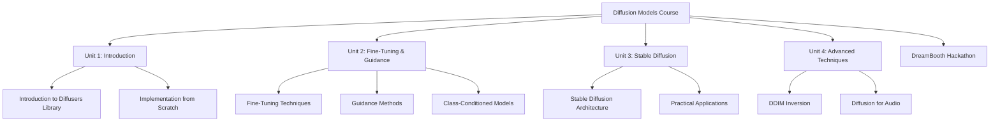
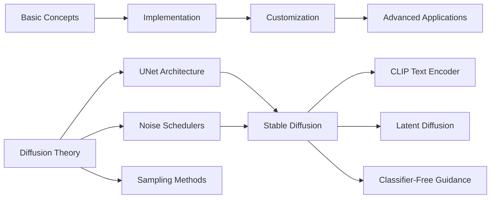
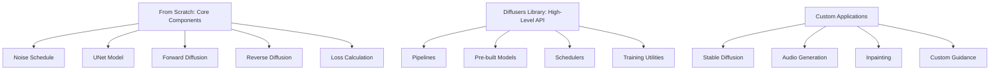

<!-- source: DeepWiki mcp.deepwiki.com · repo huggingface/diffusion-models-class · page 1 Overview · fetched 2026-10-26 -->

# Overview

Relevant source files

The following files were used as context for generating this wiki page:

- [README.md](README.md)
- [_toctree.yml](_toctree.yml)
- [unit0/README.md](unit0/README.md)

The Hugging Face Diffusion Models Course repository provides comprehensive educational materials for learning about diffusion models in generative AI. This repository contains a structured course covering theory, implementation, fine-tuning, and advanced applications of diffusion models. For specific setup instructions, see [Getting Started](#2).

Sources: [README.md:1-15](), [unit0/README.md:1-9]()

## Repository Structure

The repository is organized as a progressive course with four main units, each building on knowledge from previous sections:

### Course Content Organization

| Unit | Title | Focus Areas |
|------|-------|-------------|
| 1 | Introduction to Diffusion Models | Diffusers library, implementation from scratch |
| 2 | Fine-Tuning and Guidance | Model adaptation, guidance techniques, conditioning |
| 3 | Stable Diffusion | Architecture, text-to-image generation, practical applications |
| 4 | Advanced Techniques | Faster sampling, training improvements, audio/video applications |

The repository also includes a DreamBooth hackathon section with practical examples and community submissions.

Sources: [README.md:19-26](), [_toctree.yml:1-55]()

### Course Structure Diagram

Sources: [README.md:19-26](), [_toctree.yml:1-55]()

## Learning Path and Technical Components

The course follows a structured learning path from basic concepts to advanced applications, covering key technical components of diffusion models.

### Learning Path Diagram

Sources: [README.md:8-15](), [unit0/README.md:22-32]()

## Implementation Approaches

The course presents three main implementation approaches for working with diffusion models, bridging theoretical concepts to practical code implementations.

### Implementation Approaches Comparison

Sources: [README.md:8-15](), [_toctree.yml:13-18](), [_toctree.yml:25-31]()

## Practical Applications

The course covers a range of practical applications for diffusion models:

| Application | Description | Unit |
|-------------|-------------|------|
| Image Generation | Creating images from noise | Unit 1 |
| Text-to-Image | Generating images from text prompts | Unit 3 |
| Image Inpainting | Filling in missing parts of images | Unit 3 |
| Fine-tuning | Adapting models to new datasets | Unit 2 |
| Audio Generation | Creating audio with diffusion | Unit 4 |
| Model Personalization | DreamBooth technique for personalized models | Hackathon |

Sources: [README.md:8-15](), [_toctree.yml:33-54]()

## Prerequisites

To successfully complete this course, you should have:
- Good Python programming skills
- Basic understanding of deep learning concepts
- Familiarity with PyTorch

Optional resources for prerequisite skills are provided in the repository documentation.

Sources: [README.md:31-38](), [unit0/README.md:12-17]()

## Course Format and Community

The course is designed to be self-paced with a combination of theoretical explanations and hands-on exercises. Each unit includes Jupyter notebooks that guide users through practical implementations. Community interaction is encouraged through Discord channels where users can ask questions and share their work.

The DreamBooth Hackathon section provides an opportunity for applying learned concepts to a real-world project with community engagement and model sharing capabilities on the Hugging Face Hub.

Sources: [README.md:16-18](), [README.md:53-57](), [unit0/README.md:55-57]()

---

