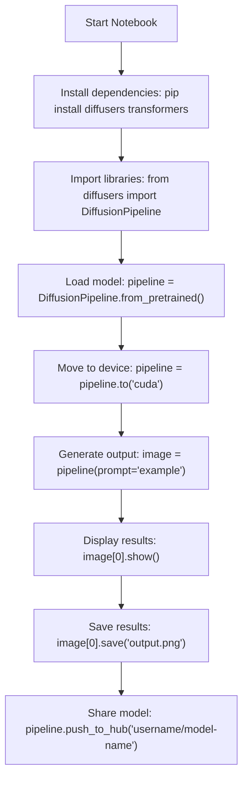

<!-- source: DeepWiki mcp.deepwiki.com · repo huggingface/diffusion-models-class · page 2 Getting Started · fetched 2026-10-26 -->

# Getting Started

<details>
<summary>Relevant source files</summary>

The following files were used as context for generating this wiki page:

- [README.md](README.md)
- [_toctree.yml](_toctree.yml)
- [unit0/README.md](unit0/README.md)

</details>


This page guides you through setting up your environment and starting the Hugging Face Diffusion Models Course. You'll find information about prerequisites, environment setup, and how to navigate the course materials. For an overview of the course content and objectives, see [Overview](#1).

## Prerequisites

Before starting the course, ensure you have:

### Required Knowledge
- Good Python programming skills
- Basic understanding of deep learning concepts
- Familiarity with PyTorch

If you need to refresh these skills, these free resources are recommended:
- Python: [Udacity's Introduction to Python](https://www.udacity.com/course/introduction-to-python--ud1110)
- PyTorch: [PyTorch in 60 Minutes](https://pytorch.org/tutorials/beginner/deep_learning_60min_blitz.html)
- Deep Learning with PyTorch: [Udacity's Intro Course](https://www.udacity.com/course/deep-learning-pytorch--ud188)

### Required Accounts
- A [Hugging Face account](https://huggingface.co/join) (free) - necessary for uploading models to the Hugging Face Hub

Sources: [README.md:31-38](), [unit0/README.md:12-17]()

## Environment Setup

### Python Environment Configuration

The course provides two main options for environment setup:

#### Option 1: Google Colab (Recommended for Beginners)
All notebooks can be run in Google Colab without local setup. Each notebook has a "Open in Colab" button at the top.

#### Option 2: Local Setup
To run notebooks locally:

1. **Clone the repository**:
   ```bash
   git clone https://github.com/huggingface/diffusion-models-class.git
   cd diffusion-models-class
   ```

2. **Create a virtual environment** (recommended):
   ```bash
   python -m venv diffusion-env
   source diffusion-env/bin/activate  # On Windows: diffusion-env\Scripts\activate
   ```

3. **Install required packages**:
   ```bash
   pip install diffusers transformers accelerate torch
   ```

### Setting Up Hugging Face Access

To access the Hugging Face Hub for model sharing:

1. Create a [Hugging Face account](https://huggingface.co/join) if needed
2. Create an access token at [Hugging Face settings page](https://huggingface.co/settings/tokens)
3. Set up your token using the Hugging Face CLI:
   ```bash
   pip install huggingface_hub
   huggingface-cli login
   ```

## Repository Structure

### Course Organization Diagram

```mermaid
flowchart TB
    Start["diffusion-models-class repository"] --> Unit1["unit1/ - Introduction to Diffusion Models"]
    Unit1 --> Unit1Readme["unit1/README.md - Theory overview"]
    Unit1 --> Unit1NB1["unit1/01_introduction_to_diffusers.ipynb - Diffusers library basics"]
    Unit1 --> Unit1NB2["unit1/02_diffusion_models_from_scratch.ipynb - Implementation basics"]
    
    Start --> Unit2["unit2/ - Fine-Tuning and Guidance"]
    Unit2 --> Unit2Readme["unit2/README.md - Theory overview"]
    Unit2 --> Unit2NB1["unit2/01_finetuning_and_guidance.ipynb - Fine-tuning techniques"]
    Unit2 --> Unit2NB2["unit2/02_class_conditioned_diffusion_model_example.ipynb - Conditioning methods"]
    
    Start --> Unit3["unit3/ - Stable Diffusion"]
    Unit3 --> Unit3Readme["unit3/README.md - Theory overview"]
    Unit3 --> Unit3NB1["unit3/01_stable_diffusion_introduction.ipynb - Practical implementation"]
    
    Start --> Unit4["unit4/ - Advanced Techniques"]
    Unit4 --> Unit4Readme["unit4/README.md - Theory overview"]
    Unit4 --> Unit4NB1["unit4/01_ddim_inversion.ipynb - DDIM techniques"]
    Unit4 --> Unit4NB2["unit4/02_diffusion_for_audio.ipynb - Audio diffusion"]
    
    Start --> Hackathon["hackathon/ - DreamBooth Hackathon"]
```



Sources: [_toctree.yml:1-64](), [README.md:19-26]()

## Key Components of the Diffusers Library

The course heavily uses the `diffusers` library. Here's a diagram of its main components:

```mermaid
flowchart TB
    diffusers["diffusers Library"] --> Pipeline["DiffusionPipeline"]
    diffusers --> Models["Model Components"]
    diffusers --> Schedulers["Noise Schedulers"]
    diffusers --> Training["Training Utilities"]
    
    Models --> UNet["UNet2DModel"]
    Models --> UNetCond["UNet2DConditionModel"]
    Models --> VAE["AutoencoderKL"]
    Models --> TextEncoder["CLIPTextModel"]
    
    Schedulers --> DDPM["DDPMScheduler"]
    Schedulers --> DDIM["DDIMScheduler"]
    Schedulers --> PNDM["PNDMScheduler"]
    Schedulers --> LMS["LMSDiscreteScheduler"]
    
    Pipeline --> TextToImage["StableDiffusionPipeline"]
    Pipeline --> ImageToImage["StableDiffusionImg2ImgPipeline"]
    Pipeline --> Inpainting["StableDiffusionInpaintPipeline"]
    Pipeline --> AudioDiffusion["AudioDiffusionPipeline"]
    
    Training --> TrainingArgs["TrainingArguments"]
    Training --> Trainer["Trainer"]
```



## Typical Notebook Workflow

Most notebooks in the course follow a similar pattern:



### Key Libraries Table

| Library | Purpose | Used In |
|---------|---------|---------|
| `diffusers` | Core diffusion models implementation | All notebooks |
| `transformers` | Text encoders and tokenizers | Text-to-image models |
| `torch` | Deep learning framework | All models |
| `accelerate` | Training optimization | Fine-tuning notebooks |
| `datasets` | Data loading and processing | Training notebooks |

## Running the Notebooks

### Instructions for Execution

1. **Open a notebook**:
   - Click the "Open in Colab" button at the top of the notebook in GitHub
   - Or in a local Jupyter server run: `jupyter notebook`

2. **Execute cells**:
   - Run cells in sequence (top to bottom) using Shift+Enter
   - Pay close attention to installation cells at the beginning
   - Some cells may take several minutes to run, especially model loading or training

3. **Hardware considerations**:
   - Basic inference can run on CPU, but GPU is recommended
   - Training requires GPU acceleration
   - In Google Colab, select: Runtime > Change runtime type > Hardware accelerator > GPU

## Community and Support

### Getting Help
- Join the [Discord server](https://discord.gg/aYka4Yhff9) for discussions
- Ask questions in the `#diffusion-models-class` channel
- For each unit page, click the "Ask a question" banner to be redirected to the right Discord section

Sources: [README.md:17](), [unit0/README.md:56-57]()

## Next Steps

Now that your environment is set up, proceed to [Unit 1: Introduction to Diffusion Models](#3) to begin learning. The first unit introduces the `diffusers` library and teaches you how to build diffusion models from scratch.

---

