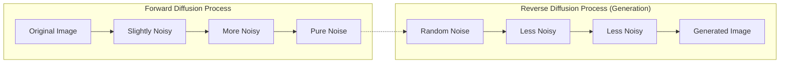
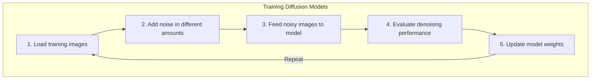
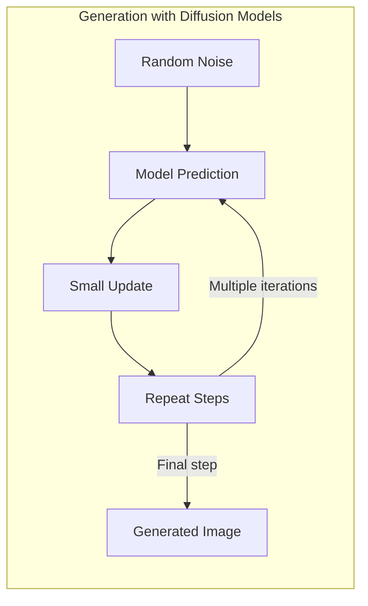
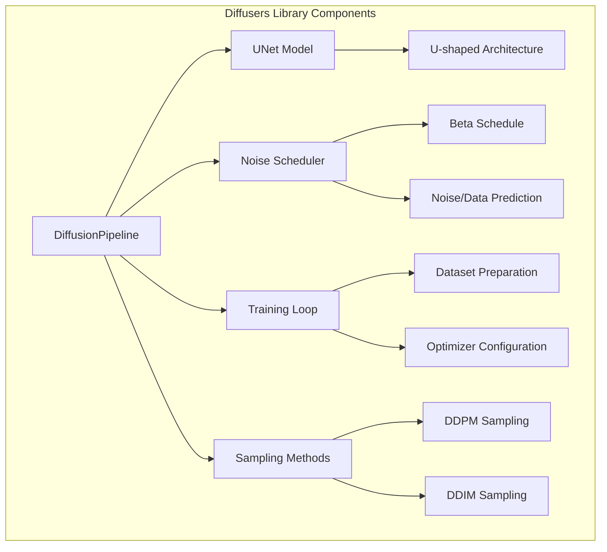
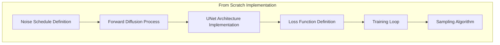
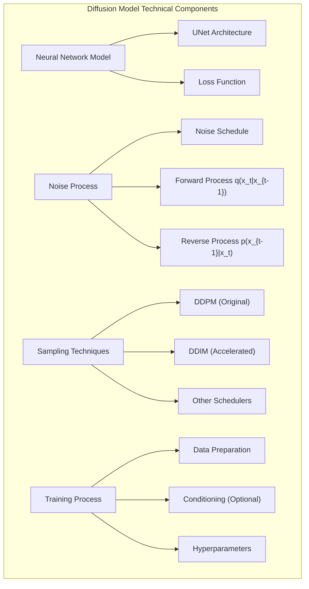
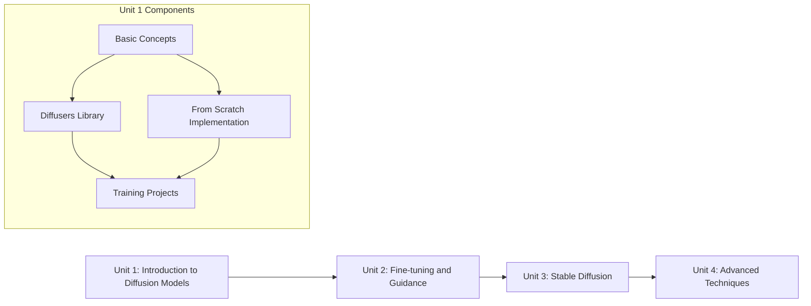

<!-- source: DeepWiki mcp.deepwiki.com · repo huggingface/diffusion-models-class · page 3 Unit 1: Introduction to Diffusion Models · fetched 2026-10-26 -->

# Unit 1: Introduction to Diffusion Models

Relevant source files

The following files were used as context for generating this wiki page:

- [unit1/README.md](unit1/README.md)

## Purpose and Scope

This unit serves as the foundational introduction to diffusion models, explaining their core concepts and providing hands-on experience with both the 🤗 Diffusers library and implementing models from scratch. The material covered here establishes the groundwork for more advanced topics in later units, including fine-tuning and guidance methods ([Unit 2: Fine-tuning and Guidance](#4)), and practical applications with Stable Diffusion ([Unit 3: Stable Diffusion](#5)).

Sources: [unit1/README.md:1-4]()

## What Are Diffusion Models?

Diffusion models are a class of generative models that learn to generate data (such as images or audio) by gradually denoising random noise over multiple steps. Unlike some other generative approaches, diffusion models use an iterative process that makes small corrections at each step, allowing them to produce high-quality outputs with greater stability.

### The Diffusion Process

The diffusion process consists of two main phases:

1. **Forward Diffusion**: Gradually adding noise to data until it becomes pure random noise
2. **Reverse Diffusion**: The generative process where the model learns to gradually denoise data, starting from random noise

Generation begins with random noise that is iteratively refined over a number of steps. At each step, the model estimates how to transform the current noisy input toward a denoised version. Since only small changes are made at each step, errors in early estimations (when predicting the final output is difficult) can be corrected in later steps.

Sources: [unit1/README.md:20-30]()

### Training Process

Training a diffusion model is relatively straightforward:

1. Load images from the training dataset
2. Add varying amounts of noise to these images (from slight to complete noise)
3. Feed the noisy images into the model
4. Evaluate how well the model denoises these inputs
5. Use this information to update the model weights

Sources: [unit1/README.md:32-39]()

### Generation Process

To generate new images with a trained model:
1. Begin with completely random noise
2. Repeatedly feed it through the model
3. Update it each time by a small amount based on the model prediction
4. Continue until a clear image emerges

Various sampling methods aim to streamline this process to generate quality outputs with fewer steps.

Sources: [unit1/README.md:39-41]()

## Hands-On Materials

Unit 1 provides two complementary notebooks that approach diffusion models from different perspectives:

### 1. Introduction to Diffusers

This notebook demonstrates how to use the 🤗 Diffusers library to create, train, and sample diffusion models. It shows the practical application of the concepts described above using a high-level API that simplifies working with diffusion models.

Key topics covered:
- Using pre-built diffusion pipelines
- Training custom diffusion models on your own datasets
- Exploring different sampling techniques
- Sharing trained models with the community

Sources: [unit1/README.md:44-54]()

### 2. Diffusion Models from Scratch

This notebook provides a minimal implementation of diffusion models using PyTorch, without relying on external libraries. It offers deeper insights into the underlying mechanics and design choices involved in diffusion models.

Key topics covered:
- Implementing the forward diffusion process
- Building a neural network for denoising
- Creating the reverse diffusion sampling process
- Comparing the implementation with the Diffusers library version

Sources: [unit1/README.md:54-56]()

## Project Exercise

After completing the notebooks, this unit encourages you to train your own diffusion models on datasets of your choice and share your findings with the community. This collaborative effort aims to identify effective "training recipes" for diffusion models at different scales.

Potential project areas include:
- Training models on different types of data (faces, landscapes, objects)
- Experimenting with model architecture sizes
- Testing various hyperparameter configurations
- Comparing different sampling strategies

Sources: [unit1/README.md:56-58]()

## Technical Components

### Key Components

1. **UNet Architecture**: The backbone neural network that performs the denoising. Its encoder-decoder structure with skip connections is particularly effective for image processing tasks.

2. **Noise Schedule**: Determines how noise is added during the forward process and removed during sampling. Common schedules include linear, cosine, and sigmoid.

3. **Loss Functions**: Typically mean squared error (MSE) between the model's prediction and the actual noise or clean data.

4. **Sampling Strategies**: Methods to generate samples from the model, ranging from the original DDPM approach to faster techniques like DDIM.

Sources: [unit1/README.md:20-41]()

## Relationship to Course Structure

Unit 1 establishes the foundational knowledge required for the more advanced topics covered in later units:

- **Unit 2** builds on this foundation to explore fine-tuning techniques and guidance methods for controlling the generation process.
- **Unit 3** introduces Stable Diffusion, a powerful latent diffusion model for text-to-image generation.
- **Unit 4** covers advanced techniques and recent developments in the field.

Sources: [unit1/README.md:41-42]()

## Additional Resources

For deeper exploration of diffusion models, the following resources are recommended:

1. **The Annotated Diffusion Model**: An in-depth walk-through of the code and theory behind DDPMs with mathematical details.
2. **Hugging Face Documentation on Unconditional Image-Generation**: Examples of training diffusion models using the official training scripts.
3. **Video Resources**:
   - AI Coffee Break on Diffusion Models
   - Yannic Kilcher's explanation of DDPMs

Sources: [unit1/README.md:60-71]()

---

