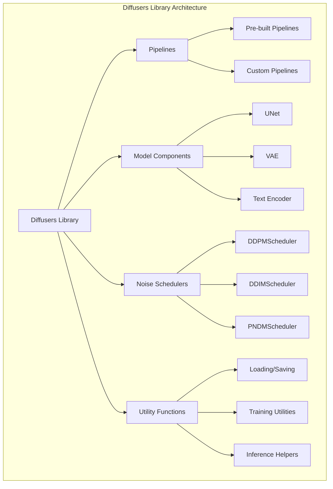
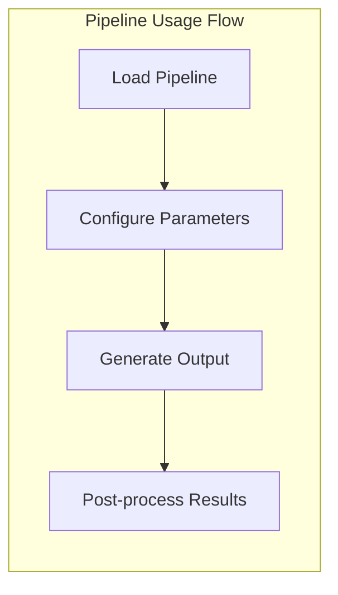
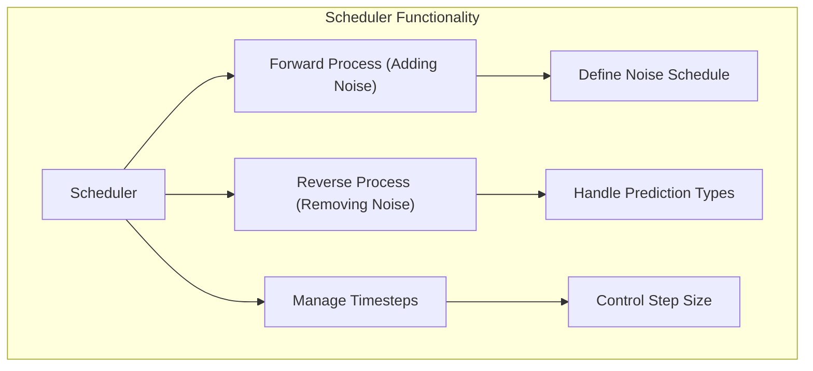
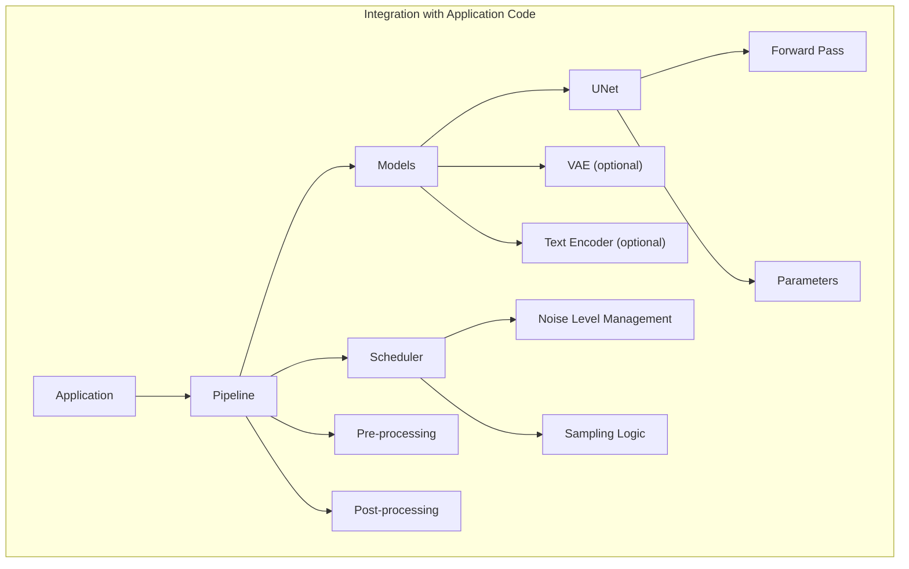

<!-- source: DeepWiki mcp.deepwiki.com · repo huggingface/diffusion-models-class · page 3.1 Introduction to the Diffusers Library · fetched 2026-10-26 -->

# Introduction to the Diffusers Library

<details>
<summary>Relevant source files</summary>

The following files were used as context for generating this wiki page:

- [unit1/01_introduction_to_diffusers.ipynb](unit1/01_introduction_to_diffusers.ipynb)

</details>


## Purpose and Scope

This document introduces the Hugging Face Diffusers library, a powerful toolkit designed to make working with diffusion models accessible, efficient, and flexible. The Diffusers library provides high-level abstractions for using pre-trained diffusion models while also offering access to the underlying components for customization. We'll cover the library's core architecture, components, and usage patterns.

For information about implementing diffusion models from first principles without using the Diffusers library, see [Building Diffusion Models from Scratch](#3.2).

## Library Overview

The Diffusers library abstracts the complexity of diffusion models through a modular and composable architecture, allowing both beginners and experts to work with state-of-the-art models.



## Key Components

### 1. Pipelines

Pipelines are end-to-end implementations that bundle all necessary components for generating outputs with diffusion models. They simplify the process of loading models and generating images (or other content).



Key pipeline types:
- `DDPMPipeline`: For basic diffusion models
- `StableDiffusionPipeline`: For text-to-image generation
- `StableDiffusionImg2ImgPipeline`: For image-to-image transformations
- `StableDiffusionInpaintPipeline`: For inpainting applications

### 2. Models

The Models component includes various neural network architectures used across different diffusion models:

| Model Type | Description | Primary Function |
|------------|-------------|------------------|
| UNet | U-shaped neural network | Core noise prediction network |
| VAE | Variational Autoencoder | Image encoding/decoding (used in latent diffusion) |
| Text Encoder | Text embedding model (e.g., CLIP) | Convert text prompts to embeddings |

### 3. Schedulers

Schedulers manage the diffusion process by controlling how noise is added during forward diffusion and predicted/removed during reverse diffusion.



Common schedulers:
- `DDPMScheduler`: Original diffusion process
- `DDIMScheduler`: Accelerated, deterministic sampling
- `PNDMScheduler`: Higher quality with pseudo numerical methods
- `EulerDiscreteScheduler`: Popular for Stable Diffusion

### 4. Utility Functions

Utilities provide support for common operations:
- Loading and saving models
- Converting between model formats
- Training functionality
- Visualization helpers

## Using the Diffusers Library

### Basic Usage Example

```python
from diffusers import StableDiffusionPipeline
import torch

# Load a pre-trained model
pipeline = StableDiffusionPipeline.from_pretrained(
    "runwayml/stable-diffusion-v1-5", 
    torch_dtype=torch.float16
)
pipeline = pipeline.to("cuda")

# Generate an image
prompt = "A serene landscape with mountains and a lake"
image = pipeline(prompt).images[0]
image.save("landscape.png")
```

### Customizing the Pipeline

```python
from diffusers import StableDiffusionPipeline, EulerDiscreteScheduler

# Load pipeline with default components
pipeline = StableDiffusionPipeline.from_pretrained("runwayml/stable-diffusion-v1-5")

# Replace the scheduler
pipeline.scheduler = EulerDiscreteScheduler.from_config(pipeline.scheduler.config)

# Use the modified pipeline
image = pipeline("A futuristic city skyline", num_inference_steps=30).images[0]
```

### Accessing Individual Components

```python
from diffusers import UNet2DConditionModel, AutoencoderKL

# Load individual components
unet = UNet2DConditionModel.from_pretrained("CompVis/stable-diffusion-v1-4", subfolder="unet")
vae = AutoencoderKL.from_pretrained("CompVis/stable-diffusion-v1-4", subfolder="vae")

# Now you can inspect or modify these components
```

## Architectural Integration



## Common Usage Patterns

### Task-specific Patterns

| Task | Pipeline | Key Parameters |
|------|----------|---------------|
| Text-to-Image | StableDiffusionPipeline | prompt, guidance_scale, num_inference_steps |
| Image-to-Image | StableDiffusionImg2ImgPipeline | prompt, init_image, strength |
| Inpainting | StableDiffusionInpaintPipeline | prompt, image, mask_image |
| Unconditional | DDPMPipeline | batch_size, num_inference_steps |

### Performance Optimization

- Using half-precision (`torch_dtype=torch.float16`)
- Enabling attention slicing (`pipeline.enable_attention_slicing()`)
- Utilizing model offloading for limited VRAM
- Adjusting `num_inference_steps` to balance quality and speed

## Integration in the Course

This introduction to the Diffusers library serves as the foundation for subsequent units in the course:

- In [Fine-tuning Techniques](#4.1), you'll learn how to adapt pre-trained diffusion models to new datasets
- In [Guidance and Conditioning Methods](#4.2), you'll explore how to control generation with various inputs
- In [Stable Diffusion Architecture](#5.1), you'll dive deeper into a specific implementation that leverages Diffusers

## Summary

The Diffusers library provides a flexible framework for working with diffusion models at varying levels of abstraction. Its modular design allows for:

1. Quick experimentation with state-of-the-art models
2. Customization of individual components
3. Building novel applications on top of existing architectures
4. Adapting models to specific use cases through fine-tuning

Understanding the Diffusers library is essential for efficiently working with diffusion models throughout this course and in practical applications.

---

