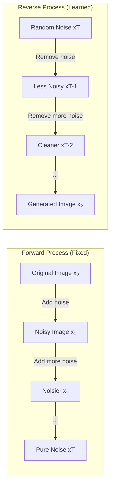
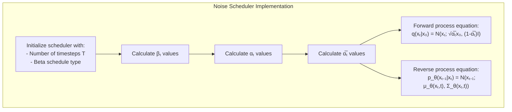
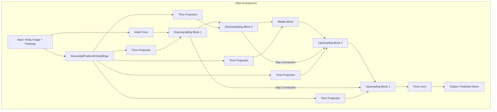
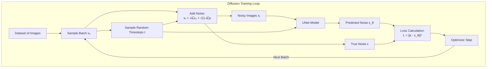
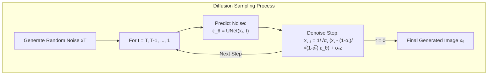
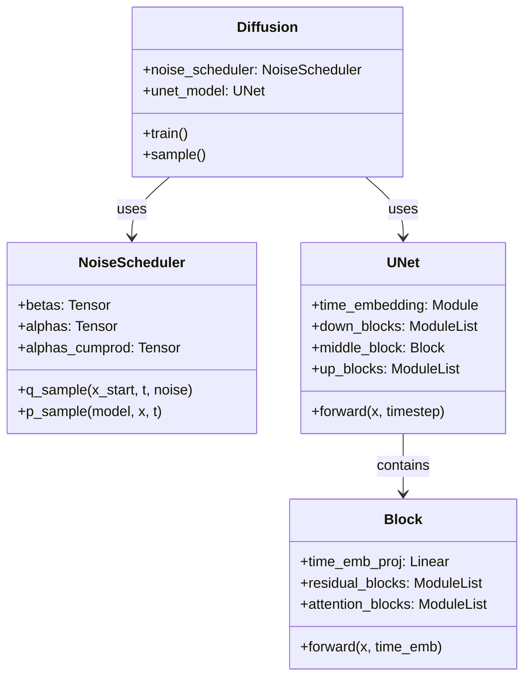

<!-- source: DeepWiki mcp.deepwiki.com · repo huggingface/diffusion-models-class · page 3.2 Building Diffusion Models from Scratch · fetched 2026-10-26 -->

# Building Diffusion Models from Scratch

<details>
<summary>Relevant source files</summary>

The following files were used as context for generating this wiki page:

- [unit1/02_diffusion_models_from_scratch.ipynb](unit1/02_diffusion_models_from_scratch.ipynb)

</details>


## Purpose and Scope

This document explains how to implement diffusion models from first principles, without relying on high-level libraries. We'll cover the mathematical foundations, the forward and reverse diffusion processes, model architecture, loss calculation, and sampling procedures. For information about using the pre-built components in the Diffusers library, see [Introduction to the Diffusers Library](#3.1).

## Diffusion Models: Theoretical Foundation

Diffusion models are generative models based on gradually adding noise to data and then learning to reverse this process. The two core processes are:

1. **Forward diffusion process**: Gradually adds Gaussian noise to images according to a schedule
2. **Reverse diffusion process**: Learns to predict and remove noise step by step



## Implementation Components

### Noise Scheduler

The noise scheduler defines how noise is added during the forward process and removed during the reverse process. It determines the noise schedule β₁, β₂, ..., βₜ and derived quantities such as αₜ = ∏ᵢ₌₁ᵗ(1-βᵢ).



Our implementation includes different types of schedulers: linear, quadratic, cosine, and sigmoid schedules.

### UNet Architecture

The UNet architecture is the backbone neural network that predicts noise at each timestep. It takes a noisy image and timestep as input and outputs the predicted noise.



The UNet consists of:
- Time embeddings using sinusoidal position embeddings
- Down blocks that decrease spatial resolution
- Up blocks that increase resolution with skip connections
- Residual blocks for feature processing

### Diffusion Model Training

Training a diffusion model involves:
1. Sampling a batch of images from the dataset
2. Sampling random timesteps
3. Adding noise to the images according to the schedule
4. Training the UNet to predict the noise



### Diffusion Model Sampling

To generate new images, we start with random noise and iteratively denoise it using the trained model:



## Implementation Details

### Forward Diffusion Process

The forward diffusion process adds noise to an image according to a schedule:

```python
def q_sample(x_start, t, noise=None):
    """
    Forward diffusion process: add noise to the input image
    """
    if noise is None:
        noise = torch.randn_like(x_start)
    
    sqrt_alphas_cumprod_t = extract(sqrt_alphas_cumprod, t, x_start.shape)
    sqrt_one_minus_alphas_cumprod_t = extract(sqrt_one_minus_alphas_cumprod, t, x_start.shape)
    
    return sqrt_alphas_cumprod_t * x_start + sqrt_one_minus_alphas_cumprod_t * noise
```

### Loss Function

The loss function trains the model to predict the noise that was added during the forward process:

```python
def p_losses(denoise_model, x_start, t, noise=None):
    """
    Calculate the loss between predicted noise and actual noise
    """
    if noise is None:
        noise = torch.randn_like(x_start)
    
    # Add noise to the input image
    x_noisy = q_sample(x_start, t, noise=noise)
    
    # Predict the noise using the model
    predicted_noise = denoise_model(x_noisy, t)
    
    # Calculate the loss
    loss = F.mse_loss(noise, predicted_noise)
    
    return loss
```

### Training Loop

A simplified training loop might look like:

```python
for epoch in range(num_epochs):
    for batch in dataloader:
        optimizer.zero_grad()
        
        # Sample random timesteps
        t = torch.randint(0, timesteps, (batch.shape[0],), device=device)
        
        # Calculate loss
        loss = p_losses(model, batch, t)
        
        # Update model parameters
        loss.backward()
        optimizer.step()
```

### Sampling Loop

A simplified sampling loop might look like:

```python
def p_sample_loop(model, shape, timesteps):
    """
    Generate samples by iteratively denoising
    """
    device = next(model.parameters()).device
    
    # Start with random noise
    img = torch.randn(shape, device=device)
    
    # Iteratively denoise
    for t in reversed(range(0, timesteps)):
        img = p_sample(model, img, torch.full((shape[0],), t, device=device))
    
    return img
```

## Key Classes and Their Relationships

The implementation consists of several key components that work together:



This diagram shows the relationship between the main classes in our implementation.

## Practical Tips for Implementation

1. **Numerical stability**: Use techniques like clamping values and working in the log domain to ensure stability.
2. **Efficient sampling**: Implement techniques like DDIM sampling for faster generation.
3. **Model size**: Balance model size with available computational resources.
4. **Training schedule**: Start with a simplified model and gradually increase complexity.
5. **Visualization**: Implement tools to visualize the denoising process during sampling.

## Conclusion

Building diffusion models from scratch provides a deep understanding of the underlying principles and complete control over the implementation. While more involved than using high-level libraries, it allows for customization and experimentation with different architectures and techniques.

For the next steps in learning about diffusion models, see [Fine-tuning Techniques](#4.1) which builds upon this foundation.

---

