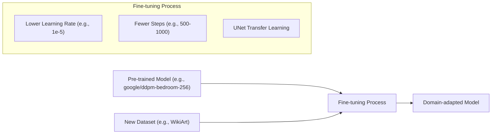
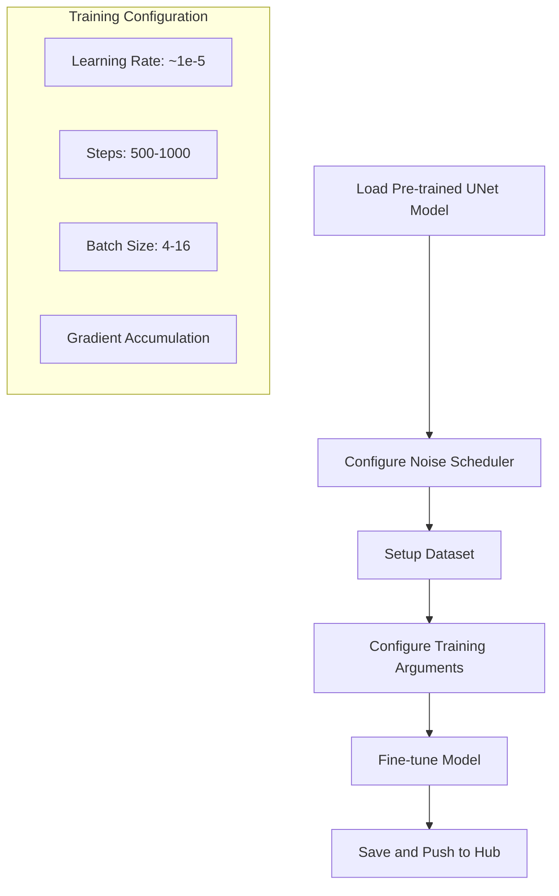
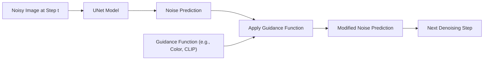
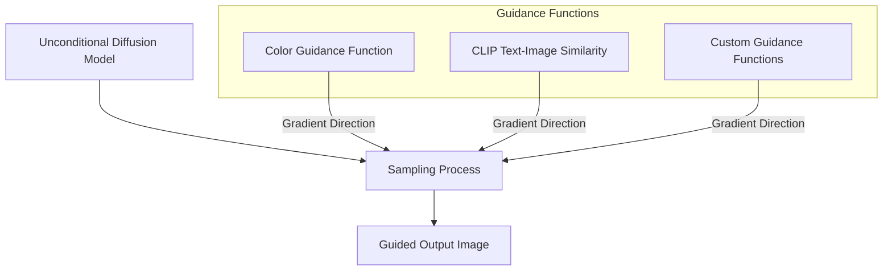
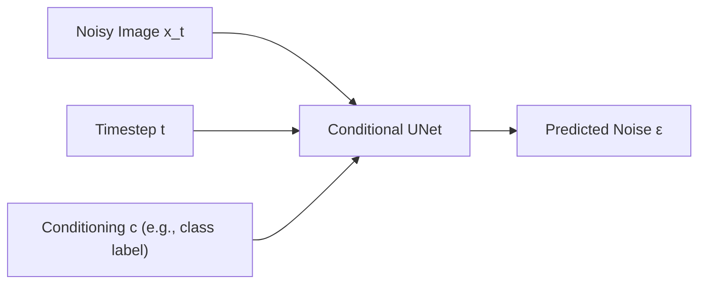
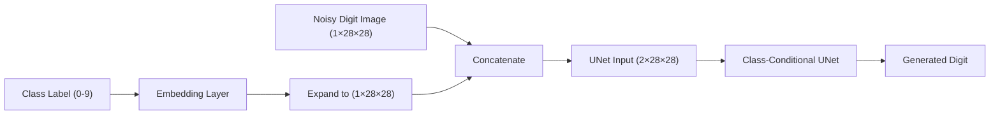
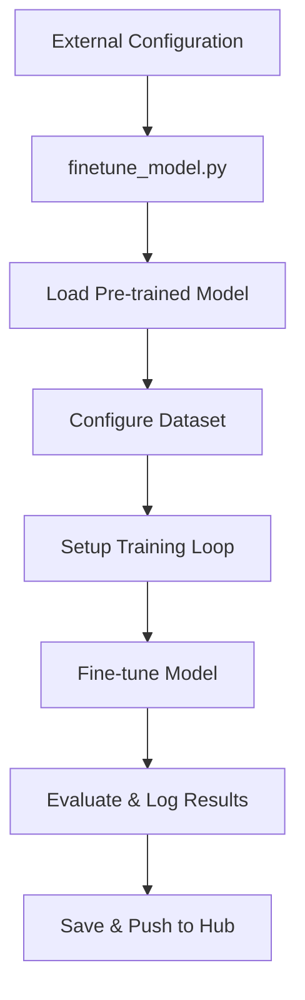
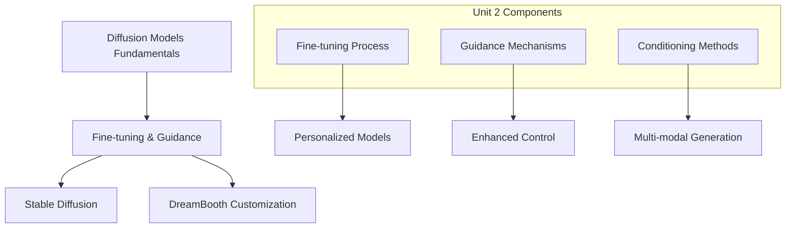

<!-- source: DeepWiki mcp.deepwiki.com · repo huggingface/diffusion-models-class · page 4 Unit 2: Fine-tuning and Guidance · fetched 2026-10-26 -->

# Unit 2: Fine-tuning and Guidance

Relevant source files

The following files were used as context for generating this wiki page:

- [unit2/README.md](unit2/README.md)

## Purpose and Scope

This document covers techniques for adapting pre-trained diffusion models through fine-tuning and controlling the generation process through guidance and conditioning. These methods allow leveraging existing models rather than training from scratch and incorporating additional control signals into the generation process. For fundamental diffusion model concepts, see [Unit 1: Introduction to Diffusion Models](#3).

## Fine-Tuning Diffusion Models

Fine-tuning allows adapting pre-trained diffusion models to new datasets without the computational expense of training from scratch. This approach leverages knowledge already captured in the pre-trained model weights, requiring less data and training time to achieve good results.

### Core Concept and Implementation

When fine-tuning a diffusion model, we start with weights from a model trained on a general or domain-specific dataset, then continue training on a new target dataset.

Even when the target domain differs significantly from the source domain, fine-tuning often produces surprisingly good results. For example, a model trained on bedroom images can be fine-tuned to generate artwork with as few as 500 training steps.

Sources: [unit2/README.md:19-25]()

### Implementation with Diffusers

The repository includes a dedicated script for fine-tuning diffusion models. The typical fine-tuning workflow includes:

1. Loading a pre-trained UNet from the Hugging Face Hub
2. Loading a noise scheduler
3. Setting up a dataset pipeline
4. Configuring training arguments with a reduced learning rate
5. Running the fine-tuning process

The fine-tuning script (`finetune_model.py`) makes it easy to experiment with different settings and datasets. It builds on the Diffusers library's training utilities, handling the details of the training loop.

Sources: [unit2/README.md:25-26](), [unit2/README.md:56-57]()

## Guidance Techniques

Guidance provides a way to control the output of unconditional diffusion models during the generation process. Unlike conditioning (which requires training or fine-tuning), guidance techniques modify the sampling procedure at inference time.

### Core Concept

In guided diffusion, we modify the model's predictions at each denoising step based on some guidance function, steering the generation process toward desired characteristics.

The guidance function evaluates the current predicted denoised image against some criteria and adjusts the prediction to better satisfy those criteria. The strength of the guidance can typically be controlled with a weight parameter.

Sources: [unit2/README.md:27-33]()

### Types of Guidance

1. **Color Guidance**: Controls the color distribution of generated images by comparing the current color histogram to a target and adjusting the prediction to minimize the difference.

2. **CLIP Guidance**: Uses the CLIP model to measure similarity between the current image and a text prompt, then adjusts the prediction to increase this similarity.

3. **Other possible guidance**: Shape constraints, structural properties, semantic features, etc.

What makes guidance powerful is its flexibility - almost any differentiable function that can evaluate an image can be used for guidance. The guidance is typically applied by computing a gradient of the guidance function with respect to the predicted image and using this gradient to adjust the prediction.

Sources: [unit2/README.md:31-33]()

## Conditioning Approaches

Conditioning differs from guidance in that the model is explicitly trained to incorporate additional information in its denoising process.

### Core Concept

Conditional diffusion models accept additional inputs (beyond the noisy image and timestep) that influence the generation. The model learns during training to use this conditioning information to produce specific types of outputs.

Examples of conditioning information include:
- Class labels (e.g., MNIST digits 0-9)
- Text descriptions (as in text-to-image models)
- Image features or embeddings
- Segmentation masks or layouts
- Depth maps

Sources: [unit2/README.md:35-40]()

### Conditioning Methods

There are several techniques for incorporating conditioning information into diffusion models:

1. **Input Channel Conditioning**:
   - Adds conditioning as additional input channels to the UNet
   - Used when conditioning has the same spatial dimensions as the image or can be expanded to match
   - Example: Class label embedding expanded to image dimensions (H×W) and concatenated with noisy image

2. **Embedding Projection and Addition**:
   - Projects conditioning to match internal feature dimensions
   - Adds to UNet block outputs (similar to timestep embedding)
   - Example: CLIP image embeddings in "Image Variations" models by Stable Diffusion

3. **Cross-Attention Conditioning**:
   - Uses cross-attention layers to attend to sequence data
   - Ideal for text conditioning with variable length
   - Example: Text conditioning in Stable Diffusion (covered in [Unit 3: Stable Diffusion](#5))

Sources: [unit2/README.md:41-45]()

### Class-Conditioned Example

A practical example in the repository demonstrates a diffusion model conditioned on MNIST digit class labels (0-9). The class conditioning is implemented using the input channel method:

1. The class label is converted to an embedding
2. This embedding is expanded to match the image dimensions
3. The expanded embedding is concatenated with the noisy image input

This conditioning allows precise control over what is generated at inference time by simply changing the class label input.

Sources: [unit2/README.md:35-38](), [unit2/README.md:58-59]()

## Practical Implementation

The repository provides two main notebooks for implementing these concepts:

### Fine-tuning and Guidance Notebook

This notebook (`01_finetuning_and_guidance.ipynb`) demonstrates:
1. How to fine-tune a pre-trained model on a new dataset
2. Implementing color guidance to control generation
3. Implementing CLIP guidance for text-based control
4. Creating a Gradio demo to showcase the model

The notebook serves as a practical guide for adapting and controlling diffusion models, with each example building on the previous ones.

### Class-Conditioned Model Example

The second notebook (`02_class_conditioned_diffusion_model_example.ipynb`) shows:
1. How to implement class conditioning in a diffusion model architecture
2. Training a conditional model on MNIST
3. Generating images with specific class controls

The focus is on demonstrating the core idea of conditioning as simply as possible, showing how to build controlled generation capabilities into the model during training.

### Fine-tuning Script

The `finetune_model.py` script provides a reusable implementation for fine-tuning experiments, with configurable options for:
- Source model selection
- Dataset choice and preprocessing
- Training hyperparameters
- Evaluation and logging

Sources: [unit2/README.md:47-59]()

## Applications and Use Cases

Fine-tuning, guidance, and conditioning techniques enable several important applications:

| Technique | Application | Description |
|-----------|-------------|-------------|
| Fine-tuning | Domain Adaptation | Adapt general models to specific visual domains (e.g., art, medical imaging) |
| Fine-tuning | Style Transfer | Generate images in specific artistic styles |
| Guidance | Controlled Generation | Control specific attributes of generated images post-training |
| Conditioning | Personalized Generation | Train models to generate specific subjects or objects |
| Conditioning | Text-to-Image | Create images based on text descriptions |

These techniques form the foundation for more advanced applications covered in later units, particularly in relation to Stable Diffusion in [Unit 3: Stable Diffusion](#5).

Sources: [unit2/README.md:60-62]()

## Relationship to the Overall System

Unit 2 builds upon the fundamental concepts from Unit 1 and provides essential techniques that will be used in the more advanced applications in Units 3 and 4. The fine-tuning and guidance methods learned here form the basis for both the Stable Diffusion applications and the DreamBooth hackathon projects.

Sources: [unit2/README.md:3-4](), [unit2/README.md:19-45]()

---

