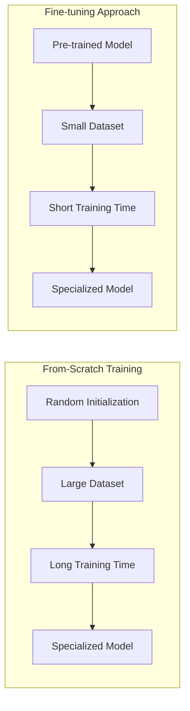
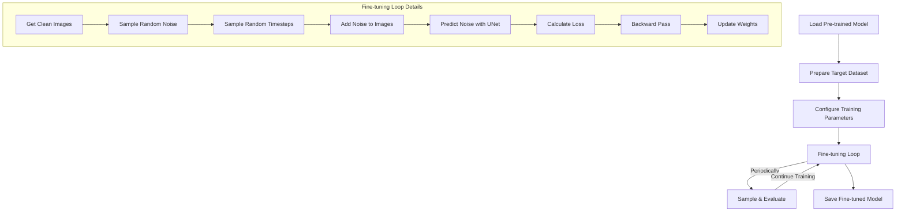
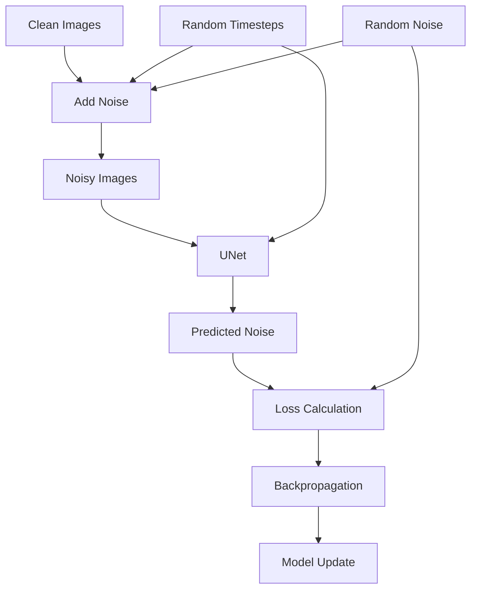
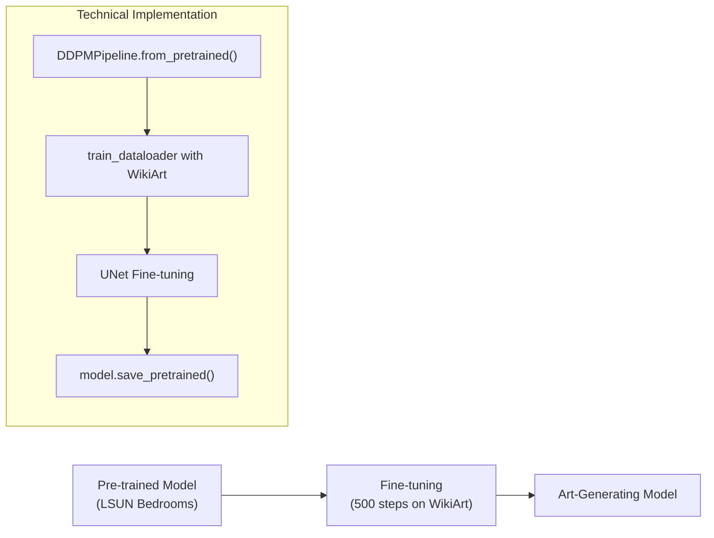

<!-- source: DeepWiki mcp.deepwiki.com · repo huggingface/diffusion-models-class · page 4.1 Fine-tuning Techniques · fetched 2026-10-26 -->

# Fine-tuning Techniques

<details>
<summary>Relevant source files</summary>

The following files were used as context for generating this wiki page:

- [unit2/01_finetuning_and_guidance.ipynb](unit2/01_finetuning_and_guidance.ipynb)
- [unit2/README.md](unit2/README.md)
- [unit2/finetune_model.py](unit2/finetune_model.py)

</details>


## Purpose and Scope

This document details the techniques for fine-tuning pre-trained diffusion models on new datasets. Fine-tuning allows you to leverage existing model knowledge while adapting it to specific domains with substantially less computational resources than training from scratch. We'll explore the fine-tuning process, implementation details, and practical applications.

For information about guiding diffusion models during inference or conditioning them on additional inputs, see [Guidance and Conditioning Methods](#4.2).

Sources: [unit2/README.md:19-26]()

## Why Fine-tune Diffusion Models?

Training diffusion models from scratch is computationally intensive and time-consuming, especially at higher resolutions. Fine-tuning offers a solution by starting with a model that has already learned to denoise images, providing several key advantages:

- Reduced training time and computational resources
- Better results with smaller datasets
- Ability to adapt general-purpose models to specific domains

While fine-tuning typically works best when the new data resembles the base model's original training data, surprisingly good results can be achieved even with significant domain shifts. For example, the course demonstrates fine-tuning a model trained on bedroom images to generate artwork.



**Fine-tuning vs. Training from Scratch**

Sources: [unit2/README.md:19-26]()

## The Fine-tuning Process

The fine-tuning process builds upon the same training methodology used for diffusion models, but starts from a pre-trained checkpoint instead of random weights.



**Diffusion Model Fine-tuning Process**

Sources: [unit2/finetune_model.py:15-120]()

### Loading Pre-trained Models

Fine-tuning begins with loading a pre-trained model from the Hugging Face Hub using the `DDPMPipeline` from the diffusers library:

```python
image_pipe = DDPMPipeline.from_pretrained(start_model)
image_pipe.to(device)
```

The script also sets up a sampling scheduler for generating samples during training:

```python
sampling_scheduler = DDIMScheduler.from_config(start_model)
sampling_scheduler.set_timesteps(num_inference_steps=50)
```

Sources: [unit2/finetune_model.py:33-39]()

### Dataset Preparation

The dataset must be processed to match the input requirements of the model. This involves:

1. Loading the dataset from Hugging Face Hub
2. Defining preprocessing transformations
3. Setting up a dataloader for batched training

```python
preprocess = transforms.Compose([
    transforms.Resize((image_size, image_size)),
    transforms.RandomHorizontalFlip(),
    transforms.ToTensor(),
    transforms.Normalize([0.5], [0.5]),
])
```

Sources: [unit2/finetune_model.py:41-55]()

### Training Configuration

Fine-tuning requires configuring several parameters:

| Parameter | Purpose | Default Value |
|-----------|---------|---------------|
| image_size | Target image dimensions | 256 |
| batch_size | Images per batch | 16 |
| grad_accumulation_steps | Steps before weight update | 2 |
| num_epochs | Training epochs | 1 |
| start_model | Pre-trained model ID | "google/ddpm-bedroom-256" |
| dataset_name | Dataset to fine-tune on | "huggan/wikiart" |
| device | Training device | "cuda" |
| log_samples_every | Steps between sample generation | 250 |
| save_model_every | Steps between model saving | 2500 |

An optimizer and learning rate scheduler are initialized to manage the training:

```python
optimizer = torch.optim.AdamW(image_pipe.unet.parameters(), lr=1e-5)
scheduler = torch.optim.lr_scheduler.ExponentialLR(optimizer, gamma=0.9)
```

Sources: [unit2/finetune_model.py:15-62]()

### The Fine-tuning Loop

The core training loop follows the standard diffusion model training process:

1. Get clean images from the dataset
2. Sample random noise and timesteps
3. Add noise to the clean images according to the timesteps
4. Predict the noise using the UNet
5. Calculate loss between predicted and actual noise
6. Update model weights



**Core Fine-tuning Loop Components**

Sources: [unit2/finetune_model.py:62-94]()

### Periodic Evaluation and Saving

During training, the script periodically:

1. Generates sample images to visualize progress (every `log_samples_every` steps)
2. Saves model checkpoints (every `save_model_every` steps)
3. Logs metrics using Weights & Biases

Sampling uses the DDIM scheduler for faster inference:

```python
for i, t in tqdm(enumerate(sampling_scheduler.timesteps)):
    model_input = sampling_scheduler.scale_model_input(x, t)
    with torch.no_grad():
        noise_pred = image_pipe.unet(model_input, t)["sample"]
    x = sampling_scheduler.step(noise_pred, t, x).prev_sample
```

Sources: [unit2/finetune_model.py:96-112]()

## Practical Example: Fine-tuning on WikiArt

The course demonstrates fine-tuning the [google/ddpm-bedroom-256](https://huggingface.co/google/ddpm-bedroom-256) model (trained on LSUN Bedrooms dataset) on the WikiArt dataset. This represents a significant domain shift from photographs of bedrooms to diverse artistic styles.

Even with relatively few training steps (around 500), the fine-tuned model learns to generate artistic images that reflect the new domain. This example illustrates how pre-trained knowledge can be effectively transferred across visually distinct domains.



**Domain Transfer via Fine-tuning**

Sources: [unit2/README.md:21-25](), [unit2/finetune_model.py:1-120]()

## Implementation and Usage

The implementation in this course uses the `finetune_model.py` script, which provides a complete workflow for fine-tuning diffusion models. The script uses:

- `diffusers` library to load and manage diffusion models
- `datasets` library to handle data loading and preprocessing
- `wandb` for experiment tracking and visualization
- PyTorch for the core training functionality

To fine-tune a model, you would run:

```bash
python finetune_model.py --start_model="google/ddpm-bedroom-256" --dataset_name="huggan/wikiart" --num_epochs=1
```

After fine-tuning, you can create a Gradio demo to showcase your model and share it on Hugging Face Spaces, as demonstrated in the accompanying notebook.

Sources: [unit2/README.md:54-58](), [unit2/finetune_model.py:14-121]()

## Combining Fine-tuning with Other Techniques

Fine-tuning can be combined with other techniques covered in this course:

1. **Guidance**: Apply guidance techniques to control the fine-tuned model's outputs (see [Guidance and Conditioning Methods](#4.2))
2. **Conditioning**: Fine-tune conditional diffusion models to provide even more control over generation

For example, after fine-tuning a model on the WikiArt dataset, you could apply color guidance to influence the color palette of the generated artwork.

Sources: [unit2/README.md:27-38]()

## Practical Considerations

When implementing fine-tuning, consider these practical aspects:

1. **Computational Requirements**: While less intensive than training from scratch, fine-tuning still requires GPU resources
2. **Domain Similarity**: The closer your target domain is to the pre-trained model's domain, the faster and more effective fine-tuning will be
3. **Gradient Accumulation**: Use gradient accumulation (as shown in the script) to effectively increase batch size on limited hardware
4. **Evaluation**: Regularly generate samples during training to assess model progress
5. **Checkpointing**: Save intermediate checkpoints to avoid losing progress

Sources: [unit2/finetune_model.py:91-94](), [unit2/finetune_model.py:96-112]()

## Conclusion

Fine-tuning provides an efficient pathway to customize diffusion models for specific domains. By leveraging pre-trained models, you can create specialized generative models with significantly reduced computational requirements compared to training from scratch.

The techniques covered in this document enable you to adapt existing diffusion models to new domains, creating custom generative models for specific applications without the need for extensive training infrastructure.

Sources: [unit2/README.md:19-26](), [unit2/README.md:54-62]()

---

