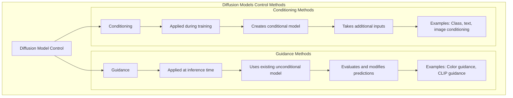
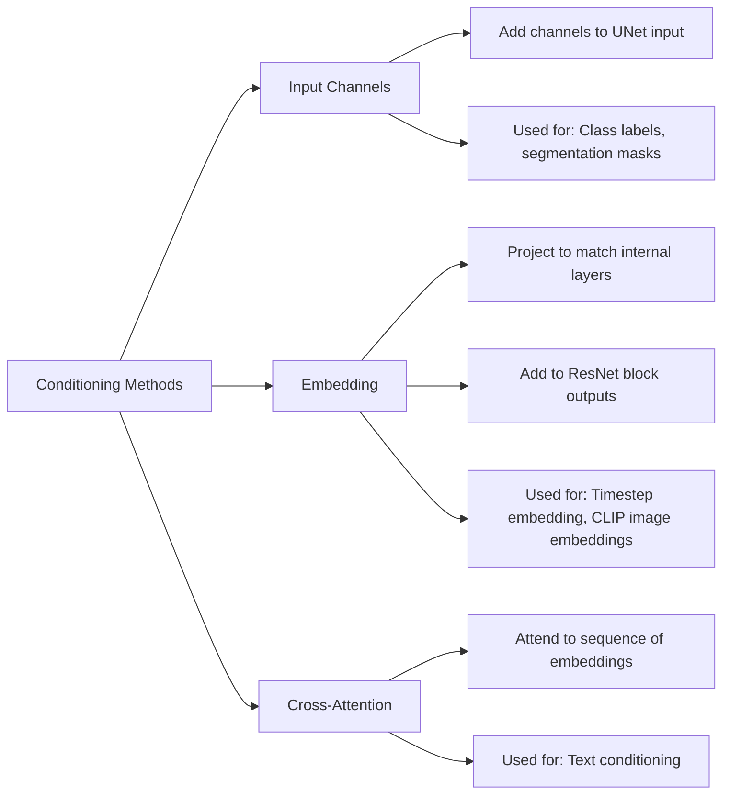
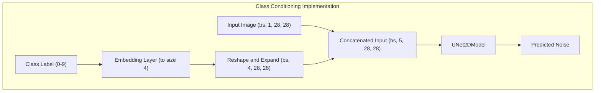

<!-- source: DeepWiki mcp.deepwiki.com · repo huggingface/diffusion-models-class · page 4.2 Guidance and Conditioning Methods · fetched 2026-10-26 -->

# Guidance and Conditioning Methods

<details>
<summary>Relevant source files</summary>

The following files were used as context for generating this wiki page:

- [unit2/02_class_conditioned_diffusion_model_example.ipynb](unit2/02_class_conditioned_diffusion_model_example.ipynb)
- [unit2/README.md](unit2/README.md)
- [unit2/conditional_digit_generation.png](unit2/conditional_digit_generation.png)
- [unit2/guidance_eg.png](unit2/guidance_eg.png)

</details>


This page explains techniques for controlling diffusion models through guidance and conditioning methods. These approaches allow you to influence the generation process, resulting in outputs that match specific criteria such as color schemes, object classes, or text descriptions. For information about fine-tuning existing diffusion models, see [Fine-tuning Techniques](#4.1).

## Introduction

Diffusion models are powerful generative models, but without additional control mechanisms, they produce random samples from the distribution they were trained on. Two primary methods for controlling the generation process are:

1. **Guidance**: Applied at inference time to modify the behavior of an existing unconditional model
2. **Conditioning**: Applied during training to create models that accept additional inputs for controlled generation



Sources:
- [unit2/README.md:27-33]()

## Guidance Methods

Guidance allows you to control an already trained unconditional diffusion model without retraining it. This approach is useful when you have an existing model that you want to adapt for specific outputs.

### How Guidance Works

During the sampling process, at each step, the guidance function evaluates the current prediction and applies an adjustment to steer the generation in the desired direction:


The key advantage of guidance is its flexibility - the guidance function can be almost anything, from simple color specifications to complex perceptual preferences encoded in pre-trained models.

### Common Guidance Approaches

#### Color Guidance

One of the simplest forms of guidance is color guidance, where we steer the generation towards images with specific color characteristics. This is implemented by evaluating how closely the current model prediction matches the desired color distribution and adjusting accordingly.

#### CLIP Guidance

CLIP (Contrastive Language-Image Pre-training) models provide a powerful way to guide diffusion models based on text descriptions. By measuring how well the current generation aligns with a text prompt according to CLIP, we can modify the diffusion process to produce images that better match the text description.

Sources:
- [unit2/README.md:27-33]()

## Conditioning Methods

While guidance modifies an existing model during inference, conditioning involves training a model to accept additional inputs that control the generation process. This creates a **conditional model** that can be directed at inference time by providing specific conditioning information.

### Types of Conditioning

The course material describes three primary approaches to incorporating conditioning information into diffusion models:



#### 1. Input Channels Conditioning

This method involves feeding conditioning information as additional channels to the UNet's input. It's particularly effective when the conditioning information has the same shape as the image, such as:

- Segmentation masks
- Depth maps
- Blurry versions of images (for super-resolution)

For example, in the class-conditioned MNIST example, class labels are mapped to embeddings and then expanded to match the image dimensions before being concatenated as additional input channels.

#### 2. Embedding Conditioning

This approach involves:
1. Creating an embedding from the conditioning information
2. Projecting it to match the number of channels at internal layers of the UNet
3. Adding it to those layer outputs

This is how timestep conditioning is handled in diffusion models - the output of each ResNet block has a projected timestep embedding added to it. This approach works well for vector-based conditioning like CLIP image embeddings.

#### 3. Cross-Attention Conditioning

Cross-attention conditioning uses attention mechanisms to incorporate sequential conditioning information:
1. The conditioning (e.g., text) is mapped to a sequence of embeddings
2. Cross-attention layers in the UNet attend to this sequence
3. This information is incorporated into the denoising path

This method is particularly effective for text conditioning, as used in text-to-image models like Stable Diffusion (covered in [Stable Diffusion](#5)).

Sources:
- [unit2/README.md:35-45]()

## Example: Class-Conditioned Diffusion Model

The course includes an example implementation of a class-conditioned diffusion model for MNIST digit generation. This example demonstrates how to create a conditional model that can generate different digit classes on demand.



### Implementation Details

The key components of the class-conditioned diffusion model implementation are:

1. **ClassConditionedUnet class**: A custom UNet that incorporates class conditioning
2. **Embedding layer**: Maps class labels (integers 0-9) to learned vectors
3. **Forward method**: Concatenates the embedded class information with the input image

```
class ClassConditionedUnet(nn.Module):
  def __init__(self, num_classes=10, class_emb_size=4):
    # The embedding layer maps the class label to a vector
    self.class_emb = nn.Embedding(num_classes, class_emb_size)

    # UNet with extra input channels for class conditioning
    self.model = UNet2DModel(
        sample_size=28,
        in_channels=1 + class_emb_size,
        # ... other parameters
    )

  def forward(self, x, t, class_labels):
    # Map class labels to embeddings and reshape
    class_cond = self.class_emb(class_labels)
    class_cond = class_cond.view(bs, class_cond.shape[1], 1, 1).expand(...)
    
    # Concatenate input and class conditioning
    net_input = torch.cat((x, class_cond), 1)
    
    # Forward pass through the UNet
    return self.model(net_input, t).sample
```

During training, the model learns to associate class labels with the corresponding digit appearances. During inference, you can control which digit is generated by specifying the desired class label.

Sources:
- [unit2/02_class_conditioned_diffusion_model_example.ipynb:222-267]()

## Practical Applications

The techniques described in this page enable a wide range of practical applications for diffusion models:

### Using Guidance

| Guidance Type | Description | Example Use Cases |
|---------------|-------------|------------------|
| Color Guidance | Steer generation toward specific color schemes | Art generation with specific palette, brand-aligned image creation |
| CLIP Guidance | Use text descriptions to guide image generation | Text-to-image generation, artistic style transfer |
| Aesthetic Guidance | Guide toward certain aesthetic qualities | High-quality image generation, specific art style emulation |

### Using Conditioning

| Conditioning Type | Description | Example Use Cases |
|-------------------|-------------|------------------|
| Class Conditioning | Generate specific classes of objects | Generating specific digits/objects, category-controlled image synthesis |
| Text Conditioning | Generate images based on text descriptions | Text-to-image generation, storytelling illustrations |
| Image Conditioning | Use image properties to condition generation | Image variations, inpainting, super-resolution |

The choice between guidance and conditioning depends on your specific needs:
- Use **guidance** when you already have an unconditional model and want to avoid retraining
- Use **conditioning** when you can incorporate the control information during training for more direct control

Sources:
- [unit2/README.md:27-45]()

## Summary

Guidance and conditioning methods provide powerful mechanisms for controlling diffusion models:

- **Guidance** offers flexibility with existing models, enabling post-training control
- **Conditioning** provides more direct control but requires specific training

Both approaches are essential tools in the diffusion modeling toolkit, enabling the creation of targeted and controllable generative models. The next unit in the course, [Stable Diffusion](#5), demonstrates how these conditioning methods are applied in practice with text-to-image models.

---

