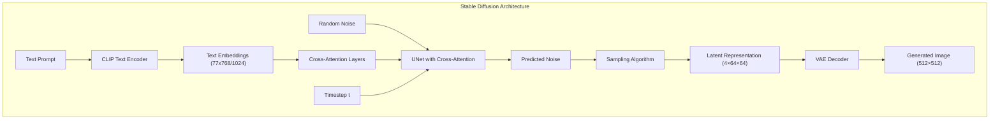
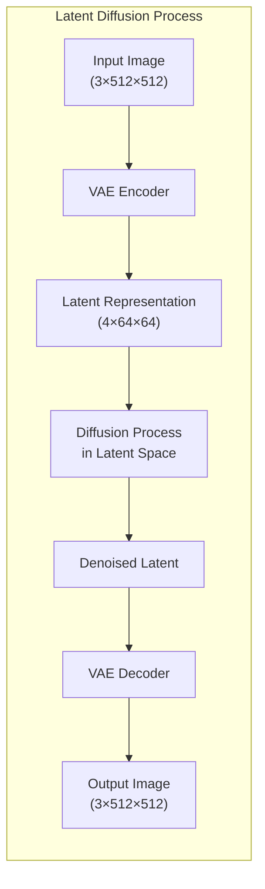
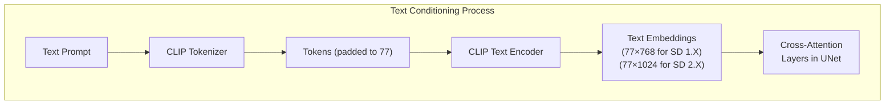
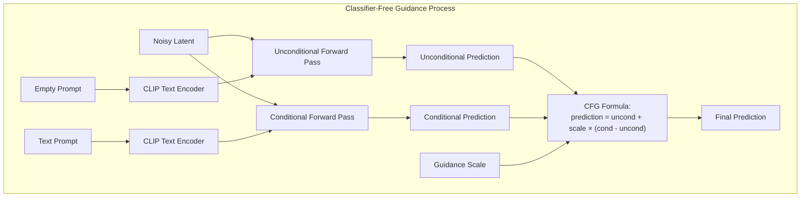
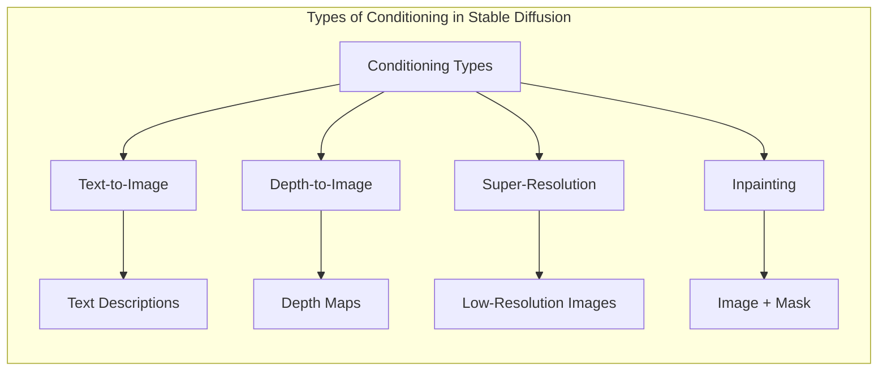
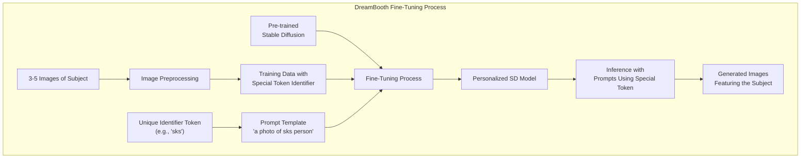
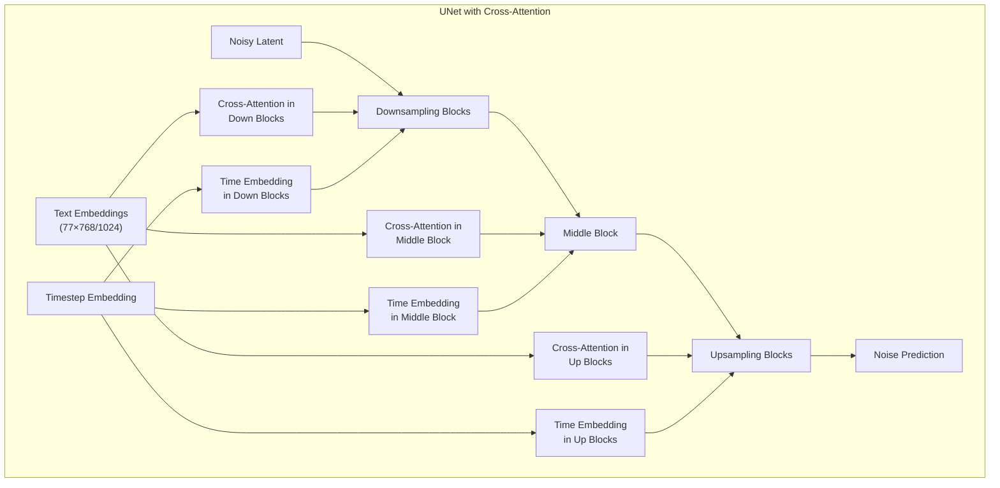

<!-- source: DeepWiki mcp.deepwiki.com · repo huggingface/diffusion-models-class · page 5 Unit 3: Stable Diffusion · fetched 2026-10-26 -->

# Unit 3: Stable Diffusion

Relevant source files

The following files were used as context for generating this wiki page:

- [unit3/README.md](unit3/README.md)

## Purpose and Scope

This document introduces Stable Diffusion (SD), a powerful text-conditioned latent diffusion model that can generate high-quality images from text descriptions. It covers the core architecture components, working principles, and key techniques that enable Stable Diffusion's capabilities. The document explains how latent diffusion and text conditioning work together to create a computationally efficient text-to-image generation system.

Sources: [unit3/README.md:1-23]()

## Stable Diffusion Architecture Overview

Stable Diffusion combines multiple neural network components to transform text prompts into images. The system operates primarily in a compressed latent space rather than directly on pixel data, which allows it to generate high-resolution images with significantly less computational resources.

The architecture consists of three primary components:
1. **CLIP Text Encoder** - Transforms text prompts into embeddings
2. **UNet with Cross-Attention** - Performs the denoising process, guided by text embeddings
3. **Variational Autoencoder (VAE)** - Compresses images to and from latent space

Sources: [unit3/README.md:26-46]()

## Latent Diffusion

Latent diffusion addresses a key computational challenge in generating high-resolution images. As image resolution increases, the computational requirements for diffusion models grow dramatically - especially for self-attention operations where the computational cost scales quadratically with the number of pixels.

The Variational Auto-Encoder (VAE) compresses input images by a factor of 8 in each spatial dimension. A 512×512 pixel RGB image (3×512×512) is compressed to a 4×64×64 latent representation. This compression:

- Reduces memory requirements by ~64x
- Decreases computational complexity for self-attention
- Enables faster training and inference
- Allows generation of higher resolution images with the same computational budget

The diffusion process (adding and removing noise) happens entirely in this compressed latent space. The final denoised latent is then decoded back to a full-resolution image.

Sources: [unit3/README.md:25-34]()

## Text Conditioning

Stable Diffusion uses text descriptions to guide the image generation process. This conditioning allows users to specify what they want the model to generate through natural language.

The text conditioning process:

1. **Tokenization**: The text prompt is divided into tokens (words or subwords) from CLIP's vocabulary
2. **Padding/Truncation**: All prompts are standardized to 77 tokens
3. **Encoding**: The CLIP text encoder transforms tokens into high-dimensional embeddings
4. **Cross-Attention**: These embeddings are fed into the UNet's cross-attention layers

The cross-attention mechanism allows each spatial location in the UNet's feature maps to selectively attend to different parts of the text embedding, incorporating relevant textual information when denoising the image.

Sources: [unit3/README.md:35-47]()

## Classifier-Free Guidance

Even with well-designed text conditioning, diffusion models can sometimes ignore the text prompt and rely primarily on the noisy input. Classifier-Free Guidance (CFG) is a technique that improves text-to-image alignment without requiring an additional classifier.

The CFG process:

1. During training, some batches use empty/null text conditioning
2. During inference, model makes two predictions:
   - **Unconditional**: Prediction with empty text prompt
   - **Conditional**: Prediction with the actual text prompt
3. The final prediction is calculated as: `prediction = unconditional + guidance_scale * (conditional - unconditional)`

The guidance scale (typically between 7-15) determines how strongly the model adheres to the prompt. Higher guidance scales produce images that match the text more closely but may appear less natural or have artifacts.

Sources: [unit3/README.md:49-56]()

## Additional Conditioning Methods

Beyond text conditioning, Stable Diffusion can be adapted to support other types of conditioning inputs:

### Inpainting

The model can be conditioned on a masked image, regenerating only the masked regions while preserving the unmasked parts.

### Super-Resolution

A specially trained version can upscale low-resolution images to higher resolutions with added details.

### Depth-to-Image

By conditioning on depth maps, the model can generate different images that maintain the same structural composition.

Each conditioning method requires either fine-tuning the base model or modifying the UNet architecture to accept the additional input channels.

Sources: [unit3/README.md:58-65]()

## DreamBooth Fine-Tuning

DreamBooth is a technique for personalizing Stable Diffusion by teaching it new concepts from just a few example images.

DreamBooth workflow:
1. Collect 3-5 images of a specific subject (person, pet, object, style)
2. Assign a unique identifier token to represent the subject
3. Fine-tune the model using these images and carefully constructed prompts
4. Generate new images by using the unique identifier in new prompts

This technique allows for personalized image generation while maintaining the model's ability to follow complex prompts and compositional abilities.

Sources: [unit3/README.md:67-72]()

## UNet Architecture with Cross-Attention

The core of Stable Diffusion is a UNet with cross-attention mechanisms. This specialized architecture allows the conditional information from text to influence the denoising process.

Key features of the UNet architecture:
1. **Downsampling Path**: Reduces spatial dimensions while increasing feature depth
2. **Middle Block**: Processes features at the lowest resolution
3. **Upsampling Path**: Increases spatial dimensions with skip connections from the downsampling path
4. **Cross-Attention Layers**: Allow text embeddings to influence features at every level
5. **Time Embeddings**: Provide information about the current noise level being removed

The cross-attention mechanism is crucial for text-to-image generation. It enables each spatial position in the feature maps to attend to the most relevant parts of the text embedding.

Sources: [unit3/README.md:39-47]()

## Practical Applications

Stable Diffusion can be used for various creative tasks:

1. **Text-to-Image Generation**: Create images from text descriptions
2. **Style Transfer**: Generate images in specific artistic styles
3. **Inpainting**: Fill in missing or masked parts of images
4. **Image Editing**: Modify existing images through text prompts
5. **Concept Creation**: Teach the model new visual concepts through fine-tuning

The balance between prompt adherence (guidance scale) and image quality/diversity can be adjusted depending on the specific application needs.

Sources: [unit3/README.md:20-89]()

## Learning Resources

The Stable Diffusion Introduction notebook provides hands-on examples demonstrating practical applications of Stable Diffusion using the Diffusers library. For those interested in customizing Stable Diffusion, the DreamBooth notebook guides through the fine-tuning process.

For deeper understanding, the "Stable Diffusion Deep Dive" notebook explores the internal components and how they can be modified for different effects.

Sources: [unit3/README.md:74-89]()

---

