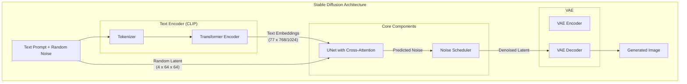
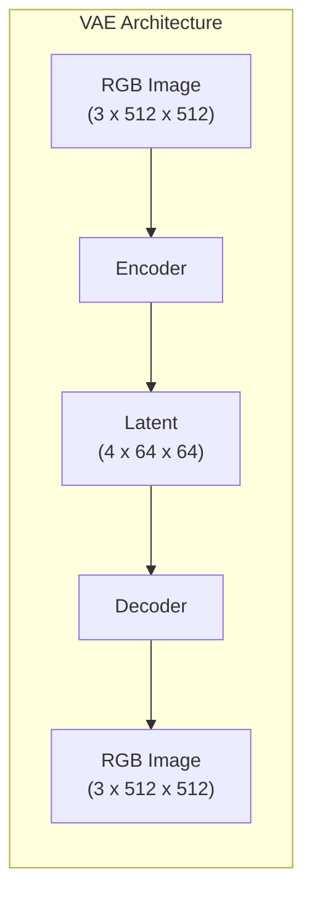
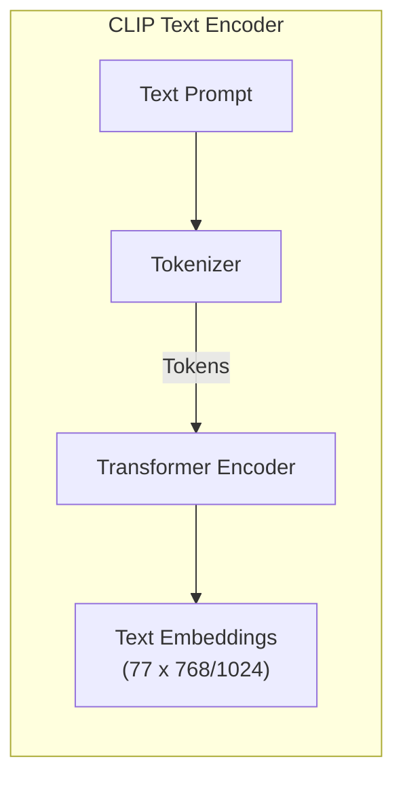
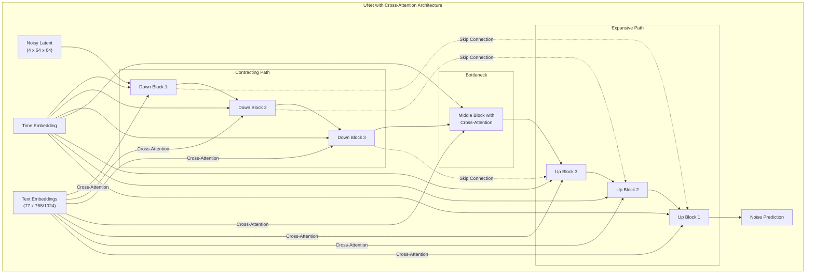
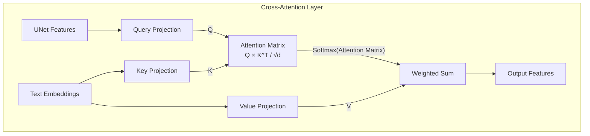
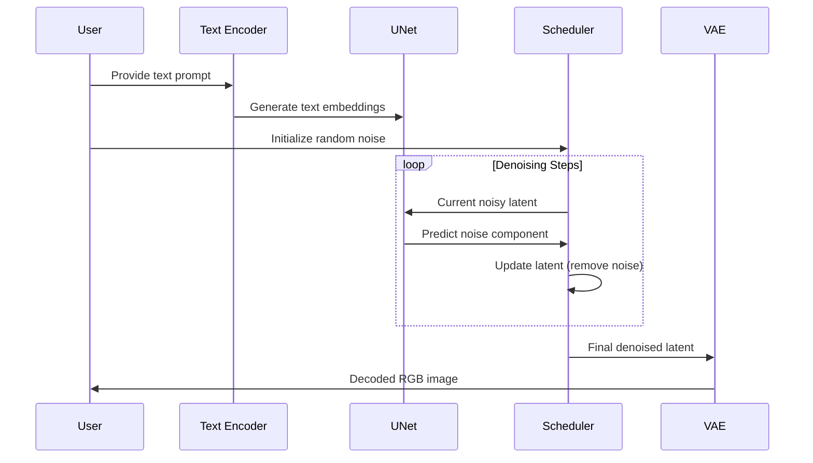
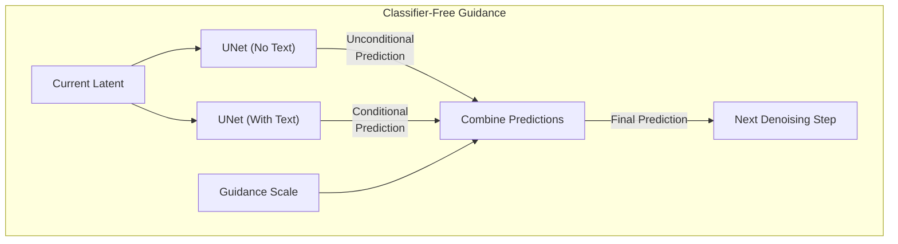
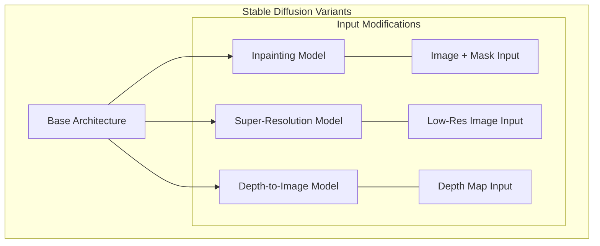

<!-- source: DeepWiki mcp.deepwiki.com · repo huggingface/diffusion-models-class · page 5.1 Stable Diffusion Architecture · fetched 2026-10-26 -->

# Stable Diffusion Architecture

<details>
<summary>Relevant source files</summary>

The following files were used as context for generating this wiki page:

- [unit3/README.md](unit3/README.md)

</details>


## Purpose and Scope

This document provides a detailed technical overview of the Stable Diffusion architecture, focusing on its core components, their interactions, and the data flow during both training and inference. This page covers the internal architecture of the model rather than its applications. For practical implementation and usage examples, see [Practical Stable Diffusion Applications](#5.2).

## Overview

Stable Diffusion is a text-conditioned latent diffusion model designed for high-quality image generation. Its architecture combines several key innovations:

1. **Latent diffusion** - Operating in a compressed latent space to reduce computational requirements
2. **Text conditioning** - Using text embeddings to guide the generation process
3. **Cross-attention mechanisms** - Incorporating text information throughout the UNet backbone
4. **Classifier-free guidance** - Enhancing adherence to text prompts through a specialized sampling technique



Sources: [unit3/README.md:25-32, 36-47]

## Core Components

### 1. Variational Auto-Encoder (VAE)

The VAE serves as both the first and last component in the pipeline, responsible for:
1. Compressing input images to a more efficient latent representation (during training)
2. Converting generated latents back to full-resolution images (during inference)

**Key specifications:**
- **Input**: 3-channel RGB images (typically 512×512 pixels)
- **Output**: 4-channel latent representations
- **Reduction factor**: 8× spatial dimension reduction
- **Latent shape**: For a 512×512 image, produces a 4×64×64 latent tensor

The VAE significantly reduces the computational requirements by:
- Decreasing the spatial dimensions that the UNet must process
- Enabling the diffusion process to run in a compressed space
- Allowing for high-resolution output while maintaining reasonable computing needs



Sources: [unit3/README.md:25-34]

### 2. CLIP Text Encoder

The text encoder transforms natural language prompts into numerical representations that can guide the image generation process.

**Specifications:**
- Based on OpenAI's CLIP text encoder or variants like OpenCLIP
- Produces embeddings with 768 dimensions (SD 1.x) or 1024 dimensions (SD 2.x)
- Processes a maximum of 77 tokens (padded/truncated as needed)
- Final conditioning tensor shape: 77×768 or 77×1024



Sources: [unit3/README.md:36-43]

### 3. UNet with Cross-Attention

The UNet is the core component that performs the actual denoising process. In Stable Diffusion, the standard UNet architecture is enhanced with cross-attention layers that incorporate the text conditioning.

**Key features:**
- **Structure**: Consists of a contracting path (encoder), bottleneck, and expansive path (decoder)
- **Cross-attention layers**: Distributed throughout the network to incorporate text conditioning
- **Time embedding**: Adds information about the current noise level/timestep
- **Skip connections**: Connect corresponding layers in the contracting and expansive paths



Sources: [unit3/README.md:44-47]

### 4. Cross-Attention Mechanism

The cross-attention mechanism is a critical innovation in Stable Diffusion that enables text-guided image generation. It allows each spatial position in the UNet's feature maps to attend to different parts of the text conditioning.

**How it works:**
1. Features from the UNet are projected to create queries (Q)
2. Text embeddings are projected to create keys (K) and values (V)
3. Attention scores are computed between Q and K
4. These scores determine how much each text token influences each spatial position
5. The weighted sum of V based on these scores is incorporated back into the UNet's features



Sources: [unit3/README.md:44-47]

### 5. Noise Scheduler

The noise scheduler controls the diffusion process by managing:
1. The noise schedule during training (forward process)
2. The step size and noise prediction conversion during sampling (reverse process)

Different schedulers offer tradeoffs between sample quality and inference speed, with options including:
- DDPM (original diffusion scheduler)
- DDIM (deterministic and faster sampling)
- PNDM (Pseudo Numerical methods for Diffusion Models)
- DPM-Solver (faster high-quality sampling)

Sources: [unit3/README.md:48-57]

## Generation Process

The complete generation process in Stable Diffusion follows these steps:

1. **Text encoding**: The input prompt is tokenized and encoded through the CLIP text encoder
2. **Latent initialization**: Random noise is generated in the latent space
3. **Denoising loop**:
   - The UNet predicts the noise in the current latent
   - The scheduler uses this prediction to produce a less noisy latent
   - This process repeats for a specified number of steps (typically 20-50)
4. **Decoding**: The VAE decoder converts the final denoised latent to an RGB image



Sources: [unit3/README.md:48-57]

### Classifier-Free Guidance

Classifier-Free Guidance (CFG) is a technique used during inference to enhance the model's adherence to the input prompt.

**Process:**
1. For each denoising step, two predictions are made:
   - Unconditional prediction (with an empty/null text embedding)
   - Conditional prediction (with the actual text embedding)
2. These predictions are combined using the formula:
   ```
   prediction = unconditional_prediction + guidance_scale * (conditional_prediction - unconditional_prediction)
   ```
3. The `guidance_scale` parameter (typically 7-9) controls how strongly the generation follows the text prompt

**Effect of guidance scale:**
- Low values (0-1): More creative but less prompt-adherent outputs
- Medium values (2-7): Balanced outputs
- High values (8+): Strong prompt adherence but potentially overly stereotypical images



Sources: [unit3/README.md:50-57]

## Architecture Variants

The Stable Diffusion architecture has been adapted for specialized tasks:

| Variant | Description | Architectural Modification |
|---------|-------------|----------------------------|
| Inpainting | Regenerates specific masked regions of an image | Additional input channels for image and mask |
| Super-resolution | Upscales low-resolution images | Low-resolution image as conditioning |
| Depth-to-image | Preserves structural layout while changing content | Depth map as additional conditioning |



Sources: [unit3/README.md:58-65]

## Technical Specifications Summary

| Component | Input Size | Output Size | Notes |
|-----------|------------|-------------|-------|
| VAE Encoder | 3×512×512 | 4×64×64 | 8× spatial reduction |
| VAE Decoder | 4×64×64 | 3×512×512 | Reconstructs full image |
| CLIP Text Encoder | 77 tokens | 77×768 (SD 1.x) or 77×1024 (SD 2.x) | Transforms text to embeddings |
| UNet | 4×64×64 + text embeddings | 4×64×64 | Predicts noise in latent |

Sources: [unit3/README.md:25-47]

## Summary

Stable Diffusion's architecture effectively combines several innovations - latent diffusion, text conditioning via cross-attention, and classifier-free guidance - to create a powerful text-to-image model with reasonable computational requirements. The key insight is performing the diffusion process in a compressed latent space while using rich text embeddings to guide the generation, enabling high-resolution outputs without the computational burden of pixel-space diffusion.

Sources: [unit3/README.md:18-47]

---

