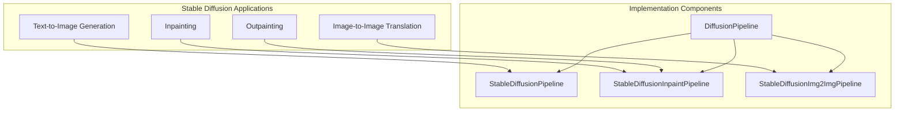
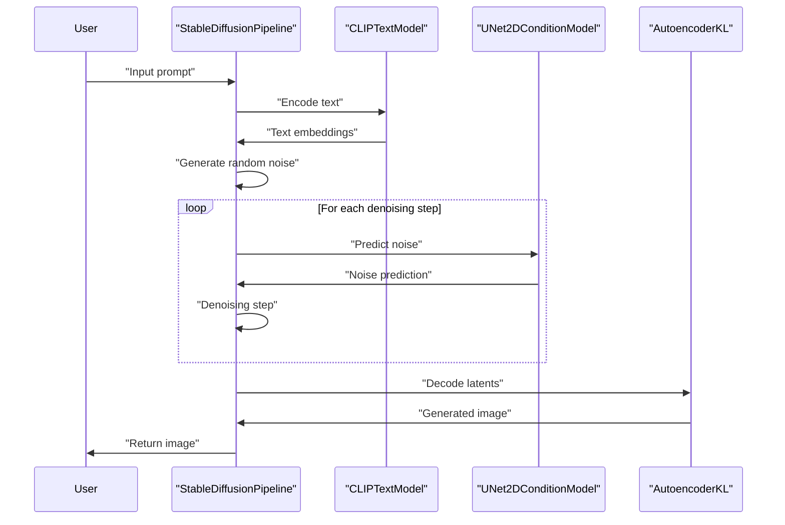
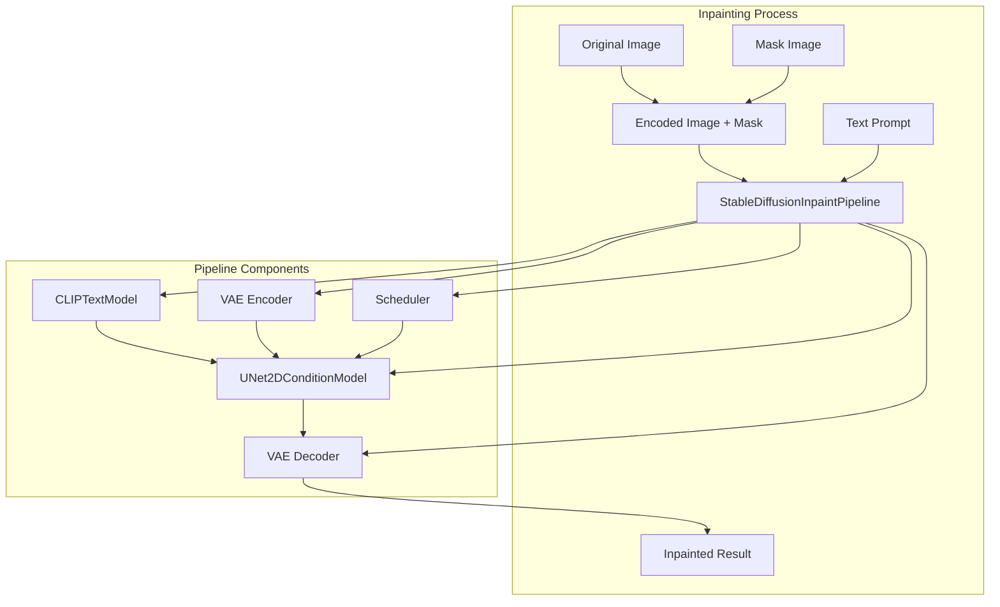
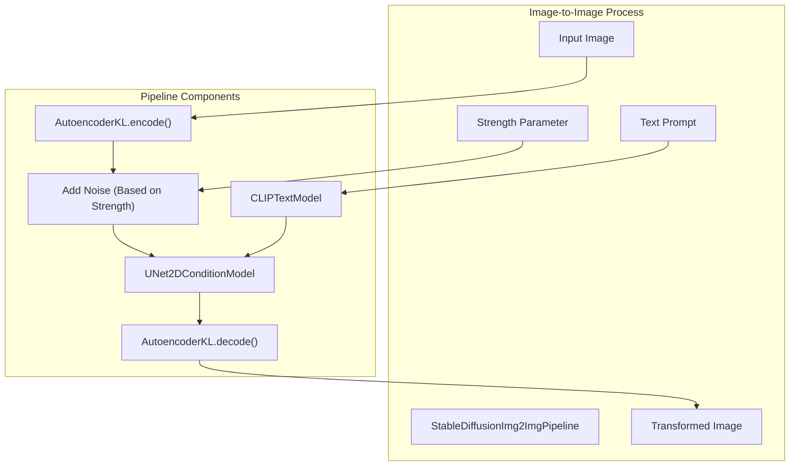
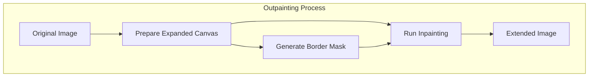
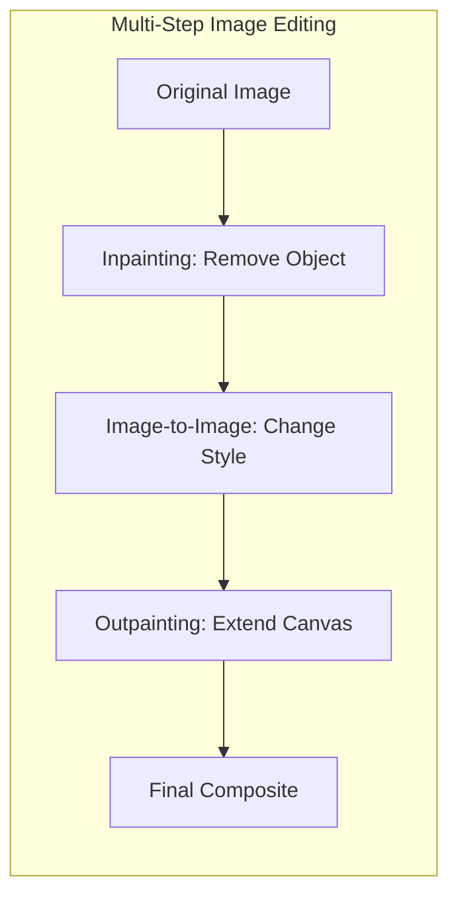

<!-- source: DeepWiki mcp.deepwiki.com · repo huggingface/diffusion-models-class · page 5.2 Practical Stable Diffusion Applications · fetched 2026-10-26 -->

# Practical Stable Diffusion Applications

<details>
<summary>Relevant source files</summary>

The following files were used as context for generating this wiki page:

- [unit3/01_stable_diffusion_introduction.ipynb](unit3/01_stable_diffusion_introduction.ipynb)
- [unit3/inpaint_w_border.jpg](unit3/inpaint_w_border.jpg)

</details>


This document details the practical applications of Stable Diffusion, focusing on how to implement and use various Stable Diffusion capabilities in real-world scenarios. For information about the architectural components and theoretical foundations of Stable Diffusion, please refer to [Stable Diffusion Architecture](#5.1).

## 1. Overview of Stable Diffusion Applications

Stable Diffusion provides several practical applications that leverage its latent diffusion capabilities. These applications range from text-to-image generation to more specialized tasks like inpainting and image-to-image translation.



Sources: [unit3/inpaint_w_border.jpg]()

## 2. Text-to-Image Generation

Text-to-image generation is the most common application of Stable Diffusion, translating textual descriptions into corresponding images.

### 2.1 Implementation Workflow



Sources: [unit3/inpaint_w_border.jpg]()

### 2.2 Basic Usage

Text-to-image generation requires creating a pipeline and passing a prompt:

```python
# Basic text-to-image generation
from diffusers import StableDiffusionPipeline
import torch

pipeline = StableDiffusionPipeline.from_pretrained("runwayml/stable-diffusion-v1-5")
pipeline = pipeline.to("cuda")

prompt = "A photo of an astronaut riding a horse on Mars"
image = pipeline(prompt).images[0]
```

### 2.3 Advanced Prompt Engineering

Effective prompt engineering can significantly improve generation results:

| Technique | Example | Purpose |
|-----------|---------|---------|
| Style specification | "oil painting of a cat" | Control artistic style |
| Quality boosters | "highly detailed, 4K resolution" | Improve detail level |
| Subject focus | "portrait of a woman, centered" | Control composition |
| Negative prompts | negative_prompt="blurry, low quality" | Avoid unwanted elements |

## 3. Inpainting with Stable Diffusion

Inpainting allows for replacing or modifying specific parts of an image while keeping the rest unchanged.

### 3.1 Inpainting Architecture and Data Flow



Sources: [unit3/inpaint_w_border.jpg]()

### 3.2 Implementing Inpainting

Inpainting requires three key inputs:
1. An original image
2. A mask image (white indicates areas to inpaint)
3. A text prompt describing what to generate in the masked area

```python
# Basic inpainting example
from diffusers import StableDiffusionInpaintPipeline
from PIL import Image
import torch

pipeline = StableDiffusionInpaintPipeline.from_pretrained(
    "runwayml/stable-diffusion-inpainting"
)
pipeline = pipeline.to("cuda")

# Load image and mask
image = Image.open("original_image.png")
mask_image = Image.open("mask.png")

# Run inpainting
prompt = "a cat sitting on a bench"
result = pipeline(
    prompt=prompt,
    image=image,
    mask_image=mask_image
).images[0]
```

### 3.3 Example Results

The repository includes `unit3/inpaint_w_border.jpg` which demonstrates the inpainting capabilities, showing how specific areas of an image can be regenerated while maintaining coherence with the surrounding content.

## 4. Image-to-Image Translation

Image-to-image translation transforms an existing image according to a text prompt, preserving varying degrees of the original structure.

### 4.1 Implementation Workflow



Sources: [unit3/inpaint_w_border.jpg]()

### 4.2 Key Parameters

The most important parameter in image-to-image translation is the `strength` value:

| Strength Value | Effect |
|----------------|--------|
| 0.0 | Returns original image unchanged |
| 0.3 | Subtle changes, preserves structure |
| 0.7 | Major changes, maintains rough composition |
| 1.0 | Complete regeneration (equivalent to text-to-image) |

### 4.3 Implementation Example

```python
# Basic image-to-image example
from diffusers import StableDiffusionImg2ImgPipeline
from PIL import Image
import torch

pipeline = StableDiffusionImg2ImgPipeline.from_pretrained(
    "runwayml/stable-diffusion-v1-5"
)
pipeline = pipeline.to("cuda")

# Load input image
init_image = Image.open("input_image.png")

# Run transformation
prompt = "A fantasy landscape with castle and dragons"
result = pipeline(
    prompt=prompt,
    image=init_image,
    strength=0.75,  # Controls how much to transform
    guidance_scale=7.5  # Controls prompt adherence
).images[0]
```

## 5. Advanced Applications

### 5.1 Outpainting (Extending Images)

Outpainting extends images beyond their original boundaries, effectively the inverse of inpainting. This can be implemented using the inpainting pipeline with a custom mask preparation process.



Sources: [unit3/inpaint_w_border.jpg]()

### 5.2 Combining Multiple Techniques

For complex image editing tasks, multiple techniques can be combined:



Sources: [unit3/inpaint_w_border.jpg]()

## 6. Performance Optimization

### 6.1 Memory and Speed Optimizations

| Technique | Implementation | Effect |
|-----------|----------------|--------|
| Half precision | `pipeline.to(torch.float16)` | Reduces memory usage by ~50% |
| Attention slicing | `pipeline.enable_attention_slicing()` | Reduces memory with slight speed penalty |
| Sequential CPU offloading | `pipeline.enable_sequential_cpu_offload()` | Enables running on smaller GPUs |
| Model pruning | Use smaller variants | Faster inference, lower quality |
| Fewer inference steps | `num_inference_steps=25` | Faster generation, potentially lower quality |

### 6.2 Production Deployment Considerations

- **Model Quantization**: For deployment on edge devices or with limited resources
- **Batch Processing**: Processing multiple prompts in parallel for higher throughput
- **Caching**: Reusing text encodings for repeated or similar prompts

## 7. Troubleshooting Common Issues

| Issue | Potential Solution |
|-------|-------------------|
| Out of VRAM errors | Reduce image resolution, use attention slicing, or enable CPU offloading |
| Poor inpainting results | Ensure mask is properly defined (white areas = inpaint) |
| Inconsistent results | Use fixed seeds for reproducibility |
| Slow generation | Reduce number of inference steps, use optimized model variants |
| Undesirable artifacts | Refine prompts, use higher guidance scale, or try negative prompts |

## 8. Conclusion

Stable Diffusion offers a versatile set of practical applications through its various pipelines. By understanding the implementation details and parameters of each application, you can effectively leverage these capabilities for a wide range of image generation and manipulation tasks.

The examples shown in this document serve as starting points for more complex implementations, and the optimization techniques can help deploy these models in various environments with different resource constraints.

---

