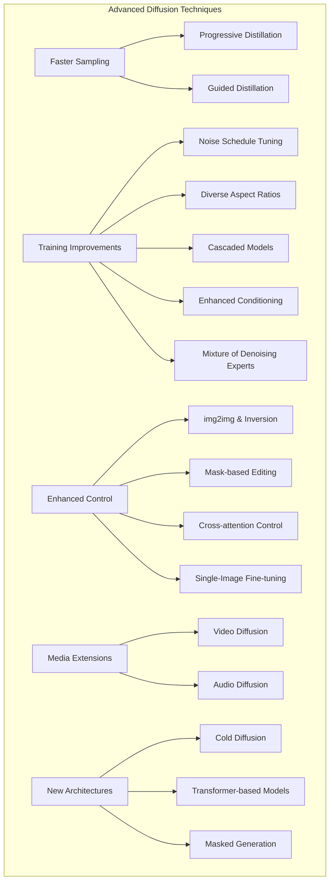
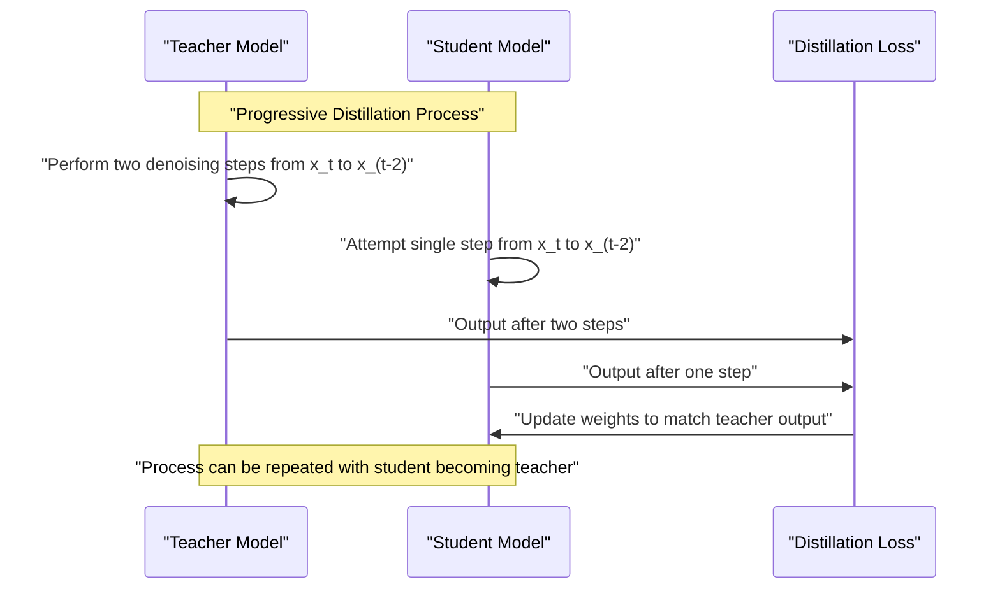
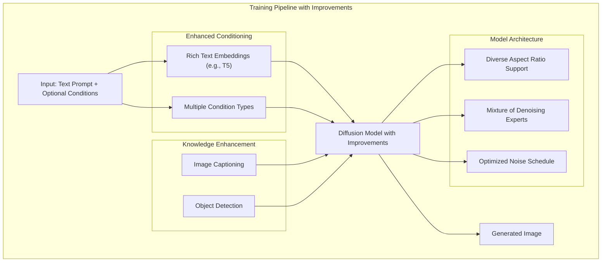
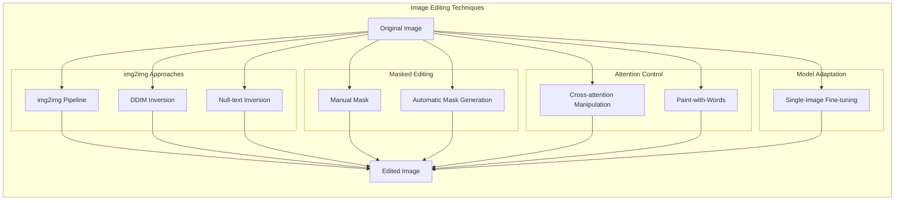
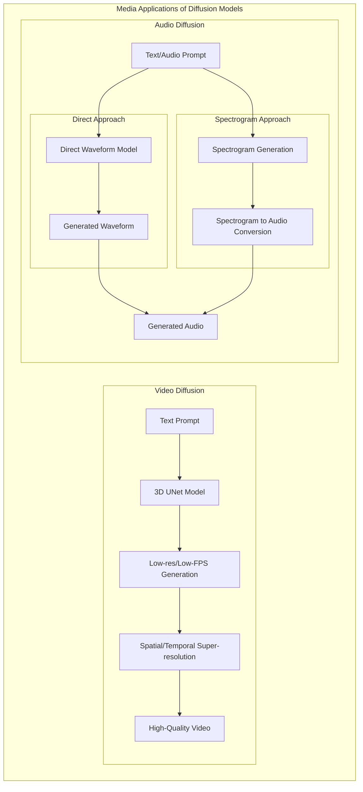
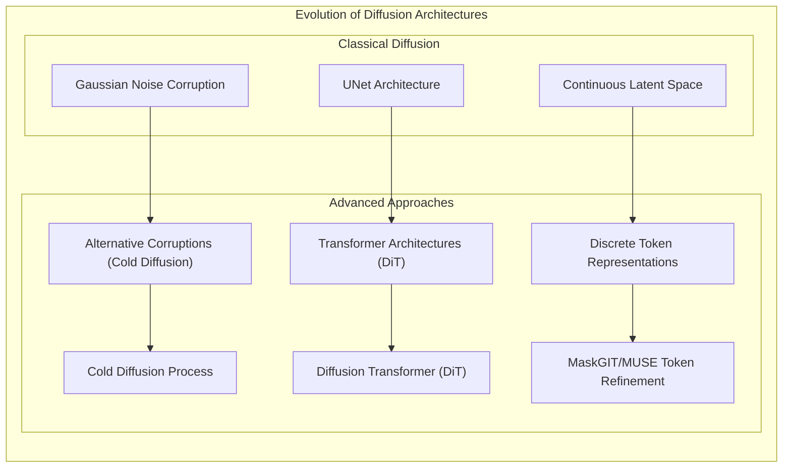
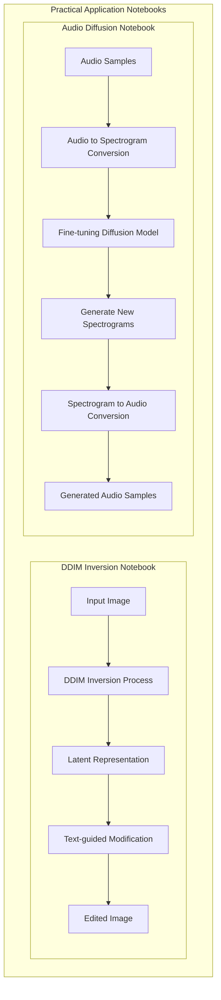

<!-- source: DeepWiki mcp.deepwiki.com · repo huggingface/diffusion-models-class · page 6 Unit 4: Advanced Diffusion Techniques · fetched 2026-10-26 -->

# Unit 4: Advanced Diffusion Techniques

Relevant source files

The following files were used as context for generating this wiki page:

- [unit4/02_diffusion_for_audio.ipynb](unit4/02_diffusion_for_audio.ipynb)
- [unit4/README.md](unit4/README.md)

## Purpose and Scope

This page provides an overview of advanced techniques in diffusion models research and development, covering recent innovations that extend beyond the fundamentals covered in earlier units. This unit is less code-heavy than previous sections and serves as a jumping-off point for exploring cutting-edge developments in the field.

For foundational concepts, see [Unit 1: Introduction to Diffusion Models](#3). For information about fine-tuning and guidance, see [Unit 2: Fine-tuning and Guidance](#4). For details on Stable Diffusion specifically, see [Unit 3: Stable Diffusion](#5).

Sources: [unit4/README.md:1-4]()

## Overview of Advanced Techniques

This unit covers several categories of advancements in diffusion models:

Sources: [unit4/README.md:16-27]()

## Faster Sampling via Distillation

Progressive distillation is a technique for accelerating diffusion model inference by training a "student" model to match the results of multiple sampling steps from a "teacher" model in a single step. This process creates models that can produce quality samples in significantly fewer steps (typically 4-8) compared to conventional models.

The technique can be extended to guided models where classifier-free guidance is used by the teacher model and the student learns to produce equivalent output with a guidance scale parameter.

Sources: [unit4/README.md:31-46]()

## Training Improvements

Recent research has introduced several effective training enhancements for diffusion models:

| Improvement | Description |
|-------------|-------------|
| Noise Schedule Tuning | Optimizing noise schedules, loss weighting, and sampling trajectories for more efficient training |
| Diverse Aspect Ratios | Training on various image dimensions to improve model flexibility |
| Cascaded Models | Training separate models for low-resolution generation followed by super-resolution models |
| Enhanced Conditioning | Using richer text embeddings or multiple conditioning types |
| Knowledge Enhancement | Incorporating pre-trained image captioning and object detection models |
| Mixture of Denoising Experts (MoDE) | Training specialized model variants for different noise levels |

For more detailed information about these training improvements, see [Faster Sampling and Training Improvements](#6.1).

Sources: [unit4/README.md:47-67]()

## Enhanced Control for Generation and Editing

Advanced diffusion models offer several techniques for more controlled image generation and editing:

1. **Image-to-Image Techniques**:
   - `img2img` pipeline: Adding noise to an existing image and denoising with a new prompt
   - DDIM inversion: Using the model to "reverse" the sampling trajectory
   - Null-text inversion: Optimizing unconditional text embeddings for better editing

2. **Masked Editing**:
   - Applying changes only to selected regions using a mask
   - Using models to automatically generate masks based on text descriptions

3. **Cross-attention Control**:
   - Manipulating the cross-attention maps to control the spatial location of edits
   - Enabling capabilities like "paint-with-words"

4. **Single-Image Fine-tuning**:
   - Overfitting a model on a single image for precise editing capabilities

For more detailed information about enhanced control techniques, see [Enhanced Control for Generation and Editing](#6.2).

Sources: [unit4/README.md:68-94]()

## Diffusion Models for Audio and Video

### Video Diffusion

Video diffusion models apply the core diffusion model principles to sequences of images. Key approaches include:

- Using 3D UNets that operate on entire sequences
- Efficient processing strategies for high-dimensional data
- Multi-stage approaches that first generate low-resolution/low-frame-rate video and then apply spatial and temporal super-resolution

### Audio Diffusion

Audio diffusion models have developed along two main paths:

1. Direct generation in the raw audio domain (e.g., DiffWave)
2. Generation in the spectrogram domain, where audio is converted to a 2D representation that can be processed by image-focused diffusion models

For more detailed information about diffusion models for audio and video, see [Diffusion Models for Audio and Video](#6.3).

Sources: [unit4/README.md:97-126]()

## New Architectures and Approaches

Recent research is expanding beyond the original definition of diffusion models toward more general "iterative refinement" approaches:

- **Cold Diffusion**: Demonstrates that many types of corruption beyond Gaussian noise can be iteratively reversed to generate images
- **Transformer-based Architectures**: Replacing UNets with transformer models (e.g., DiT - Diffusion Transformers)
- **Token-based Methods**: Working with discrete tokens instead of continuous representations (e.g., MaskGIT, MUSE)

For more detailed information about new architectures and approaches, see [New Architectures and Approaches](#6.4).

Sources: [unit4/README.md:127-151]()

## Hands-On Resources

Two practical notebooks are provided to explore selected topics from this unit:

1. **DDIM Inversion**: Demonstrates how inversion techniques can be used to edit images with existing diffusion models
2. **Diffusion for Audio**: Introduces spectrograms and shows how to fine-tune an audio diffusion model on a specific music genre

Sources: [unit4/README.md:152-162]()

## Summary

Unit 4 provides an overview of cutting-edge advancements in diffusion models, demonstrating how this field continues to evolve rapidly. The techniques covered include faster sampling methods, training improvements, enhanced control mechanisms, applications to new media types, and architectural innovations.

These advanced topics build upon the foundations covered in previous units and point toward future developments in the field of generative AI.

Sources: [unit4/README.md:163-166]()

---

